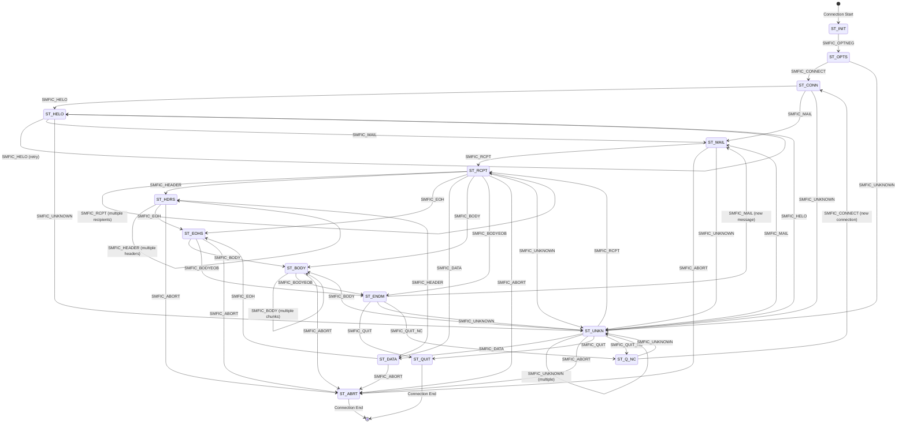

# Milter Protocol Specification

## Overview

The Milter (Mail Filter) protocol is a communication protocol between a Mail Transfer Agent (MTA) like Sendmail and external mail filter programs. It allows third-party programs to access mail messages as they are being processed in order to filter meta-information and content.

This document is based on the Sendmail libmilter implementation (version 8.18.1-7).

## Protocol Architecture

### Connection Model

- The MTA connects to the milter over a socket (Unix domain socket or TCP/IP)
- Each SMTP session corresponds to one milter connection
- The milter listens on a socket and accepts connections from the MTA
- Communication is bidirectional: MTA sends commands, milter sends replies

### Socket Types

Milters can listen on:
- **Unix domain sockets**: `local:/path/to/socket`
- **IPv4 sockets**: `inet:port@hostname`
- **IPv6 sockets**: `inet6:port@hostname`

## Message Format

All messages in the milter protocol follow this format:

```
+------------------+------------------+------------------+
| Length (4 bytes) | Command (1 byte) | Data (variable)  |
+------------------+------------------+------------------+
```

- **Length**: 4-byte unsigned integer in network byte order (big-endian)
  - Includes the command byte (so actual data length = Length - 1)
- **Command**: Single ASCII character command code
- **Data**: Optional variable-length data (null-terminated strings, binary data, etc.)

### Reading a Message

1. Read 4 bytes for the length (network byte order)
2. Read 1 byte for the command
3. Read (Length - 1) bytes for the data

### Writing a Message

1. Calculate total length: data_length + 1 (for command byte)
2. Write 4-byte length (network byte order)
3. Write 1-byte command
4. Write data

## Protocol States

The milter protocol operates as a state machine with the following states:

| State | Code | Description |
|-------|------|-------------|
| `ST_INIT` | 0 | Initial state |
| `ST_OPTS` | 1 | Option negotiation |
| `ST_CONN` | 2 | Connection info received |
| `ST_HELO` | 3 | HELO command received |
| `ST_MAIL` | 4 | MAIL FROM command received |
| `ST_RCPT` | 5 | RCPT TO command received |
| `ST_DATA` | 6 | DATA command received |
| `ST_HDRS` | 7 | Headers being received |
| `ST_EOHS` | 8 | End of headers |
| `ST_BODY` | 9 | Body chunks being received |
| `ST_ENDM` | 10 | End of message |
| `ST_QUIT` | 11 | QUIT command received | 
| `ST_ABRT` | 12 | Message aborted |
| `ST_UNKN` | 13 | Unknown SMTP command |
| `ST_Q_NC` | 14 | Quit, new connection follows |

### State Transitions

Valid state transitions are enforced by the protocol. The following Mermaid diagram shows all valid state transitions:



**State Transition Rules:**

- **ST_INIT**: Initial state, only accepts option negotiation
- **ST_OPTS**: Option negotiation completed, accepts connection or unknown commands
- **ST_CONN**: Connection established, accepts HELO, MAIL, or unknown commands
- **ST_HELO**: HELO received, can accept another HELO (retry), MAIL, or unknown
- **ST_MAIL**: MAIL FROM received, accepts RCPT, ABORT, or unknown
- **ST_RCPT**: RCPT TO received, can accept multiple RCPTs, headers, DATA, body, or end-of-message
- **ST_DATA**: DATA command received, accepts headers or end-of-headers
- **ST_HDRS**: Headers being received, can accept more headers or end-of-headers
- **ST_EOHS**: End of headers, accepts body chunks or end-of-message
- **ST_BODY**: Body chunks being received, can accept more chunks or end-of-message
- **ST_ENDM**: End of message, accepts QUIT, new MAIL (for multiple messages), or unknown
- **ST_UNKN**: Unknown command received, can transition to most states (flexible recovery)
- **ST_Q_NC**: Quit with new connection, accepts new connection or unknown
- **ST_QUIT**: Terminal state (connection ends)
- **ST_ABRT**: Terminal state (connection aborted)

## Commands from MTA to Milter

Commands sent by the MTA to the milter use the `SMFIC_` prefix:

| Command | Code | Description | Data Format |
|---------|------|-------------|-------------|
| `SMFIC_ABORT` | 'A' | Message aborted | None |
| `SMFIC_BODY` | 'B' | Body chunk | Binary data (body chunk) |
| `SMFIC_BODYEOB` | 'D' | End of body | None |
| `SMFIC_CONNECT` | 'C' | Connection information | Connection string |
| `SMFIC_DATA` | 'D' | DATA command | None |
| `SMFIC_EOH` | 'E' | End of headers | None |
| `SMFIC_HEADER` | 'H' | Header field | Header name\0Header value\0 |
| `SMFIC_HELO` | 'H' | HELO command | HELO string |
| `SMFIC_MAIL` | 'M' | MAIL FROM command | Envelope sender |
| `SMFIC_MACRO` | 'M' | Macro definitions | Macro string |
| `SMFIC_OPTNEG` | 'O' | Option negotiation | Protocol version, flags |
| `SMFIC_QUIT` | 'Q' | QUIT command | None |
| `SMFIC_QUIT_NC` | 'Q' | Quit, new connection | None |
| `SMFIC_RCPT` | 'R' | RCPT TO command | Envelope recipient |
| `SMFIC_UNKNOWN` | 'U' | Unknown SMTP command | Command string |

### Internal Error Codes

These are not actual protocol commands but internal error indicators:

| Code | Value | Description |
|------|-------|-------------|
| `SMFIC_TIMEOUT` | 1 | Timeout occurred |
| `SMFIC_SELECT` | 2 | Select/poll error |
| `SMFIC_MALLOC` | 3 | Memory allocation error |
| `SMFIC_RECVERR` | 4 | Receive error |
| `SMFIC_EOF` | 5 | End of file (connection closed) |
| `SMFIC_UNKNERR` | 6 | Unknown error |
| `SMFIC_TOOBIG` | 7 | Body chunk too big |

## Replies from Milter to MTA

Replies sent by the milter to the MTA use the `SMFIR_` prefix:

| Reply | Code | Description | Data Format |
|-------|------|-------------|-------------|
| `SMFIR_ACCEPT` | 'a' | Accept message | None |
| `SMFIR_ADDHEADER` | 'h' | Add header | Header name\0Header value\0 |
| `SMFIR_ADDRCPT` | '+' | Add recipient | Recipient address\0 |
| `SMFIR_CHGBODY` | 'b' | Change body | Body chunk |
| `SMFIR_CHGHEADER` | 'm' | Change header | Header index (4 bytes) + Header name\0Header value\0 |
| `SMFIR_CONNFAIL` | 'c' | Connection failure | None |
| `SMFIR_CONTINUE` | 'c' | Continue processing | None |
| `SMFIR_DELRCPT` | '-' | Delete recipient | Recipient address\0 |
| `SMFIR_DISCARD` | 'd' | Discard message | None |
| `SMFIR_INSHEADER` | 'i' | Insert header | Header index (4 bytes) + Header name\0Header value\0 |
| `SMFIR_PROGRESS` | 'p' | Progress (keep connection alive) | None |
| `SMFIR_QUARANTINE` | 'q' | Quarantine message | Reason string\0 |
| `SMFIR_REJECT` | 'r' | Reject message | None |
| `SMFIR_REPLYCODE` | 'y' | Reply with SMTP code | SMTP reply code\0 |
| `SMFIR_REPLBODY` | 'b' | Replace body | Body chunk |
| `SMFIR_SKIP` | 's' | Skip remaining filters | None |
| `SMFIR_TEMPFAIL` | 't' | Temporary failure | None |

## Option Negotiation

At the start of each connection, the MTA and milter negotiate capabilities through the `SMFIC_OPTNEG` command.

### Option Negotiation Message Format

The `SMFIC_OPTNEG` data contains:

```
+------------------+------------------+------------------+------------------+
| Protocol Version | Action Flags     | Protocol Flags   | Symbol List      |
| (4 bytes)        | (4 bytes)        | (4 bytes)        | (variable)       |
+------------------+------------------+------------------+------------------+
```

All multi-byte integers are in network byte order.

### Protocol Version

- Minimum supported version: 2
- Current version: 6 (SMFI_PROT_VERSION)

### Action Flags (MTA Capabilities)

Action flags indicate what actions the MTA can perform:

| Flag | Value | Description |
|------|-------|-------------|
| `SMFIF_ADDHDRS` | 0x00000001 | Can add headers |
| `SMFIF_CHGBODY` | 0x00000002 | Can change body |
| `SMFIF_ADDRCPT` | 0x00000004 | Can add recipients |
| `SMFIF_DELRCPT` | 0x00000008 | Can delete recipients |
| `SMFIF_CHGHDRS` | 0x00000010 | Can change headers |
| `SMFIF_QUARANTINE` | 0x00000020 | Can quarantine messages |
| `SMFIF_CHGFROM` | 0x00000040 | Can change envelope sender |
| `SMFIF_ADDRCPT_PAR` | 0x00000080 | Can add recipients with parameters |
| `SMFIF_SETSYMLIST` | 0x00000100 | Can set symbol list |
| `SMFIF_SETSENDER` | 0x00000200 | Can set envelope sender |
| `SMFIF_SETREPLYCODE` | 0x00000400 | Can set SMTP reply code |

### Protocol Flags (MTA Capabilities)

Protocol flags indicate which protocol steps the MTA supports:

| Flag | Value | Description |
|------|-------|-------------|
| `SMFIP_NOCONNECT` | 0x00000001 | Skip connect callback |
| `SMFIP_NOHELO` | 0x00000002 | Skip HELO callback |
| `SMFIP_NOMAIL` | 0x00000004 | Skip MAIL callback |
| `SMFIP_NORCPT` | 0x00000008 | Skip RCPT callback |
| `SMFIP_NOBODY` | 0x00000010 | Skip body callback |
| `SMFIP_NOHDRS` | 0x00000020 | Skip headers callback |
| `SMFIP_NOEOH` | 0x00000040 | Skip end-of-headers callback |
| `SMFIP_NR_HDR` | 0x00000080 | No reply needed for headers |
| `SMFIP_NR_CONN` | 0x00000100 | No reply needed for connect |
| `SMFIP_NR_HELO` | 0x00000200 | No reply needed for HELO |
| `SMFIP_NR_MAIL` | 0x00000400 | No reply needed for MAIL |
| `SMFIP_NR_RCPT` | 0x00000800 | No reply needed for RCPT |
| `SMFIP_NR_DATA` | 0x00001000 | No reply needed for DATA |
| `SMFIP_NR_UNKN` | 0x00002000 | No reply needed for unknown |
| `SMFIP_NR_EOH` | 0x00004000 | No reply needed for end-of-headers |
| `SMFIP_NR_BODY` | 0x00008000 | No reply needed for body |
| `SMFIP_HDR_LEADSPC` | 0x00010000 | Header values may have leading spaces |
| `SMFIP_MACRO` | 0x00020000 | Supports macros |

### Symbol List

After the three 4-byte integers, there may be a symbol list containing macro definitions. The format is a series of null-terminated strings.

## Macros

The MTA can send macro definitions before certain commands. Macros are sent via `SMFIC_MACRO` commands and contain information like:

- Connection information (IP address, hostname)
- HELO string
- Envelope sender
- Envelope recipients
- And more...

Macros are stored as null-terminated strings in the format: `name\0value\0name\0value\0...`

## Typical Protocol Flow

### 1. Connection Establishment

```
MTA → Milter: SMFIC_OPTNEG (option negotiation)
Milter → MTA: SMFIC_OPTNEG (negotiated options)
```

### 2. SMTP Session

```
MTA → Milter: SMFIC_CONNECT (connection info)
Milter → MTA: SMFIR_CONTINUE (or other reply)

MTA → Milter: SMFIC_HELO (HELO command)
Milter → MTA: SMFIR_CONTINUE (or other reply)

MTA → Milter: SMFIC_MAIL (MAIL FROM)
Milter → MTA: SMFIR_CONTINUE (or other reply)

MTA → Milter: SMFIC_RCPT (RCPT TO) [may be multiple]
Milter → MTA: SMFIR_CONTINUE (or other reply)

MTA → Milter: SMFIC_DATA (DATA command)
Milter → MTA: SMFIR_CONTINUE (or other reply)

MTA → Milter: SMFIC_HEADER (header field) [may be multiple]
Milter → MTA: SMFIR_CONTINUE (or SMFIR_NOREPLY if supported)

MTA → Milter: SMFIC_EOH (end of headers)
Milter → MTA: SMFIR_CONTINUE (or other reply)

MTA → Milter: SMFIC_BODY (body chunk) [may be multiple]
Milter → MTA: SMFIR_CONTINUE (or SMFIR_NOREPLY if supported)

MTA → Milter: SMFIC_BODYEOB (end of body)
Milter → MTA: SMFIR_ACCEPT (or SMFIR_REJECT, SMFIR_TEMPFAIL, etc.)
```

### 3. Connection Cleanup

```
MTA → Milter: SMFIC_QUIT
Milter → MTA: (no reply, connection closed)
```

## Callback Functions

A milter implementation provides callback functions that are invoked when commands are received:

| Callback | Triggered By | Return Values |
|----------|--------------|---------------|
| `xxfi_connect` | `SMFIC_CONNECT` | `SMFIS_CONTINUE`, `SMFIS_REJECT`, `SMFIS_TEMPFAIL`, `SMFIS_ACCEPT`, `SMFIS_DISCARD` |
| `xxfi_helo` | `SMFIC_HELO` | Same as above |
| `xxfi_envfrom` | `SMFIC_MAIL` | Same as above |
| `xxfi_envrcpt` | `SMFIC_RCPT` | Same as above |
| `xxfi_data` | `SMFIC_DATA` | Same as above |
| `xxfi_header` | `SMFIC_HEADER` | Same as above, plus `SMFIS_NOREPLY` |
| `xxfi_eoh` | `SMFIC_EOH` | Same as above |
| `xxfi_body` | `SMFIC_BODY` | Same as above, plus `SMFIS_NOREPLY` |
| `xxfi_eom` | `SMFIC_BODYEOB` | Same as above |
| `xxfi_abort` | `SMFIC_ABORT` | `SMFIS_ACCEPT` |
| `xxfi_close` | `SMFIC_QUIT` | `SMFIS_ACCEPT` |
| `xxfi_unknown` | `SMFIC_UNKNOWN` | Same as connect |
| `xxfi_negotiate` | `SMFIC_OPTNEG` | `SMFIS_CONTINUE` |

### Return Status Codes

| Status | Code | Description |
|--------|------|-------------|
| `SMFIS_CONTINUE` | 'c' | Continue processing |
| `SMFIS_REJECT` | 'r' | Reject message |
| `SMFIS_TEMPFAIL` | 't' | Temporary failure |
| `SMFIS_ACCEPT` | 'a' | Accept message |
| `SMFIS_DISCARD` | 'd' | Discard message |
| `SMFIS_SKIP` | 's' | Skip remaining filters |
| `SMFIS_NOREPLY` | - | Don't send reply (if protocol flag set) |

## Data Limits

- **Maximum data size**: `MILTER_MAX_DATA_SIZE` (default: 134217728 bytes = 128 MB)
- **Body chunks**: Can be sent in multiple `SMFIC_BODY` commands
- **Headers**: Each header sent separately via `SMFIC_HEADER`

## Timeouts

Default timeout values:
- **Read/Write timeout**: 7210 seconds (MI_TIMEOUT)
- **Connection timeout**: 5 minutes (default)
- **Send timeout**: 10 seconds (default)
- **Receive timeout**: 10 seconds (default)
- **End-of-message timeout**: 5 minutes (default)

Timeouts can be configured in sendmail.cf using the `T=` equate:
```
T=C:5m;S:10s;R:10s;E:5m
```

Where:
- `C` = Connection timeout
- `S` = Send timeout
- `R` = Receive timeout
- `E` = End-of-message timeout

## Error Handling

### Connection Errors

If the milter is unavailable, sendmail can be configured to:
- **R**: Reject the connection
- **T**: Temporarily fail the connection
- **4**: Shut down with 421 temporary error
- **None**: Pass message through as if filter wasn't present

### Protocol Errors

- Invalid state transitions are ignored or cause connection abort
- Unknown commands cause connection abort
- Timeouts cause connection abort
- Malformed messages cause connection abort

## Security Considerations

1. **Do not run milters as root** - libmilter does not need root privileges
2. **Socket permissions** - Ensure proper permissions on Unix domain sockets
3. **Network security** - If using TCP/IP, consider firewall rules
4. **Input validation** - Always validate data received from the MTA

## Example: Simple Milter Implementation

```c
// Register callbacks
struct smfiDesc smfilter = {
    "MyFilter",
    SMFI_VERSION,
    SMFIF_ADDHDRS,  // Capabilities
    mlfi_connect,   // Connection callback
    mlfi_helo,      // HELO callback
    mlfi_envfrom,   // MAIL FROM callback
    mlfi_envrcpt,   // RCPT TO callback
    mlfi_header,    // Header callback
    mlfi_eoh,       // End of headers callback
    mlfi_body,      // Body chunk callback
    mlfi_eom,       // End of message callback
    mlfi_abort,     // Abort callback
    mlfi_close,     // Close callback
    mlfi_unknown,   // Unknown command callback
    mlfi_data,      // DATA callback
    mlfi_negotiate  // Negotiation callback
};

// Example callback
sfsistat mlfi_connect(ctx, hostname, hostaddr)
    SMFICTX *ctx;
    char *hostname;
    _SOCK_ADDR *hostaddr;
{
    // Process connection info
    return SMFIS_CONTINUE;
}
```

## References

- Sendmail libmilter source code (sendmail 8.18.1-7)
- [Sendmail Milter Documentation](https://www.sendmail.com/sm/open_source/docs/milter.readme)
- [Wikipedia: Milter](https://en.wikipedia.org/wiki/Milter)

## Protocol Constants

### Length Constants

- `MILTER_LEN_BYTES`: 4 (size of length field)
- `MILTER_OPTLEN`: Minimum length for option negotiation (12 bytes for version/flags)

### Version Constants

- `SMFI_PROT_VERSION_MIN`: 2 (minimum protocol version)
- `SMFI_PROT_VERSION`: 6 (current protocol version)
- `SMFI_VERSION`: API version code (do not change)

## Notes

1. All network byte order conversions use `htonl()` / `ntohl()` for 32-bit integers
2. Strings are null-terminated
3. The protocol is case-sensitive
4. Commands and replies are single ASCII characters
5. The milter must be thread-safe if handling multiple connections
6. Each SMTP session corresponds to one milter connection context

