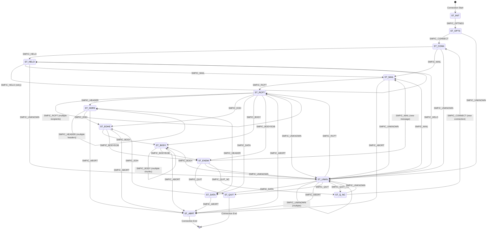

# Milter Protocol Specification <!-- omit from toc -->

- [Overview](#overview)
- [Protocol Architecture](#protocol-architecture)
  - [Connection Model](#connection-model)
  - [Socket Types](#socket-types)
- [Message Format](#message-format)
  - [Reading a Message](#reading-a-message)
  - [Writing a Message](#writing-a-message)
- [Protocol States](#protocol-states)
  - [State Transitions](#state-transitions)
- [Commands from MTA to Milter](#commands-from-mta-to-milter)
  - [Connection Info Format (SMFIC\_CONNECT)](#connection-info-format-smfic_connect)
  - [Macro Format (SMFIC\_MACRO)](#macro-format-smfic_macro)
  - [Internal Error Codes](#internal-error-codes)
- [Replies from Milter to MTA](#replies-from-milter-to-mta)
  - [Header Modification Data Formats](#header-modification-data-formats)
- [Option Negotiation](#option-negotiation)
  - [Option Negotiation Message Format](#option-negotiation-message-format)
  - [Protocol Version](#protocol-version)
  - [Action Flags (SMFIF\_\*)](#action-flags-smfif_)
  - [Protocol Flags (SMFIP\_\*)](#protocol-flags-smfip_)
  - [Symbol List (Optional)](#symbol-list-optional)
- [Macro Stages (SMFIM\_\*)](#macro-stages-smfim_)
- [Typical Protocol Flow](#typical-protocol-flow)
  - [1. Connection Establishment](#1-connection-establishment)
  - [2. SMTP Session](#2-smtp-session)
  - [3. Connection Cleanup](#3-connection-cleanup)
  - [4. Connection Reuse (QUIT\_NC)](#4-connection-reuse-quit_nc)
- [Callback Functions](#callback-functions)
  - [Return Status Codes (SMFIS\_\*)](#return-status-codes-smfis_)
- [Data Limits](#data-limits)
- [Timeouts](#timeouts)
- [Error Handling](#error-handling)
  - [Connection Errors](#connection-errors)
  - [Protocol Errors](#protocol-errors)
- [Security Considerations](#security-considerations)
- [Example: Simple Milter Implementation](#example-simple-milter-implementation)
- [Protocol Constants Summary](#protocol-constants-summary)
  - [Length Constants](#length-constants)
  - [Version Constants](#version-constants)
- [References](#references)
- [Notes](#notes)

## Overview

The Milter (Mail Filter) protocol is a communication protocol between a Mail Transfer Agent (MTA) like Sendmail and external mail filter programs. It allows third-party programs to access mail messages as they are being processed in order to filter meta-information and content.

This document is based on the Sendmail libmilter implementation (version 8.18.2).

## Protocol Architecture

### Connection Model

- The MTA connects to the milter over a socket (Unix domain socket or TCP/IP)
- Each SMTP session corresponds to one milter connection
- The milter listens on a socket and accepts connections from the MTA
- Communication is bidirectional: MTA sends commands, milter sends replies

### Socket Types

Milters can listen on:
- **Unix domain sockets**: `local:/path/to/socket` or `unix:/path/to/socket`
- **IPv4 sockets**: `inet:port@hostname`
- **IPv6 sockets**: `inet6:port@hostname`

## Message Format

All messages in the milter protocol follow this format:

```
+------------------+------------------+------------------+
| Length (4 bytes) | Command (1 byte) | Data (variable)  |
+------------------+------------------+------------------+
```

- **Length**: 4-byte unsigned integer in network byte order (big-endian)
  - Includes the command byte (so actual data length = Length - 1)
- **Command**: Single ASCII character command code
- **Data**: Optional variable-length data (null-terminated strings, binary data, etc.)

### Reading a Message

1. Read 4 bytes for the length (network byte order)
2. Read 1 byte for the command
3. Read (Length - 1) bytes for the data

### Writing a Message

1. Calculate total length: data_length + 1 (for command byte)
2. Write 4-byte length (network byte order)
3. Write 1-byte command
4. Write data

## Protocol States

The milter protocol operates as a state machine with the following states:

| State | Code | Description |
|-------|------|-------------|
| `ST_INIT` | 0 | Initial state |
| `ST_OPTS` | 1 | Option negotiation |
| `ST_CONN` | 2 | Connection info received |
| `ST_HELO` | 3 | HELO command received |
| `ST_MAIL` | 4 | MAIL FROM command received |
| `ST_RCPT` | 5 | RCPT TO command received |
| `ST_DATA` | 6 | DATA command received |
| `ST_HDRS` | 7 | Headers being received |
| `ST_EOHS` | 8 | End of headers |
| `ST_BODY` | 9 | Body chunks being received |
| `ST_ENDM` | 10 | End of message |
| `ST_QUIT` | 11 | QUIT command received | 
| `ST_ABRT` | 12 | Message aborted |
| `ST_UNKN` | 13 | Unknown SMTP command |
| `ST_Q_NC` | 14 | Quit, new connection follows |

### State Transitions

Valid state transitions are enforced by the protocol. The following Mermaid diagram shows all valid state transitions:



**State Transition Rules:**

- **ST_INIT**: Initial state, only accepts option negotiation
- **ST_OPTS**: Option negotiation completed, accepts connection or unknown commands
- **ST_CONN**: Connection established, accepts HELO, MAIL, or unknown commands
- **ST_HELO**: HELO received, can accept another HELO (retry), MAIL, or unknown
- **ST_MAIL**: MAIL FROM received, accepts RCPT, ABORT, or unknown
- **ST_RCPT**: RCPT TO received, can accept multiple RCPTs, headers, DATA, body, or end-of-message
- **ST_DATA**: DATA command received, accepts headers or end-of-headers
- **ST_HDRS**: Headers being received, can accept more headers or end-of-headers
- **ST_EOHS**: End of headers, accepts body chunks or end-of-message
- **ST_BODY**: Body chunks being received, can accept more chunks or end-of-message
- **ST_ENDM**: End of message, accepts QUIT, new MAIL (for multiple messages), or unknown
- **ST_UNKN**: Unknown command received, can transition to most states (flexible recovery)
- **ST_Q_NC**: Quit with new connection, accepts new connection or unknown
- **ST_QUIT**: Terminal state (connection ends)
- **ST_ABRT**: Terminal state (connection aborted)

## Commands from MTA to Milter

Commands sent by the MTA to the milter use the `SMFIC_` prefix:

| Command | Code | Description | Data Format |
|---------|------|-------------|-------------|
| `SMFIC_ABORT` | 'A' (0x41) | Message aborted | None |
| `SMFIC_BODY` | 'B' (0x42) | Body chunk | Binary data (body chunk) |
| `SMFIC_CONNECT` | 'C' (0x43) | Connection information | See Connection Info Format |
| `SMFIC_MACRO` | 'D' (0x44) | Define macro | Stage code + macro pairs |
| `SMFIC_BODYEOB` | 'E' (0x45) | End of body | None |
| `SMFIC_HELO` | 'H' (0x48) | HELO/EHLO command | HELO string\0 |
| `SMFIC_QUIT_NC` | 'K' (0x4B) | Quit, new connection follows | None |
| `SMFIC_HEADER` | 'L' (0x4C) | Header field | Header name\0Header value\0 |
| `SMFIC_MAIL` | 'M' (0x4D) | MAIL FROM command | Sender\0[ESMTP args\0...] |
| `SMFIC_EOH` | 'N' (0x4E) | End of headers | None |
| `SMFIC_OPTNEG` | 'O' (0x4F) | Option negotiation | Protocol version, flags |
| `SMFIC_QUIT` | 'Q' (0x51) | QUIT command | None |
| `SMFIC_RCPT` | 'R' (0x52) | RCPT TO command | Recipient\0[ESMTP args\0...] |
| `SMFIC_DATA` | 'T' (0x54) | DATA command | None |
| `SMFIC_UNKNOWN` | 'U' (0x55) | Unknown SMTP command | Command string\0 |

### Connection Info Format (SMFIC_CONNECT)

The `SMFIC_CONNECT` data contains:

```
+------------------+------------------+------------------+------------------+
| Hostname         | Family (1 byte)  | Port (2 bytes)   | Address          |
| (null-terminated)|                  | (network order)  | (null-terminated)|
+------------------+------------------+------------------+------------------+
```

**Family Codes (SMFIA_*):**

| Code | Value | Description |
|------|-------|-------------|
| `SMFIA_UNKNOWN` | 'U' | Unknown address family |
| `SMFIA_UNIX` | 'L' | Unix/local socket |
| `SMFIA_INET` | '4' | IPv4 address |
| `SMFIA_INET6` | '6' | IPv6 address |

If family is `SMFIA_UNKNOWN`, port and address fields are not present.

### Macro Format (SMFIC_MACRO)

```
+------------------+------------------+
| Stage (1 byte)   | Macro pairs      |
|                  | name\0value\0... |
+------------------+------------------+
```

The stage byte indicates which SMTP stage the macros are associated with (uses same command codes as SMFIC_CONNECT, SMFIC_HELO, etc.).

### Internal Error Codes

These are not actual protocol commands but internal error indicators:

| Code | Value | Description |
|------|-------|-------------|
| `SMFIC_TIMEOUT` | 1 | Timeout occurred |
| `SMFIC_SELECT` | 2 | Select/poll error |
| `SMFIC_MALLOC` | 3 | Memory allocation error |
| `SMFIC_RECVERR` | 4 | Receive error |
| `SMFIC_EOF` | 5 | End of file (connection closed) |
| `SMFIC_UNKNERR` | 6 | Unknown error |
| `SMFIC_TOOBIG` | 7 | Data chunk too big |
| `SMFIC_VALIDCMD` | ' ' (0x20) | First valid command code |

## Replies from Milter to MTA

Replies sent by the milter to the MTA use the `SMFIR_` prefix:

| Reply | Code | Description | Data Format |
|-------|------|-------------|-------------|
| `SMFIR_ADDRCPT` | '+' (0x2B) | Add recipient | Recipient address\0 |
| `SMFIR_DELRCPT` | '-' (0x2D) | Delete recipient | Recipient address\0 |
| `SMFIR_ADDRCPT_PAR` | '2' (0x32) | Add recipient with ESMTP args | Recipient\0Args\0 |
| `SMFIR_SHUTDOWN` | '4' (0x34) | 421 shutdown (internal to MTA) | None |
| `SMFIR_ACCEPT` | 'a' (0x61) | Accept message | None |
| `SMFIR_REPLBODY` | 'b' (0x62) | Replace body (chunk) | Body chunk |
| `SMFIR_CONTINUE` | 'c' (0x63) | Continue processing | None |
| `SMFIR_DISCARD` | 'd' (0x64) | Discard message | None |
| `SMFIR_CHGFROM` | 'e' (0x65) | Change envelope sender | Sender\0[Args\0] |
| `SMFIR_CONN_FAIL` | 'f' (0x66) | Cause connection failure | None |
| `SMFIR_ADDHEADER` | 'h' (0x68) | Add header | Header name\0Header value\0 |
| `SMFIR_INSHEADER` | 'i' (0x69) | Insert header | Index (4 bytes) + Header name\0Header value\0 |
| `SMFIR_SETSYMLIST` | 'l' (0x6C) | Set list of symbols (macros) | Stage (4 bytes) + Macros\0 |
| `SMFIR_CHGHEADER` | 'm' (0x6D) | Change/delete header | Index (4 bytes) + Header name\0Header value\0 |
| `SMFIR_PROGRESS` | 'p' (0x70) | Progress (keep connection alive) | None |
| `SMFIR_QUARANTINE` | 'q' (0x71) | Quarantine message | Reason string\0 |
| `SMFIR_REJECT` | 'r' (0x72) | Reject message | None |
| `SMFIR_SKIP` | 's' (0x73) | Skip remaining callbacks of same type | None |
| `SMFIR_TEMPFAIL` | 't' (0x74) | Temporary failure | None |
| `SMFIR_REPLYCODE` | 'y' (0x79) | Reply with custom SMTP code | SMTP reply string\0 |

### Header Modification Data Formats

**Add Header (SMFIR_ADDHEADER):**
```
+------------------+------------------+
| Header name\0    | Header value\0   |
+------------------+------------------+
```

**Insert Header (SMFIR_INSHEADER):**
```
+------------------+------------------+------------------+
| Index (4 bytes)  | Header name\0    | Header value\0   |
| (network order)  |                  |                  |
+------------------+------------------+------------------+
```

**Change Header (SMFIR_CHGHEADER):**
```
+------------------+------------------+------------------+
| Index (4 bytes)  | Header name\0    | Header value\0   |
| (network order)  |                  | (empty = delete) |
+------------------+------------------+------------------+
```

## Option Negotiation

At the start of each connection, the MTA and milter negotiate capabilities through the `SMFIC_OPTNEG` command.

### Option Negotiation Message Format

The `SMFIC_OPTNEG` data contains:

```
+------------------+------------------+------------------+------------------+
| Protocol Version | Action Flags     | Protocol Flags   | Symbol List      |
| (4 bytes)        | (4 bytes)        | (4 bytes)        | (variable)       |
+------------------+------------------+------------------+------------------+
```

All multi-byte integers are in network byte order (big-endian).

The minimum option negotiation length is 12 bytes (`MILTER_OPTLEN`).

### Protocol Version

- Minimum supported version: 2 (`SMFI_PROT_VERSION_MIN`)
- Current version: 6 (`SMFI_PROT_VERSION`)

### Action Flags (SMFIF_*)

Action flags indicate what actions the milter requests to perform:

| Flag | Value | Description |
|------|-------|-------------|
| `SMFIF_NONE` | 0x00000000 | No flags |
| `SMFIF_ADDHDRS` | 0x00000001 | Add headers |
| `SMFIF_CHGBODY` | 0x00000002 | Change/replace body |
| `SMFIF_ADDRCPT` | 0x00000004 | Add recipients |
| `SMFIF_DELRCPT` | 0x00000008 | Delete recipients |
| `SMFIF_CHGHDRS` | 0x00000010 | Change/delete headers |
| `SMFIF_QUARANTINE` | 0x00000020 | Quarantine messages |
| `SMFIF_CHGFROM` | 0x00000040 | Change envelope sender |
| `SMFIF_ADDRCPT_PAR` | 0x00000080 | Add recipients with ESMTP args |
| `SMFIF_SETSYMLIST` | 0x00000100 | Set symbol list |

**Predefined Action Sets:**

| Set | Value | Description |
|-----|-------|-------------|
| `SMFI_V1_ACTS` | 0x0000000F | V1 filter actions |
| `SMFI_V2_ACTS` | 0x0000003F | V2 filter actions |
| `SMFI_CURR_ACTS` | 0x000001FF | Current version actions |

### Protocol Flags (SMFIP_*)

Protocol flags indicate which protocol features are supported/requested:

| Flag | Value | Description |
|------|-------|-------------|
| `SMFIP_NOCONNECT` | 0x00000001 | MTA should not send connect info |
| `SMFIP_NOHELO` | 0x00000002 | MTA should not send HELO info |
| `SMFIP_NOMAIL` | 0x00000004 | MTA should not send MAIL info |
| `SMFIP_NORCPT` | 0x00000008 | MTA should not send RCPT info |
| `SMFIP_NOBODY` | 0x00000010 | MTA should not send body |
| `SMFIP_NOHDRS` | 0x00000020 | MTA should not send headers |
| `SMFIP_NOEOH` | 0x00000040 | MTA should not send EOH |
| `SMFIP_NR_HDR` | 0x00000080 | No reply needed for headers |
| `SMFIP_NOUNKNOWN` | 0x00000100 | MTA should not send unknown commands |
| `SMFIP_NODATA` | 0x00000200 | MTA should not send DATA |
| `SMFIP_SKIP` | 0x00000400 | MTA understands SMFIR_SKIP |
| `SMFIP_RCPT_REJ` | 0x00000800 | MTA should also send rejected RCPTs |
| `SMFIP_NR_CONN` | 0x00001000 | No reply needed for connect |
| `SMFIP_NR_HELO` | 0x00002000 | No reply needed for HELO |
| `SMFIP_NR_MAIL` | 0x00004000 | No reply needed for MAIL |
| `SMFIP_NR_RCPT` | 0x00008000 | No reply needed for RCPT |
| `SMFIP_NR_DATA` | 0x00010000 | No reply needed for DATA |
| `SMFIP_NR_UNKN` | 0x00020000 | No reply needed for unknown |
| `SMFIP_NR_EOH` | 0x00040000 | No reply needed for end-of-headers |
| `SMFIP_NR_BODY` | 0x00080000 | No reply needed for body |
| `SMFIP_HDR_LEADSPC` | 0x00100000 | Header values may have leading space |
| `SMFIP_MDS_256K` | 0x10000000 | Max data size = 256K |
| `SMFIP_MDS_1M` | 0x20000000 | Max data size = 1M |

**Predefined Protocol Sets:**

| Set | Value | Description |
|-----|-------|-------------|
| `SMFI_V1_PROT` | 0x0000003F | V1 protocol flags |
| `SMFI_V2_PROT` | 0x0000007F | V2 protocol flags |
| `SMFI_CURR_PROT` | 0x001FFFFF | Current protocol flags |
| `SMFI_INTERNAL` | 0x70000000 | Internal flags (MTA-libmilter only) |

### Symbol List (Optional)

After the three 4-byte integers, there may be a symbol list for each macro stage. The format is:

```
+------------------+------------------+
| Stage (4 bytes)  | Macro list\0     |
| (network order)  | (space-separated)|
+------------------+------------------+
```

This pattern can repeat for multiple stages.

## Macro Stages (SMFIM_*)

| Stage | Value | Description |
|-------|-------|-------------|
| `SMFIM_CONNECT` | 0 | Connect stage |
| `SMFIM_HELO` | 1 | HELO/EHLO stage |
| `SMFIM_ENVFROM` | 2 | MAIL FROM stage |
| `SMFIM_ENVRCPT` | 3 | RCPT TO stage |
| `SMFIM_DATA` | 4 | DATA stage |
| `SMFIM_EOM` | 5 | End of message stage |
| `SMFIM_EOH` | 6 | End of headers stage |

## Typical Protocol Flow

### 1. Connection Establishment

```
MTA → Milter: SMFIC_OPTNEG (option negotiation)
Milter → MTA: SMFIC_OPTNEG (negotiated options)
```

### 2. SMTP Session

```
MTA → Milter: SMFIC_MACRO (macros for connect stage)
MTA → Milter: SMFIC_CONNECT (connection info)
Milter → MTA: SMFIR_CONTINUE (or other reply)

MTA → Milter: SMFIC_MACRO (macros for HELO stage)
MTA → Milter: SMFIC_HELO (HELO command)
Milter → MTA: SMFIR_CONTINUE (or other reply)

MTA → Milter: SMFIC_MACRO (macros for MAIL stage)
MTA → Milter: SMFIC_MAIL (MAIL FROM)
Milter → MTA: SMFIR_CONTINUE (or other reply)

MTA → Milter: SMFIC_MACRO (macros for RCPT stage)
MTA → Milter: SMFIC_RCPT (RCPT TO) [may be multiple]
Milter → MTA: SMFIR_CONTINUE (or other reply)

MTA → Milter: SMFIC_MACRO (macros for DATA stage)
MTA → Milter: SMFIC_DATA (DATA command)
Milter → MTA: SMFIR_CONTINUE (or other reply)

MTA → Milter: SMFIC_HEADER (header field) [may be multiple]
Milter → MTA: SMFIR_CONTINUE (or no reply if SMFIP_NR_HDR)

MTA → Milter: SMFIC_MACRO (macros for EOH stage)
MTA → Milter: SMFIC_EOH (end of headers)
Milter → MTA: SMFIR_CONTINUE (or other reply)

MTA → Milter: SMFIC_BODY (body chunk) [may be multiple]
Milter → MTA: SMFIR_CONTINUE (or no reply if SMFIP_NR_BODY)

MTA → Milter: SMFIC_MACRO (macros for EOM stage)
MTA → Milter: SMFIC_BODYEOB (end of body)
Milter → MTA: SMFIR_ACCEPT (or SMFIR_REJECT, SMFIR_TEMPFAIL, etc.)
```

### 3. Connection Cleanup

```
MTA → Milter: SMFIC_QUIT
(no reply, connection closed)
```

### 4. Connection Reuse (QUIT_NC)

```
MTA → Milter: SMFIC_QUIT_NC (quit but keep connection)
(no reply)
MTA → Milter: SMFIC_MACRO (macros for new connection)
MTA → Milter: SMFIC_CONNECT (new connection info)
...
```

## Callback Functions

A milter implementation provides callback functions that are invoked when commands are received:

| Callback | Triggered By | Return Values |
|----------|--------------|---------------|
| `xxfi_connect` | `SMFIC_CONNECT` | `SMFIS_CONTINUE`, `SMFIS_REJECT`, `SMFIS_TEMPFAIL`, `SMFIS_ACCEPT`, `SMFIS_DISCARD` |
| `xxfi_helo` | `SMFIC_HELO` | Same as above |
| `xxfi_envfrom` | `SMFIC_MAIL` | Same as above |
| `xxfi_envrcpt` | `SMFIC_RCPT` | Same as above |
| `xxfi_data` | `SMFIC_DATA` | Same as above |
| `xxfi_header` | `SMFIC_HEADER` | Same as above, plus `SMFIS_NOREPLY` |
| `xxfi_eoh` | `SMFIC_EOH` | Same as above |
| `xxfi_body` | `SMFIC_BODY` | Same as above, plus `SMFIS_NOREPLY`, `SMFIS_SKIP` |
| `xxfi_eom` | `SMFIC_BODYEOB` | Same as above (modifications allowed here) |
| `xxfi_abort` | `SMFIC_ABORT` | Return value ignored (no reply sent) |
| `xxfi_close` | `SMFIC_QUIT` / `SMFIC_QUIT_NC` | Return value ignored (no reply sent) |
| `xxfi_unknown` | `SMFIC_UNKNOWN` | Same as connect |
| `xxfi_negotiate` | `SMFIC_OPTNEG` | `SMFIS_CONTINUE`, `SMFIS_ALL_OPTS`, or abort |

### Return Status Codes (SMFIS_*)

| Status | Value | Description |
|--------|-------|-------------|
| `SMFIS_CONTINUE` | 0 | Continue processing |
| `SMFIS_REJECT` | 1 | Reject message/connection |
| `SMFIS_DISCARD` | 2 | Accept but discard message |
| `SMFIS_ACCEPT` | 3 | Accept message/connection |
| `SMFIS_TEMPFAIL` | 4 | Temporary failure (4xx) |
| `SMFIS_NOREPLY` | 7 | Don't send reply (requires protocol flag) |
| `SMFIS_SKIP` | 8 | Skip remaining callbacks of same type |
| `SMFIS_ALL_OPTS` | 10 | Accept all MTA options (negotiate callback) |

## Data Limits

- **MILTER_LEN_BYTES**: 4 (size of length field)
- **MILTER_OPTLEN**: 12 (minimum option negotiation length: 3 × 4 bytes)
- **MILTER_CHUNK_SIZE**: 65535 (body chunk size)
- **MILTER_MAX_DATA_SIZE**: 65535 (default max data size)
- **MILTER_MDS_256K**: 262143 (256K - 1, when negotiated)
- **MILTER_MDS_1M**: 1048575 (1M - 1, when negotiated)

## Timeouts

Default timeout values:
- **MI_TIMEOUT**: 7210 seconds (default read/write timeout)
- **MI_CHK_TIME**: 5 seconds (check interval for termination)

Timeouts can be configured in sendmail.cf using the `T=` equate:
```
T=C:5m;S:10s;R:10s;E:5m
```

Where:
- `C` = Connection timeout
- `S` = Send timeout
- `R` = Receive timeout
- `E` = End-of-message timeout

## Error Handling

### Connection Errors

If the milter is unavailable, sendmail can be configured to:
- **R**: Reject the connection
- **T**: Temporarily fail the connection
- **4**: Shut down with 421 temporary error
- **None**: Pass message through as if filter wasn't present

### Protocol Errors

- Invalid state transitions may be recovered by resetting to ST_HELO
- Unknown commands cause connection abort
- Timeouts cause connection abort
- Malformed messages cause connection abort

## Security Considerations

1. **Do not run milters as root** - libmilter does not need root privileges
2. **Socket permissions** - Ensure proper permissions on Unix domain sockets
3. **Network security** - If using TCP/IP, consider firewall rules
4. **Input validation** - Always validate data received from the MTA

## Example: Simple Milter Implementation

```c
#include <libmilter/mfapi.h>

// Callback functions
sfsistat mlfi_connect(SMFICTX *ctx, char *hostname, _SOCK_ADDR *hostaddr)
{
    // Process connection info
    return SMFIS_CONTINUE;
}

sfsistat mlfi_helo(SMFICTX *ctx, char *helohost)
{
    return SMFIS_CONTINUE;
}

sfsistat mlfi_envfrom(SMFICTX *ctx, char **argv)
{
    // argv[0] is sender address
    return SMFIS_CONTINUE;
}

sfsistat mlfi_envrcpt(SMFICTX *ctx, char **argv)
{
    // argv[0] is recipient address
    return SMFIS_CONTINUE;
}

sfsistat mlfi_header(SMFICTX *ctx, char *headerf, char *headerv)
{
    return SMFIS_CONTINUE;
}

sfsistat mlfi_eoh(SMFICTX *ctx)
{
    return SMFIS_CONTINUE;
}

sfsistat mlfi_body(SMFICTX *ctx, unsigned char *bodyp, size_t bodylen)
{
    return SMFIS_CONTINUE;
}

sfsistat mlfi_eom(SMFICTX *ctx)
{
    // Can modify message here
    return SMFIS_ACCEPT;
}

sfsistat mlfi_abort(SMFICTX *ctx)
{
    // Cleanup on abort
    return SMFIS_CONTINUE;
}

sfsistat mlfi_close(SMFICTX *ctx)
{
    // Connection cleanup
    return SMFIS_CONTINUE;
}

// Register callbacks
struct smfiDesc smfilter = {
    "MyFilter",           // filter name
    SMFI_VERSION,         // version code
    SMFIF_ADDHDRS,        // flags (capabilities requested)
    mlfi_connect,         // connection callback
    mlfi_helo,            // HELO callback
    mlfi_envfrom,         // MAIL FROM callback
    mlfi_envrcpt,         // RCPT TO callback
    mlfi_header,          // header callback
    mlfi_eoh,             // end of headers callback
    mlfi_body,            // body chunk callback
    mlfi_eom,             // end of message callback
    mlfi_abort,           // abort callback
    mlfi_close,           // close callback
    NULL,                 // unknown command callback
    NULL,                 // DATA callback
    NULL                  // negotiation callback
};

int main(int argc, char **argv)
{
    smfi_setconn("inet:8891@localhost");
    if (smfi_register(smfilter) == MI_FAILURE)
        return 1;
    return smfi_main();
}
```

## Protocol Constants Summary

### Length Constants

| Constant | Value | Description |
|----------|-------|-------------|
| `MILTER_LEN_BYTES` | 4 | Size of length field |
| `MILTER_OPTLEN` | 12 | Minimum option negotiation length |
| `MILTER_CHUNK_SIZE` | 65535 | Body chunk size |
| `MILTER_MAX_DATA_SIZE` | 65535 | Default max data size |

### Version Constants

| Constant | Value | Description |
|----------|-------|-------------|
| `SMFI_PROT_VERSION_MIN` | 2 | Minimum protocol version |
| `SMFI_PROT_VERSION` | 6 | Current protocol version |
| `SMFI_VERSION` | 0x01000001 | libmilter API version |

## References

- Sendmail libmilter source code (sendmail 8.18.2)
- [Sendmail Milter Documentation](https://www.sendmail.com/sm/open_source/docs/milter.readme)
- [Postfix Milter Protocol](http://www.postfix.org/MILTER_README.html)

## Notes

1. All network byte order conversions use `htonl()` / `ntohl()` for 32-bit integers and `htons()` / `ntohs()` for 16-bit integers
2. Strings are null-terminated
3. The protocol is case-sensitive
4. Commands and replies are single ASCII characters
5. The milter must be thread-safe if handling multiple connections
6. Each SMTP session corresponds to one milter connection context
7. Macros are sent before the command they are associated with
8. Message modifications (add/change headers, replace body) can only be done in the `xxfi_eom` callback
