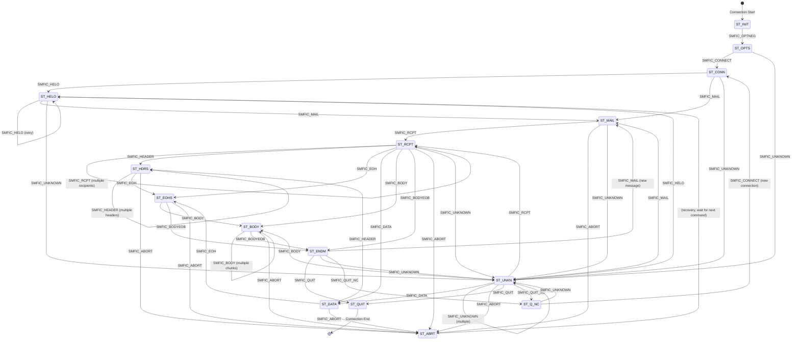

# Milter Protocol Specification <!-- omit from toc -->
- [Overview](#overview)
- [MTA-Specific Differences](#mta-specific-differences)
  - [Connection Lifecycle](#connection-lifecycle)
  - [Hostname Handling (SMFIC\_CONNECT)](#hostname-handling-smfic_connect)
  - [SMTP Reply Code Handling (SMFIR\_REPLYCODE)](#smtp-reply-code-handling-smfir_replycode)
  - [Protocol Version Configuration](#protocol-version-configuration)
  - [Error Handling and Cleanup](#error-handling-and-cleanup)
  - [Multi-line Reply Handling](#multi-line-reply-handling)
- [Protocol Architecture](#protocol-architecture)
  - [Connection Model](#connection-model)
  - [Socket Types](#socket-types)
- [Message Format](#message-format)
  - [Reading a Message](#reading-a-message)
  - [Writing a Message](#writing-a-message)
- [Protocol States](#protocol-states)
  - [State Transitions](#state-transitions)
- [Commands from MTA to Milter](#commands-from-mta-to-milter)
  - [Connection Info Format (SMFIC\_CONNECT)](#connection-info-format-smfic_connect)
  - [Macro Format (SMFIC\_MACRO)](#macro-format-smfic_macro)
  - [Internal Error Codes](#internal-error-codes)
- [Replies from Milter to MTA](#replies-from-milter-to-mta)
  - [Header Modification Data Formats](#header-modification-data-formats)
  - [Custom Reply Code Format (SMFIR\_REPLYCODE)](#custom-reply-code-format-smfir_replycode)
- [Option Negotiation](#option-negotiation)
  - [Option Negotiation Message Format](#option-negotiation-message-format)
  - [Protocol Version](#protocol-version)
  - [Action Flags (SMFIF\_\*)](#action-flags-smfif_)
  - [Protocol Flags (SMFIP\_\*)](#protocol-flags-smfip_)
  - [Symbol List in Option Negotiation (Optional)](#symbol-list-in-option-negotiation-optional)
- [Macro Stages (SMFIM\_\*)](#macro-stages-smfim_)
- [Typical Protocol Flow](#typical-protocol-flow)
  - [1. Connection Establishment](#1-connection-establishment)
  - [2. SMTP Session](#2-smtp-session)
  - [3. Connection Cleanup](#3-connection-cleanup)
  - [4. Connection Reuse (QUIT\_NC)](#4-connection-reuse-quit_nc)
  - [5. Message Abort](#5-message-abort)
- [Callback Functions](#callback-functions)
  - [Return Status Codes (SMFIS\_\*)](#return-status-codes-smfis_)
- [Data Limits](#data-limits)
- [Timeouts](#timeouts)
- [Error Handling](#error-handling)
  - [Connection Errors](#connection-errors)
  - [Protocol Errors](#protocol-errors)
- [Implementation Guidelines for MTA Compatibility](#implementation-guidelines-for-mta-compatibility)
  - [1. Connection Management](#1-connection-management)
  - [2. Hostname Processing](#2-hostname-processing)
  - [3. Reply Code Formatting](#3-reply-code-formatting)
  - [4. Protocol Version Negotiation](#4-protocol-version-negotiation)
  - [5. Error Recovery](#5-error-recovery)
  - [6. Testing Strategy](#6-testing-strategy)
- [Security Considerations](#security-considerations)
- [Example: Simple Milter Implementation](#example-simple-milter-implementation)
- [Protocol Constants Summary](#protocol-constants-summary)
  - [Command Codes](#command-codes)
  - [Reply Codes](#reply-codes)
  - [Version Constants](#version-constants)
- [References](#references)
- [Notes](#notes)

## Overview

The Milter (Mail Filter) protocol is a communication protocol between a Mail Transfer Agent (MTA) like Sendmail or Postfix and external mail filter programs. It allows third-party programs to access mail messages as they are being processed in order to filter meta-information and content.

This document is based on both:
- **Sendmail libmilter** implementation (version 8.18.2)
- **Postfix milter** implementation (milter8 module)

Both MTAs implement the same core protocol with minor behavioral differences documented throughout this specification.

## MTA-Specific Differences

While Sendmail and Postfix implement the same Milter protocol (protocol version 6), there are important behavioral differences:

### Connection Lifecycle

**Sendmail:**
- Maintains persistent connections to milter applications
- Reuses the same socket connection across multiple SMTP sessions (with SMFIC_QUIT_NC)
- Connection remains open until explicitly closed with SMFIC_QUIT

**Postfix:**
- **Auto-disconnect behavior**: Automatically closes the MTA-to-filter socket when the SMTP client disconnects
- Opens a new MTA-to-filter socket for **each SMTP client connection**
- Does NOT reuse connections across SMTP sessions
- This behavior is hardcoded (`LIBMILTER_AUTO_DISCONNECT` in milter8.c)

**Impact for Milter Implementations:**
- Must support both connection models
- Cannot rely on connection reuse in Postfix environments
- Per-connection state is preserved in Sendmail but not in Postfix
- Connection pooling strategies differ between the two MTAs

### Hostname Handling (SMFIC_CONNECT)

**Sendmail:**
- Sends unknown hostnames as provided (may be "unknown" or empty)

**Postfix:**
- Transforms unknown hostname to Sendmail-compatible format
- If `client_name` is "unknown" and `client_addr` is valid, sends `"[<ip_address>]"` format
- Example: Unknown hostname with IP 192.168.1.1 → sends `"[192.168.1.1]"`

### SMTP Reply Code Handling (SMFIR_REPLYCODE)

**Sendmail:**
- Uses reply as a format string
- Doubles '%' characters (`%` → `%%`) in replies

**Postfix:**
- Does NOT use replies as format strings
- Replaces '%%' with '%'
- Removes invalid single '%' characters

**Example:**
- Reply: `"550 5.7.1 Rejected: 100% spam"`
- Sendmail expects: `"550 5.7.1 Rejected: 100%% spam"`
- Postfix expects: `"550 5.7.1 Rejected: 100% spam"` (no escaping needed)

### Protocol Version Configuration

**Sendmail:**
- Protocol version determined automatically via negotiation
- Compiled with libmilter version support

**Postfix:**
- Protocol version must be **explicitly configured** in `main.cf`
- Parameter: `milter_protocol` (default: 6)
- Supports versions 2, 3, 4, and 6
- Configuration example: `milter_protocol = 6`
- Can also specify extensions: `milter_protocol = 6, no_header_reply`

### Error Handling and Cleanup

**Sendmail:**
- Closes connection on protocol errors
- Immediate abort on malformed messages

**Postfix:**
- More resilient to local errors
- After local queue file errors (file too big, write error), keeps Milter socket open
- Skips further Milter replies until final decision
- Maintains SMTP session continuity for multiple deliveries

### Multi-line Reply Handling

**Sendmail:**
- Standard RFC 5321 multi-line reply format
- Lines separated by `\r\n` with `-` for continuation

**Postfix:**
- Enforces format validation for each line of multi-line replies
- Verifies each line starts with '4' or '5' and second character is a digit

## Protocol Architecture

### Connection Model

- The MTA connects to the milter over a socket (Unix domain socket or TCP/IP)
- Each SMTP session corresponds to one milter connection
- The milter listens on a socket and accepts connections from the MTA
- Communication is bidirectional: MTA sends commands, milter sends replies

### Socket Types

Milters can listen on:
- **Unix domain sockets**: `local:/path/to/socket` or `unix:/path/to/socket`
- **IPv4 sockets**: `inet:port@hostname`
- **IPv6 sockets**: `inet6:port@hostname`

## Message Format

All messages in the milter protocol follow this format:

```
+------------------+------------------+------------------+
| Length (4 bytes) | Command (1 byte) | Data (variable)  |
+------------------+------------------+------------------+
```

- **Length**: 4-byte unsigned integer in network byte order (big-endian)
  - Includes the command byte (so actual data length = Length - 1)
- **Command**: Single ASCII character command code
- **Data**: Optional variable-length data (null-terminated strings, binary data, etc.)

### Reading a Message

1. Read 4 bytes for the length (network byte order)
2. Read 1 byte for the command
3. Read (Length - 1) bytes for the data

### Writing a Message

1. Calculate total length: data_length + 1 (for command byte)
2. Write 4-byte length (network byte order)
3. Write 1-byte command
4. Write data

## Protocol States

The milter protocol operates as a state machine with the following states:

| State | Code | Description |
|-------|------|-------------|
| `ST_INIT` | 0 | Initial state |
| `ST_OPTS` | 1 | Option negotiation |
| `ST_CONN` | 2 | Connection info received |
| `ST_HELO` | 3 | HELO command received |
| `ST_MAIL` | 4 | MAIL FROM command received |
| `ST_RCPT` | 5 | RCPT TO command received |
| `ST_DATA` | 6 | DATA command received |
| `ST_HDRS` | 7 | Headers being received |
| `ST_EOHS` | 8 | End of headers |
| `ST_BODY` | 9 | Body chunks being received |
| `ST_ENDM` | 10 | End of message |
| `ST_QUIT` | 11 | QUIT command received (terminal) | 
| `ST_ABRT` | 12 | Message aborted (returns to waiting) |
| `ST_UNKN` | 13 | Unknown SMTP command |
| `ST_Q_NC` | 14 | Quit, new connection follows |

### State Transitions

Valid state transitions are enforced by the protocol. The following Mermaid diagram shows all valid state transitions:



**State Transition Rules:**

- **ST_INIT**: Initial state, only accepts option negotiation
- **ST_OPTS**: Option negotiation completed, accepts connection or unknown commands
- **ST_CONN**: Connection established, accepts HELO, MAIL, or unknown commands
- **ST_HELO**: HELO received, can accept another HELO (retry), MAIL, or unknown
- **ST_MAIL**: MAIL FROM received, accepts RCPT, ABORT, or unknown
- **ST_RCPT**: RCPT TO received, can accept multiple RCPTs, headers, DATA, body, or end-of-message
- **ST_DATA**: DATA command received, accepts headers or end-of-headers
- **ST_HDRS**: Headers being received, can accept more headers or end-of-headers
- **ST_EOHS**: End of headers, accepts body chunks or end-of-message
- **ST_BODY**: Body chunks being received, can accept more chunks or end-of-message
- **ST_ENDM**: End of message, accepts QUIT, new MAIL (for multiple messages), or unknown
- **ST_ABRT**: Message aborted - **NOT a terminal state**; the connection continues and waits for the next command (typically recovers to ST_HELO equivalent state)
- **ST_UNKN**: Unknown command received, can transition to most states (flexible recovery)
- **ST_Q_NC**: Quit with new connection, accepts new connection or unknown
- **ST_QUIT**: **Terminal state** - only state that ends the connection

**Important Notes on Abort:**
- `SMFIC_ABORT` does NOT close the connection
- After abort, the milter continues waiting for commands
- The abort callback (`xxfi_abort`) is called, but no reply is sent
- The MTA typically sends a new `SMFIC_MAIL` to start a new message transaction

## Commands from MTA to Milter

Commands sent by the MTA to the milter use the `SMFIC_` prefix:

| Command | Code | Description | Data Format |
|---------|------|-------------|-------------|
| `SMFIC_ABORT` | 'A' (0x41) | Abort current message | None |
| `SMFIC_BODY` | 'B' (0x42) | Body chunk | Binary data (up to 65535 bytes) |
| `SMFIC_CONNECT` | 'C' (0x43) | Connection information | See Connection Info Format |
| `SMFIC_MACRO` | 'D' (0x44) | Define macro | Stage code + macro pairs |
| `SMFIC_BODYEOB` | 'E' (0x45) | End of body | Optional trailing body data |
| `SMFIC_HELO` | 'H' (0x48) | HELO/EHLO command | HELO string\0 |
| `SMFIC_QUIT_NC` | 'K' (0x4B) | Quit, new connection follows | None |
| `SMFIC_HEADER` | 'L' (0x4C) | Header field | Header name\0Header value\0 |
| `SMFIC_MAIL` | 'M' (0x4D) | MAIL FROM command | Sender\0[ESMTP args\0...] |
| `SMFIC_EOH` | 'N' (0x4E) | End of headers | None |
| `SMFIC_OPTNEG` | 'O' (0x4F) | Option negotiation | Protocol version, flags |
| `SMFIC_QUIT` | 'Q' (0x51) | QUIT command | None |
| `SMFIC_RCPT` | 'R' (0x52) | RCPT TO command | Recipient\0[ESMTP args\0...] |
| `SMFIC_DATA` | 'T' (0x54) | DATA command | None |
| `SMFIC_UNKNOWN` | 'U' (0x55) | Unknown SMTP command | Command string\0 |

### Connection Info Format (SMFIC_CONNECT)

The `SMFIC_CONNECT` data contains:

```
+------------------+------------------+------------------+------------------+
| Hostname         | Family (1 byte)  | Port (2 bytes)   | Address          |
| (null-terminated)|                  | (network order)  | (null-terminated)|
+------------------+------------------+------------------+------------------+
```

**Family Codes (SMFIA_*):**

| Code | Value | Description |
|------|-------|-------------|
| `SMFIA_UNKNOWN` | 'U' (0x55) | Unknown address family |
| `SMFIA_UNIX` | 'L' (0x4C) | Unix/local socket |
| `SMFIA_INET` | '4' (0x34) | IPv4 address |
| `SMFIA_INET6` | '6' (0x36) | IPv6 address |

**Notes:**
- If family is `SMFIA_UNKNOWN`, port and address fields are **not present**
- Port is in **network byte order** (big-endian, as received from the socket)
- For IPv4, address is the dotted-decimal string (e.g., "192.168.1.1")
- For IPv6, address is the colon-hex string (e.g., "::1" or "2001:db8::1")
- For Unix sockets, address is the socket path

### Macro Format (SMFIC_MACRO)

```
+------------------+------------------+
| Stage (1 byte)   | Macro pairs      |
|                  | name\0value\0... |
+------------------+------------------+
```

The stage byte indicates which SMTP command the macros are associated with. It uses the **same command codes** as the corresponding SMFIC_* commands:

| Stage Byte | Corresponds To |
|------------|----------------|
| 'C' (0x43) | SMFIC_CONNECT |
| 'H' (0x48) | SMFIC_HELO |
| 'M' (0x4D) | SMFIC_MAIL |
| 'R' (0x52) | SMFIC_RCPT |
| 'T' (0x54) | SMFIC_DATA |
| 'N' (0x4E) | SMFIC_EOH |
| 'E' (0x45) | SMFIC_BODYEOB (end of message) |

**Note:** Macros are always sent **before** the command they are associated with.

### Internal Error Codes

These are not actual protocol commands but internal error indicators used by libmilter:

| Code | Value | Description |
|------|-------|-------------|
| `SMFIC_TIMEOUT` | 1 | Timeout occurred |
| `SMFIC_SELECT` | 2 | Select/poll error |
| `SMFIC_MALLOC` | 3 | Memory allocation error |
| `SMFIC_RECVERR` | 4 | Receive error |
| `SMFIC_EOF` | 5 | End of file (connection closed) |
| `SMFIC_UNKNERR` | 6 | Unknown error |
| `SMFIC_TOOBIG` | 7 | Data chunk too big |
| `SMFIC_VALIDCMD` | ' ' (0x20) | First valid command code |

## Replies from Milter to MTA

Replies sent by the milter to the MTA use the `SMFIR_` prefix:

| Reply | Code | Description | Data Format |
|-------|------|-------------|-------------|
| `SMFIR_ADDRCPT` | '+' (0x2B) | Add recipient | Recipient address\0 |
| `SMFIR_DELRCPT` | '-' (0x2D) | Delete recipient | Recipient address\0 |
| `SMFIR_ADDRCPT_PAR` | '2' (0x32) | Add recipient with ESMTP args | Recipient\0Args\0 |
| `SMFIR_SHUTDOWN` | '4' (0x34) | 421 shutdown (internal to MTA) | None |
| `SMFIR_ACCEPT` | 'a' (0x61) | Accept message | None |
| `SMFIR_REPLBODY` | 'b' (0x62) | Replace body (chunk) | Body data (≤65535 bytes) |
| `SMFIR_CONTINUE` | 'c' (0x63) | Continue processing | None |
| `SMFIR_DISCARD` | 'd' (0x64) | Discard message silently | None |
| `SMFIR_CHGFROM` | 'e' (0x65) | Change envelope sender | Sender\0[Args\0] |
| `SMFIR_CONN_FAIL` | 'f' (0x66) | Cause connection failure | None |
| `SMFIR_ADDHEADER` | 'h' (0x68) | Add header | Header name\0Header value\0 |
| `SMFIR_INSHEADER` | 'i' (0x69) | Insert header at position | Index (4 bytes) + Name\0Value\0 |
| `SMFIR_SETSYMLIST` | 'l' (0x6C) | Set list of symbols (macros) | Stage (4 bytes) + Macros\0 |
| `SMFIR_CHGHEADER` | 'm' (0x6D) | Change/delete header | Index (4 bytes) + Name\0Value\0 |
| `SMFIR_PROGRESS` | 'p' (0x70) | Progress (reset timeout) | None |
| `SMFIR_QUARANTINE` | 'q' (0x71) | Quarantine message | Reason string\0 |
| `SMFIR_REJECT` | 'r' (0x72) | Reject with 5xx | None |
| `SMFIR_SKIP` | 's' (0x73) | Skip remaining callbacks of same type | None |
| `SMFIR_TEMPFAIL` | 't' (0x74) | Temporary failure (4xx) | None |
| `SMFIR_REPLYCODE` | 'y' (0x79) | Custom SMTP reply code | SMTP reply string\0 |

### Header Modification Data Formats

**Add Header (SMFIR_ADDHEADER):**
```
+------------------+------------------+
| Header name\0    | Header value\0   |
+------------------+------------------+
```

**Insert Header (SMFIR_INSHEADER):**
```
+------------------+------------------+------------------+
| Index (4 bytes)  | Header name\0    | Header value\0   |
| (network order)  |                  |                  |
+------------------+------------------+------------------+
```
Index 0 = insert at the beginning, index 1 = after first header, etc.

**Change Header (SMFIR_CHGHEADER):**
```
+------------------+------------------+------------------+
| Index (4 bytes)  | Header name\0    | Header value\0   |
| (network order)  |                  | (empty = delete) |
+------------------+------------------+------------------+
```
Index is 1-based: index 1 = first occurrence, index 2 = second occurrence, etc.
To delete a header, set the value to an empty string.

### Custom Reply Code Format (SMFIR_REPLYCODE)

```
+------------------+------------------+------------------+
| 3-digit code     | space            | Extended code    |
| (e.g., "550")    |                  | + message\0      |
+------------------+------------------+------------------+
```

Example: `"550 5.7.1 Rejected by policy\0"`

For multi-line replies, lines are separated by `\r\n` followed by the reply code with `-` instead of space for continuation lines.

## Option Negotiation

At the start of each connection, the MTA and milter negotiate capabilities through the `SMFIC_OPTNEG` command.

### Option Negotiation Message Format

Both the MTA's request and the milter's response use `SMFIC_OPTNEG` ('O'):

```
+------------------+------------------+------------------+------------------+
| Protocol Version | Action Flags     | Protocol Flags   | Symbol List      |
| (4 bytes)        | (4 bytes)        | (4 bytes)        | (optional)       |
+------------------+------------------+------------------+------------------+
```

All multi-byte integers are in network byte order (big-endian).

The minimum option negotiation length is 12 bytes (`MILTER_OPTLEN`).

### Protocol Version

| Constant | Value | Description |
|----------|-------|-------------|
| `SMFI_PROT_VERSION_MIN` | 2 | Minimum supported version |
| `SMFI_PROT_VERSION` | 6 | Current version (Sendmail 8.14+) |

The negotiated version is the **minimum** of the MTA and milter versions.

#### Protocol Version Evolution

**Version 2** (Sendmail 8.10 - 8.12):
- Base protocol with core callbacks
- Supported events: Connect, HELO, MAIL, RCPT, Headers, Body, End-of-Message
- Protocol flags: `SMFIP_NOCONNECT`, `SMFIP_NOHELO`, `SMFIP_NOMAIL`, `SMFIP_NORCPT`, `SMFIP_NOBODY`, `SMFIP_NOHDRS`, `SMFIP_NOEOH`

**Version 3** (Sendmail 8.13):
- Added `SMFIC_UNKNOWN` command support
- Added `SMFIP_NOUNKNOWN` protocol flag
- Added `SMFIF_QUARANTINE` action flag

**Version 4** (Sendmail 8.13+):
- Added `SMFIC_DATA` command support
- Added `SMFIP_NODATA` protocol flag

**Version 6** (Sendmail 8.14+):
- Added `SMFIC_QUIT_NC` (quit with new connection) command
- Added `SMFIR_SKIP` reply (skip remaining callbacks of same type)
- Added "No-Reply" optimization flags: `SMFIP_NR_CONN`, `SMFIP_NR_HELO`, `SMFIP_NR_MAIL`, `SMFIP_NR_RCPT`, `SMFIP_NR_DATA`, `SMFIP_NR_UNKN`, `SMFIP_NR_EOH`, `SMFIP_NR_BODY`
- Added `SMFIP_SKIP` support flag (MTA understands SMFIR_SKIP)
- Added `SMFIP_RCPT_REJ` flag (send rejected RCPTs to filter)
- Added `SMFIP_HDR_LEADSPC` flag (preserve leading spaces in header values)
- Added `SMFIF_CHGFROM`, `SMFIF_ADDRCPT_PAR`, `SMFIF_SETSYMLIST` action flags

**Version Compatibility Matrix:**

| Feature | V2 | V3 | V4 | V6 |
|---------|----|----|----|----|
| Core callbacks (connect, helo, mail, rcpt, header, body, eom) | ✓ | ✓ | ✓ | ✓ |
| SMFIC_UNKNOWN | ✗ | ✓ | ✓ | ✓ |
| SMFIC_DATA | ✗ | ✗ | ✓ | ✓ |
| SMFIC_QUIT_NC | ✗ | ✗ | ✗ | ✓ |
| SMFIR_SKIP | ✗ | ✗ | ✗ | ✓ |
| No-Reply flags (SMFIP_NR_*) | ✗ | ✗ | ✗ | ✓ |
| SMFIP_RCPT_REJ | ✗ | ✗ | ✗ | ✓ |
| SMFIF_QUARANTINE | ✗ | ✓ | ✓ | ✓ |
| SMFIF_CHGFROM | ✗ | ✗ | ✗ | ✓ |
| SMFIF_ADDRCPT_PAR | ✗ | ✗ | ✗ | ✓ |
| SMFIF_SETSYMLIST | ✗ | ✗ | ✗ | ✓ |

**MTA Version Support:**
- **Sendmail**: Automatically negotiates version based on libmilter build
- **Postfix**: Supports versions 2, 3, 4, and 6; configured via `milter_protocol` parameter (default: 6)

### Action Flags (SMFIF_*)

Action flags indicate what actions the milter requests to perform:

| Flag | Value | Description |
|------|-------|-------------|
| `SMFIF_NONE` | 0x00000000 | No flags |
| `SMFIF_ADDHDRS` | 0x00000001 | Add headers |
| `SMFIF_CHGBODY` | 0x00000002 | Change/replace body |
| `SMFIF_ADDRCPT` | 0x00000004 | Add recipients |
| `SMFIF_DELRCPT` | 0x00000008 | Delete recipients |
| `SMFIF_CHGHDRS` | 0x00000010 | Change/delete headers |
| `SMFIF_QUARANTINE` | 0x00000020 | Quarantine messages |
| `SMFIF_CHGFROM` | 0x00000040 | Change envelope sender |
| `SMFIF_ADDRCPT_PAR` | 0x00000080 | Add recipients with ESMTP args |
| `SMFIF_SETSYMLIST` | 0x00000100 | Can set symbol (macro) list |

**Predefined Action Sets:**

| Set | Value | Description |
|-----|-------|-------------|
| `SMFI_V1_ACTS` | 0x0000000F | V1 filter actions |
| `SMFI_V2_ACTS` | 0x0000003F | V2 filter actions |
| `SMFI_CURR_ACTS` | 0x000001FF | Current version actions |

### Protocol Flags (SMFIP_*)

Protocol flags indicate which protocol features are supported/requested:

| Flag | Value | Description |
|------|-------|-------------|
| `SMFIP_NOCONNECT` | 0x00000001 | MTA should not send connect info |
| `SMFIP_NOHELO` | 0x00000002 | MTA should not send HELO info |
| `SMFIP_NOMAIL` | 0x00000004 | MTA should not send MAIL info |
| `SMFIP_NORCPT` | 0x00000008 | MTA should not send RCPT info |
| `SMFIP_NOBODY` | 0x00000010 | MTA should not send body |
| `SMFIP_NOHDRS` | 0x00000020 | MTA should not send headers |
| `SMFIP_NOEOH` | 0x00000040 | MTA should not send EOH |
| `SMFIP_NR_HDR` | 0x00000080 | No reply needed for headers |
| `SMFIP_NOUNKNOWN` | 0x00000100 | MTA should not send unknown cmds |
| `SMFIP_NODATA` | 0x00000200 | MTA should not send DATA |
| `SMFIP_SKIP` | 0x00000400 | MTA understands SMFIR_SKIP |
| `SMFIP_RCPT_REJ` | 0x00000800 | MTA should also send rejected RCPTs |
| `SMFIP_NR_CONN` | 0x00001000 | No reply needed for connect |
| `SMFIP_NR_HELO` | 0x00002000 | No reply needed for HELO |
| `SMFIP_NR_MAIL` | 0x00004000 | No reply needed for MAIL |
| `SMFIP_NR_RCPT` | 0x00008000 | No reply needed for RCPT |
| `SMFIP_NR_DATA` | 0x00010000 | No reply needed for DATA |
| `SMFIP_NR_UNKN` | 0x00020000 | No reply needed for unknown |
| `SMFIP_NR_EOH` | 0x00040000 | No reply needed for EOH |
| `SMFIP_NR_BODY` | 0x00080000 | No reply needed for body |
| `SMFIP_HDR_LEADSPC` | 0x00100000 | Preserve leading space in headers |
| `SMFIP_MDS_256K` | 0x10000000 | Max data size = 256K |
| `SMFIP_MDS_1M` | 0x20000000 | Max data size = 1M |

**Aliases:**
- `SMFIP_NOHREPL` = `SMFIP_NR_HDR` (backwards compatibility)

**Predefined Protocol Sets:**

| Set | Value | Description |
|-----|-------|-------------|
| `SMFI_V1_PROT` | 0x0000003F | V1 protocol flags |
| `SMFI_V2_PROT` | 0x0000007F | V2 protocol flags |
| `SMFI_CURR_PROT` | 0x001FFFFF | Current protocol flags |
| `SMFI_INTERNAL` | 0x70000000 | Internal flags (MTA-libmilter) |

### Symbol List in Option Negotiation (Optional)

After the three 4-byte integers, the milter can optionally include a symbol list to request specific macros. Format:

```
+------------------+------------------+
| Stage (4 bytes)  | Macro list\0     |
| (network order)  | (space-separated)|
+------------------+------------------+
```

This pattern can repeat for multiple stages. Example macro list: `"{mail_mailer} {mail_host} {mail_addr}"`

**Maximum macros per stage:** 50 (`MAXFILTERMACROS`)

## Macro Stages (SMFIM_*)

These constants are used with `smfi_setsymlist()` and in the symbol list:

| Stage | Value | Description |
|-------|-------|-------------|
| `SMFIM_CONNECT` | 0 | Connect stage |
| `SMFIM_HELO` | 1 | HELO/EHLO stage |
| `SMFIM_ENVFROM` | 2 | MAIL FROM stage |
| `SMFIM_ENVRCPT` | 3 | RCPT TO stage |
| `SMFIM_DATA` | 4 | DATA stage |
| `SMFIM_EOM` | 5 | End of message stage |
| `SMFIM_EOH` | 6 | End of headers stage |

**Internal only:**
- `SMFIM_NOMACROS` = -1 (no macros for this command, used internally)

## Typical Protocol Flow

### 1. Connection Establishment

```
MTA → Milter: SMFIC_OPTNEG (version=6, actions, protocol flags)
Milter → MTA: SMFIC_OPTNEG (negotiated version, actions, protocol flags)
```

### 2. SMTP Session

```
MTA → Milter: SMFIC_MACRO ('C', macros for connect)
MTA → Milter: SMFIC_CONNECT (hostname, family, port, address)
Milter → MTA: SMFIR_CONTINUE

MTA → Milter: SMFIC_MACRO ('H', macros for HELO)
MTA → Milter: SMFIC_HELO (helo_string)
Milter → MTA: SMFIR_CONTINUE

MTA → Milter: SMFIC_MACRO ('M', macros for MAIL)
MTA → Milter: SMFIC_MAIL (sender, esmtp_args...)
Milter → MTA: SMFIR_CONTINUE

MTA → Milter: SMFIC_MACRO ('R', macros for RCPT)
MTA → Milter: SMFIC_RCPT (recipient, esmtp_args...)
Milter → MTA: SMFIR_CONTINUE
[... repeat for each recipient ...]

MTA → Milter: SMFIC_MACRO ('T', macros for DATA)
MTA → Milter: SMFIC_DATA
Milter → MTA: SMFIR_CONTINUE

MTA → Milter: SMFIC_HEADER (name, value)
Milter → MTA: SMFIR_CONTINUE (or no reply if SMFIP_NR_HDR)
[... repeat for each header ...]

MTA → Milter: SMFIC_MACRO ('N', macros for EOH)
MTA → Milter: SMFIC_EOH
Milter → MTA: SMFIR_CONTINUE

MTA → Milter: SMFIC_BODY (chunk, up to 65535 bytes)
Milter → MTA: SMFIR_CONTINUE (or no reply if SMFIP_NR_BODY)
[... repeat for each body chunk ...]

MTA → Milter: SMFIC_MACRO ('E', macros for EOM)
MTA → Milter: SMFIC_BODYEOB
Milter → MTA: [modifications...] then SMFIR_ACCEPT/REJECT/etc.
```

### 3. Connection Cleanup

```
MTA → Milter: SMFIC_QUIT
(no reply, connection closed by both sides)
```

### 4. Connection Reuse (QUIT_NC)

```
MTA → Milter: SMFIC_QUIT_NC
(no reply, connection stays open)
MTA → Milter: SMFIC_MACRO ('C', macros for new connection)
MTA → Milter: SMFIC_CONNECT (new connection info)
...
```

### 5. Message Abort

```
MTA → Milter: SMFIC_ABORT
(no reply, xxfi_abort called, wait for next command)
MTA → Milter: SMFIC_MAIL (start new message)
...
```

## Callback Functions

A milter implementation provides callback functions:

| Callback | Triggered By | Valid Returns |
|----------|--------------|---------------|
| `xxfi_negotiate` | `SMFIC_OPTNEG` | `SMFIS_ALL_OPTS`, `SMFIS_CONTINUE`, `SMFIS_REJECT` |
| `xxfi_connect` | `SMFIC_CONNECT` | `SMFIS_CONTINUE`, `SMFIS_REJECT`, `SMFIS_TEMPFAIL`, `SMFIS_ACCEPT`, `SMFIS_DISCARD` |
| `xxfi_helo` | `SMFIC_HELO` | Same as connect |
| `xxfi_envfrom` | `SMFIC_MAIL` | Same as connect |
| `xxfi_envrcpt` | `SMFIC_RCPT` | Same as connect |
| `xxfi_data` | `SMFIC_DATA` | Same as connect |
| `xxfi_header` | `SMFIC_HEADER` | Same as connect, plus `SMFIS_NOREPLY` |
| `xxfi_eoh` | `SMFIC_EOH` | Same as connect |
| `xxfi_body` | `SMFIC_BODY` | Same as connect, plus `SMFIS_NOREPLY`, `SMFIS_SKIP` |
| `xxfi_eom` | `SMFIC_BODYEOB` | Same as connect (can also send modifications) |
| `xxfi_abort` | `SMFIC_ABORT` | Return ignored (no reply sent) |
| `xxfi_close` | Connection end | Return ignored (no reply sent) |
| `xxfi_unknown` | `SMFIC_UNKNOWN` | Same as connect |

**Notes on xxfi_close:**
- Called when connection ends (after `SMFIC_QUIT`)
- Also called after `SMFIC_QUIT_NC`
- Called on errors/failures even without explicit QUIT

### Return Status Codes (SMFIS_*)

| Status | Value | Description |
|--------|-------|-------------|
| `SMFIS_CONTINUE` | 0 | Continue processing |
| `SMFIS_REJECT` | 1 | Reject with 5xx |
| `SMFIS_DISCARD` | 2 | Accept but discard silently |
| `SMFIS_ACCEPT` | 3 | Accept, skip remaining filters |
| `SMFIS_TEMPFAIL` | 4 | Temporary failure (4xx) |
| `SMFIS_NOREPLY` | 7 | Don't send reply (requires NR_* flag) |
| `SMFIS_SKIP` | 8 | Skip remaining callbacks of same type |
| `SMFIS_ALL_OPTS` | 10 | Accept all MTA options (negotiate only) |

## Data Limits

| Constant | Value | Description |
|----------|-------|-------------|
| `MILTER_LEN_BYTES` | 4 | Size of length field |
| `MILTER_OPTLEN` | 12 | Minimum option negotiation (3×4 bytes) |
| `MILTER_CHUNK_SIZE` | 65535 | Max body chunk size |
| `MILTER_MAX_DATA_SIZE` | 65535 | Default max data size |
| `MILTER_MDS_256K` | 262143 | 256K - 1 (when negotiated) |
| `MILTER_MDS_1M` | 1048575 | 1M - 1 (when negotiated) |
| `MAXFILTERMACROS` | 50 | Max macros per stage |

## Timeouts

Default timeout values:
- **MI_TIMEOUT**: 7210 seconds (default read/write timeout)
- **MI_CHK_TIME**: 5 seconds (check interval for termination)

Sendmail.cf configuration using `T=` equate:
```
T=C:5m;S:10s;R:10s;E:5m
```

| Code | Description | Default |
|------|-------------|---------|
| C | Connection timeout | 5 minutes |
| S | Send timeout | 10 seconds |
| R | Receive timeout | 10 seconds |
| E | End-of-message timeout | 5 minutes |

## Error Handling

### Connection Errors

Sendmail `F=` flags for milter failure:
- **R**: Reject the message
- **T**: Temporary fail the message
- **4**: Shut down with 421 error
- **(none)**: Accept message as if filter wasn't present

### Protocol Errors

- Invalid state transitions: attempt recovery to ST_HELO, else ignore
- Unknown commands: connection abort
- Timeouts: connection abort, call xxfi_abort if in message
- Malformed messages: connection abort

## Implementation Guidelines for MTA Compatibility

To ensure your milter works correctly with both Sendmail and Postfix:

### 1. Connection Management

**Design for Ephemeral Connections:**
- Do NOT rely on connection reuse across SMTP sessions
- Initialize per-session state on each `SMFIC_CONNECT`
- Clean up per-session state in `xxfi_close`
- Assume each SMTP session gets a new connection (Postfix behavior)

**Handle Both Models:**
- Support `SMFIC_QUIT_NC` for Sendmail connection reuse
- Reset all message-specific state after `SMFIC_BODYEOB` or `SMFIC_ABORT`
- Treat `xxfi_close` as the final cleanup regardless of connection model

### 2. Hostname Processing

**Normalize Unknown Hostnames:**
- Accept both "unknown" and "[<ip>]" formats for unknown hostnames
- If hostname is "unknown" or starts with '[', extract IP from address field
- Do not assume hostname format consistency between MTAs

### 3. Reply Code Formatting

**SMFIR_REPLYCODE Best Practices:**
- Do NOT double '%' characters in reply strings
- Use plain text replies without format string escaping
- Postfix will handle any necessary transformations
- Validate reply format: `<3-digit> <space> <text>`

**Multi-line Replies:**
- Each line must start with the 3-digit code
- Use '-' for continuation lines, ' ' for final line
- Format: `"<code>-<text>\r\n<code>-<text>\r\n<code> <text>"`
- Ensure each line starts with '4' or '5' (reject/tempfail)

### 4. Protocol Version Negotiation

**Implement Version Detection:**
- Accept negotiations for versions 2, 3, 4, and 6
- Gracefully degrade features for older versions
- Only send events/replies supported by negotiated version

**Version-Specific Behavior:**
```
if (negotiated_version >= 6) {
    // Can use SMFIR_SKIP, SMFIP_NR_* flags, SMFIF_CHGFROM, etc.
}
if (negotiated_version >= 4) {
    // Can receive SMFIC_DATA
}
if (negotiated_version >= 3) {
    // Can receive SMFIC_UNKNOWN
}
```

### 5. Error Recovery

**Robust Error Handling:**
- Continue processing after non-fatal errors
- Do not assume connection will be closed on error
- Implement timeout handling with `SMFIR_PROGRESS`
- Handle missing or malformed commands gracefully

### 6. Testing Strategy

**Test with Both MTAs:**
- Verify connection lifecycle with Sendmail (persistent connections)
- Verify connection lifecycle with Postfix (connection-per-session)
- Test hostname handling with unknown/bracketed formats
- Test protocol version negotiation (v2, v3, v4, v6)
- Test reply code handling with '%' characters
- Test cleanup behavior after errors

## Security Considerations

1. **Do not run milters as root** - libmilter does not need root privileges
2. **Socket permissions** - Ensure proper permissions on Unix domain sockets
3. **Network security** - If using TCP/IP, consider firewall rules and localhost binding
4. **Input validation** - Always validate data received from the MTA
5. **Timeout handling** - Use `SMFIR_PROGRESS` for long operations to prevent timeouts
6. **MTA-agnostic design** - Do not rely on MTA-specific behaviors for security decisions

## Example: Simple Milter Implementation

```c
#include <libmilter/mfapi.h>

sfsistat mlfi_connect(SMFICTX *ctx, char *hostname, _SOCK_ADDR *hostaddr)
{
    return SMFIS_CONTINUE;
}

sfsistat mlfi_envfrom(SMFICTX *ctx, char **argv)
{
    // argv[0] = sender address, argv[1..n] = ESMTP args, NULL terminated
    return SMFIS_CONTINUE;
}

sfsistat mlfi_envrcpt(SMFICTX *ctx, char **argv)
{
    // argv[0] = recipient address
    return SMFIS_CONTINUE;
}

sfsistat mlfi_header(SMFICTX *ctx, char *name, char *value)
{
    return SMFIS_CONTINUE;
}

sfsistat mlfi_eom(SMFICTX *ctx)
{
    // Can add/change headers, replace body here
    smfi_addheader(ctx, "X-Filtered", "true");
    return SMFIS_ACCEPT;
}

sfsistat mlfi_close(SMFICTX *ctx)
{
    // Cleanup private data here
    return SMFIS_CONTINUE;
}

struct smfiDesc smfilter = {
    "MyFilter",           // filter name
    SMFI_VERSION,         // version code
    SMFIF_ADDHDRS,        // action flags
    mlfi_connect,         // xxfi_connect
    NULL,                 // xxfi_helo
    mlfi_envfrom,         // xxfi_envfrom
    mlfi_envrcpt,         // xxfi_envrcpt
    mlfi_header,          // xxfi_header
    NULL,                 // xxfi_eoh
    NULL,                 // xxfi_body
    mlfi_eom,             // xxfi_eom
    NULL,                 // xxfi_abort
    mlfi_close,           // xxfi_close
    NULL,                 // xxfi_unknown
    NULL,                 // xxfi_data
    NULL                  // xxfi_negotiate
};

int main(void)
{
    smfi_setconn("inet:8891@localhost");
    if (smfi_register(smfilter) == MI_FAILURE)
        return 1;
    return smfi_main();
}
```

## Protocol Constants Summary

### Command Codes

| Command | Code | Hex |
|---------|------|-----|
| SMFIC_ABORT | 'A' | 0x41 |
| SMFIC_BODY | 'B' | 0x42 |
| SMFIC_CONNECT | 'C' | 0x43 |
| SMFIC_MACRO | 'D' | 0x44 |
| SMFIC_BODYEOB | 'E' | 0x45 |
| SMFIC_HELO | 'H' | 0x48 |
| SMFIC_QUIT_NC | 'K' | 0x4B |
| SMFIC_HEADER | 'L' | 0x4C |
| SMFIC_MAIL | 'M' | 0x4D |
| SMFIC_EOH | 'N' | 0x4E |
| SMFIC_OPTNEG | 'O' | 0x4F |
| SMFIC_QUIT | 'Q' | 0x51 |
| SMFIC_RCPT | 'R' | 0x52 |
| SMFIC_DATA | 'T' | 0x54 |
| SMFIC_UNKNOWN | 'U' | 0x55 |

### Reply Codes

| Reply | Code | Hex |
|-------|------|-----|
| SMFIR_ADDRCPT | '+' | 0x2B |
| SMFIR_DELRCPT | '-' | 0x2D |
| SMFIR_ADDRCPT_PAR | '2' | 0x32 |
| SMFIR_SHUTDOWN | '4' | 0x34 |
| SMFIR_ACCEPT | 'a' | 0x61 |
| SMFIR_REPLBODY | 'b' | 0x62 |
| SMFIR_CONTINUE | 'c' | 0x63 |
| SMFIR_DISCARD | 'd' | 0x64 |
| SMFIR_CHGFROM | 'e' | 0x65 |
| SMFIR_CONN_FAIL | 'f' | 0x66 |
| SMFIR_ADDHEADER | 'h' | 0x68 |
| SMFIR_INSHEADER | 'i' | 0x69 |
| SMFIR_SETSYMLIST | 'l' | 0x6C |
| SMFIR_CHGHEADER | 'm' | 0x6D |
| SMFIR_PROGRESS | 'p' | 0x70 |
| SMFIR_QUARANTINE | 'q' | 0x71 |
| SMFIR_REJECT | 'r' | 0x72 |
| SMFIR_SKIP | 's' | 0x73 |
| SMFIR_TEMPFAIL | 't' | 0x74 |
| SMFIR_REPLYCODE | 'y' | 0x79 |

### Version Constants

| Constant | Value | Description |
|----------|-------|-------------|
| `SMFI_PROT_VERSION_MIN` | 2 | Minimum protocol version |
| `SMFI_PROT_VERSION` | 6 | Current protocol version |
| `SMFI_VERSION` | 0x01000001 | libmilter API version |

## References

### Primary Sources
- **Sendmail libmilter** source code (version 8.18.2)
  - `sendmail-8.18.2/include/libmilter/mfdef.h` - Protocol definitions
  - `sendmail-8.18.2/include/libmilter/mfapi.h` - API definitions
  - `sendmail-8.18.2/libmilter/` - Implementation
- **Postfix milter8** source code (latest)
  - `postfix/src/milter/milter.h` - Postfix milter interface
  - `postfix/src/milter/milter8.c` - Sendmail 8 protocol implementation
  - `postfix/src/smtpd/smtpd_milter.c` - SMTP integration

### Documentation
- [Postfix MILTER_README](http://www.postfix.org/MILTER_README.html) - Official Postfix Milter documentation
- [Sendmail libmilter Documentation](https://www.sendmail.org/releases/8.18.1.html) - Official Sendmail documentation
- RFC 5321 - Simple Mail Transfer Protocol (SMTP)
- RFC 5322 - Internet Message Format

## Notes

### General Protocol Rules
1. All multi-byte integers use network byte order (big-endian)
2. Strings are null-terminated
3. The protocol is case-sensitive
4. Commands and replies are single ASCII characters (≥ 0x20)
5. The milter must be thread-safe for multiple simultaneous connections
6. Macros are sent **before** the command they are associated with
7. Message modifications can **only** be done in `xxfi_eom`
8. Body replacement must split data into chunks ≤ `MILTER_CHUNK_SIZE`
9. After `SMFIS_ACCEPT/REJECT/DISCARD/TEMPFAIL`, the filter receives no more callbacks for that message
10. `SMFIS_NOREPLY` requires the corresponding `SMFIP_NR_*` flag to be negotiated

### MTA-Specific Considerations
11. **Connection Reuse**: Sendmail reuses connections with `SMFIC_QUIT_NC`, Postfix opens new connections per SMTP session
12. **Hostname Format**: Postfix transforms unknown hostnames to `[<ip>]` format; Sendmail sends as-is
13. **Reply Escaping**: Only Sendmail doubles '%' in `SMFIR_REPLYCODE`; Postfix uses plain text
14. **Protocol Version**: Postfix requires explicit configuration (`milter_protocol`); Sendmail negotiates automatically
15. **Error Recovery**: Postfix maintains connections after local errors; Sendmail may close immediately
16. **Auto-Disconnect**: Postfix automatically closes milter connections when SMTP clients disconnect

### Protocol Version Features
17. Version 2 is the baseline; versions 3, 4, and 6 add incremental features
18. Always implement version detection and feature degradation for compatibility
19. Version 6 is recommended for production use (full feature set)
20. Test with multiple protocol versions to ensure backward compatibility
