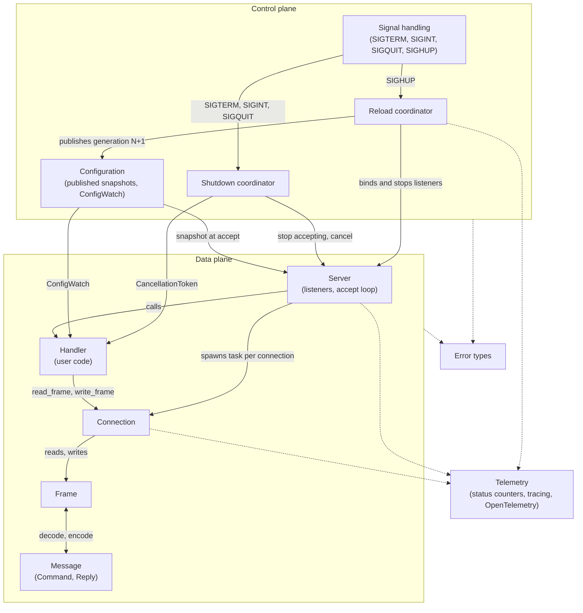
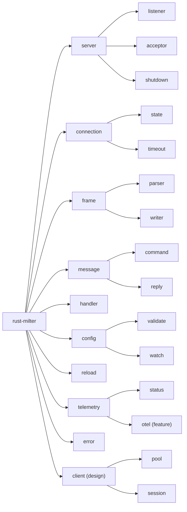
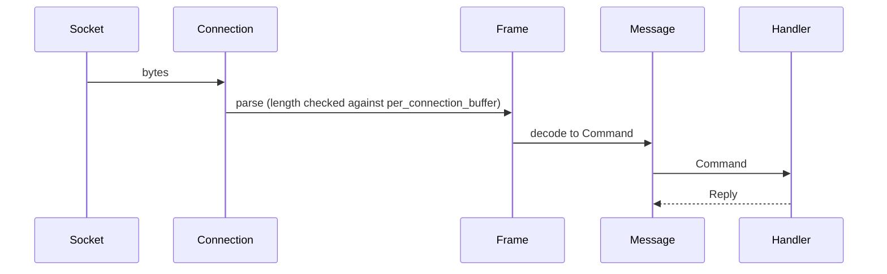
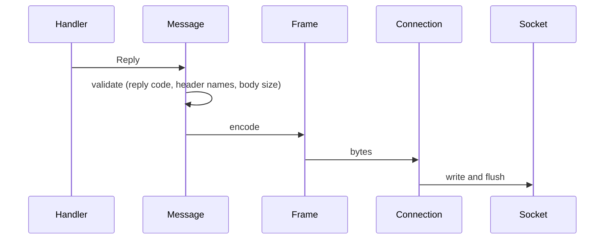
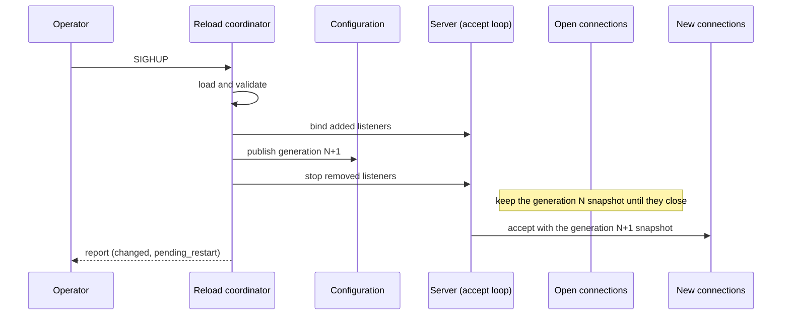
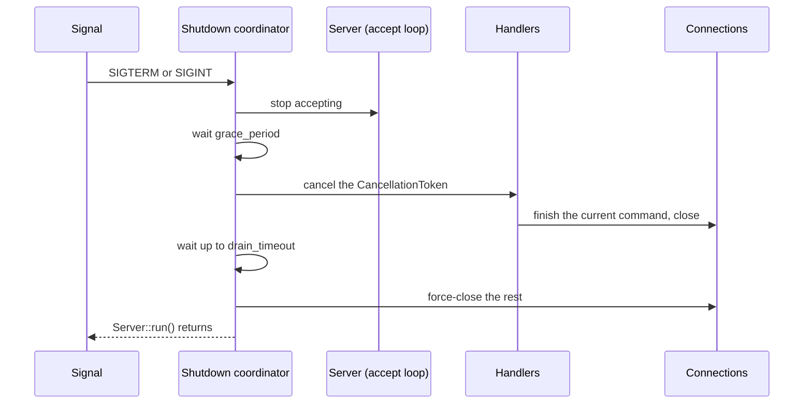
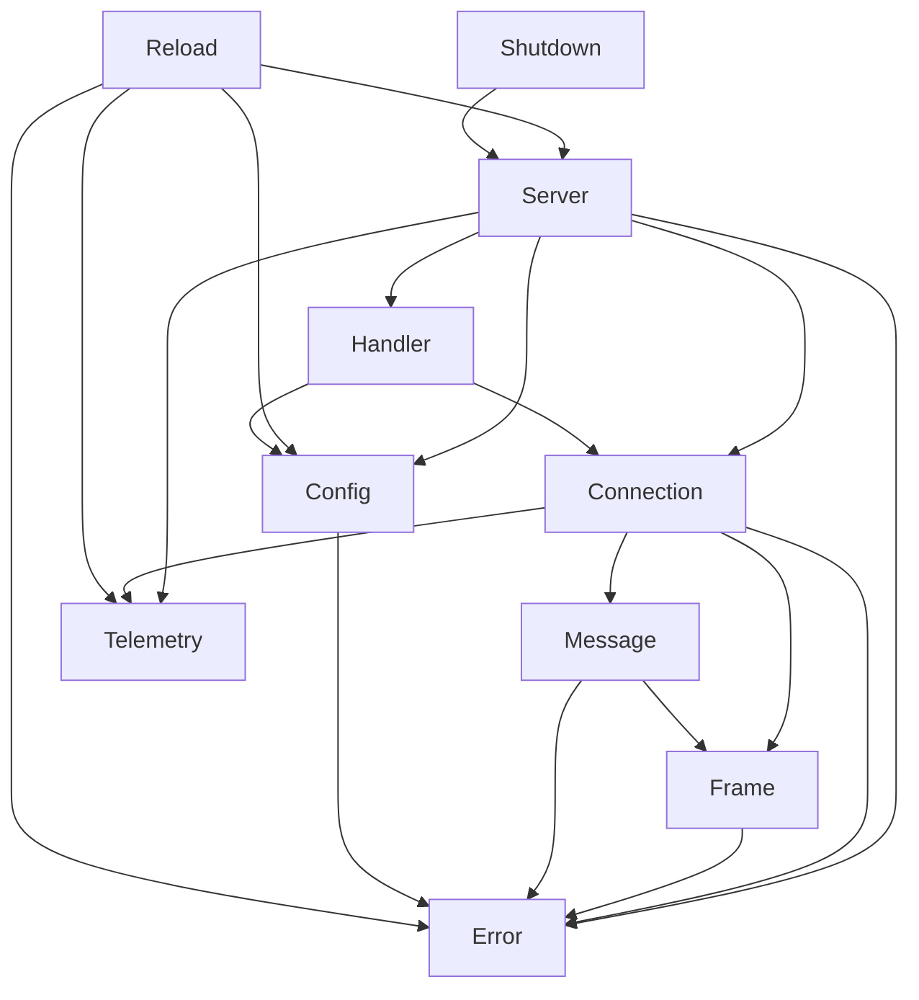

# Library architecture

How the rust-milter library is put together and why: its components, their responsibilities and interactions, and the module boundaries. The public API is in [api-specification.md](../reference/api-specification.md) and every setting is in [configuration.md](../reference/configuration.md).

## Architecture principles

1. Separation of concerns: protocol handling, I/O, configuration, and business logic live in separate components.
2. Async first: all I/O is asynchronous and runs on Tokio.
3. Type safety: protocol messages are strongly typed.
4. Zero copy: `bytes::Bytes` keeps data copying to a minimum.
5. Trait-based extension: users extend the library by implementing the `Handler` trait.
6. Immutable configuration: each configuration is published once as a numbered snapshot; a reload publishes a new snapshot and never edits the old one.
7. Session isolation: no data from one SMTP session reaches the next, in memory, in logs, or in telemetry.
8. Zero-cost abstractions: the type safety and validation add no runtime overhead on the hot path.
9. Ergonomics: the API is easy to use correctly and hard to use incorrectly; for example, the library enforces the `SMFIC_QUIT_NC` rule so that handlers cannot get it wrong.
10. Composability: traits and generics let applications combine the server, their own configuration, and their handlers freely.

## Component architecture

The control plane decides what the server does: which listeners exist, which configuration applies, and when to stop. The data plane moves milter traffic. The two meet in two places only: a connection takes a configuration snapshot when it is accepted, and the handler receives the shutdown token and a `ConfigWatch`.

## Component specifications

### 1. Server

Responsibilities:
- bind and listen on TCP sockets (IPv4, IPv6); Unix domain sockets are not supported
- run the accept loop and spawn one task per accepted connection
- give each new connection the current configuration snapshot
- enforce `max_connections`: past the limit, accept and close at once
- track active connections for the shutdown coordinator and the status counters

Dependencies:
- Tokio `TcpListener`, `socket2` for socket options set before `bind()`
- the Configuration, Connection, and Handler components

Concurrency: one accept task per listener, one task per connection.

The transport-level behavior (address formats, accept errors, backpressure, transport states) is specified in [tcp-server.md](../reference/tcp-server.md).

### 2. Connection

Responsibilities:
- own the socket of one MTA connection
- read and write frames, with buffering
- enforce the `connect`, `read`, `write`, and `idle` timeouts and the `per_connection_buffer` limit from its snapshot
- track the transport state (`CONNECTED`, `IDLE`, `ACTIVE`, `DRAINING`, `ERROR`, `CLOSED`)
- track the protocol state from the commands and replies that pass through it, and close the connection on `SMFIC_QUIT_NC` outside `ST_ENDM` and `ST_UNKN`
- report its close reason to telemetry and to `Handler::on_disconnect`

Dependencies: Tokio `TcpStream`, the Frame component, `bytes::BytesMut`.

Concurrency: one connection per task, with exclusive ownership of the socket.

### 3. Frame

Responsibilities:
- parse Milter protocol frames: a 4-byte length, a 1-byte command, then the data
- reject a packet longer than `per_connection_buffer` before allocating memory for it
- handle incomplete frames by waiting for more data
- serialize frames

Dependencies: `bytes` only. Parsing is synchronous and pure.

### 4. Message

Responsibilities:
- define every protocol command (`SMFIC_*`) and reply (`SMFIR_*`) as Rust types
- convert a `Frame` into a `Command`, and a `Reply` into a `Frame`
- validate replies before encoding: reply code format and `%` escaping, header names, body chunk size

Dependencies: the Frame component and the protocol constants.

### 5. Handler

The `Handler` trait is where user business logic plugs in. The server calls it once per connection, in that connection's task.

The implementation:
- runs the protocol exchange from `SMFIC_OPTNEG` on, following [milter-protocol.md](../reference/milter-protocol.md)
- implements the filtering logic and returns replies
- stops when the shutdown token is cancelled
- drops all per-session state on `SMFIC_QUIT_NC`
- reads its own settings from `ConfigWatch` at session or message boundaries

The trait itself is defined in [api-specification.md](../reference/api-specification.md).

### 6. Configuration

Responsibilities:
- validate a `ServerConfig` and the application configuration, at startup and on reload
- publish each valid configuration as an immutable `Arc` with an increasing generation number, through a `tokio::sync::watch` channel
- give readers the current snapshot without blocking

Who reads what:

| Reader | Reads | When |
|--------|-------|------|
| Accept loop | `ServerConfig` | at every accept; the snapshot goes to the new connection |
| Connection | its own snapshot | for its whole life |
| Reload coordinator | old and new `ServerConfig` | to compute listener changes and the report |
| Shutdown coordinator | `shutdown.*` | when a shutdown starts |
| Handler | application configuration via `ConfigWatch` | once per session or per message |

What a changed setting does on reload, and which settings need a restart, is specified in [configuration.md](../reference/configuration.md#reload-classes). In short: the listener set, `max_connections`, the shutdown timings, and the resource limits apply at once; timeouts, socket options, and buffer size apply to new connections; `worker_threads`, socket options on an address that stays bound, and everything set only on the builder need a restart.

### 7. Reload coordinator

Responsibilities:
- receive reload requests from `SIGHUP` and `ServerHandle::reload()`
- run one reload at a time, and fold requests that arrive meanwhile into one more reload
- call the application's loader, validate, bind added listeners, publish, then stop removed listeners
- roll back added listeners when a bind fails in `FailFast` mode
- report changed settings and settings pending a restart

It is the only component that changes the listener set after startup. The procedure is specified in [hot-reload.md](../reference/hot-reload.md).

### 8. Shutdown coordinator

Responsibilities:
- handle `SIGTERM`, `SIGINT`, and `SIGQUIT`, and a second signal that forces shutdown
- stop the accept loops, wait `grace_period`, cancel the shared `CancellationToken`, and wait up to `drain_timeout`
- force-close remaining connections and end `Server::run()`
- stop the reload coordinator, so no reload starts during shutdown

### 9. Telemetry

Responsibilities:
- keep the status counters (atomics) behind `ServerHandle::status()` and the health check
- emit `tracing` spans for connections, sessions, and messages
- with the `otel` feature, expose the counters and record histograms through OpenTelemetry instruments

Telemetry never records SMTP session data. The metric names, span structure, and forbidden data are in [telemetry.md](../reference/telemetry.md).

### 10. Error types

Responsibilities:
- define typed error enums: `Error`, `ConfigError`, `ReloadError`, `ProtocolError`, `AddressError`
- keep the cause of each error in `source()`

The variants are listed in [api-specification.md](../reference/api-specification.md#errors).

### Milter client (design)

The MTA-side client and its connection pool are a separate component group that shares Frame, Message, and the error types with the server. They are specified in [milter-client.md](../reference/milter-client.md) and are not implemented yet.

## Module structure

Module boundaries follow the components. `config` knows nothing about sockets; `frame` and `message` know nothing about Tokio; `telemetry::otel` compiles only with the `otel` feature.

## Data flow

### Inbound: MTA to milter

1. Connection reads bytes from the socket.
2. The frame parser checks the length against `per_connection_buffer` and extracts a frame.
3. The message decoder converts it into a `Command`.
4. The handler processes the command.
5. The handler returns a `Reply`, or none for commands that get no reply.

### Outbound: milter to MTA

### Configuration reload

A failed load, validation, or bind leaves generation N in place; see [hot-reload.md](../reference/hot-reload.md).

### Shutdown

## Concurrency model

### Tasks

The library runs on the Tokio multi-threaded runtime:
- one worker thread per CPU core by default (`worker_threads`, fixed at startup)
- one accept task per listener
- one task per connection
- one reload coordinator task and one shutdown coordinator task

### Shared state

Shared between tasks:
- the configuration channel (`tokio::sync::watch`), written only by the reload coordinator
- the status counters (atomics)
- the shutdown `CancellationToken`

Isolated per connection:
- the socket, the buffers, and the configuration snapshot
- all protocol and SMTP session state, held by the handler for that connection

### Async and sync operations

Async: socket I/O, handler execution, timeouts, reload, and shutdown coordination.

Sync: frame parsing, message encoding and decoding, configuration validation.

## State management

Two separate state machines track each connection:

| State machine | Tracks | Specified in |
|---------------|--------|--------------|
| Transport | `CONNECTED`, `IDLE`, `ACTIVE`, `DRAINING`, `ERROR`, `CLOSED`, driven by socket events, timeouts, and shutdown | [tcp-server.md](../reference/tcp-server.md#connection-lifecycle) |
| Protocol | `ST_INIT` to `ST_QUIT`, driven by Milter commands, as libmilter defines them | [milter-protocol.md](../reference/milter-protocol.md#protocol-states) |

The Connection component owns the transport state. It also tracks the protocol state from the frames it reads and writes, and enforces one rule itself: `SMFIC_QUIT_NC` outside `ST_ENDM` and `ST_UNKN` closes the connection. The handler validates the other commands against the protocol state; an invalid transition is a protocol error.

## Resource management

### Memory

- each connection has one read buffer and one write buffer that grow up to `per_connection_buffer` (default 128 KB, minimum 65,540 bytes, the largest default-size milter packet)
- frame data is shared without copying through `bytes::Bytes`
- `max_memory` caps the total of all connection buffers

### File descriptors

- one FD per open connection and one per listener
- `max_fds` must leave room for `max_connections` plus the listeners plus 10
- on `EMFILE` or `ENFILE` the accept loop backs off and retries

All limits and defaults are in [configuration.md](../reference/configuration.md).

## Implementation approach

Practices the implementation follows inside the data plane:
- `tokio::select!` with the shutdown token wherever a task waits, so cancellation is prompt and safe.
- Buffered I/O on each connection, with buffers reused for the life of the connection and bounded by `per_connection_buffer`.
- `bytes::Bytes` for frame data, so body chunks and header values are shared rather than copied.
- No blocking calls on runtime threads; CPU-heavy work, if a handler needs it, goes to `tokio::task::spawn_blocking`.
- File descriptors released as soon as a connection closes; on exhaustion the accept loop backs off instead of failing.

## Error handling strategy

### Error classes

Fatal for the connection, which is closed:
- protocol violations and malformed frames
- frames longer than `per_connection_buffer`
- expired timeouts
- I/O errors

Recoverable within the connection:
- incomplete frames, which need more data
- transient I/O errors, which are retried

Fatal for startup (exit code 2):
- invalid configuration
- a bind failure in `FailFast` mode

Not fatal on reload:
- a failed load, invalid configuration, or bind failure leaves the running configuration in place and is reported as a `ReloadError`

### Propagation

- Use `Result<T, Error>` throughout, with typed error enums.
- Convert errors at component boundaries and keep the cause in `source()`.
- Record errors in `tracing` with the masking rules from `logging-principles`.

## Security architecture

### Trust boundaries

- network input from the MTA: untrusted
- handler implementation: trusted
- configuration: trusted, but validated before use

Input validation:
- frame length, before any allocation
- command code and data format
- reply contents before encoding
- resource limits

### Attack mitigation

Denial of service: connection limits, timeouts from accept on, buffer limits, and optional rate limiting.

Network exposure: the milter protocol has no authentication or encryption. Bind to loopback unless the MTA is on another host, and restrict access with firewall rules when it is.

Data exposure:
- session isolation: per-session state is dropped at the end of each SMTP session, including on `SMFIC_QUIT_NC`
- telemetry and logs carry no envelope, header, body, or macro data (see [telemetry.md](../reference/telemetry.md))
- configuration values are never logged; reloads log the names of changed settings only

## Component dependencies

Rules:
- no circular dependencies
- lower layers (Frame, Message, Config, Error) do not depend on higher layers
- traits define the boundaries
- the error types are shared

## Extension points

The `Handler` trait is the main extension point. The user implements the filtering logic in it, and an application can have several implementations.

The reload loader is the second one: the application decides where configuration comes from.

Possible future extension traits:
- health check provider
- authentication provider
- a metrics collector trait; this may be dropped in favor of OpenTelemetry (see the open questions in [telemetry.md](../reference/telemetry.md))

## Testing architecture

### Unit tests

All synchronous:
- frame parsing, including the length limit
- message encoding and decoding, including reply validation
- configuration validation and the reload class of every setting
- error type conversions

### Integration tests

Connection:
- socket communication and frame I/O
- protocol flows, including `SMFIC_QUIT_NC` with session isolation
- timeout behavior, from accept on

Server:
- many concurrent connections
- graceful shutdown
- resource limits
- reload during traffic: open connections keep their snapshot, new connections get the new one
- error recovery

### Load tests

Performance targets:
- 10,000 concurrent connections
- p99 latency per frame under 1 millisecond
- no memory leaks under load
- graceful degradation

## References

- [API specification](../reference/api-specification.md)
- [Configuration specification](../reference/configuration.md)
- [TCP server specification](../reference/tcp-server.md)
- [Milter protocol specification](../reference/milter-protocol.md)
- [Configuration hot reload](../reference/hot-reload.md)
- [Telemetry](../reference/telemetry.md)
- [Milter client and connection pool](../reference/milter-client.md)
