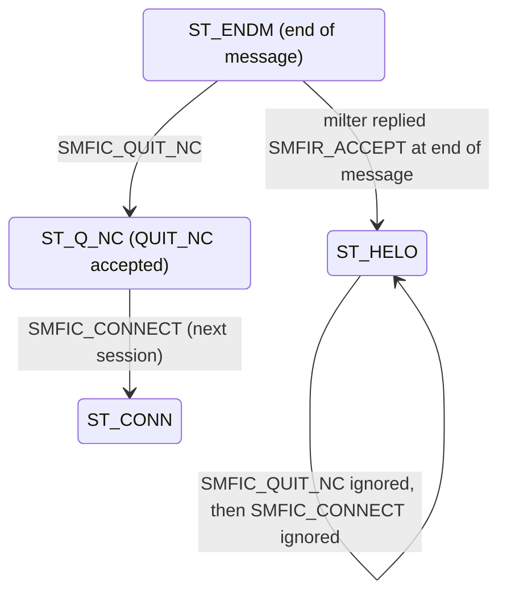

# Connection reuse and session isolation

Why rust-milter reuses milter connections only in narrow cases, why its server closes a connection where libmilter would ignore a command, and why a reused connection forgets everything about the previous SMTP session. The rules themselves are in [milter-client.md](../reference/milter-client.md) and [milter-protocol.md](../reference/milter-protocol.md).

## What reuse would save

Sendmail and Postfix open one milter connection per SMTP session and close it when the session ends. Every new SMTP client costs a TCP handshake to the milter and one `SMFIC_OPTNEG` round trip before the first real command. For a busy MTA on the same host this is cheap, but it adds latency to every session, and across a network it adds more.

The protocol has a way around it. `SMFIC_QUIT_NC`, "quit, new connection follows", ends one SMTP session but keeps the milter connection open. The next session starts with `SMFIC_CONNECT` on the same socket and skips the negotiation. libmilter has supported it since protocol version 6, yet neither Sendmail nor Postfix sends it. The milter client sample in this repository, a reference implementation of the MTA side, would.

## Why libmilter makes reuse fragile

libmilter accepts `SMFIC_QUIT_NC` only in two of its internal states: `ST_ENDM`, right after a message ends, and `ST_UNKN`, right after an unknown SMTP command. Several ordinary replies move libmilter out of those states. When a milter answers `SMFIS_ACCEPT` to any command, libmilter jumps back to `ST_HELO`; a reject, discard, or tempfail does the same, except for a single recipient or an unknown command.

From `ST_HELO`, libmilter treats `SMFIC_QUIT_NC` as an invalid transition and drops it without a reply. The `SMFIC_CONNECT` that follows is invalid from there too, and is dropped the same way. An MTA that sent them would wait for a reply until its timeout expired. Neither Sendmail nor Postfix sends `SMFIC_QUIT_NC`, so no widely used MTA runs into this.

`SMFIR_ACCEPT` is a common way to end a message, so with many milters a connection would almost never be in a reusable state.

## Why the client copies libmilter's rules

The client cannot ask a milter which implementation it runs, and a wrong guess costs a hung session. So the client tracks the milter's protocol state with libmilter's own rules and sends `SMFIC_QUIT_NC` only where libmilter would accept it. Anywhere else it closes the connection with `SMFIC_QUIT` and opens a new one for the next session.

The result is modest. A connection is reused when the milter ended the last message with `SMFIR_CONTINUE`. A milter that ends with `SMFIR_ACCEPT` gets a new connection per session, which is what Sendmail and Postfix give it today.

The client never sends an extra command to reach a reusable state. An extra `SMFIC_UNKNOWN`, for example, would make the milter run its callback for an SMTP command no client ever sent.

## Why the server closes instead of accepting everywhere

For rust-milter's own server there were three choices for `SMFIC_QUIT_NC` in a state where libmilter ignores it: copy libmilter and hang, accept it in any state, or close the connection.

Accepting it everywhere sounds friendlier, but it pushes the hard part onto every handler author: each handler would have to drop its per-session state correctly from any point in the conversation, including halfway through a message. State handling of that kind is where application bugs hide, and a bug here leaks one SMTP session's data into the next.

Closing the connection keeps the rule small. `SMFIC_QUIT_NC` is valid exactly where libmilter says it is, and anywhere else the connection closes at once, so the MTA reconnects instead of waiting for a timeout. The client's rules then work the same against libmilter and rust-milter servers.

The same reasoning covers every other command that libmilter would drop while the MTA waits for a reply, such as `SMFIC_RCPT` before any `SMFIC_MAIL`: the server closes the connection. Commands that libmilter recovers from, such as `SMFIC_MAIL` in the middle of a message, recover the same way in rust-milter.

The decision is recorded in [ADR 0001](../adr/0001-commands-in-wrong-state-recover-like-libmilter-or-close.md).

The library enforces this rule itself. Its protocol engine runs the whole conversation, as libmilter's does, so it knows the protocol state without help from the handler ([ADR 0002](../adr/0002-library-runs-the-protocol-handlers-decide.md)). Handler authors never deal with `SMFIC_QUIT_NC` at all: when a session ends this way, the engine calls `session_end` and drops the session's state.

## Why a reused connection forgets everything

A milter connection that serves one SMTP session after another carries traffic from different SMTP clients, who may be different people and organizations. The previous session's sender, recipients, authenticated user name (the `{auth_authen}` macro), headers, and replies are personal data that must not reach the next session.

When a session ends, the client and the server discard everything learned during it, whether the connection is reused or not. Only what belongs to the connection itself survives: the socket and the options negotiated once per connection. Even the SMTP client's address from `SMFIC_CONNECT` is session data, because the next session comes from a different client.

A rule that depends on remembering to clear each field fails the first time someone adds a field. The design makes the type system carry the rule instead: the pooled connection has no field that could hold SMTP data, and everything a session learns lives in a session object that is dropped when the session ends.

The other safeguards follow the same idea of failing closed:
- A connection with unread bytes is closed, so a late reply from one session cannot be read as a reply in the next.
- Any error, timeout, or cancelled command closes the connection instead of returning it to the pool.
- One pool serves one trust domain. An application that serves several tenants creates a client per tenant, so a connection never passes between them.

None of this protects against a milter that keeps session data in its own global state. The client cannot see inside the milter, which is why reuse can be turned off for milters nobody has reviewed for it.
