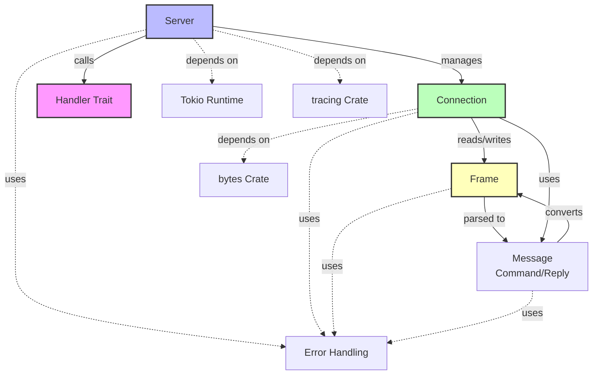
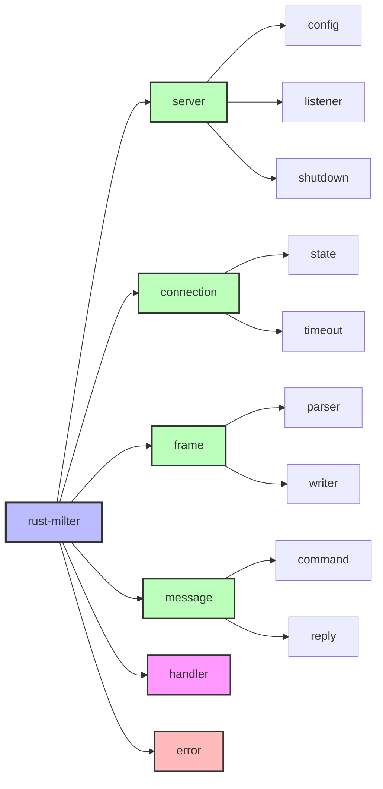
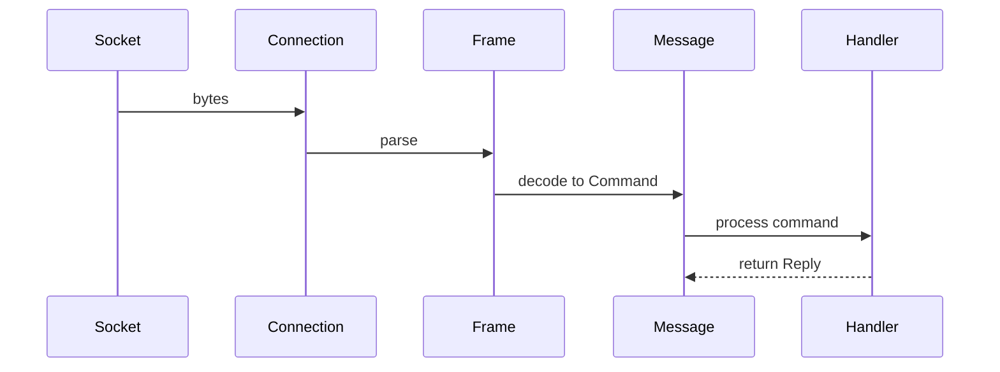
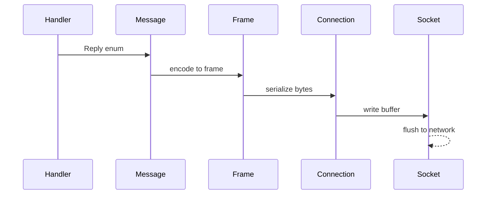
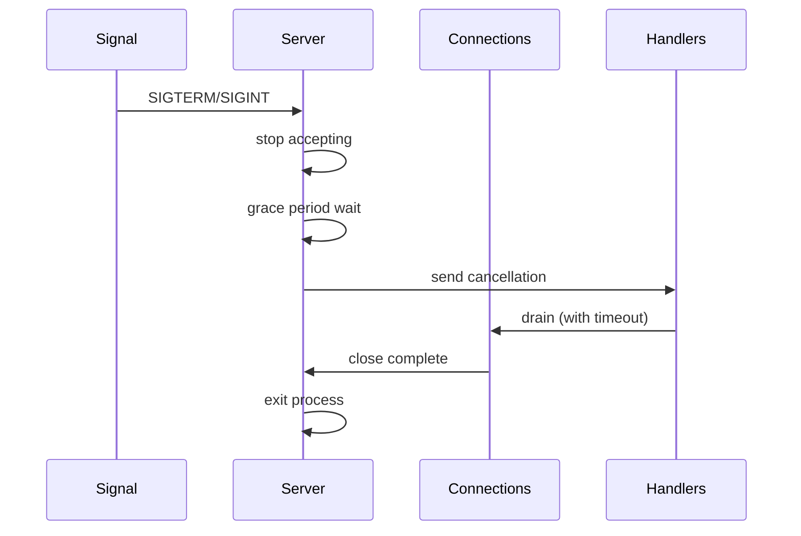
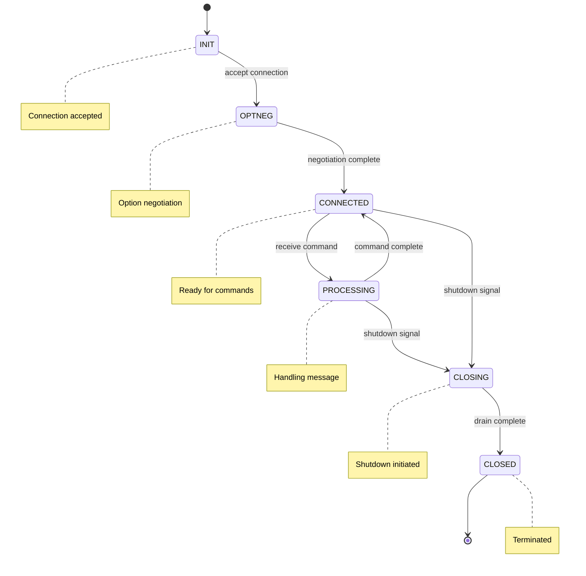
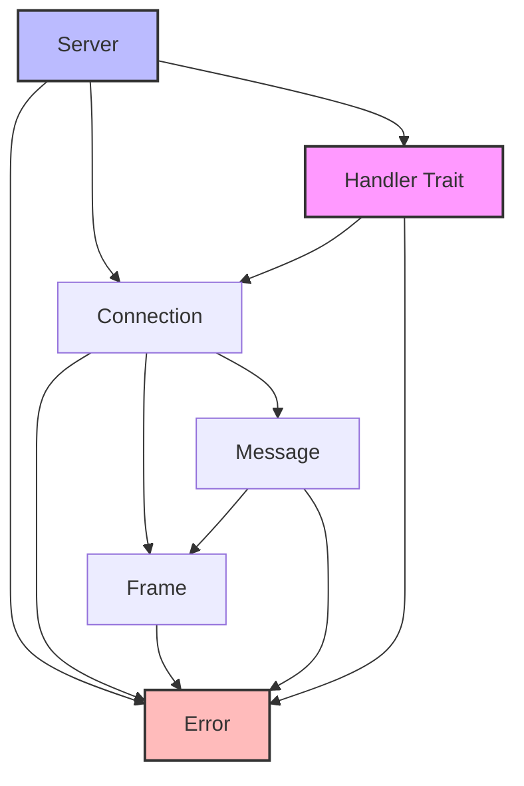

# Library architecture specification

The high-level architecture of the rust-milter library: its components, their responsibilities and interactions, and the module boundaries.

## Architecture principles

1. Separation of concerns: protocol handling, I/O, and business logic live in separate components.
2. Async first: all I/O is asynchronous and runs on Tokio.
3. Type safety: protocol messages are strongly typed.
4. Zero copy: `bytes::Bytes` keeps data copying to a minimum.
5. Trait-based extension: users extend the library by implementing the `Handler` trait.

## Component architecture

## Component specifications

### 1. Server

Responsibilities:
- bind and listen on sockets (Unix, IPv4, IPv6)
- accept incoming connections and spawn a handler task for each
- track active connections and manage their lifecycle
- coordinate the graceful shutdown sequence
- enforce resource limits, including the maximum connection count
- handle signals (SIGTERM, SIGINT, SIGQUIT)
- provide metrics and a health check

Dependencies:
- Tokio `TcpListener` and `UnixListener`
- the `Handler` trait, implemented by the user
- the Connection component

Concurrency:
- one task per listening socket
- one task per connection
- shutdown coordination shared through `CancellationToken`

### 2. Connection

Responsibilities:
- manage I/O for one connection
- read frames from and write frames to the socket
- manage the read and write buffers
- track the connection state
- handle connection errors
- enforce the read, write, and idle timeouts

Dependencies:
- Tokio `TcpStream` or `UnixStream`
- the Frame component
- `bytes::BytesMut` for buffering

Concurrency:
- one connection per task
- exclusive ownership of the socket
- `BufWriter` for write buffering

### 3. Frame

Responsibilities:
- parse Milter protocol frames: a 4-byte length, a 1-byte command, then the data
- validate the frame structure
- convert bytes to structured data and structured data back to bytes
- handle incomplete frames

Dependencies:
- `bytes::Bytes` and `bytes::BytesMut`
- no async operations; parsing is pure

Data format:
- length: 4 bytes, network byte order
- command: 1 byte, ASCII
- data: variable length

### 4. Message

Responsibilities:
- define every protocol command type (`SMFIC_*`) and reply type (`SMFIR_*`) as Rust types
- convert a `Frame` into a `Command`, and a `Reply` into a `Frame`
- validate protocol state transitions

Dependencies:
- the Frame component
- the protocol constants

Types:
- `Command` enum, with every `SMFIC_*` variant
- `Reply` enum, with every `SMFIR_*` variant
- data structures for the complex messages

### 5. Handler trait

The `Handler` trait is where user business logic plugs in. The library calls it once per connection.

The implementation:
- processes the incoming connection
- implements the milter filtering logic and the protocol exchange
- returns the right replies
- handles errors cleanly
- respects shutdown signals

Interface contract:
- receives a `Connection` and a `CancellationToken`
- runs as an async method
- must be `Send + Sync + Clone`
- returns a `Result`

### 6. Error handling

Responsibilities:
- define the error types and their hierarchy
- define how errors propagate and how the library recovers from them
- separate protocol errors from I/O errors, and recoverable errors from fatal ones
- attach context and integrate with `tracing`

Error categories:
- protocol errors: malformed frames, invalid state
- I/O errors: connection failures, timeouts
- configuration errors: invalid parameters
- resource errors: limits exceeded

## Module structure

## Data flow

### Inbound: MTA to milter

1. Connection reads bytes from the socket.
2. The frame parser validates and extracts a frame.
3. The message decoder converts it into a `Command`.
4. The handler processes the command.
5. The handler returns a `Reply`.

### Outbound: milter to MTA

1. The handler returns a `Reply`.
2. The message encoder converts it into a frame.
3. The frame serializer writes the bytes.
4. Connection writes them to the socket buffer.
5. Tokio flushes the buffer to the network.

### Shutdown

1. The server receives SIGTERM or SIGINT.
2. The server stops accepting new connections.
3. The server waits for the grace period so in-flight requests can finish.
4. The server sends cancellation to every handler.
5. The server waits, up to a timeout, for the connections to drain.
6. The server force-closes any remaining connections.
7. The process exits.

## Concurrency model

### Threads

The library runs on the Tokio multi-threaded runtime:
- one worker thread per CPU core by default
- work-stealing scheduler
- one task per connection
- one shared shutdown coordinator

### Shared state

Shared between tasks:
- the active connection counter (atomic)
- shutdown coordination (`CancellationToken`)
- metrics aggregation (atomics or channels)

Isolated per connection:
- Each connection owns its socket exclusively.
- Connections share no mutable state.
- Coordination uses message passing over channels.

### Async and sync operations

Async:
- socket I/O (read, write)
- handler execution
- timeout enforcement
- shutdown coordination

Sync:
- frame parsing
- message encoding and decoding
- configuration validation

## Protocol state management

### Connection states

The connection tracks its current state and validates each command against it. An invalid transition produces a protocol error.

## Resource management

### Memory

Buffers:
- per-connection read buffer: 4KB default
- per-connection write buffer: 4KB default
- frame data: zero copy with `bytes::Bytes`
- buffer sizes are configurable

Limits:
- max connections: 10,000 default
- max frame size: 65,535 bytes (protocol limit)
- per-connection buffer limit: 64KB default
- total memory limit: configurable

### File descriptors

- one FD per active connection
- one FD per listening socket
- the OS limit is enforced
- the server handles FD exhaustion gracefully

## Error handling strategy

### Error classes

Fatal errors close the connection:
- protocol violations
- malformed frames
- expired timeouts
- I/O errors

Recoverable errors let the connection continue:
- incomplete frames, which need more data
- transient I/O errors, which are retried

Configuration errors stop startup:
- invalid bind addresses
- port already in use
- invalid configuration parameters

### Propagation

- Use `Result<T, Error>` throughout.
- Convert errors at component boundaries.
- Add context with `tracing`.
- Preserve the error chain.

## Security architecture

### Trust boundaries

- network I/O: untrusted
- handler implementation: trusted
- configuration: trusted

Input validation:
- frame length
- command code
- data format
- resource limits

### Attack mitigation

Denial of service:
- connection limits
- timeouts
- buffer size limits
- optional rate limiting

Resource exhaustion:
- maximum connection count
- memory limits
- FD limits
- graceful degradation

## Component dependencies

Rules:
- no circular dependencies
- lower layers do not depend on higher layers
- traits define the boundaries
- the error types are shared

## Extension points

The `Handler` trait is the main extension point. The user implements the filtering logic in it, and an application can have several implementations.

Possible future extension traits:
- metrics collector
- health check provider
- authentication provider

## Testing architecture

### Unit tests

All synchronous:
- frame parsing
- message encoding and decoding
- configuration validation
- error type conversions

### Integration tests

Connection:
- socket communication
- frame I/O
- protocol flows
- timeout behavior

Server:
- handling many connections
- graceful shutdown
- resource limits
- error recovery

### Load tests

Performance targets:
- 10,000 concurrent connections
- p99 latency under 1 millisecond
- no memory leaks under load
- graceful degradation

## References

- [TCP server specification](tcp-server.md)
- [Milter protocol specification](milter-protocol.md)
- [API specification](api-specification.md)
