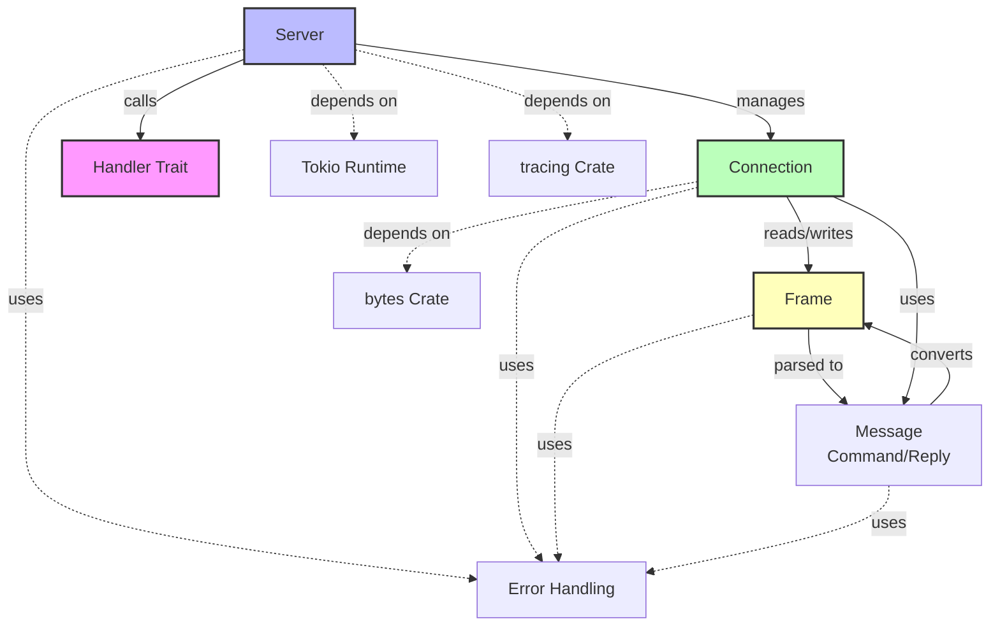
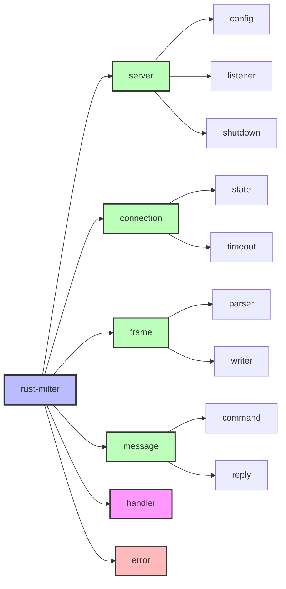
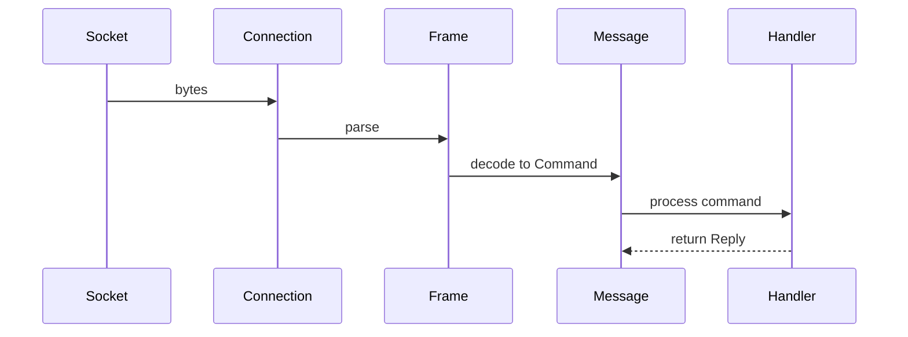
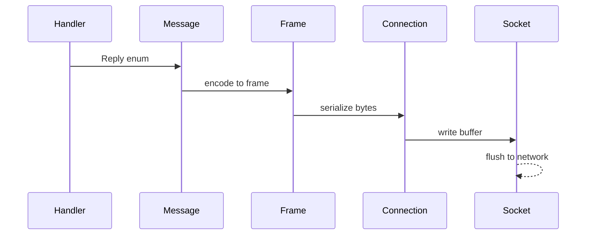
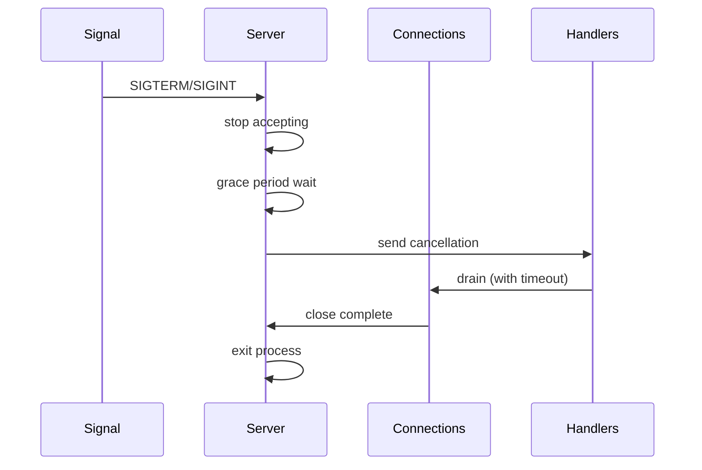
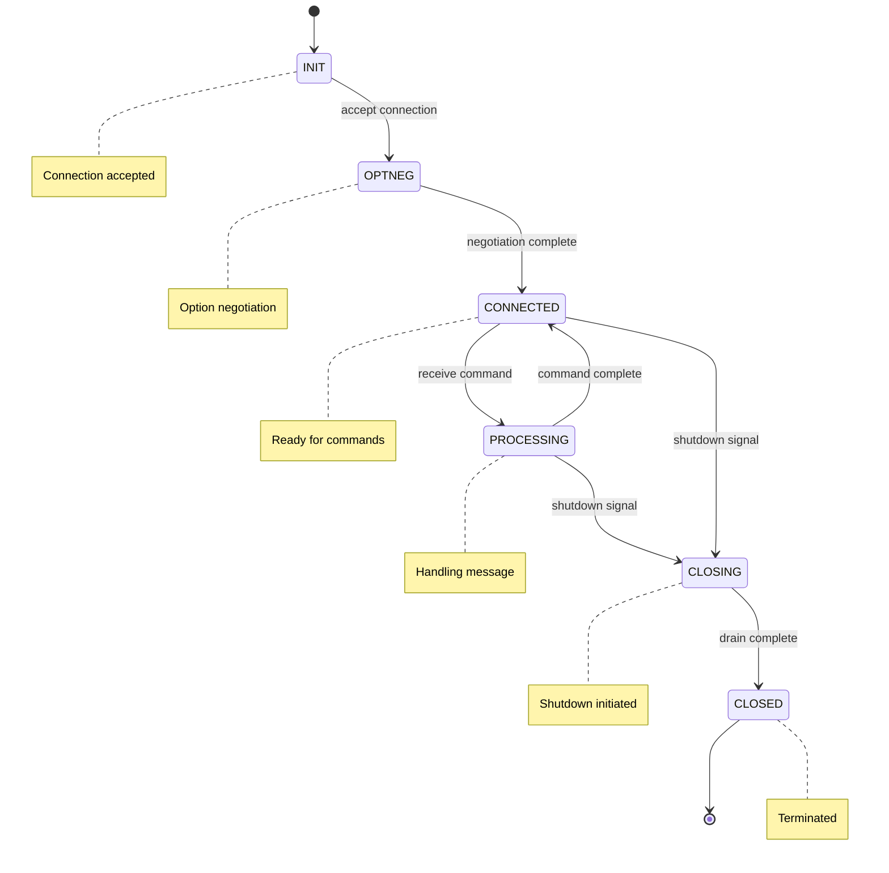
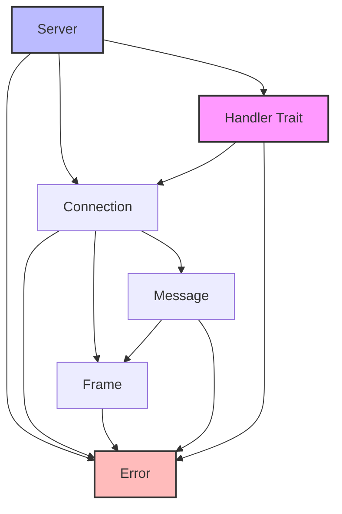

# Library Architecture Specification

## Overview

This document specifies the high-level architecture of the rust-milter library, including component breakdown, responsibilities, interactions, and module boundaries.

## Architecture Principles

1. **Separation of Concerns**: Protocol handling, I/O, and business logic are separated
2. **Async-First**: All I/O operations are asynchronous using Tokio
3. **Type Safety**: Protocol messages are strongly typed
4. **Zero-Copy**: Minimize data copying using `bytes::Bytes`
5. **Trait-Based Extension**: Users extend via Handler trait implementation

## Component Architecture

## Component Specifications

### 1. Server Component

**Responsibility:**
- Socket binding and listening (Unix, IPv4, IPv6)
- Connection acceptance
- Connection lifecycle management
- Graceful shutdown coordination
- Resource limit enforcement
- Signal handling (SIGTERM, SIGINT, SIGQUIT)

**Key Responsibilities:**
- Accept incoming connections
- Spawn connection handlers
- Track active connections
- Coordinate shutdown sequence
- Enforce max connection limits
- Provide metrics and health check

**Dependencies:**
- Tokio TcpListener, UnixListener
- Handler trait (user-provided)
- Connection component

**Concurrency:**
- One task per socket listener
- One task per connection
- Shared shutdown coordination via CancellationToken

### 2. Connection Component

**Responsibility:**
- Per-connection I/O management
- Frame reading and writing
- Buffered I/O operations
- Connection state tracking
- Timeout enforcement

**Key Responsibilities:**
- Read frames from socket
- Write frames to socket
- Manage read/write buffers
- Handle connection errors
- Enforce timeouts (read, write, idle)

**Dependencies:**
- Tokio TcpStream or UnixStream
- Frame component
- bytes::BytesMut for buffering

**Concurrency:**
- One connection per task
- Exclusive ownership of socket
- BufWriter for write buffering

### 3. Frame Component

**Responsibility:**
- Milter protocol frame parsing
- Frame serialization
- Protocol validation
- Length-prefixed message handling

**Key Responsibilities:**
- Parse 4-byte length + 1-byte command + data
- Validate frame structure
- Convert bytes to structured data
- Serialize structured data to bytes
- Handle incomplete frames

**Dependencies:**
- bytes::Bytes and bytes::BytesMut
- No async operations (pure parsing)

**Data Format:**
- Length: 4 bytes (network byte order)
- Command: 1 byte (ASCII)
- Data: variable length

### 4. Message Component

**Responsibility:**
- Milter protocol message types
- Command parsing (SMFIC_*)
- Reply generation (SMFIR_*)
- Type-safe protocol representation

**Key Responsibilities:**
- Define all protocol command types
- Define all protocol reply types
- Convert Frame to Command
- Convert Reply to Frame
- Validate protocol state transitions

**Dependencies:**
- Frame component
- Protocol constants

**Types:**
- Command enum (all SMFIC_* variants)
- Reply enum (all SMFIR_* variants)
- Data structures for complex messages

### 5. Handler Trait

**Responsibility:**
- User-implementable trait
- Connection processing callback
- Business logic integration point

**Key Responsibilities:**
- Process incoming connections
- Implement milter filtering logic
- Handle shutdown signals
- Return appropriate replies

**Interface Contract:**
- Receives Connection and CancellationToken
- Async method execution
- Must be Send + Sync + Clone
- Returns Result type

**User Responsibility:**
- Implement protocol logic
- Generate appropriate replies
- Handle errors gracefully
- Respect shutdown signals

### 6. Error Handling Component

**Responsibility:**
- Error type definitions
- Error propagation patterns
- Error recovery strategies

**Key Responsibilities:**
- Define error hierarchy
- Protocol errors vs I/O errors
- Recoverable vs fatal errors
- Error context and tracing

**Error Categories:**
- Protocol errors (malformed frames, invalid state)
- I/O errors (connection failures, timeouts)
- Configuration errors (invalid parameters)
- Resource errors (limits exceeded)

## Module Structure

## Data Flow

### Inbound Flow (MTA → Milter)

**Steps:**
1. Connection reads bytes from socket
2. Frame parser validates and extracts frame
3. Message decoder converts to Command enum
4. Handler processes command
5. Handler returns Reply

### Outbound Flow (Milter → MTA)

**Steps:**
1. Handler returns Reply enum
2. Message encoder converts to frame structure
3. Frame serializer writes bytes
4. Connection writes to socket buffer
5. Tokio flushes to network

### Shutdown Flow

**Steps:**
1. Signal received (SIGTERM/SIGINT)
2. Server stops accepting new connections
3. Grace period wait (allow in-flight requests)
4. Send cancellation to all handlers
5. Wait for connections to drain (with timeout)
6. Force close remaining connections
7. Exit process

## Concurrency Model

### Threading Model

**Tokio Multi-threaded Runtime:**
- Worker threads = CPU cores (default)
- Work-stealing scheduler
- One task per connection
- Shared shutdown coordinator

### Synchronization Points

**Shared State:**
- Active connection counter (atomic)
- Shutdown coordination (CancellationToken)
- Metrics aggregation (atomic or channels)

**Isolation:**
- Each connection has exclusive socket ownership
- No shared mutable state between connections
- Message passing via channels for coordination

### Async Boundaries

**Async Operations:**
- Socket I/O (read, write)
- Handler execution
- Timeout enforcement
- Shutdown coordination

**Sync Operations:**
- Frame parsing
- Message encoding/decoding
- Configuration validation

## Protocol State Management

### Connection States

**State Enforcement:**
- Connection tracks current state
- Commands validated against current state
- Invalid transitions generate protocol errors

## Resource Management

### Memory Management

**Buffer Allocation:**
- Per-connection read buffer: 4KB default
- Per-connection write buffer: 4KB default
- Frame data: Zero-copy using bytes::Bytes
- Configurable buffer sizes

**Limits:**
- Max connections: 10,000 default
- Max frame size: 65,535 bytes (protocol limit)
- Per-connection buffer limit: 64KB default
- Total memory limit: Configurable

### File Descriptor Management

**FD Usage:**
- One FD per active connection
- One FD per listener socket
- OS limit enforcement
- Graceful handling of FD exhaustion

## Error Handling Strategy

### Error Classification

**Fatal Errors (Connection Close):**
- Protocol violations
- Malformed frames
- Timeout expiration
- I/O errors

**Recoverable Errors (Continue):**
- Incomplete frames (need more data)
- Transient I/O errors (retry)

**Configuration Errors (Startup Failure):**
- Invalid bind addresses
- Port already in use
- Invalid configuration parameters

### Error Propagation

**Pattern:**
- Use Result<T, Error> throughout
- Convert errors at boundaries
- Add context with tracing
- Preserve error chain

## Security Architecture

### Security Boundaries

**Trust Boundaries:**
- Network I/O (untrusted)
- Handler implementation (trusted)
- Configuration (trusted)

**Input Validation:**
- Frame length validation
- Command code validation
- Data format validation
- Resource limit checks

### Attack Mitigation

**DoS Protection:**
- Connection limits
- Timeout enforcement
- Buffer size limits
- Rate limiting (optional)

**Resource Exhaustion:**
- Max connection enforcement
- Memory limits
- FD limits
- Graceful degradation

## Dependencies Between Components

**Dependency Rules:**
- No circular dependencies
- Lower layers don't depend on higher layers
- Traits define boundaries
- Error types are shared

## Extension Points

### Trait-Based Extension

**Handler Trait:**
- Primary extension point
- User implements filtering logic
- Multiple implementations supported

**Future Extension Traits:**
- Metrics collector trait
- Health check provider trait
- Authentication provider trait

## Testing Architecture

### Unit Testing Strategy

**Component Testing:**
- Frame parsing (sync)
- Message encoding/decoding (sync)
- Configuration validation (sync)
- Error type conversions (sync)

### Integration Testing Strategy

**Connection Testing:**
- Socket communication
- Frame I/O
- Protocol flows
- Timeout behavior

**Server Testing:**
- Multi-connection handling
- Graceful shutdown
- Resource limits
- Error recovery

### Load Testing Strategy

**Performance Targets:**
- 10,000 concurrent connections
- Sub-millisecond latency (p99)
- No memory leaks under load
- Graceful degradation

## References

- [TCP Server Specification](tcp-server.md)
- [Milter Protocol Specification](milter-protocol.md)
- [API Specification](api-specification.md)
