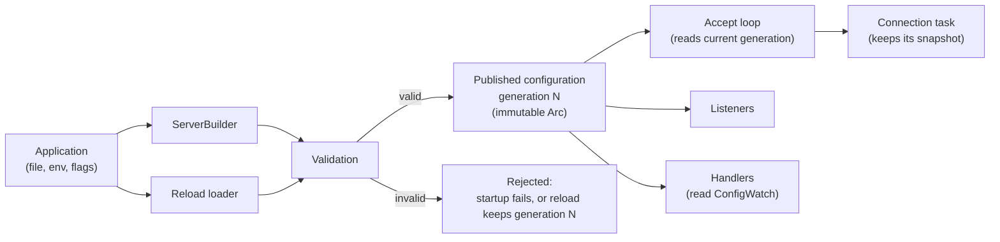

# Configuration specification

Every setting of the rust-milter server: its type, default, valid range, and what happens to it on a configuration reload. Other specifications refer to this document and do not repeat these values.

## Contents

- [How configuration reaches the server](#how-configuration-reaches-the-server)
- [Reload classes](#reload-classes)
- [Settings that need a restart](#settings-that-need-a-restart)
- [Settings that do not need a restart](#settings-that-do-not-need-a-restart)
- [ServerConfig reference](#serverconfig-reference)
- [Builder-only settings](#builder-only-settings)
- [Application configuration](#application-configuration)
- [Validation rules](#validation-rules)
- [File format (serde feature)](#file-format-serde-feature)
- [Environment variables](#environment-variables)
- [Example](#example)
- [Milter client sample](#milter-client-sample)

## How configuration reaches the server

rust-milter is a library and reads no configuration file itself. It reads environment variables only when the application calls one of the helpers in [Environment variables](#environment-variables). The application builds the configuration and hands it over in two places:

- `ServerBuilder` takes the initial `ServerConfig`, the initial application configuration, and the builder-only settings.
- The reload loader, registered with `ServerBuilder::reload_with`, returns a new `ServerConfig` and application configuration on `SIGHUP` or `ServerHandle::reload()`.

Each valid configuration is published once as an immutable value with a generation number, starting at 1. A reload never changes a published value in place; it publishes generation N+1. The reload procedure itself is specified in [hot-reload.md](hot-reload.md).

## Reload classes

Every setting belongs to one of three classes.

| Class | When a changed value takes effect |
|-------|-----------------------------------|
| `immediate` | As soon as the new generation is published, for every decision the server makes from then on |
| `new_connections` | For connections accepted after the reload. Open connections keep the snapshot they were accepted with until they close |
| `restart` | Only after the process restarts. A reload that changes it fails with `RestartRequired` and applies nothing |

With Sendmail and Postfix one milter connection lasts one SMTP session, so a `new_connections` change reaches all traffic within one SMTP session of the reload.

The four `ServerConfig` settings of class `restart` are read only when a listener is created, and a running listener cannot take a new value. A reload that changes one of them fails even if it also adds or removes addresses, and `RestartRequired` names every such setting that changed ([ADR 0007](../adr/0007-a-reload-that-changes-a-restart-setting-fails.md)). To apply the file, restart the process, or revert those settings and reload.

## Settings that need a restart

| Setting | Fixed when |
|---------|------------|
| `backlog` | the listener starts listening |
| `socket_options.reuse_addr`, `reuse_port`, `ipv6_only` | the listener is bound |
| Builder-only settings (handler, reload loader, meter provider, runtime settings) | the server is built; see [Builder-only settings](#builder-only-settings) |
| Cargo features (`otel`, `serde`) | the crate is compiled |

The reasons behind the reload classes are explained in [Configuration snapshots and reload](../explanation/configuration-and-reload.md).

## Settings that do not need a restart

| Setting | Class |
|---------|-------|
| `bind_addresses` | `immediate`: added addresses get new listeners, removed addresses stop accepting |
| `bind_mode` | `immediate`: the reload that changes it already uses the new value |
| `max_connections` | `immediate` |
| `timeouts.connect`, `timeouts.read`, `timeouts.write`, `timeouts.idle` | `new_connections` |
| `socket_options.tcp_nodelay`, `keepalive`, `recv_buffer_size`, `send_buffer_size` | `new_connections` |
| `shutdown.grace_period`, `shutdown.drain_timeout` | `immediate` (read when a shutdown starts) |
| `resource_limits.max_fds`, `resource_limits.max_memory` | `immediate` (checked at accept and allocation time) |
| `resource_limits.per_connection_buffer` | `new_connections` |
| `telemetry.trace_commands` | `new_connections` |
| Application configuration | `immediate` publication; handlers choose when to read it |

Lowering `max_connections` below the current count closes no open connection. New connections are closed at once until the count drops below the new limit ([ADR 0005](../adr/0005-reload-closes-no-connection-and-rebinds-no-listener.md)).

## ServerConfig reference

`ServerConfig` and all its parts are plain data types. They implement `Clone`, `Debug`, `PartialEq`, and `Default`, and are `Send + Sync`. With the `serde` feature they also implement `Serialize` and `Deserialize` (see [File format](#file-format-serde-feature)).

### Top level

| Field | Type | Default | Valid values | Reload class |
|-------|------|---------|--------------|--------------|
| `bind_addresses` | `Vec<SocketAddr>` | none (required) | 1 or more, no duplicates; ports 1 to 65535 | `immediate` |
| `bind_mode` | `BindMode` | `FailFast` | `FailFast`, `BestEffort` | `immediate` |
| `backlog` | `u32` | 1024 | 1 to 65535 | `restart` |
| `max_connections` | `usize` | 10000 | 1 to 1,000,000 | `immediate` |
| `timeouts` | `TimeoutConfig` | see below | | |
| `socket_options` | `SocketOptions` | see below | | |
| `shutdown` | `ShutdownConfig` | see below | | |
| `resource_limits` | `ResourceLimitsConfig` | see below | | |
| `telemetry` | `TelemetryConfig` | see below | | |

`bind_addresses` also accepts the libmilter forms `inet:port@host` and `inet6:port@host` when parsed from text. `ServerConfig::parse_bind_address` parses that text, and the file format and the environment variables use it. The host must be an IP address of the form's family, because no name is looked up. As in libmilter, `inet:port` and `inet6:port` without a host bind every address of the family (`0.0.0.0` and `::`). An IPv6 address may carry a scope ID, as in `[fe80::1%2]:8891`. `unix:` and `local:` addresses are rejected; rust-milter does not support Unix domain sockets.

### TimeoutConfig

| Field | Type | Default | Valid values | Reload class |
|-------|------|---------|--------------|--------------|
| `connect` | `Duration` | 10 s | 1 ms to 5 min | `new_connections` |
| `read` | `Duration` | 30 s | 1 ms to 1 h | `new_connections` |
| `write` | `Duration` | 30 s | 1 ms to 1 h | `new_connections` |
| `idle` | `Duration` | 7210 s | 1 s to 24 h | `new_connections` |

What each timeout measures:
- `connect`: from `accept()` until the MTA's first command (`SMFIC_OPTNEG`) arrives. The kernel completes the TCP handshake before `accept()` returns, so the server cannot time it.
- `idle`: while the connection waits for the first byte of the MTA's next command. The default is libmilter's `MI_TIMEOUT`.
- `read`: from the first byte of a frame until the frame is complete.
- `write`: while one reply is being written. It expires when the MTA stops reading.

Time a handler spends in a callback counts against none of them; the MTA's own milter timeouts limit it ([ADR 0006](../adr/0006-connection-timeouts-per-frame-and-libmilter-idle-default.md)).

### SocketOptions

| Field | Type | Default | Valid values | Reload class |
|-------|------|---------|--------------|--------------|
| `tcp_nodelay` | `bool` | `true` | | `new_connections` |
| `keepalive` | `Option<KeepaliveConfig>` | `Some` with the defaults below | | `new_connections` |
| `recv_buffer_size` | `Option<usize>` | `None` (OS default) | 1 KB to 64 MB | `new_connections` |
| `send_buffer_size` | `Option<usize>` | `None` (OS default) | 1 KB to 64 MB | `new_connections` |
| `reuse_addr` | `bool` | `true` | | `restart` |
| `reuse_port` | `bool` | `false` | Linux 3.9 and later, BSD | `restart` |
| `ipv6_only` | `bool` | `false` | | `restart` |

### KeepaliveConfig

| Field | Type | Default | Valid values | Reload class |
|-------|------|---------|--------------|--------------|
| `time` | `Duration` | 60 s | 1 s to 24 h | `new_connections` |
| `interval` | `Duration` | 10 s | 1 s to 1 h | `new_connections` |
| `retries` | `u32` | 6 | 1 to 30 | `new_connections` |

### ShutdownConfig

| Field | Type | Default | Valid values | Reload class |
|-------|------|---------|--------------|--------------|
| `grace_period` | `Duration` | 5 s | 0 s to 1 min | `immediate` |
| `drain_timeout` | `Duration` | 30 s | 1 s to 5 min | `immediate` |

### ResourceLimitsConfig

| Field | Type | Default | Valid values | Reload class |
|-------|------|---------|--------------|--------------|
| `max_fds` | `Option<usize>` | `None` (system limit) | at least `max_connections` + listeners + 10 | `immediate` |
| `max_memory` | `Option<usize>` | `None` (unlimited) | at least `per_connection_buffer` | `immediate` |
| `per_connection_buffer` | `usize` | 128 KB | 65,540 bytes to 16 MB | `new_connections` |

`per_connection_buffer` is also the largest milter packet the server accepts. Its lower bound is one full default-size packet: 4 length bytes, 1 command byte, and 65,535 data bytes. Neither MTA sends a larger packet in its default build: both send the body in chunks of at most 65,535 bytes, Postfix cuts each header to 60,000 bytes when a milter is configured, and Sendmail limits all headers together to 32,768 bytes ([protocol: Headers and body](milter-protocol.md#headers-and-body)). Raise the value only for an MTA that sends larger packets.

### TelemetryConfig

| Field | Type | Default | Valid values | Reload class |
|-------|------|---------|--------------|--------------|
| `trace_commands` | `TraceCommands` | `Envelope` | `None`, `Envelope`, `All` | `new_connections` |

[telemetry.md](telemetry.md#command-events) lists what each level records.

## Builder-only settings

These are set on `ServerBuilder` and are not part of `ServerConfig`, so a reload cannot change them.

| Setting | Builder method | Why it is fixed |
|---------|----------------|-----------------|
| Connection handler | `handler(...)` | Replacing code needs a new binary |
| Reload loader | `reload_with(...)` | The loader is what performs reloads |
| Initial application configuration | `app_config(...)` | Later values come through reloads |
| OpenTelemetry meter provider | `meter_provider(...)` | Instruments are created once from it at build time |
| Tokio runtime settings: flavor, worker threads, thread stack size | the application's runtime builder, such as `#[tokio::main(worker_threads = 8)]` | The application creates the runtime, and the runtime runs the server and every reload |

## Application configuration

The application can attach its own configuration type `A` for its handlers, such as spam thresholds or allow lists. rust-milter treats it as opaque:
- it is published with the same generation number as `ServerConfig`
- handlers read it through `ConfigWatch<A>`, once per SMTP session or per message, so a message sees one consistent value
- rust-milter never logs its contents
- it holds settings only, never data from an SMTP session

The application validates `A` in its loader. If the loader returns an error, the reload fails and both configurations stay at the current generation.

## Validation rules

The same rules run at startup and on every reload, and `ServerConfig::validate()` runs them on demand. A failure at startup makes `build()` return an error, and the server does not start. A failure on reload leaves the running generation unchanged.

1. Every field is within the range in the reference tables.
2. `bind_addresses` is not empty and has no duplicates.
3. `per_connection_buffer` is at least 65,540 bytes.
4. If `max_fds` is set, it is at least `max_connections` + the number of listeners + 10, so the server can always accept, log, and close.
5. If `max_memory` is set, it is at least `per_connection_buffer`.
6. If `reuse_port` is true, the platform supports `SO_REUSEPORT`.
7. If `ipv6_only` is false, `bind_addresses` does not hold `[::]` and an IPv4 address on the same port. A dual-stack `[::]` listener already receives the IPv4 connections on its port, so the second bind fails on Linux and behaves differently on other systems. Set `ipv6_only` to true to listen on both, or keep only `[::]`.

On reload only:

8. The new configuration must leave at least one listener (see [hot-reload.md](hot-reload.md)).
9. No `restart` setting differs from the running configuration. Otherwise the reload fails with `RestartRequired`, which names each one that does.

## File format (serde feature)

With the optional Cargo feature `serde`, `ServerConfig` and all its parts implement `serde::Serialize` and `serde::Deserialize`. A reload loader can then read `ServerConfig` straight from TOML, YAML, JSON, or any other format with a serde implementation. rust-milter still reads no file itself; the application picks the format and the file.

### Mapping

| Rust value | File representation |
|------------|---------------------|
| Field names | The names in the reference tables above, such as `max_connections` |
| Nested parts (`timeouts`, `socket_options`, `shutdown`, `resource_limits`, `telemetry`) | Nested tables or maps under the same names; `socket_options.keepalive` is a table inside `socket_options` |
| `SocketAddr` in `bind_addresses` | Text: `"127.0.0.1:8891"`, `"[::1]:8891"`, `"[fe80::1%2]:8891"`, or the libmilter forms `"inet:8891@127.0.0.1"`, `"inet6:8891@::1"`, and `"inet:8891"` for every address |
| `Duration` | Text: a whole number and a unit, `ms`, `s`, `m`, or `h`, for example `"500ms"`, `"30s"`, `"5m"`. A bare number, or another unit, is an error |
| Sizes in bytes | Integers, for example `131072` |
| Enums | Lowercase text with underscores: `bind_mode` is `"fail_fast"` or `"best_effort"`; `trace_commands` is `"none"`, `"envelope"`, or `"all"` |
| `Option` fields | Leave the key out for `None`. `keepalive` also accepts `false` to turn keepalive off; `true` is an error, because leaving the key out already gives the defaults |

### Compatibility rules

These rules apply across rust-milter versions (see [Why the file rules are strict](../explanation/configuration-and-reload.md#why-the-file-rules-are-strict)):

1. Every configuration struct deserializes with `#[serde(default)]`: a missing key takes its default.
2. Unknown keys are errors (`#[serde(deny_unknown_fields)]`). The error names the key. On reload, the error leaves the running configuration in place.
3. A renamed field keeps its old name as an alias until the next major version.
4. Removing a field, or changing its type or meaning, is a major-version change.
5. The text format of durations and enum values never changes within a major version.

`Serialize` writes every field, including defaults, so a serialized configuration shows exactly what the server runs with. Two exceptions follow from the formats having no null:
- an `Option` field that is `None` is left out, which reads back as `None`
- `keepalive` off is written as `false`, because a missing key would read back as the default, keepalive on

Durations are written in the largest unit that holds them exactly, such as `"5m"` for 300 seconds. A duration with a fraction of a millisecond cannot be written, and serializing it fails.

## Environment variables

`ServerConfig` can be built from, or overridden by, environment variables, for running in Docker or Kubernetes. The helpers need no Cargo feature.

| Method | Effect |
|--------|--------|
| `ServerConfig::from_env(prefix)` | Defaults, overridden by every environment variable that starts with `prefix` |
| `config.apply_env(prefix)` | Overrides an existing configuration, for example one read from a file, with the environment variables that are set |
| `ServerConfig::from_vars(prefix, vars)` | Like `from_env`, but reads the given name and value pairs instead of the process environment |
| `config.apply_vars(prefix, vars)` | Like `apply_env`, with the given pairs |

All four return `Result` with a `ConfigError`. The usual prefix is `RUST_MILTER_`; an application can choose its own, such as `MYFILTER_`.

### Variable names

A variable name is the prefix followed by the setting's path in upper case, with `__` (two underscores) between the levels of the path:

| Setting | Variable (prefix `RUST_MILTER_`) |
|---------|----------------------------------|
| `bind_addresses` | `RUST_MILTER_BIND_ADDRESSES` |
| `max_connections` | `RUST_MILTER_MAX_CONNECTIONS` |
| `timeouts.idle` | `RUST_MILTER_TIMEOUTS__IDLE` |
| `socket_options.keepalive.time` | `RUST_MILTER_SOCKET_OPTIONS__KEEPALIVE__TIME` |
| `shutdown.drain_timeout` | `RUST_MILTER_SHUTDOWN__DRAIN_TIMEOUT` |
| `resource_limits.per_connection_buffer` | `RUST_MILTER_RESOURCE_LIMITS__PER_CONNECTION_BUFFER` |
| `telemetry.trace_commands` | `RUST_MILTER_TELEMETRY__TRACE_COMMANDS` |

Every setting in [ServerConfig reference](#serverconfig-reference) has a variable built the same way.

### Values

| Value type | Format |
|------------|--------|
| Durations, enums, sizes, socket addresses | The same text as in the [file format](#mapping), for example `30s`, `best_effort`, `131072`, `0.0.0.0:8891` |
| Booleans | `true` or `false` |
| Lists (`bind_addresses`) | Items separated by commas; spaces around items are ignored |
| `keepalive` | `false` turns keepalive off; the `KEEPALIVE__*` variables set its parts, and turn keepalive on with the defaults for the other parts if it was off |
| `Option` fields | Leave the variable unset to keep the default |

### Rules

1. Only variables that start with the prefix are read. All others, such as `PATH` or `OTEL_EXPORTER_OTLP_ENDPOINT`, are ignored.
2. A variable with the prefix that names no setting is an error (`ConfigError::UnknownEnvVariable`), so a misspelled name fails instead of being ignored. A name with the prefix that is not valid UTF-8 is such an error too; the error shows the name with U+FFFD in place of the invalid bytes.
3. A value that cannot be parsed is an error (`ConfigError::InvalidEnvValue`) that names the variable and the reason, not the value. A value that is not valid UTF-8 is such an error too.
4. A name matches only in upper case, so `RUST_MILTER_max_connections` names no setting.
5. `KEEPALIVE` = `false` together with a `KEEPALIVE__*` variable is an error (`InvalidEnvValue` naming `KEEPALIVE`). The variables come in no order that could decide which one wins.
6. When any variable fails, `apply_env` and `apply_vars` leave the configuration unchanged.
7. With `apply_env`, environment variables win over the values already in the configuration. Applying a file first and the environment second gives the order defaults, then file, then environment.
8. The helpers check names and value formats only. The [validation rules](#validation-rules) run as usual when the configuration reaches `build()` or a reload.
9. The process environment does not change while the process runs. A reload loader that calls `apply_env` again gets the same values, so changing an environment variable takes a restart; in Kubernetes, a rollout.

How to run a milter in a container with these variables is shown in the how-to guide [Run a milter in Docker or Kubernetes](../how-to/run-a-milter-in-docker-or-kubernetes.md).

## Example

The [getting started tutorial](../tutorials/getting-started.md) builds a `ServerConfig` and a server step by step. The how-to guide [Reload the configuration without a restart](../how-to/reload-the-configuration.md) adds an application configuration and a reload loader.

## Milter client sample

The milter client sample has its own settings, defined in [milter-client.md](milter-client.md#configuration). They are not part of `ServerConfig`, and the server's reload does not touch them.
