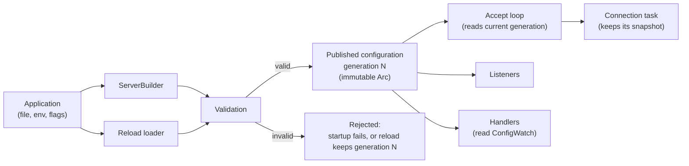

# Configuration specification

Every setting of the rust-milter server: its type, default, valid range, and what happens to it on a configuration reload. Other specifications refer to this document and do not repeat these values.

## Contents

- [How configuration reaches the server](#how-configuration-reaches-the-server)
- [Reload classes](#reload-classes)
- [Settings that need a restart](#settings-that-need-a-restart)
- [Settings that do not need a restart](#settings-that-do-not-need-a-restart)
- [ServerConfig reference](#serverconfig-reference)
- [Builder-only settings](#builder-only-settings)
- [Application configuration](#application-configuration)
- [Validation rules](#validation-rules)
- [Example](#example)
- [Milter client configuration](#milter-client-configuration)
- [Open questions](#open-questions)

## How configuration reaches the server

rust-milter is a library and reads no configuration file or environment variable itself. The application builds the configuration and hands it over in two places:

- `ServerBuilder` takes the initial `ServerConfig`, the initial application configuration, and the builder-only settings.
- The reload loader, registered with `ServerBuilder::reload_with`, returns a new `ServerConfig` and application configuration on `SIGHUP` or `ServerHandle::reload()`.

Each valid configuration is published once as an immutable value with a generation number, starting at 1. A reload never changes a published value in place; it publishes generation N+1. The reload procedure itself is specified in `docs/reference/hot-reload.md`.

## Reload classes

Every setting belongs to one of four classes.

| Class | When a changed value takes effect |
|-------|-----------------------------------|
| `immediate` | As soon as the new generation is published, for every decision the server makes from then on |
| `new_connections` | For connections accepted after the reload. Open connections keep the snapshot they were accepted with until they close |
| `new_listeners` | For listeners the reload binds. A listener that stays bound keeps its old value |
| `restart` | Only after the process restarts. A reload keeps the running value, applies the other changes, and reports the setting as `pending_restart` |

With Sendmail and Postfix one milter connection lasts one SMTP session, so a `new_connections` change reaches all traffic within one SMTP session of the reload.

A `new_listeners` change on an address that stays in `bind_addresses` cannot reach that listener without closing it, so the reload reports it as `pending_restart` for that address. Removing the address in one reload and adding it back in the next applies the change without a restart.

## Settings that need a restart

| Setting | Why |
|---------|-----|
| `worker_threads` | The Tokio runtime is built once at startup and cannot change its thread count |
| `backlog` on an address that stays bound | The kernel sets the backlog when the listener starts listening |
| `socket_options.reuse_addr`, `reuse_port`, `ipv6_only` on an address that stays bound | These options must be set before `bind()` |
| Builder-only settings (handler, reload loader, meter provider, runtime settings) | They are fixed when the server is built; see [Builder-only settings](#builder-only-settings) |
| Cargo features (`otel`) | They are fixed at compile time; changing them needs a rebuild |

## Settings that do not need a restart

| Setting | Class |
|---------|-------|
| `bind_addresses` | `immediate`: added addresses get new listeners, removed addresses stop accepting |
| `bind_mode` | `immediate`: the reload that changes it already uses the new value |
| `max_connections` | `immediate` |
| `backlog` for an added address | `new_listeners` |
| `socket_options.reuse_addr`, `reuse_port`, `ipv6_only` for an added address | `new_listeners` |
| `timeouts.connect`, `timeouts.read`, `timeouts.write`, `timeouts.idle` | `new_connections` |
| `socket_options.tcp_nodelay`, `keepalive`, `recv_buffer_size`, `send_buffer_size` | `new_connections` |
| `shutdown.grace_period`, `shutdown.drain_timeout` | `immediate` (read when a shutdown starts) |
| `resource_limits.max_fds`, `resource_limits.max_memory` | `immediate` (checked at accept and allocation time) |
| `resource_limits.per_connection_buffer` | `new_connections` |
| `telemetry.trace_commands` | `new_connections` |
| Application configuration | `immediate` publication; handlers choose when to read it |

Lowering `max_connections` below the current count closes no open connection. New connections are closed at once until the count drops below the new limit.

## ServerConfig reference

`ServerConfig` and all its parts are plain data types. They implement `Clone`, `Debug`, `PartialEq`, and `Default`, and are `Send + Sync`.

### Top level

| Field | Type | Default | Valid values | Reload class |
|-------|------|---------|--------------|--------------|
| `bind_addresses` | `Vec<SocketAddr>` | none (required) | 1 or more, no duplicates; ports 1 to 65535 | `immediate` |
| `bind_mode` | `BindMode` | `FailFast` | `FailFast`, `BestEffort` | `immediate` |
| `backlog` | `u32` | 1024 | 1 to 65535 | `new_listeners` |
| `max_connections` | `usize` | 10000 | 0 (unlimited) to 1,000,000 | `immediate` |
| `worker_threads` | `Option<usize>` | `None` (number of CPU cores) | 1 to 1024 | `restart` |
| `timeouts` | `TimeoutConfig` | see below | | |
| `socket_options` | `SocketOptions` | see below | | |
| `shutdown` | `ShutdownConfig` | see below | | |
| `resource_limits` | `ResourceLimitsConfig` | see below | | |
| `telemetry` | `TelemetryConfig` | see below | | |

`bind_addresses` also accepts the libmilter forms `inet:port@host` and `inet6:port@host` when parsed from text. `unix:` and `local:` addresses are rejected; rust-milter does not support Unix domain sockets.

### TimeoutConfig

| Field | Type | Default | Valid values | Reload class |
|-------|------|---------|--------------|--------------|
| `connect` | `Duration` | 10 s | 1 ms to 5 min | `new_connections` |
| `read` | `Duration` | 30 s | 1 ms to 1 h | `new_connections` |
| `write` | `Duration` | 30 s | 1 ms to 1 h | `new_connections` |
| `idle` | `Duration` | 300 s | 1 s to 24 h | `new_connections` |

`connect` runs from `accept()` until the MTA's first command (`SMFIC_OPTNEG`) arrives. The kernel completes the TCP handshake before `accept()` returns, so the server cannot time it.

### SocketOptions

| Field | Type | Default | Valid values | Reload class |
|-------|------|---------|--------------|--------------|
| `tcp_nodelay` | `bool` | `true` | | `new_connections` |
| `keepalive` | `Option<KeepaliveConfig>` | `Some` with the defaults below | | `new_connections` |
| `recv_buffer_size` | `Option<usize>` | `None` (OS default) | 1 KB to 64 MB | `new_connections` |
| `send_buffer_size` | `Option<usize>` | `None` (OS default) | 1 KB to 64 MB | `new_connections` |
| `reuse_addr` | `bool` | `true` | | `new_listeners` |
| `reuse_port` | `bool` | `false` | Linux 3.9 and later, BSD | `new_listeners` |
| `ipv6_only` | `bool` | `false` | | `new_listeners` |

### KeepaliveConfig

| Field | Type | Default | Valid values | Reload class |
|-------|------|---------|--------------|--------------|
| `time` | `Duration` | 60 s | 1 s to 24 h | `new_connections` |
| `interval` | `Duration` | 10 s | 1 s to 1 h | `new_connections` |
| `retries` | `u32` | 6 | 1 to 30 | `new_connections` |

### ShutdownConfig

| Field | Type | Default | Valid values | Reload class |
|-------|------|---------|--------------|--------------|
| `grace_period` | `Duration` | 5 s | 0 s to 1 min | `immediate` |
| `drain_timeout` | `Duration` | 30 s | 1 s to 5 min | `immediate` |

### ResourceLimitsConfig

| Field | Type | Default | Valid values | Reload class |
|-------|------|---------|--------------|--------------|
| `max_fds` | `Option<usize>` | `None` (system limit) | at least `max_connections` + listeners + 10 | `immediate` |
| `max_memory` | `Option<usize>` | `None` (unlimited) | at least `per_connection_buffer` | `immediate` |
| `per_connection_buffer` | `usize` | 128 KB | 65,540 bytes to 16 MB | `new_connections` |

`per_connection_buffer` is also the largest milter packet the server accepts. Its lower bound is one full default-size packet: 4 length bytes, 1 command byte, and 65,535 data bytes. Postfix can send a header packet larger than that, so raise the value if very long headers are expected.

### TelemetryConfig

| Field | Type | Default | Valid values | Reload class |
|-------|------|---------|--------------|--------------|
| `trace_commands` | `TraceCommands` | `Envelope` | `None`, `Envelope`, `All` | `new_connections` |

See `docs/reference/telemetry.md` for what each level records.

## Builder-only settings

These are set on `ServerBuilder` and are not part of `ServerConfig`, so a reload cannot change them.

| Setting | Builder method | Why it is fixed |
|---------|----------------|-----------------|
| Connection handler | `handler(...)` | Replacing code needs a new binary |
| Reload loader | `reload_with(...)` | The loader is what performs reloads |
| Initial application configuration | `app_config(...)` | Later values come through reloads |
| OpenTelemetry meter provider | `meter_provider(...)` | Instruments are created once from it at build time |
| Tokio runtime flavor and thread stack size | runtime builder in the application | The runtime runs the server and every reload |

## Application configuration

The application can attach its own configuration type `A` for its handlers, such as spam thresholds or allow lists. rust-milter treats it as opaque:
- it is published with the same generation number as `ServerConfig`
- handlers read it through `ConfigWatch<A>`, once per SMTP session or per message, so a message sees one consistent value
- rust-milter never logs its contents
- it holds settings only, never data from an SMTP session

The application validates `A` in its loader. If the loader returns an error, the reload fails and both configurations stay at the current generation.

## Validation rules

The same rules run at startup and on every reload. A failure at startup stops the server with exit code 2. A failure on reload leaves the running generation unchanged.

1. Every field is within the range in the reference tables.
2. `bind_addresses` is not empty and has no duplicates.
3. `per_connection_buffer` is at least 65,540 bytes.
4. If `max_fds` is set, it is at least `max_connections` + the number of listeners + 10, so the server can always accept, log, and close.
5. If `max_memory` is set, it is at least `per_connection_buffer`.
6. If `reuse_port` is true, the platform supports `SO_REUSEPORT`.

On reload only:

7. The new configuration must leave at least one listener (see `docs/reference/hot-reload.md`).
8. Changes to `restart` settings are not errors. They are reported as `pending_restart`.

## Example

The [getting started tutorial](../tutorials/getting-started.md) builds a `ServerConfig` and a server step by step. The [reload tutorial](../tutorials/reloading-configuration.md) adds an application configuration and a reload loader.

## Milter client configuration

The milter client (`docs/reference/milter-client.md`) has its own `ClientConfig`, defined in that document. The server's reload does not touch it. To change it, the application builds a new `MilterClient` and shuts down the old one.

## Open questions

1. Should `ServerConfig` implement `serde::Deserialize` behind an optional `serde` feature, so loaders can read it straight from TOML or YAML?
2. Should rust-milter offer a helper that maps standard environment variables to `ServerConfig`, or leave that entirely to the application?
