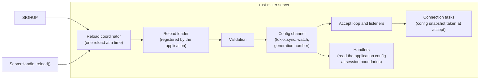
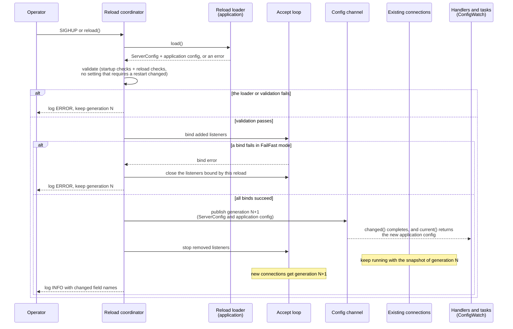
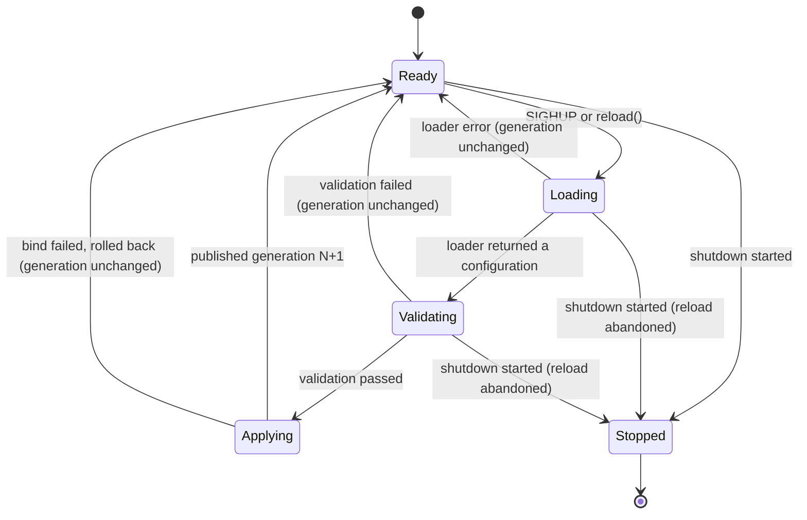

# Configuration hot reload specification

Reloading the server configuration while rust-milter keeps running, triggered by `SIGHUP` or by an API call, without dropping MTA connections.

## Contents

- [Scope](#scope)
- [Architecture](#architecture)
- [Reload sequence](#reload-sequence)
- [Reload coordinator states](#reload-coordinator-states)
- [What each setting does on reload](#what-each-setting-does-on-reload)
- [Listener changes](#listener-changes)
- [Application configuration](#application-configuration)
- [Concurrency rules](#concurrency-rules)
- [API](#api)
- [Errors](#errors)
- [Logging and metrics](#logging-and-metrics)
- [Testing requirements](#testing-requirements)

## Scope

rust-milter never reads a configuration file itself. The application registers a loader. On `SIGHUP` the server calls the loader, validates the result, and applies it. Why reload works this way is explained in [Configuration snapshots and reload](../explanation/configuration-and-reload.md).

In scope:
- reloading `ServerConfig` (see [configuration.md](configuration.md))
- reloading the application's own configuration for its handlers, such as spam thresholds or allow lists
- adding and removing listeners

Out of scope:
- the Tokio runtime settings, such as the number of worker threads. The application creates the runtime, so they change only with a restart.
- replacing the handler code. That needs a new binary and a restart.
- reloading the log filter. The application owns its `tracing` subscriber and can reload it from the same loader.

## Architecture

Responsibilities:
- The reload coordinator receives reload requests, runs one at a time, and reports the result.
- The reload loader belongs to the application. It returns a new `ServerConfig` and a new application configuration, or an error.
- Validation runs the same checks as startup, plus the reload-specific checks below, including that no setting that requires a restart has changed.
- The config channel publishes each accepted configuration as an immutable `Arc` with an increasing generation number.
- The accept loop reads the current configuration for every accepted connection. Each connection task keeps the snapshot it started with.
- Handlers read the current application configuration when a new SMTP session or message starts.

## Reload sequence

New listeners are bound before the new configuration is published, and removed listeners stop only after it. A failed bind leaves the running configuration untouched.

The loader runs before the server's own checks, so the server can still discard what it returns: when validation fails, when a setting that requires a restart changed, or when a bind fails in `FailFast` mode. The loader must therefore only read and check the new settings and build the value it returns. It must not act on them, for example by replacing a value that other code reads or by closing a connection pool. Work that must follow an applied reload waits on `ConfigWatch::changed()`, which completes only when a new generation is published.

## Reload coordinator states

A request that arrives while a reload is running is not lost. The coordinator records it, and when the current reload ends it runs one more reload. Any number of requests that arrive in the meantime cause one extra reload only, which then picks up the latest configuration. Every caller whose request was folded into that reload gets its result. Only requests for the loader are folded: a `reload_with_config()` request carries its own configuration and runs on its own, in the order it arrived.

The coordinator starts when `run()` has bound the listeners. A request made before that waits, and runs then.

`Applying` is not interrupted by shutdown.

## What each setting does on reload

Every connection keeps the configuration snapshot it was accepted with until it closes. One milter connection lives for one SMTP session with Sendmail and Postfix, so within one SMTP session of a reload, the connections on the old snapshot have closed and all traffic runs on the new values.

Which settings apply at once, which apply to new connections, and which require a restart is specified per setting in [configuration.md](configuration.md#reload-classes).

A reload closes no open connection and rebinds no listener ([ADR 0005](../adr/0005-reload-closes-no-connection-and-rebinds-no-listener.md)). A lowered `max_connections` closes no open connection. New connections are closed at once until the count falls below the new limit.

A reload that changes a setting that requires a restart fails with `RestartRequired` and applies nothing, even if it changes other settings too ([ADR 0007](../adr/0007-a-reload-that-changes-a-restart-setting-fails.md)). The error names every such setting that changed, and the server keeps running with the previous generation. After every applied reload, the server runs exactly the configuration the loader returned.

## Listener changes

The coordinator compares the addresses it has listeners on with the new `bind_addresses`, as sets:

| Case | Action |
|------|--------|
| Address only in the new set | Bind a new listener before publishing |
| Address only in the old set | Stop accepting on it after publishing. Open connections accepted on it keep running |
| Address in both sets | Keep the listener as it is |

A bind failure follows `bind_mode` from the new configuration (see [configuration.md](configuration.md#top-level)):
- `FailFast`: close every listener this reload bound, keep the running configuration, and report the error.
- `BestEffort`: publish the new configuration with the listeners that did bind, and report the failed addresses as a warning.

A reload never leaves the server with no listener. If the new set would bind nothing, the reload fails.

An address that failed to bind in `BestEffort` mode has no listener, so the next reload that keeps it in `bind_addresses` tries to bind it again.

## Application configuration

Handlers often need their own settings. The server carries them next to `ServerConfig`, as a type chosen by the application: the application passes the first value to `ServerBuilder::app_config` and returns later values from its reload loader. The how-to guide [Reload the configuration without a restart](../how-to/reload-the-configuration.md) shows a complete loader.

Handlers read the application configuration through a `ConfigWatch<A>`, a thin wrapper around a `tokio::sync::watch` receiver. `ConfigWatch::current()` returns the current `Arc<A>` and does not block. `ConfigWatch::changed()` completes when a reload publishes a new generation; a failed reload publishes nothing, so it does not complete then.

Read it once per SMTP session (in the `connect` callback) or once per message (in the `mail` callback), and keep that `Arc` in the handler's `Session` or `Message` value. A message then sees one consistent configuration, even if a reload happens halfway through it.

The application configuration follows the same isolation rule as the rest of rust-milter: it holds settings, never data from an SMTP session.

## Concurrency rules

1. One reload runs at a time. The coordinator owns the listener set; no other task changes it.
2. Readers never wait for a reload. The accept loop and the handlers read the current `Arc` and continue.
3. A published configuration is immutable. A reload publishes a new `Arc`; it never changes the old one in place.
4. The generation number grows by one per published configuration and never goes back. A failed reload does not change it.
5. Once shutdown has started, `reload()` returns `ShuttingDown` and `SIGHUP` is logged and ignored.
6. Without a registered loader, `SIGHUP` is logged at WARN level and ignored. `reload()` with an explicit configuration still works.

## API

The reload API (`ServerBuilder::reload_with`, `ServerHandle::reload`, `reload_with_config`, `config_watch`, `config_generation`) and the `ReloadReport` and `ReloadError` types are specified in [api-specification.md](api-specification.md#configuration-and-reload-api).

## Errors

The reload errors are the variants of `ReloadError` in [api-specification.md](api-specification.md#reloaderror). Every one of them leaves the server running with the previous generation; none ends `Server::run()`.

## Logging and metrics

| Event | Level | Fields |
|-------|-------|--------|
| Reload requested | INFO | `source` (`sighup` or `api`), `generation` |
| Reload coalesced | DEBUG | `pending_requests` |
| Reload applied | INFO | `generation`, `changed`, `listeners_added`, `listeners_removed` |
| Reload failed | ERROR | `generation`, `error` |
| SIGHUP ignored | WARN | `reason` (`no_loader` or `shutting_down`) |

Logs carry the names of changed settings, never their values. A configuration can contain secrets, and the application configuration is opaque to the library.

The reload metrics are defined under "Configuration reload metrics" in [telemetry.md](telemetry.md).

`ServerHandle::status()` reports one more field next to the [health check](tcp-server.md#health-check) fields: `config_generation`, the current generation.

## Testing requirements

The test scenarios are in [docs/testing/reload.md](../testing/reload.md), with the prefix `RLD`.

Unit tests:
- the listener set comparison for added, removed, and kept addresses
- classification of every `ServerConfig` field (at once, new connections, restart)
- coalescing: several requests during one reload cause exactly one more reload
- generation numbering on success and failure

Integration tests:
- a reload during an open SMTP session: the session finishes with its old timeouts, and the next connection uses the new ones
- moving the listen address: no moment without a listener, and connections on the old address finish
- a bind failure in `FailFast` mode rolls back; in `BestEffort` mode it applies the rest
- an invalid configuration, or one that changes a setting that requires a restart, leaves the server unchanged
- `SIGHUP` without a loader, and during shutdown
- a handler reading `ConfigWatch` sees one value for a whole message while a reload happens
