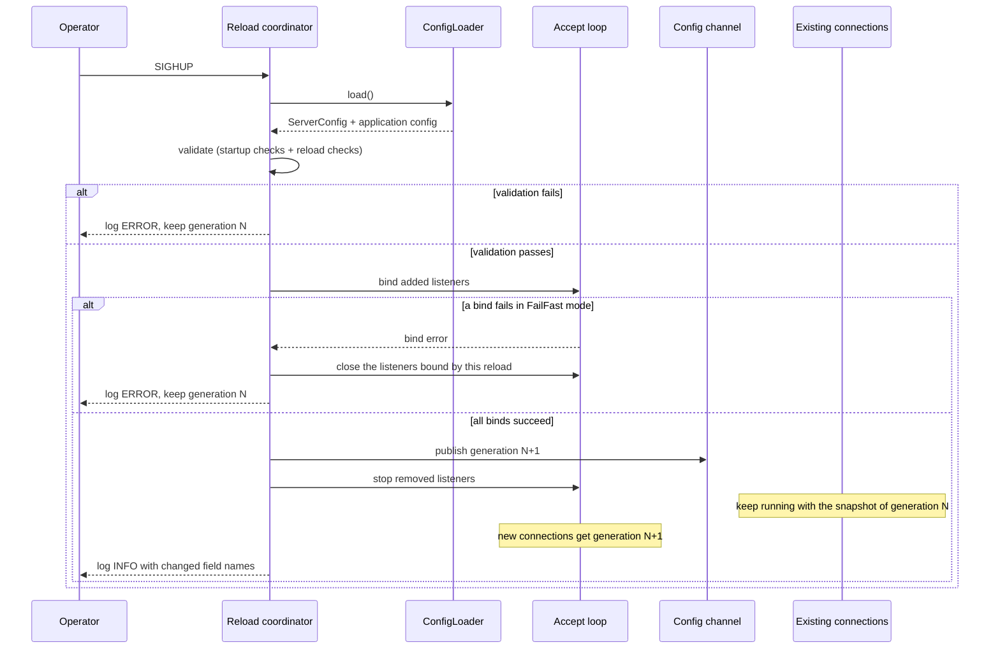
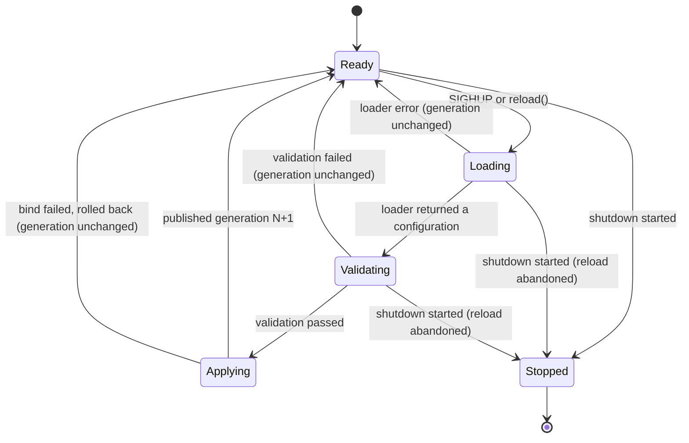

# Configuration hot reload specification

Status: design, not implemented.

Reloading the server configuration while rust-milter keeps running, triggered by `SIGHUP` or by an API call, without dropping MTA connections.

## Contents

- [Purpose and scope](#purpose-and-scope)
- [Architecture](#architecture)
- [Reload sequence](#reload-sequence)
- [Reload coordinator states](#reload-coordinator-states)
- [What each setting does on reload](#what-each-setting-does-on-reload)
- [Listener changes](#listener-changes)
- [Application configuration](#application-configuration)
- [Concurrency rules](#concurrency-rules)
- [API](#api)
- [Errors](#errors)
- [Logging and metrics](#logging-and-metrics)
- [Testing requirements](#testing-requirements)
- [Open questions](#open-questions)

## Purpose and scope

An operator changes a timeout, a connection limit, or a listen address, and sends `SIGHUP`. Restarting the milter would drop every open MTA connection, and each MTA would apply its failure policy to the messages in flight (Sendmail `F=` flags, Postfix `milter_default_action`). A reload avoids that.

rust-milter is a library. It does not know where the application keeps its configuration, so it never reads a file itself. The application registers a loader. On `SIGHUP` the server calls the loader, validates the result, and applies it.

In scope:
- reloading `ServerConfig` (see `docs/reference/tcp-server.md`)
- reloading the application's own configuration for its handlers, such as spam thresholds or allow lists
- adding and removing listeners

Out of scope:
- settings fixed when the Tokio runtime starts, such as `worker_threads`. They need a restart.
- replacing the handler code. That needs a new binary and a restart.
- reloading the log filter. The application owns its `tracing` subscriber and can reload it from the same loader.

## Architecture


Responsibilities:
- The reload coordinator receives reload requests, runs one at a time, and reports the result.
- The `ConfigLoader` belongs to the application. It returns a new `ServerConfig` and a new application configuration, or an error.
- Validation runs the same checks as startup, plus the reload-specific checks below.
- The config channel publishes each accepted configuration as an immutable `Arc` with an increasing generation number.
- The accept loop reads the current configuration for every accepted connection. Each connection task keeps the snapshot it started with.
- Handlers read the current application configuration when a new SMTP session or message starts.

## Reload sequence



The order matters. New listeners are bound before the new configuration is published, and removed listeners stop only after it. Moving the server to a new address therefore never leaves a moment without a listener, and a failed bind leaves the running configuration untouched.

## Reload coordinator states



A request that arrives while a reload is running is not lost. The coordinator records it, and when the current reload ends it runs one more reload. Any number of requests that arrive in the meantime cause one extra reload only, which then picks up the latest configuration.

`Applying` is not interrupted by shutdown. It is short (binding sockets and publishing a value), and stopping halfway would leave listeners in an unknown state.

## What each setting does on reload

Every connection keeps the configuration snapshot it was accepted with until it closes. One milter connection lives for one SMTP session with Sendmail and Postfix, so every open connection picks up the new values within one SMTP session.

| Setting | Effect of a change |
|---------|--------------------|
| `bind_addresses` | Listeners are added and removed at once (see [Listener changes](#listener-changes)) |
| `backlog` | Applies to listeners created by this reload. An unchanged address keeps its old backlog; the change is reported as needing a restart |
| `max_connections` | Applies at once to new accepts. Lowering it does not close open connections; new connections are closed at once until the count drops below the limit |
| `worker_threads` | Needs a restart; reported, not applied |
| `timeouts.*` | New connections |
| `socket_options.tcp_nodelay`, `keepalive`, `recv_buffer_size`, `send_buffer_size` | New connections |
| `socket_options.reuse_addr`, `reuse_port`, `ipv6_only` | Listeners created by this reload |
| `shutdown.grace_period`, `shutdown.drain_timeout` | At once; read when a shutdown starts |
| `resource_limits.max_fds`, `max_memory` | At once, checked at accept and allocation time |
| `resource_limits.per_connection_buffer` | New connections |

A change to a setting that needs a restart does not fail the reload. The server applies everything else, keeps the running value for that setting, and lists it as `pending_restart` in the log and in the reload report.

## Listener changes

The coordinator compares the old and new `bind_addresses` as sets:

| Case | Action |
|------|--------|
| Address only in the new set | Bind a new listener before publishing |
| Address only in the old set | Stop accepting on it after publishing. Open connections accepted on it keep running |
| Address in both sets | Keep the listener as it is |

A bind failure follows the configured bind mode from `docs/reference/tcp-server.md`:
- `FailFast`: close every listener this reload bound, keep the running configuration, and report the error.
- `BestEffort`: publish the new configuration with the listeners that did bind, and report the failed addresses as a warning.

A reload never leaves the server with no listener. If the new set would bind nothing, the reload fails.

## Application configuration

Handlers often need their own settings. The server carries them next to `ServerConfig`, as a type chosen by the application:

```rust
let server = Server::builder()
    .config(server_config)
    .app_config(MyConfig::load(&path)?)
    .reload_with(move || async move {
        let file = read_config_file(&path).await?;
        Ok(Reloaded { server: file.server, app: file.app })
    })
    .handler(MyHandler::new)
    .build()?;
```

Handlers read the application configuration through a `ConfigWatch<A>`, a thin wrapper around `tokio::sync::watch::Receiver<Arc<A>>`. `ConfigWatch::current()` returns the current `Arc<A>` and does not block.

Read it once per SMTP session (at `SMFIC_CONNECT`) or once per message (at `SMFIC_MAIL`), and keep that `Arc` until the session or message ends. A message then sees one consistent configuration, even if a reload happens halfway through it.

The application configuration follows the same isolation rule as the rest of rust-milter: it holds settings, never data from an SMTP session.

## Concurrency rules

1. One reload runs at a time. The coordinator owns the listener set; no other task changes it.
2. Readers never wait for a reload. The accept loop and the handlers read the current `Arc` and continue.
3. A published configuration is immutable. A reload publishes a new `Arc`; it never changes the old one in place.
4. The generation number grows by one per published configuration and never goes back. A failed reload does not change it.
5. Once shutdown has started, `reload()` returns `ShuttingDown` and `SIGHUP` is logged and ignored.
6. Without a registered loader, `SIGHUP` is logged at WARN level and ignored. `reload()` with an explicit configuration still works.

## API

| Item | Description |
|------|-------------|
| `ServerBuilder::reload_with(loader)` | Register the loader called on `SIGHUP`. `loader` is an async function returning `Result<Reloaded<A>, E>` |
| `ServerBuilder::app_config(a)` | Initial application configuration |
| `ServerHandle::reload()` | Run the registered loader, as `SIGHUP` does |
| `ServerHandle::reload_with_config(Reloaded<A>)` | Apply a configuration the caller already built |
| `ServerHandle::config_watch()` | Return a `ConfigWatch<A>` for handlers |
| `ServerHandle::config_generation()` | Current generation number |

`reload()` and `reload_with_config()` return a `ReloadReport`:

| Field | Type | Description |
|-------|------|-------------|
| `generation` | u64 | Generation after the reload; unchanged on failure |
| `changed` | Vec\<&'static str\> | Names of the settings that changed |
| `pending_restart` | Vec\<&'static str\> | Changed settings that need a restart |
| `listeners_added` | Vec\<SocketAddr\> | Listeners bound by this reload |
| `listeners_removed` | Vec\<SocketAddr\> | Listeners stopped by this reload |
| `bind_failures` | Vec\<(SocketAddr, String)\> | Failed binds (`BestEffort` only) |

In `docs/reference/tcp-server.md`, `SIGHUP` changes from "reserved" to "reload the configuration through the registered loader".

## Errors

| Error | Cause | Effect |
|-------|-------|--------|
| `Load` | the loader returned an error | generation unchanged |
| `Validation` | the new configuration failed validation | generation unchanged |
| `Bind` | a new listener failed to bind in `FailFast` mode | listeners bound by this reload closed; generation unchanged |
| `NoListener` | the new configuration would leave no listener | generation unchanged |
| `ShuttingDown` | shutdown has started | nothing done |

A failed reload never stops the server and never changes its exit code.

## Logging and metrics

| Event | Level | Fields |
|-------|-------|--------|
| Reload requested | INFO | `source` (`sighup` or `api`), `generation` |
| Reload coalesced | DEBUG | `pending_requests` |
| Reload applied | INFO | `generation`, `changed`, `pending_restart`, `listeners_added`, `listeners_removed` |
| Reload failed | ERROR | `generation`, `error` |
| Setting needs restart | WARN | `setting` |
| SIGHUP ignored | WARN | `reason` (`no_loader` or `shutting_down`) |

Logs carry the names of changed settings, never their values. A configuration can contain secrets, and the application configuration is opaque to the library.

| Metric | Type | Description |
|--------|------|-------------|
| `config_generation` | Gauge | Current generation |
| `config_reloads_total` | Counter | Reloads, labeled `result` (`applied`, `failed`) and `source` |
| `config_last_reload_timestamp_seconds` | Gauge | Time of the last applied reload |
| `config_pending_restart` | Gauge | 1 while a changed setting waits for a restart |

The health check gains two fields: `config_generation` and `pending_restart`.

## Testing requirements

Unit tests:
- the listener set comparison for added, removed, and kept addresses
- classification of every `ServerConfig` field (at once, new connections, new listeners, restart)
- coalescing: several requests during one reload cause exactly one more reload
- generation numbering on success and failure

Integration tests:
- a reload during an open SMTP session: the session finishes with its old timeouts, and the next connection uses the new ones
- moving the listen address: no moment without a listener, and connections on the old address finish
- a bind failure in `FailFast` mode rolls back; in `BestEffort` mode it applies the rest
- an invalid configuration leaves the server unchanged
- `SIGHUP` without a loader, and during shutdown
- a handler reading `ConfigWatch` sees one value for a whole message while a reload happens

## Open questions

1. Should a lowered `max_connections` also close idle connections above the new limit, or only stop new ones as designed?
2. Should a changed `backlog` on an unchanged address rebind the listener with `SO_REUSEPORT`, so it applies without a restart?
3. Does the milter client in `docs/reference/milter-client.md` need the same reload support for its pool settings?
