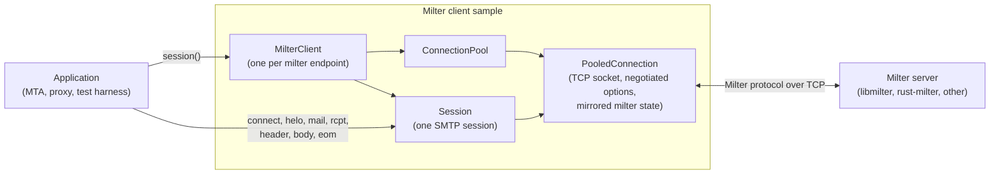
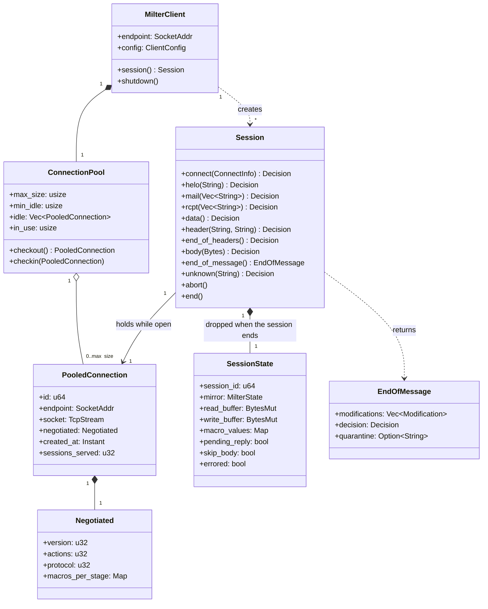
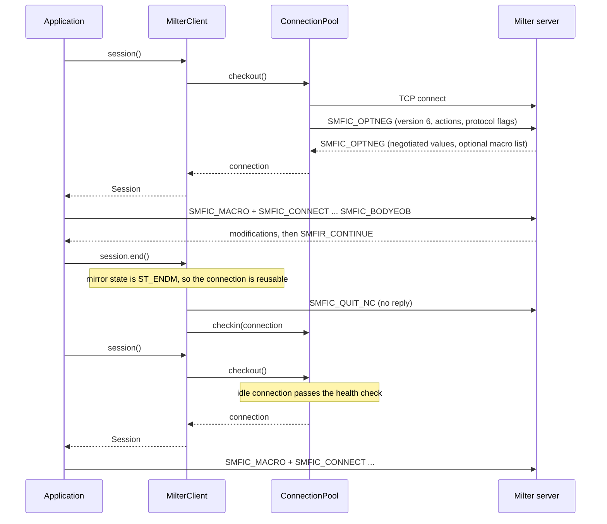
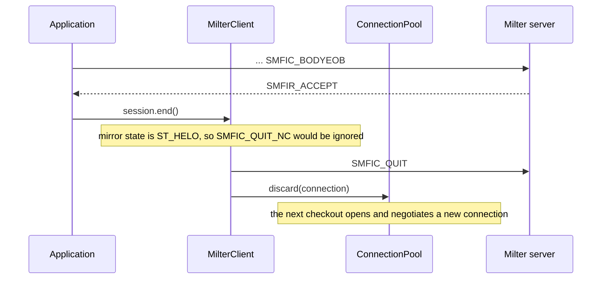
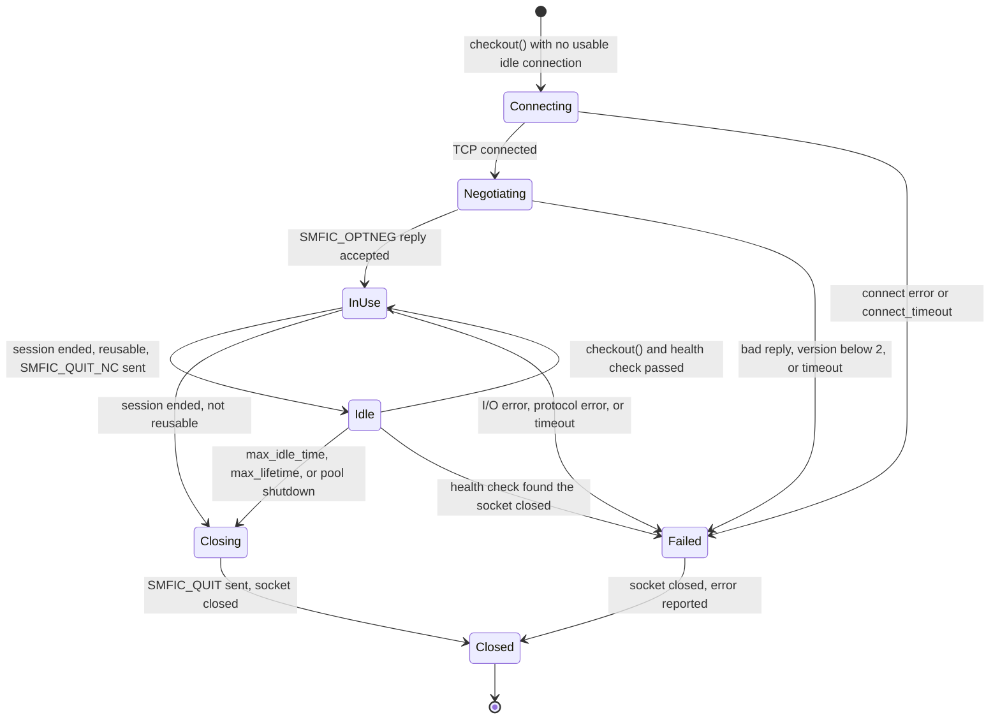

# Milter client sample: design reference

Status: reference sample, not part of the product. The sample will live in `examples/milter_client/` of this repository. CI builds it, it is not published to crates.io, and the rust-milter library does not export its types. This document records its design as a reference.

The MTA side of the Milter protocol for rust-milter: a client that talks to milter servers, and a pool that keeps those connections open and reuses them across SMTP sessions with `SMFIC_QUIT_NC`.

## Contents

- [Scope](#scope)
- [Architecture](#architecture)
- [Domain model](#domain-model)
- [Session lifecycle](#session-lifecycle)
- [Pooled connection states](#pooled-connection-states)
- [Reuse rules](#reuse-rules)
- [Session isolation](#session-isolation)
- [Pool behavior](#pool-behavior)
- [Configuration](#configuration)
- [API](#api)
- [Errors and failure policy](#errors-and-failure-policy)
- [Shutdown](#shutdown)
- [Logging and metrics](#logging-and-metrics)
- [Testing requirements](#testing-requirements)

## Scope

rust-milter is a milter server: an MTA connects to it. The sample described here plays the MTA's role, using only the library's public protocol types (`Frame`, `Command`, `Reply`). It is a reference for:
- authors of MTAs and SMTP servers in Rust who want to call existing milters
- authors of milter proxies
- test harnesses that drive a milter without running Sendmail or Postfix

In scope:
- one client per milter endpoint, over TCP (IPv4 and IPv6)
- protocol versions 2 through 6, the same range as the rust-milter server
- connection reuse with `SMFIC_QUIT_NC`, only where it is safe
- timeouts and failure handling equivalent to Sendmail's and Postfix's

Out of scope:
- Unix domain sockets, which rust-milter supports neither as a server nor as a client. A milter that listens only on a Unix socket must be configured to listen on TCP before the client can reach it.
- running several milters in sequence (a milter chain). The program that uses the client creates one client per milter and calls them in order, as Sendmail and Postfix do in their own code.
- configuration reload. A program that uses the client builds a new client to change its settings and shuts down the old one; sessions in progress finish on the old client.
- applying message modifications. The client returns them; the application applies them to its own queue file.

## Architecture

The application asks a `MilterClient` for a `Session`. The client takes a connection from its pool, or opens and negotiates a new one, and hands it to the session. The session sends the SMTP events of one SMTP session and returns the milter's decisions. When the session ends, the connection goes back to the pool if the reuse rules allow it. Otherwise the client closes it.

Responsibilities:
- `MilterClient` owns the configuration and the pool for one endpoint. It is cheap to clone and safe to share between tasks.
- `ConnectionPool` creates, stores, checks, and retires connections. It knows nothing about SMTP.
- `Session` runs one SMTP session on one connection, in protocol order. It holds the connection exclusively until it ends.
- `PooledConnection` owns the socket, the result of option negotiation, and a mirror of the milter's protocol state.

## Domain model

The split between `PooledConnection` and `SessionState` is the isolation boundary described in [Session isolation](#session-isolation). `PooledConnection` has no field that can hold SMTP data. Everything a session learns or buffers lives in `SessionState`, which the `Session` owns and drops when it ends.

`Decision` is one of `Continue`, `Accept`, `Reject`, `TempFail`, `Discard`, `ReplyCode(String)`, `Skip`, or `NoReply`. `Modification` mirrors the `SMFIR_*` modification actions in [milter-protocol.md](milter-protocol.md#replies-from-milter-to-mta).

## Session lifecycle

A reusable session, followed by a second session on the same connection:

A session that cannot be reused:

## Pooled connection states

`Failed` connections are never returned to the pool. A connection reached through `Idle` skips `Connecting` and `Negotiating`, because option negotiation happens once per TCP connection and stays valid after `SMFIC_QUIT_NC`.

## Reuse rules

When a session ends, the client returns the connection to the pool only if all of these hold. Why the rules are this narrow is explained in [Connection reuse and session isolation](../explanation/connection-reuse.md).

1. The negotiated protocol version is 6. `SMFIC_QUIT_NC` belongs to version 6.
2. No reply is pending, and the session saw no I/O error, protocol error, or timeout.
3. The session was not cancelled in the middle of a command.
4. The mirrored milter state allows `SMFIC_QUIT_NC` under the configured reuse policy:
   - `libmilter_compatible` (default): the state is `ST_ENDM` or `ST_UNKN`
   - `never`: no connection is reused
5. The write buffer is flushed and the read buffer is empty. A leftover byte means the stream is out of step, so a reply from this session could be read as a reply in the next one.
6. The connection is younger than `max_lifetime` and has served fewer than `max_sessions_per_connection` sessions.
7. The pool is not shutting down.

Otherwise the client sends `SMFIC_QUIT` and closes the socket.

The mirror is part of the session state. A session on a new connection starts it at `ST_OPTS`; a session on a reused connection starts it at `ST_Q_NC`. It follows libmilter's `mi_engine` exactly:
- Each command moves the state to the command's state (`SMFIC_CONNECT` to `ST_CONN`, `SMFIC_BODYEOB` to `ST_ENDM`, and so on).
- `SMFIR_ACCEPT` moves it to `ST_HELO`.
- `SMFIR_REJECT`, `SMFIR_DISCARD`, `SMFIR_TEMPFAIL`, and `SMFIR_REPLYCODE` move it to `ST_HELO`, except after `SMFIC_RCPT` and `SMFIC_UNKNOWN`, where the state stays.
- `SMFIC_ABORT` moves it to `ST_ABRT`. The next command goes through libmilter's recovery from `ST_HELO`.
- A stage with a negotiated no-reply flag (`SMFIP_NR_*`) changes the state without a reply.

The client never sends a command only to reach a reusable state.

## Session isolation

A reused connection carries milter connection information only. When a session ends, the client discards everything it learned or buffered during that SMTP session, whether or not the connection is reused.

Kept with the connection:

| Item | Reason |
|------|--------|
| TCP socket and endpoint | the connection itself |
| Negotiated version, actions, and protocol flags | `SMFIC_OPTNEG` happens once per TCP connection and is not repeated after `SMFIC_QUIT_NC` |
| Macro names the milter requested per stage (its symbol list) | part of the negotiation; names only, never values |
| `conn_id`, `created_at`, `sessions_served` | bookkeeping for the reuse limits |

Discarded at the end of every session:

| Item | Examples |
|------|----------|
| SMTP client information | hostname, address, and port from `SMFIC_CONNECT`; the HELO name |
| Envelope | sender, recipients, ESMTP arguments |
| Message content | headers and body chunks |
| Macro values | every value sent with `SMFIC_MACRO`, such as `{i}`, `{auth_authen}`, `{client_addr}` |
| Milter replies | decisions, reply codes and text, quarantine reasons, modifications |
| Protocol state | the state mirror, pending-reply and skip flags, error flags |
| Buffers | the read and write buffers |

The client SMTP connection information from `SMFIC_CONNECT` is session information, not connection information: a reused milter connection serves a different SMTP client each time.

How the design enforces this:
1. Type separation. `PooledConnection` has no field that can hold SMTP data. All session data lives in `SessionState`, which `session()` builds from scratch and `end()` drops before the connection goes back to the pool.
2. No macro cache. The client sends macro values only from data the application passed in the current session.
3. Clean stream. `end()` returns a connection to the pool only with a flushed write buffer and an empty read buffer, and the checkout health check discards any idle connection with readable data. Neither session can read the other's bytes.
4. Fail closed. An error, a timeout, a cancelled command, or a `Session` dropped without `end()` closes the connection with `SMFIC_QUIT`; such a connection is never reused.
5. One trust domain per pool. Connections are reused only within one `MilterClient`: one endpoint and one configuration. An application that serves separate trust domains, such as tenants, must create one `MilterClient` per domain. The pool never moves a connection between clients.
6. Logging. Each session gets a new `session_id`. Log lines and metrics of one session never carry fields from another; only `conn_id` is shared, on purpose.

The milter must also forget the previous session. On `SMFIC_QUIT_NC`, libmilter calls `xxfi_close` and clears all stored macros. The rust-milter server does the same: its protocol engine calls the handler's `session_end`, drops the handler's `Session` value and every macro value, and keeps only the negotiated options. A milter that keeps session data in its own global state, keyed by connection, can still leak it across sessions. The client cannot detect this. `reuse_policy = never` turns reuse off.

## Pool behavior

Checkout:
1. Take the most recently returned idle connection (LIFO). Recently used sockets are the least likely to have been closed by the milter.
2. Run the health check: a zero-timeout read on the socket. Readable data or end of file means the milter closed it or sent something unexpected, so the pool discards the connection and tries the next one.
3. If no idle connection is usable and fewer than `max_size` connections exist, open and negotiate a new one.
4. If `max_size` connections are in use, wait up to `checkout_timeout` for one to come back. Waiters are served in arrival order.

The milter can close an idle connection at any time, for example on its own idle timeout, and the health check can miss a close that is still in flight. If the first command of a session on a reused connection fails with end of file or a reset before any reply arrives, the client retries that command once on a new connection. It never retries after a reply has arrived, because the milter has then run its callback.

Sizing and maintenance:
- `min_idle` connections are opened in the background and kept ready.
- A background task closes idle connections older than `max_idle_time`, and any connection older than `max_lifetime`.
- `max_idle_time` must be shorter than the milter's own idle timeout: 7210 seconds by default for both a rust-milter server and libmilter (`MI_TIMEOUT`). The default of 60 seconds is well below it.

A connection carries one SMTP session at a time. The Milter protocol is strictly sequential, so the pool never multiplexes sessions on one socket.

## Configuration

| Field | Type | Default | Description |
|-------|------|---------|-------------|
| `endpoint` | SocketAddr | required | Milter address (`inet:` or `inet6:` style is also accepted) |
| `protocol_version` | u32 | 6 | Version offered in `SMFIC_OPTNEG` (2, 3, 4, or 6) |
| `actions` | u32 | `SMFI_CURR_ACTS` | Actions offered to the milter |
| `protocol_flags` | u32 | flags defined for `protocol_version` | Protocol flags offered to the milter |
| `macros` | per stage | none | Macros to send at each stage, unless the milter's symbol list overrides them |
| `connect_timeout` | Duration | 30s | TCP connect plus option negotiation |
| `command_timeout` | Duration | 30s | Sending one command and reading its reply |
| `eom_timeout` | Duration | 300s | Total time from `SMFIC_BODYEOB` to the final reply. `SMFIR_PROGRESS` does not extend it |
| `max_size` | usize | 16 | Most connections open at once, idle plus in use |
| `min_idle` | usize | 0 | Idle connections kept ready |
| `checkout_timeout` | Duration | 5s | Longest wait for a free connection |
| `max_idle_time` | Duration | 60s | Idle connections older than this are closed |
| `max_lifetime` | Duration | 1 hour | Connections older than this are retired after their current session |
| `max_sessions_per_connection` | u32 | 1000 | Sessions after which a connection is retired |
| `reuse_policy` | enum | `libmilter_compatible` | `libmilter_compatible` or `never` |
| `drain_timeout` | Duration | 30s | Longest wait for open sessions at shutdown |
| `failure_action` | enum | `tempfail` | Decision the client reports when the milter is unavailable: `accept`, `reject`, `tempfail`, or `error` |

The timeout defaults follow Postfix (`milter_connect_timeout`, `milter_command_timeout`, `milter_content_timeout`). `reuse_policy = never` turns the pool into a plain connector that behaves like Sendmail and Postfix.

## API

These types belong to the sample and are not exported by the rust-milter library. `MilterClient::builder()` takes the settings in [Configuration](#configuration), and `build()` returns the client.

| Method | Async | Returns | Description |
|--------|-------|---------|-------------|
| `MilterClient::session()` | yes | `Session` | Check out a connection and start one SMTP session |
| `MilterClient::shutdown()` | yes | nothing | See [Shutdown](#shutdown) |
| `Session::set_macros(stage, pairs)` | no | nothing | Macro names and values to send before the next command of that stage, in this session only |
| `Session::connect(&ConnectInfo)` | yes | `Decision` | Send `SMFIC_CONNECT` |
| `Session::helo(name)` | yes | `Decision` | Send `SMFIC_HELO` |
| `Session::mail(args)` | yes | `Decision` | Send `SMFIC_MAIL`: the sender, then ESMTP arguments |
| `Session::rcpt(args)` | yes | `Decision` | Send `SMFIC_RCPT`: the recipient, then ESMTP arguments |
| `Session::data()` | yes | `Decision` | Send `SMFIC_DATA` |
| `Session::header(name, value)` | yes | `Decision` | Send `SMFIC_HEADER` |
| `Session::end_of_headers()` | yes | `Decision` | Send `SMFIC_EOH` |
| `Session::body(bytes)` | yes | `Decision` | Send `SMFIC_BODY`, split into chunks of at most 65,535 bytes |
| `Session::end_of_message()` | yes | `EndOfMessage` | Send `SMFIC_BODYEOB` and collect modifications until the final reply |
| `Session::unknown(command)` | yes | `Decision` | Send `SMFIC_UNKNOWN` |
| `Session::abort()` | yes | nothing | Send `SMFIC_ABORT` |
| `Session::end()` | yes | nothing | End the session: `SMFIC_QUIT_NC` and return the connection to the pool, or `SMFIC_QUIT` and close it |

`ConnectInfo` holds the SMTP client's `hostname` and its `address` (`Option<SocketAddr>`). With no address, the client sends family `SMFIA_UNKNOWN`.

Rules:
- Session methods take `&mut self` and must be called in protocol order. A call out of order returns `Error::OutOfOrder` before anything is sent.
- `end()` is async, because it may write `SMFIC_QUIT_NC` or `SMFIC_QUIT`. Rust has no async `Drop`. If a `Session` is dropped without `end()`, it spawns a task that sends `SMFIC_QUIT` and closes the socket; the connection is never reused.
- Session methods are cancellation-safe only between commands. A cancelled command marks the connection as not reusable.
- `MilterClient` is `Clone + Send + Sync`. `Session` is `Send` but not `Sync`.
- Methods that the negotiated options turned off (for example `data()` when the milter set `SMFIP_NODATA`, or any stage on a version that lacks it) return `Decision::Continue` without sending anything. Macros for that stage are still sent, as Postfix does.

## Errors and failure policy

| Error | Cause | Effect on the connection |
|-------|-------|--------------------------|
| `Connect` | TCP connect failed or timed out | none opened |
| `Negotiate` | bad `SMFIC_OPTNEG` reply, version below 2 or above the offered version, or flags outside the offer | closed |
| `Timeout` | `command_timeout` or `eom_timeout` expired | closed |
| `Io` | read or write failed | closed |
| `Protocol` | unexpected reply code, or a reply not allowed at this stage | `SMFIC_QUIT` sent, closed |
| `PoolTimeout` | no connection free within `checkout_timeout` | none |
| `OutOfOrder` | session method called out of protocol order | unchanged |
| `ShuttingDown` | the client is shutting down | none |

When a session method fails because the milter is unavailable (`Connect`, `Negotiate`, `Timeout`, `Io`, `PoolTimeout`), the client applies `failure_action`. With `accept`, `reject`, or `tempfail` it returns that `Decision` and ends the session, the way Sendmail's `F=` flags and Postfix's `milter_default_action` do. With `error` it returns the error and the application decides.

## Shutdown

`MilterClient::shutdown()`:
1. stops handing out new sessions; `session()` returns `ShuttingDown`
2. sends `SMFIC_QUIT` on every idle connection and closes it
3. lets open sessions finish; when each one ends, its connection is closed, not returned
4. completes when no connection is open, or after `drain_timeout`, when it closes the rest

## Logging and metrics

Each log line carries `endpoint` and `conn_id`; session-level lines also carry `session_id`.

| Event | Level | Fields |
|-------|-------|--------|
| Connection opened | DEBUG | `endpoint`, `conn_id`, `duration_ms` (connect plus negotiation) |
| Negotiation result | DEBUG | `conn_id`, `version`, `actions`, `protocol_flags` |
| Connection reused | DEBUG | `conn_id`, `sessions_served` |
| Connection not reusable | DEBUG | `conn_id`, `reason` (for example `mirror_state=ST_HELO`) |
| Connection closed | DEBUG | `conn_id`, `reason`, `sessions_served`, `age_ms` |
| Milter unavailable | WARN | `endpoint`, `error`, `failure_action` |
| Pool exhausted | WARN | `endpoint`, `max_size`, `waiters` |

The sample exports no metrics.

## Testing requirements

CI builds the sample. These are the checks the sample itself should have.

Unit tests:
- the state mirror against libmilter's transition rules, for every reply at every stage
- the reuse decision for each rule in [Reuse rules](#reuse-rules)
- configuration validation, including `max_idle_time` and `min_idle <= max_size`
- `PooledConnection` after `end()` holds no SMTP data: a test inspects every field of a checked-in connection

Integration tests:
- against a libmilter milter built from the Sendmail source: reuse after an end-of-message `SMFIR_CONTINUE`, no reuse after `SMFIR_ACCEPT`, and no hang in either case
- against a rust-milter server: the same reuse results as against libmilter, and a connection closed by the server when `SMFIC_QUIT_NC` arrives in a wrong state
- the milter closing an idle connection, and the single retry on a reused connection
- pool exhaustion and `checkout_timeout`
- shutdown with idle and in-use connections
- `Session` dropped without `end()`
- isolation on a reused connection: the milter receives no macro value, envelope data, or header from the previous session, and the second session's replies match only its own commands
- a leftover unread reply at `end()` closes the connection, and the next session gets a new one
- the rust-milter server on `SMFIC_QUIT_NC`: the handler's per-session state and all macro values are gone before the next `SMFIC_CONNECT`

Load tests:
- 1000 sessions per second through a pool of 32 connections, with reuse rate and checkout latency reported
