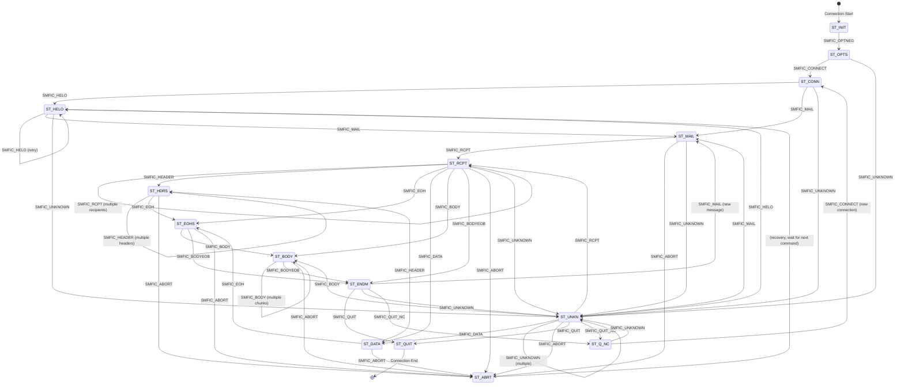

# Milter protocol specification <!-- omit from toc -->
- [Overview](#overview)
- [MTA-specific differences](#mta-specific-differences)
  - [Connection lifecycle](#connection-lifecycle)
  - [Hostname handling (SMFIC\_CONNECT)](#hostname-handling-smfic_connect)
  - [SMTP reply code handling (SMFIR\_REPLYCODE)](#smtp-reply-code-handling-smfir_replycode)
  - [Protocol version configuration](#protocol-version-configuration)
  - [Error handling and cleanup](#error-handling-and-cleanup)
  - [Multi-line reply handling](#multi-line-reply-handling)
- [Protocol architecture](#protocol-architecture)
  - [Connection model](#connection-model)
  - [Socket types](#socket-types)
- [Message format](#message-format)
  - [Reading a message](#reading-a-message)
  - [Writing a message](#writing-a-message)
- [Protocol states](#protocol-states)
  - [State transitions](#state-transitions)
- [Commands from MTA to milter](#commands-from-mta-to-milter)
  - [Connection info format (SMFIC\_CONNECT)](#connection-info-format-smfic_connect)
  - [Macro format (SMFIC\_MACRO)](#macro-format-smfic_macro)
  - [Internal error codes](#internal-error-codes)
- [Replies from milter to MTA](#replies-from-milter-to-mta)
  - [Header modification data formats](#header-modification-data-formats)
  - [Custom reply code format (SMFIR\_REPLYCODE)](#custom-reply-code-format-smfir_replycode)
- [Option negotiation](#option-negotiation)
  - [Option negotiation message format](#option-negotiation-message-format)
  - [Protocol version](#protocol-version)
  - [Action flags (SMFIF\_\*)](#action-flags-smfif_)
  - [Protocol flags (SMFIP\_\*)](#protocol-flags-smfip_)
  - [Symbol list in option negotiation (optional)](#symbol-list-in-option-negotiation-optional)
- [Macro stages (SMFIM\_\*)](#macro-stages-smfim_)
- [Typical protocol flow](#typical-protocol-flow)
  - [1. Connection establishment](#1-connection-establishment)
  - [2. SMTP session](#2-smtp-session)
  - [3. Connection cleanup](#3-connection-cleanup)
  - [4. Connection reuse (QUIT\_NC)](#4-connection-reuse-quit_nc)
  - [5. Message abort](#5-message-abort)
- [Callback functions](#callback-functions)
  - [Return status codes (SMFIS\_\*)](#return-status-codes-smfis_)
- [Data limits](#data-limits)
- [Timeouts](#timeouts)
- [Error handling](#error-handling)
  - [Connection errors](#connection-errors)
  - [Protocol errors](#protocol-errors)
- [Implementation guidelines for MTA compatibility](#implementation-guidelines-for-mta-compatibility)
  - [1. Connection management](#1-connection-management)
  - [2. Hostname processing](#2-hostname-processing)
  - [3. Reply code formatting](#3-reply-code-formatting)
  - [4. Protocol version negotiation](#4-protocol-version-negotiation)
  - [5. Error recovery](#5-error-recovery)
  - [6. Testing strategy](#6-testing-strategy)
- [Security considerations](#security-considerations)
- [Example: simple milter implementation](#example-simple-milter-implementation)
- [Protocol constants summary](#protocol-constants-summary)
  - [Command codes](#command-codes)
  - [Reply codes](#reply-codes)
  - [Version constants](#version-constants)
- [References](#references)
- [Notes](#notes)

## Overview

Milter (mail filter) is the protocol between a Mail Transfer Agent (MTA), such as Sendmail or Postfix, and external mail filter programs. Through it, a third-party program sees each message while the MTA processes it and can filter on the metadata and the content.

This specification follows two implementations:
- Sendmail libmilter, version 8.18.2
- Postfix milter, the milter8 module

Both MTAs implement the same core protocol. Where their behavior differs, this specification says so.

## MTA-specific differences

Sendmail and Postfix both implement protocol version 6, but they behave differently in the following areas.

### Connection lifecycle

Sendmail:
- keeps persistent connections to milter applications
- reuses one socket connection across several SMTP sessions, using SMFIC_QUIT_NC
- keeps the connection open until it closes it with SMFIC_QUIT

Postfix:
- closes the MTA-to-filter socket when the SMTP client disconnects
- opens a new MTA-to-filter socket for each SMTP client connection
- never reuses a connection across SMTP sessions
- hardcodes this behavior (`LIBMILTER_AUTO_DISCONNECT` in milter8.c)

What this means for a milter:
- It must support both connection models.
- It cannot rely on connection reuse under Postfix.
- Per-connection state survives across sessions under Sendmail, but not under Postfix.
- Connection pooling works differently with the two MTAs.

### Hostname handling (SMFIC_CONNECT)

Sendmail sends an unknown hostname as it has it, which can be "unknown" or empty.

Postfix converts an unknown hostname to a Sendmail-compatible form. If `client_name` is "unknown" and `client_addr` is valid, it sends `"[<ip_address>]"`. For example, an unknown host at 192.168.1.1 arrives as `"[192.168.1.1]"`.

### SMTP reply code handling (SMFIR_REPLYCODE)

Sendmail uses the reply as a format string and doubles each `%` (`%` becomes `%%`).

Postfix does not treat replies as format strings. It replaces `%%` with `%` and removes any invalid single `%`.

Example:
- reply: `"550 5.7.1 Rejected: 100% spam"`
- Sendmail expects: `"550 5.7.1 Rejected: 100%% spam"`
- Postfix expects: `"550 5.7.1 Rejected: 100% spam"`, with no escaping

### Protocol version configuration

Sendmail determines the protocol version through negotiation. Which versions it supports depends on the libmilter it was built with.

Postfix needs the version set in `main.cf`:
- parameter: `milter_protocol` (default: 6)
- supported versions: 2, 3, 4, and 6
- example: `milter_protocol = 6`
- extensions can follow the version: `milter_protocol = 6, no_header_reply`

### Error handling and cleanup

Sendmail closes the connection on a protocol error and aborts at once on a malformed message.

Postfix tolerates local errors better. After a local queue file error, such as a file that is too big or a write error, it:
- keeps the milter socket open
- skips further milter replies until the final decision
- keeps the SMTP session going for further deliveries

### Multi-line reply handling

Sendmail uses the standard RFC 5321 multi-line reply format: lines separated by `\r\n`, with `-` after the code on continuation lines.

Postfix validates every line of a multi-line reply. Each line must start with `4` or `5`, and its second character must be a digit.

## Protocol architecture

### Connection model

- The MTA connects to the milter over a Unix domain socket or TCP/IP.
- Each SMTP session corresponds to one milter connection.
- The milter listens on a socket and accepts connections from the MTA.
- The MTA sends commands and the milter sends replies over the same connection.

### Socket types

A milter can listen on:
- a Unix domain socket: `local:/path/to/socket` or `unix:/path/to/socket`
- an IPv4 socket: `inet:port@hostname`
- an IPv6 socket: `inet6:port@hostname`

## Message format

Every message in the milter protocol has this layout:

```
+------------------+------------------+------------------+
| Length (4 bytes) | Command (1 byte) | Data (variable)  |
+------------------+------------------+------------------+
```

- Length: a 4-byte unsigned integer in network byte order (big endian). It includes the command byte, so the data length is Length - 1.
- Command: one ASCII character, the command code.
- Data: optional, variable length. It can hold null-terminated strings, binary data, and so on.

### Reading a message

1. Read 4 bytes for the length, in network byte order.
2. Read 1 byte for the command.
3. Read Length - 1 bytes for the data.

### Writing a message

1. Compute the total length: data length + 1 for the command byte.
2. Write the length as 4 bytes in network byte order.
3. Write the 1-byte command.
4. Write the data.

## Protocol states

The milter protocol is a state machine with these states:

| State | Code | Description |
|-------|------|-------------|
| `ST_INIT` | 0 | Initial state |
| `ST_OPTS` | 1 | Option negotiation |
| `ST_CONN` | 2 | Connection info received |
| `ST_HELO` | 3 | HELO command received |
| `ST_MAIL` | 4 | MAIL FROM command received |
| `ST_RCPT` | 5 | RCPT TO command received |
| `ST_DATA` | 6 | DATA command received |
| `ST_HDRS` | 7 | Headers being received |
| `ST_EOHS` | 8 | End of headers |
| `ST_BODY` | 9 | Body chunks being received |
| `ST_ENDM` | 10 | End of message |
| `ST_QUIT` | 11 | QUIT command received (terminal) | 
| `ST_ABRT` | 12 | Message aborted (returns to waiting) |
| `ST_UNKN` | 13 | Unknown SMTP command |
| `ST_Q_NC` | 14 | Quit, new connection follows |

### State transitions

The protocol allows only the transitions in this diagram:



What each state accepts:

- `ST_INIT`: the initial state. Accepts option negotiation only.
- `ST_OPTS`: option negotiation is complete. Accepts connect or unknown commands.
- `ST_CONN`: the connection is established. Accepts HELO, MAIL, or unknown commands.
- `ST_HELO`: HELO received. Accepts another HELO (a retry), MAIL, or unknown commands.
- `ST_MAIL`: MAIL FROM received. Accepts RCPT, ABORT, or unknown commands.
- `ST_RCPT`: RCPT TO received. Accepts more RCPTs, headers, DATA, body, or end of message.
- `ST_DATA`: DATA received. Accepts headers or end of headers.
- `ST_HDRS`: headers arriving. Accepts more headers or end of headers.
- `ST_EOHS`: end of headers. Accepts body chunks or end of message.
- `ST_BODY`: body chunks arriving. Accepts more chunks or end of message.
- `ST_ENDM`: end of message. Accepts QUIT, a new MAIL for the next message, or unknown commands.
- `ST_ABRT`: message aborted. This state is not terminal: the connection stays open and waits for the next command, usually returning to a state equivalent to `ST_HELO`.
- `ST_UNKN`: unknown command received. Can move to most other states, which allows flexible recovery.
- `ST_Q_NC`: quit with a new connection to follow. Accepts a new connect or unknown commands.
- `ST_QUIT`: the terminal state, and the only state that ends the connection.

Abort in detail:
- `SMFIC_ABORT` does not close the connection.
- After an abort, the milter keeps waiting for commands.
- libmilter calls the abort callback (`xxfi_abort`) but sends no reply.
- The MTA usually sends a new `SMFIC_MAIL` next, to start a new message transaction.

## Commands from MTA to milter

The commands the MTA sends to the milter use the `SMFIC_` prefix:

| Command | Code | Description | Data Format |
|---------|------|-------------|-------------|
| `SMFIC_ABORT` | 'A' (0x41) | Abort current message | None |
| `SMFIC_BODY` | 'B' (0x42) | Body chunk | Binary data (up to 65535 bytes) |
| `SMFIC_CONNECT` | 'C' (0x43) | Connection information | See Connection Info Format |
| `SMFIC_MACRO` | 'D' (0x44) | Define macro | Stage code + macro pairs |
| `SMFIC_BODYEOB` | 'E' (0x45) | End of body | Optional trailing body data |
| `SMFIC_HELO` | 'H' (0x48) | HELO/EHLO command | HELO string\0 |
| `SMFIC_QUIT_NC` | 'K' (0x4B) | Quit, new connection follows | None |
| `SMFIC_HEADER` | 'L' (0x4C) | Header field | Header name\0Header value\0 |
| `SMFIC_MAIL` | 'M' (0x4D) | MAIL FROM command | Sender\0[ESMTP args\0...] |
| `SMFIC_EOH` | 'N' (0x4E) | End of headers | None |
| `SMFIC_OPTNEG` | 'O' (0x4F) | Option negotiation | Protocol version, flags |
| `SMFIC_QUIT` | 'Q' (0x51) | QUIT command | None |
| `SMFIC_RCPT` | 'R' (0x52) | RCPT TO command | Recipient\0[ESMTP args\0...] |
| `SMFIC_DATA` | 'T' (0x54) | DATA command | None |
| `SMFIC_UNKNOWN` | 'U' (0x55) | Unknown SMTP command | Command string\0 |

### Connection info format (SMFIC_CONNECT)

The `SMFIC_CONNECT` data has this layout:

```
+------------------+------------------+------------------+------------------+
| Hostname         | Family (1 byte)  | Port (2 bytes)   | Address          |
| (null-terminated)|                  | (network order)  | (null-terminated)|
+------------------+------------------+------------------+------------------+
```

Family codes (SMFIA_*):

| Code | Value | Description |
|------|-------|-------------|
| `SMFIA_UNKNOWN` | 'U' (0x55) | Unknown address family |
| `SMFIA_UNIX` | 'L' (0x4C) | Unix/local socket |
| `SMFIA_INET` | '4' (0x34) | IPv4 address |
| `SMFIA_INET6` | '6' (0x36) | IPv6 address |

Notes:
- If the family is `SMFIA_UNKNOWN`, the port and address fields are absent.
- The port is in network byte order (big endian), as received from the socket.
- For IPv4, the address is a dotted-decimal string such as "192.168.1.1".
- For IPv6, the address is a colon-hex string such as "::1" or "2001:db8::1".
- For Unix sockets, the address is the socket path.

### Macro format (SMFIC_MACRO)

```
+------------------+------------------+
| Stage (1 byte)   | Macro pairs      |
|                  | name\0value\0... |
+------------------+------------------+
```

The stage byte names the SMTP command the macros belong to. It uses the same codes as the matching SMFIC_* commands:

| Stage Byte | Corresponds To |
|------------|----------------|
| 'C' (0x43) | SMFIC_CONNECT |
| 'H' (0x48) | SMFIC_HELO |
| 'M' (0x4D) | SMFIC_MAIL |
| 'R' (0x52) | SMFIC_RCPT |
| 'T' (0x54) | SMFIC_DATA |
| 'N' (0x4E) | SMFIC_EOH |
| 'E' (0x45) | SMFIC_BODYEOB (end of message) |

The MTA always sends the macros before the command they belong to.

### Internal error codes

libmilter uses these codes internally to signal errors. They are not protocol commands.

| Code | Value | Description |
|------|-------|-------------|
| `SMFIC_TIMEOUT` | 1 | Timeout occurred |
| `SMFIC_SELECT` | 2 | Select/poll error |
| `SMFIC_MALLOC` | 3 | Memory allocation error |
| `SMFIC_RECVERR` | 4 | Receive error |
| `SMFIC_EOF` | 5 | End of file (connection closed) |
| `SMFIC_UNKNERR` | 6 | Unknown error |
| `SMFIC_TOOBIG` | 7 | Data chunk too big |
| `SMFIC_VALIDCMD` | ' ' (0x20) | First valid command code |

## Replies from milter to MTA

The replies the milter sends to the MTA use the `SMFIR_` prefix:

| Reply | Code | Description | Data Format |
|-------|------|-------------|-------------|
| `SMFIR_ADDRCPT` | '+' (0x2B) | Add recipient | Recipient address\0 |
| `SMFIR_DELRCPT` | '-' (0x2D) | Delete recipient | Recipient address\0 |
| `SMFIR_ADDRCPT_PAR` | '2' (0x32) | Add recipient with ESMTP args | Recipient\0Args\0 |
| `SMFIR_SHUTDOWN` | '4' (0x34) | 421 shutdown (internal to MTA) | None |
| `SMFIR_ACCEPT` | 'a' (0x61) | Accept message | None |
| `SMFIR_REPLBODY` | 'b' (0x62) | Replace body (chunk) | Body data (≤65535 bytes) |
| `SMFIR_CONTINUE` | 'c' (0x63) | Continue processing | None |
| `SMFIR_DISCARD` | 'd' (0x64) | Discard message silently | None |
| `SMFIR_CHGFROM` | 'e' (0x65) | Change envelope sender | Sender\0[Args\0] |
| `SMFIR_CONN_FAIL` | 'f' (0x66) | Cause connection failure | None |
| `SMFIR_ADDHEADER` | 'h' (0x68) | Add header | Header name\0Header value\0 |
| `SMFIR_INSHEADER` | 'i' (0x69) | Insert header at position | Index (4 bytes) + Name\0Value\0 |
| `SMFIR_SETSYMLIST` | 'l' (0x6C) | Set list of symbols (macros) | Stage (4 bytes) + Macros\0 |
| `SMFIR_CHGHEADER` | 'm' (0x6D) | Change/delete header | Index (4 bytes) + Name\0Value\0 |
| `SMFIR_PROGRESS` | 'p' (0x70) | Progress (reset timeout) | None |
| `SMFIR_QUARANTINE` | 'q' (0x71) | Quarantine message | Reason string\0 |
| `SMFIR_REJECT` | 'r' (0x72) | Reject with 5xx | None |
| `SMFIR_SKIP` | 's' (0x73) | Skip remaining callbacks of same type | None |
| `SMFIR_TEMPFAIL` | 't' (0x74) | Temporary failure (4xx) | None |
| `SMFIR_REPLYCODE` | 'y' (0x79) | Custom SMTP reply code | SMTP reply string\0 |

### Header modification data formats

Add header (SMFIR_ADDHEADER):
```
+------------------+------------------+
| Header name\0    | Header value\0   |
+------------------+------------------+
```

Insert header (SMFIR_INSHEADER):
```
+------------------+------------------+------------------+
| Index (4 bytes)  | Header name\0    | Header value\0   |
| (network order)  |                  |                  |
+------------------+------------------+------------------+
```
Index 0 inserts at the beginning, index 1 after the first header, and so on.

Change header (SMFIR_CHGHEADER):
```
+------------------+------------------+------------------+
| Index (4 bytes)  | Header name\0    | Header value\0   |
| (network order)  |                  | (empty = delete) |
+------------------+------------------+------------------+
```
The index is 1-based: index 1 is the first occurrence of the header, index 2 the second, and so on.
An empty value deletes the header.

### Custom reply code format (SMFIR_REPLYCODE)

```
+------------------+------------------+------------------+
| 3-digit code     | space            | Extended code    |
| (e.g., "550")    |                  | + message\0      |
+------------------+------------------+------------------+
```

Example: `"550 5.7.1 Rejected by policy\0"`

In a multi-line reply, `\r\n` separates the lines. Each continuation line starts with the reply code followed by `-` in place of the space.

## Option negotiation

At the start of each connection, the MTA and the milter negotiate capabilities with the `SMFIC_OPTNEG` command.

### Option negotiation message format

The MTA's request and the milter's response both use `SMFIC_OPTNEG` ('O'):

```
+------------------+------------------+------------------+------------------+
| Protocol Version | Action Flags     | Protocol Flags   | Symbol List      |
| (4 bytes)        | (4 bytes)        | (4 bytes)        | (optional)       |
+------------------+------------------+------------------+------------------+
```

All multi-byte integers are in network byte order (big endian).

An option negotiation message is at least 12 bytes long (`MILTER_OPTLEN`).

### Protocol version

| Constant | Value | Description |
|----------|-------|-------------|
| `SMFI_PROT_VERSION_MIN` | 2 | Minimum supported version |
| `SMFI_PROT_VERSION` | 6 | Current version (Sendmail 8.14+) |

The negotiated version is the lower of the MTA's version and the milter's version.

#### Protocol version history

Version 2 (Sendmail 8.10 to 8.12):
- the base protocol with the core callbacks
- events: connect, HELO, MAIL, RCPT, headers, body, end of message
- protocol flags: `SMFIP_NOCONNECT`, `SMFIP_NOHELO`, `SMFIP_NOMAIL`, `SMFIP_NORCPT`, `SMFIP_NOBODY`, `SMFIP_NOHDRS`, `SMFIP_NOEOH`

Version 3 (Sendmail 8.13) added:
- the `SMFIC_UNKNOWN` command
- the `SMFIP_NOUNKNOWN` protocol flag
- the `SMFIF_QUARANTINE` action flag

Version 4 (Sendmail 8.13 and later) added:
- the `SMFIC_DATA` command
- the `SMFIP_NODATA` protocol flag

Version 6 (Sendmail 8.14 and later) added:
- the `SMFIC_QUIT_NC` command (quit, new connection follows)
- the `SMFIR_SKIP` reply (skip the remaining callbacks of the same type)
- the no-reply flags `SMFIP_NR_CONN`, `SMFIP_NR_HELO`, `SMFIP_NR_MAIL`, `SMFIP_NR_RCPT`, `SMFIP_NR_DATA`, `SMFIP_NR_UNKN`, `SMFIP_NR_EOH`, and `SMFIP_NR_BODY`
- the `SMFIP_SKIP` flag (the MTA understands SMFIR_SKIP)
- the `SMFIP_RCPT_REJ` flag (send rejected RCPTs to the filter)
- the `SMFIP_HDR_LEADSPC` flag (preserve leading spaces in header values)
- the action flags `SMFIF_CHGFROM`, `SMFIF_ADDRCPT_PAR`, and `SMFIF_SETSYMLIST`

Version compatibility:

| Feature | V2 | V3 | V4 | V6 |
|---------|----|----|----|----|
| Core callbacks (connect, helo, mail, rcpt, header, body, eom) | ✓ | ✓ | ✓ | ✓ |
| SMFIC_UNKNOWN | ✗ | ✓ | ✓ | ✓ |
| SMFIC_DATA | ✗ | ✗ | ✓ | ✓ |
| SMFIC_QUIT_NC | ✗ | ✗ | ✗ | ✓ |
| SMFIR_SKIP | ✗ | ✗ | ✗ | ✓ |
| No-Reply flags (SMFIP_NR_*) | ✗ | ✗ | ✗ | ✓ |
| SMFIP_RCPT_REJ | ✗ | ✗ | ✗ | ✓ |
| SMFIF_QUARANTINE | ✗ | ✓ | ✓ | ✓ |
| SMFIF_CHGFROM | ✗ | ✗ | ✗ | ✓ |
| SMFIF_ADDRCPT_PAR | ✗ | ✗ | ✗ | ✓ |
| SMFIF_SETSYMLIST | ✗ | ✗ | ✗ | ✓ |

Version support by MTA:
- Sendmail negotiates the version based on its libmilter build.
- Postfix supports versions 2, 3, 4, and 6, set with the `milter_protocol` parameter (default: 6).

### Action flags (SMFIF_*)

The action flags list the actions the milter asks permission to perform:

| Flag | Value | Description |
|------|-------|-------------|
| `SMFIF_NONE` | 0x00000000 | No flags |
| `SMFIF_ADDHDRS` | 0x00000001 | Add headers |
| `SMFIF_CHGBODY` | 0x00000002 | Change/replace body |
| `SMFIF_MODBODY` | `SMFIF_CHGBODY` | Alias for CHGBODY (backwards compatible) |
| `SMFIF_ADDRCPT` | 0x00000004 | Add recipients |
| `SMFIF_DELRCPT` | 0x00000008 | Delete recipients |
| `SMFIF_CHGHDRS` | 0x00000010 | Change/delete headers |
| `SMFIF_QUARANTINE` | 0x00000020 | Quarantine messages |
| `SMFIF_CHGFROM` | 0x00000040 | Change envelope sender |
| `SMFIF_ADDRCPT_PAR` | 0x00000080 | Add recipients with ESMTP args |
| `SMFIF_SETSYMLIST` | 0x00000100 | Can set symbol (macro) list |

Predefined action sets:

| Set | Value | Description |
|-----|-------|-------------|
| `SMFI_V1_ACTS` | 0x0000000F | V1 filter actions |
| `SMFI_V2_ACTS` | 0x0000003F | V2 filter actions |
| `SMFI_CURR_ACTS` | 0x000001FF | Current version actions |

### Protocol flags (SMFIP_*)

The protocol flags list the protocol features each side supports or requests:

| Flag | Value | Description |
|------|-------|-------------|
| `SMFIP_NOCONNECT` | 0x00000001 | MTA should not send connect info |
| `SMFIP_NOHELO` | 0x00000002 | MTA should not send HELO info |
| `SMFIP_NOMAIL` | 0x00000004 | MTA should not send MAIL info |
| `SMFIP_NORCPT` | 0x00000008 | MTA should not send RCPT info |
| `SMFIP_NOBODY` | 0x00000010 | MTA should not send body |
| `SMFIP_NOHDRS` | 0x00000020 | MTA should not send headers |
| `SMFIP_NOEOH` | 0x00000040 | MTA should not send EOH |
| `SMFIP_NR_HDR` | 0x00000080 | No reply needed for headers |
| `SMFIP_NOUNKNOWN` | 0x00000100 | MTA should not send unknown cmds |
| `SMFIP_NODATA` | 0x00000200 | MTA should not send DATA |
| `SMFIP_SKIP` | 0x00000400 | MTA understands SMFIR_SKIP |
| `SMFIP_RCPT_REJ` | 0x00000800 | MTA should also send rejected RCPTs |
| `SMFIP_NR_CONN` | 0x00001000 | No reply needed for connect |
| `SMFIP_NR_HELO` | 0x00002000 | No reply needed for HELO |
| `SMFIP_NR_MAIL` | 0x00004000 | No reply needed for MAIL |
| `SMFIP_NR_RCPT` | 0x00008000 | No reply needed for RCPT |
| `SMFIP_NR_DATA` | 0x00010000 | No reply needed for DATA |
| `SMFIP_NR_UNKN` | 0x00020000 | No reply needed for unknown |
| `SMFIP_NR_EOH` | 0x00040000 | No reply needed for EOH |
| `SMFIP_NR_BODY` | 0x00080000 | No reply needed for body |
| `SMFIP_HDR_LEADSPC` | 0x00100000 | Preserve leading space in headers |
| `SMFIP_MDS_256K` | 0x10000000 | Max data size = 256K |
| `SMFIP_MDS_1M` | 0x20000000 | Max data size = 1M |

Alias: `SMFIP_NOHREPL` = `SMFIP_NR_HDR`, kept for backward compatibility.

Predefined protocol sets:

| Set | Value | Description |
|-----|-------|-------------|
| `SMFI_V1_PROT` | 0x0000003F | V1 protocol flags |
| `SMFI_V2_PROT` | 0x0000007F | V2 protocol flags |
| `SMFI_CURR_PROT` | 0x001FFFFF | Current protocol flags |
| `SMFI_INTERNAL` | 0x70000000 | Internal flags (MTA-libmilter) |

### Symbol list in option negotiation (optional)

After the three 4-byte integers, the milter can add a symbol list to request specific macros. Format:

```
+------------------+------------------+
| Stage (4 bytes)  | Macro list\0     |
| (network order)  | (space-separated)|
+------------------+------------------+
```

The pattern can repeat for several stages. Example macro list: `"{mail_mailer} {mail_host} {mail_addr}"`

At most 50 macros per stage (`MAXFILTERMACROS`).

## Macro stages (SMFIM_*)

`smfi_setsymlist()` and the symbol list use these constants:

| Stage | Value | Description |
|-------|-------|-------------|
| `SMFIM_CONNECT` | 0 | Connect stage |
| `SMFIM_HELO` | 1 | HELO/EHLO stage |
| `SMFIM_ENVFROM` | 2 | MAIL FROM stage |
| `SMFIM_ENVRCPT` | 3 | RCPT TO stage |
| `SMFIM_DATA` | 4 | DATA stage |
| `SMFIM_EOM` | 5 | End of message stage |
| `SMFIM_EOH` | 6 | End of headers stage |

`SMFIM_NOMACROS` = -1 is internal only. It means the command has no macros.

## Typical protocol flow

### 1. Connection establishment

```
MTA → Milter: SMFIC_OPTNEG (version=6, actions, protocol flags)
Milter → MTA: SMFIC_OPTNEG (negotiated version, actions, protocol flags)
```

### 2. SMTP session

```
MTA → Milter: SMFIC_MACRO ('C', macros for connect)
MTA → Milter: SMFIC_CONNECT (hostname, family, port, address)
Milter → MTA: SMFIR_CONTINUE

MTA → Milter: SMFIC_MACRO ('H', macros for HELO)
MTA → Milter: SMFIC_HELO (helo_string)
Milter → MTA: SMFIR_CONTINUE

MTA → Milter: SMFIC_MACRO ('M', macros for MAIL)
MTA → Milter: SMFIC_MAIL (sender, esmtp_args...)
Milter → MTA: SMFIR_CONTINUE

MTA → Milter: SMFIC_MACRO ('R', macros for RCPT)
MTA → Milter: SMFIC_RCPT (recipient, esmtp_args...)
Milter → MTA: SMFIR_CONTINUE
[... repeat for each recipient ...]

MTA → Milter: SMFIC_MACRO ('T', macros for DATA)
MTA → Milter: SMFIC_DATA
Milter → MTA: SMFIR_CONTINUE

MTA → Milter: SMFIC_HEADER (name, value)
Milter → MTA: SMFIR_CONTINUE (or no reply if SMFIP_NR_HDR)
[... repeat for each header ...]

MTA → Milter: SMFIC_MACRO ('N', macros for EOH)
MTA → Milter: SMFIC_EOH
Milter → MTA: SMFIR_CONTINUE

MTA → Milter: SMFIC_BODY (chunk, up to 65535 bytes)
Milter → MTA: SMFIR_CONTINUE (or no reply if SMFIP_NR_BODY)
[... repeat for each body chunk ...]

MTA → Milter: SMFIC_MACRO ('E', macros for EOM)
MTA → Milter: SMFIC_BODYEOB
Milter → MTA: [modifications...] then SMFIR_ACCEPT/REJECT/etc.
```

### 3. Connection cleanup

```
MTA → Milter: SMFIC_QUIT
(no reply, connection closed by both sides)
```

### 4. Connection reuse (QUIT_NC)

```
MTA → Milter: SMFIC_QUIT_NC
(no reply, connection stays open)
MTA → Milter: SMFIC_MACRO ('C', macros for new connection)
MTA → Milter: SMFIC_CONNECT (new connection info)
...
```

### 5. Message abort

```
MTA → Milter: SMFIC_ABORT
(no reply, xxfi_abort called, wait for next command)
MTA → Milter: SMFIC_MAIL (start new message)
...
```

## Callback functions

A milter implementation provides these callback functions:

| Callback | Triggered By | Valid Returns |
|----------|--------------|---------------|
| `xxfi_negotiate` | `SMFIC_OPTNEG` | `SMFIS_ALL_OPTS`, `SMFIS_CONTINUE`, `SMFIS_REJECT` |
| `xxfi_connect` | `SMFIC_CONNECT` | `SMFIS_CONTINUE`, `SMFIS_REJECT`, `SMFIS_TEMPFAIL`, `SMFIS_ACCEPT`, `SMFIS_DISCARD` |
| `xxfi_helo` | `SMFIC_HELO` | Same as connect |
| `xxfi_envfrom` | `SMFIC_MAIL` | Same as connect |
| `xxfi_envrcpt` | `SMFIC_RCPT` | Same as connect |
| `xxfi_data` | `SMFIC_DATA` | Same as connect |
| `xxfi_header` | `SMFIC_HEADER` | Same as connect, plus `SMFIS_NOREPLY` |
| `xxfi_eoh` | `SMFIC_EOH` | Same as connect |
| `xxfi_body` | `SMFIC_BODY` | Same as connect, plus `SMFIS_NOREPLY`, `SMFIS_SKIP` |
| `xxfi_eom` | `SMFIC_BODYEOB` | Same as connect (can also send modifications) |
| `xxfi_abort` | `SMFIC_ABORT` | Return ignored (no reply sent) |
| `xxfi_close` | Connection end | Return ignored (no reply sent) |
| `xxfi_unknown` | `SMFIC_UNKNOWN` | Same as connect |

When libmilter calls `xxfi_close`:
- when the connection ends, after `SMFIC_QUIT`
- after `SMFIC_QUIT_NC`
- on errors and failures, even without an explicit QUIT

### Return status codes (SMFIS_*)

| Status | Value | Description |
|--------|-------|-------------|
| `SMFIS_CONTINUE` | 0 | Continue processing |
| `SMFIS_REJECT` | 1 | Reject with 5xx |
| `SMFIS_DISCARD` | 2 | Accept but discard silently |
| `SMFIS_ACCEPT` | 3 | Accept, skip remaining filters |
| `SMFIS_TEMPFAIL` | 4 | Temporary failure (4xx) |
| `SMFIS_NOREPLY` | 7 | Don't send reply (requires NR_* flag) |
| `SMFIS_SKIP` | 8 | Skip remaining callbacks of same type |
| `SMFIS_ALL_OPTS` | 10 | Accept all MTA options (negotiate only) |

## Data limits

| Constant | Value | Description |
|----------|-------|-------------|
| `MILTER_LEN_BYTES` | 4 | Size of length field |
| `MILTER_OPTLEN` | 12 | Minimum option negotiation (3×4 bytes) |
| `MILTER_CHUNK_SIZE` | 65535 | Max body chunk size |
| `MILTER_MAX_DATA_SIZE` | 65535 | Default max data size |
| `MILTER_MDS_256K` | 262143 | 256K - 1 (when negotiated) |
| `MILTER_MDS_1M` | 1048575 | 1M - 1 (when negotiated) |
| `MAXFILTERMACROS` | 50 | Max macros per stage |

## Timeouts

Default timeouts:
- `MI_TIMEOUT`: 7210 seconds, the default read and write timeout
- `MI_CHK_TIME`: 5 seconds, the interval for checking for termination

In sendmail.cf, set the timeouts with the `T=` equate:
```
T=C:5m;S:10s;R:10s;E:5m
```

| Code | Description | Default |
|------|-------------|---------|
| C | Connection timeout | 5 minutes |
| S | Send timeout | 10 seconds |
| R | Receive timeout | 10 seconds |
| E | End-of-message timeout | 5 minutes |

## Error handling

### Connection errors

The Sendmail `F=` flags choose what happens when a milter fails:
- `R`: reject the message
- `T`: temporarily fail the message
- `4`: shut down with a 421 error
- no flag: accept the message as if the filter were not there

### Protocol errors

- Invalid state transition: try to recover to `ST_HELO`; otherwise ignore the command.
- Unknown command: abort the connection.
- Timeout: abort the connection, and call `xxfi_abort` if a message is in progress.
- Malformed message: abort the connection.

## Implementation guidelines for MTA compatibility

Follow these guidelines so the milter works with both Sendmail and Postfix.

### 1. Connection management

Design for short-lived connections:
- Do not rely on connection reuse across SMTP sessions.
- Initialize per-session state on each `SMFIC_CONNECT`.
- Clean up per-session state in `xxfi_close`.
- Assume each SMTP session gets a new connection, as under Postfix.

Support both models:
- Handle `SMFIC_QUIT_NC` for Sendmail connection reuse.
- Reset all per-message state after `SMFIC_BODYEOB` or `SMFIC_ABORT`.
- Treat `xxfi_close` as the final cleanup under either connection model.

### 2. Hostname processing

Normalize unknown hostnames:
- Accept both "unknown" and "[<ip>]" as forms of an unknown hostname.
- If the hostname is "unknown" or starts with `[`, take the IP from the address field.
- Do not expect the two MTAs to format hostnames the same way.

### 3. Reply code formatting

SMFIR_REPLYCODE:
- Do not double `%` characters in reply strings.
- Send plain-text replies without format string escaping.
- Postfix applies any transformation it needs.
- Validate the reply format: `<3-digit> <space> <text>`.

Multi-line replies:
- Start each line with the 3-digit code.
- Put `-` after the code on continuation lines and a space on the final line.
- Format: `"<code>-<text>\r\n<code>-<text>\r\n<code> <text>"`
- Start each line with `4` or `5` (tempfail or reject).

### 4. Protocol version negotiation

Detect the version:
- Accept negotiation for versions 2, 3, 4, and 6.
- Drop features cleanly for older versions.
- Send only the events and replies that the negotiated version supports.

Version-specific behavior:
```
if (negotiated_version >= 6) {
    // Can use SMFIR_SKIP, SMFIP_NR_* flags, SMFIF_CHGFROM, etc.
}
if (negotiated_version >= 4) {
    // Can receive SMFIC_DATA
}
if (negotiated_version >= 3) {
    // Can receive SMFIC_UNKNOWN
}
```

### 5. Error recovery

- Keep processing after non-fatal errors.
- Do not assume an error closes the connection.
- Use `SMFIR_PROGRESS` to avoid timeouts.
- Handle missing or malformed commands without crashing.

### 6. Testing strategy

Test with both MTAs:
- the connection lifecycle under Sendmail (persistent connections)
- the connection lifecycle under Postfix (one connection per session)
- hostname handling with the unknown and bracketed forms
- protocol version negotiation (v2, v3, v4, v6)
- reply codes that contain `%`
- cleanup after errors

## Security considerations

1. Do not run milters as root. libmilter does not need root privileges.
2. Set restrictive permissions on Unix domain sockets.
3. With TCP/IP, use firewall rules and consider binding to localhost.
4. Validate all data received from the MTA.
5. Send `SMFIR_PROGRESS` during long operations so the MTA does not time out.
6. Do not base security decisions on behavior specific to one MTA.

## Example: simple milter implementation

```c
#include <libmilter/mfapi.h>

sfsistat mlfi_connect(SMFICTX *ctx, char *hostname, _SOCK_ADDR *hostaddr)
{
    return SMFIS_CONTINUE;
}

sfsistat mlfi_envfrom(SMFICTX *ctx, char **argv)
{
    // argv[0] = sender address, argv[1..n] = ESMTP args, NULL terminated
    return SMFIS_CONTINUE;
}

sfsistat mlfi_envrcpt(SMFICTX *ctx, char **argv)
{
    // argv[0] = recipient address
    return SMFIS_CONTINUE;
}

sfsistat mlfi_header(SMFICTX *ctx, char *name, char *value)
{
    return SMFIS_CONTINUE;
}

sfsistat mlfi_eom(SMFICTX *ctx)
{
    // Can add/change headers, replace body here
    smfi_addheader(ctx, "X-Filtered", "true");
    return SMFIS_ACCEPT;
}

sfsistat mlfi_close(SMFICTX *ctx)
{
    // Cleanup private data here
    return SMFIS_CONTINUE;
}

struct smfiDesc smfilter = {
    "MyFilter",           // filter name
    SMFI_VERSION,         // version code
    SMFIF_ADDHDRS,        // action flags
    mlfi_connect,         // xxfi_connect
    NULL,                 // xxfi_helo
    mlfi_envfrom,         // xxfi_envfrom
    mlfi_envrcpt,         // xxfi_envrcpt
    mlfi_header,          // xxfi_header
    NULL,                 // xxfi_eoh
    NULL,                 // xxfi_body
    mlfi_eom,             // xxfi_eom
    NULL,                 // xxfi_abort
    mlfi_close,           // xxfi_close
    NULL,                 // xxfi_unknown
    NULL,                 // xxfi_data
    NULL                  // xxfi_negotiate
};

int main(void)
{
    smfi_setconn("inet:8891@localhost");
    if (smfi_register(smfilter) == MI_FAILURE)
        return 1;
    return smfi_main();
}
```

## Protocol constants summary

### Command codes

| Command | Code | Hex |
|---------|------|-----|
| SMFIC_ABORT | 'A' | 0x41 |
| SMFIC_BODY | 'B' | 0x42 |
| SMFIC_CONNECT | 'C' | 0x43 |
| SMFIC_MACRO | 'D' | 0x44 |
| SMFIC_BODYEOB | 'E' | 0x45 |
| SMFIC_HELO | 'H' | 0x48 |
| SMFIC_QUIT_NC | 'K' | 0x4B |
| SMFIC_HEADER | 'L' | 0x4C |
| SMFIC_MAIL | 'M' | 0x4D |
| SMFIC_EOH | 'N' | 0x4E |
| SMFIC_OPTNEG | 'O' | 0x4F |
| SMFIC_QUIT | 'Q' | 0x51 |
| SMFIC_RCPT | 'R' | 0x52 |
| SMFIC_DATA | 'T' | 0x54 |
| SMFIC_UNKNOWN | 'U' | 0x55 |

### Reply codes

| Reply | Code | Hex |
|-------|------|-----|
| SMFIR_ADDRCPT | '+' | 0x2B |
| SMFIR_DELRCPT | '-' | 0x2D |
| SMFIR_ADDRCPT_PAR | '2' | 0x32 |
| SMFIR_SHUTDOWN | '4' | 0x34 |
| SMFIR_ACCEPT | 'a' | 0x61 |
| SMFIR_REPLBODY | 'b' | 0x62 |
| SMFIR_CONTINUE | 'c' | 0x63 |
| SMFIR_DISCARD | 'd' | 0x64 |
| SMFIR_CHGFROM | 'e' | 0x65 |
| SMFIR_CONN_FAIL | 'f' | 0x66 |
| SMFIR_ADDHEADER | 'h' | 0x68 |
| SMFIR_INSHEADER | 'i' | 0x69 |
| SMFIR_SETSYMLIST | 'l' | 0x6C |
| SMFIR_CHGHEADER | 'm' | 0x6D |
| SMFIR_PROGRESS | 'p' | 0x70 |
| SMFIR_QUARANTINE | 'q' | 0x71 |
| SMFIR_REJECT | 'r' | 0x72 |
| SMFIR_SKIP | 's' | 0x73 |
| SMFIR_TEMPFAIL | 't' | 0x74 |
| SMFIR_REPLYCODE | 'y' | 0x79 |

### Version constants

| Constant | Value | Description |
|----------|-------|-------------|
| `SMFI_PROT_VERSION_MIN` | 2 | Minimum protocol version |
| `SMFI_PROT_VERSION` | 6 | Current protocol version |
| `SMFI_VERSION` | 0x01000001 or 0x01000002 | libmilter API version (depends on MDS support) |
| `SMFI_VERSION_MDS` | 0x01000002 | First version with MDS (Max Data Size) support |

## References

### Primary sources
- Sendmail libmilter source code, version 8.18.2
  - `sendmail-8.18.2/include/libmilter/mfdef.h`: protocol definitions
  - `sendmail-8.18.2/include/libmilter/mfapi.h`: API definitions
  - `sendmail-8.18.2/libmilter/`: implementation
- Postfix milter8 source code (latest)
  - `postfix/src/milter/milter.h`: Postfix milter interface
  - `postfix/src/milter/milter8.c`: Sendmail 8 protocol implementation
  - `postfix/src/smtpd/smtpd_milter.c`: SMTP integration

### Documentation
- [Postfix MILTER_README](http://www.postfix.org/MILTER_README.html): the official Postfix milter documentation
- [Sendmail libmilter documentation](https://www.sendmail.org/releases/8.18.1.html): the official Sendmail documentation
- RFC 5321: Simple Mail Transfer Protocol (SMTP)
- RFC 5322: Internet Message Format

## Notes

### General protocol rules
1. All multi-byte integers use network byte order (big endian).
2. Strings are null-terminated.
3. The protocol is case-sensitive.
4. Commands and replies are single ASCII characters (≥ 0x20).
5. The milter must be thread-safe, because it serves several connections at once.
6. The MTA sends macros before the command they belong to.
7. Message modifications are allowed only in `xxfi_eom`.
8. A body replacement must be split into chunks of at most `MILTER_CHUNK_SIZE`.
9. After `SMFIS_ACCEPT`, `SMFIS_REJECT`, `SMFIS_DISCARD`, or `SMFIS_TEMPFAIL`, the filter receives no more callbacks for that message.
10. `SMFIS_NOREPLY` requires the matching `SMFIP_NR_*` flag to have been negotiated.

### MTA-specific considerations
11. Connection reuse: Sendmail reuses connections with `SMFIC_QUIT_NC`; Postfix opens a new connection per SMTP session.
12. Hostname format: Postfix turns unknown hostnames into `[<ip>]`; Sendmail sends them unchanged.
13. Reply escaping: only Sendmail doubles `%` in `SMFIR_REPLYCODE`; Postfix uses plain text.
14. Protocol version: Postfix needs `milter_protocol` configured; Sendmail negotiates the version itself.
15. Error recovery: Postfix keeps connections open after local errors; Sendmail may close them at once.
16. Auto-disconnect: Postfix closes the milter connection when the SMTP client disconnects.

### Protocol version features
17. Version 2 is the baseline. Versions 3, 4, and 6 each add features.
18. Implement version detection, and drop features the negotiated version lacks.
19. Use version 6 in production; it has the full feature set.
20. Test with several protocol versions to confirm backward compatibility.
