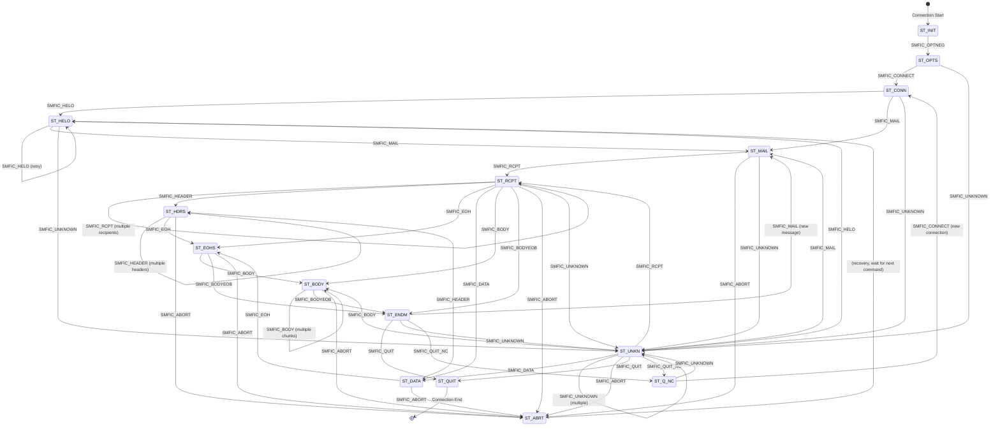
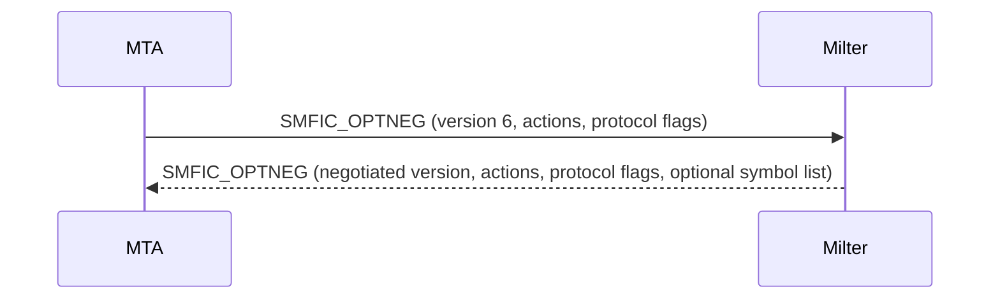
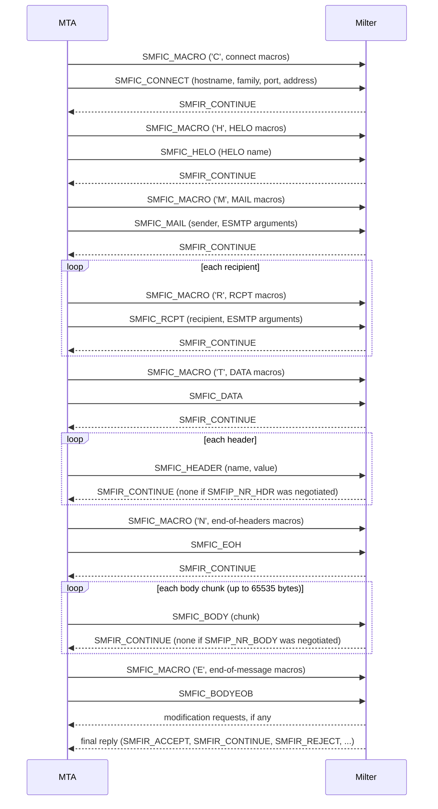
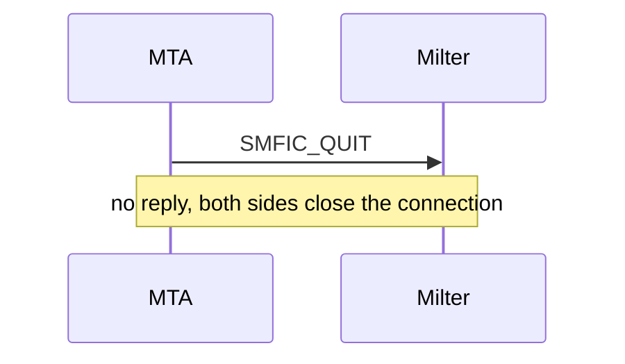
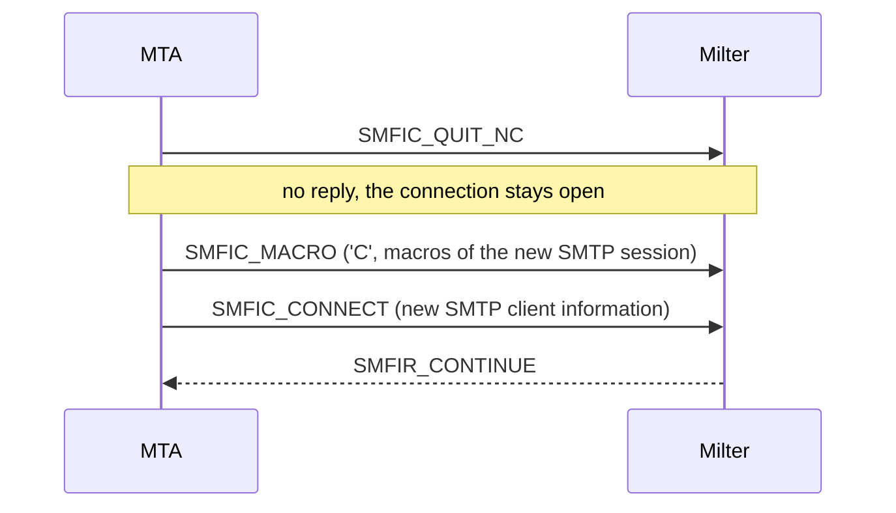
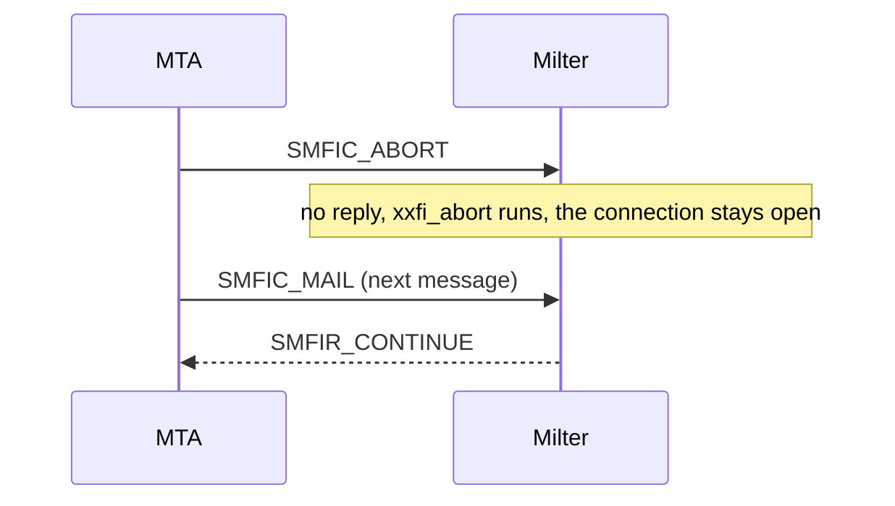

# Milter protocol specification <!-- omit from toc -->
- [Overview](#overview)
- [rust-milter protocol support](#rust-milter-protocol-support)
- [MTA-specific differences](#mta-specific-differences)
  - [Connection lifecycle](#connection-lifecycle)
  - [Hostname handling (SMFIC\_CONNECT)](#hostname-handling-smfic_connect)
  - [SMTP reply code handling (SMFIR\_REPLYCODE)](#smtp-reply-code-handling-smfir_replycode)
  - [Protocol version configuration](#protocol-version-configuration)
  - [Replies accepted at each stage](#replies-accepted-at-each-stage)
  - [Macros](#macros)
  - [Abort handling](#abort-handling)
  - [Headers and body](#headers-and-body)
  - [Error handling and cleanup](#error-handling-and-cleanup)
  - [Multi-line reply handling](#multi-line-reply-handling)
- [Protocol architecture](#protocol-architecture)
  - [Connection model](#connection-model)
  - [Socket types](#socket-types)
- [Message format](#message-format)
  - [Reading a message](#reading-a-message)
  - [Writing a message](#writing-a-message)
- [Protocol states](#protocol-states)
  - [State transitions](#state-transitions)
- [Commands from MTA to milter](#commands-from-mta-to-milter)
  - [Connection info format (SMFIC\_CONNECT)](#connection-info-format-smfic_connect)
  - [Macro format (SMFIC\_MACRO)](#macro-format-smfic_macro)
  - [Internal error codes](#internal-error-codes)
- [Replies from milter to MTA](#replies-from-milter-to-mta)
  - [Header modification data formats](#header-modification-data-formats)
  - [Custom reply code format (SMFIR\_REPLYCODE)](#custom-reply-code-format-smfir_replycode)
- [Option negotiation](#option-negotiation)
  - [Option negotiation message format](#option-negotiation-message-format)
  - [Protocol version](#protocol-version)
  - [Action flags (SMFIF\_\*)](#action-flags-smfif_)
  - [Protocol flags (SMFIP\_\*)](#protocol-flags-smfip_)
  - [Symbol list in option negotiation (optional)](#symbol-list-in-option-negotiation-optional)
- [Macro stages (SMFIM\_\*)](#macro-stages-smfim_)
- [Typical protocol flow](#typical-protocol-flow)
  - [1. Connection establishment](#1-connection-establishment)
  - [2. SMTP session](#2-smtp-session)
  - [3. Connection cleanup](#3-connection-cleanup)
  - [4. Connection reuse (QUIT\_NC)](#4-connection-reuse-quit_nc)
  - [5. Message abort](#5-message-abort)
- [Callback functions](#callback-functions)
  - [Return status codes (SMFIS\_\*)](#return-status-codes-smfis_)
- [Data limits](#data-limits)
- [Timeouts](#timeouts)
- [Error handling](#error-handling)
  - [Connection errors](#connection-errors)
  - [Protocol errors](#protocol-errors)
- [Example milter implementations](#example-milter-implementations)
- [Protocol constants summary](#protocol-constants-summary)
  - [Command codes](#command-codes)
  - [Reply codes](#reply-codes)
  - [Version constants](#version-constants)
- [References](#references)
- [Notes](#notes)

## Overview

Milter (mail filter) is the protocol between a Mail Transfer Agent (MTA), such as Sendmail or Postfix, and external mail filter programs. Through it, a third-party program sees each message while the MTA processes it and can filter on the metadata and the content.

This specification is checked against the source code of:
- Sendmail 8.19.0.2: libmilter (`include/libmilter/`, `libmilter/`) and the MTA side (`sendmail/milter.c`)
- Postfix 3.12: the `milter8` module (`src/milter/milter8.c`)

Both MTAs implement the same core protocol. Where their behavior differs, this specification says so.

## rust-milter protocol support

rust-milter supports Milter protocol versions 2 through 6. The minimum is 2, the same as libmilter (`SMFI_PROT_VERSION_MIN` in `libmilter/engine.c`).

- If the MTA offers a version below 2 in `SMFIC_OPTNEG`, rust-milter closes the connection without replying.
- Otherwise rust-milter answers with the lower of the MTA's version and 6, as libmilter does.
- rust-milter uses only the commands, replies, and flags that the negotiated version and the MTA's offered flags allow. See [Protocol version](#protocol-version) for what each version adds.
- There is no protocol version 5. Neither MTA sends it, and Postfix rejects it in `milter_protocol`.
- `SMFIC_QUIT_NC` is accepted only where libmilter accepts it: in `ST_ENDM` (after the final reply at end of message, if that reply did not reset the state) and in `ST_UNKN`. In any other state rust-milter treats it as a protocol error and closes the connection, where libmilter would ignore it, then ignore the next `SMFIC_CONNECT` too, and leave the MTA waiting for a reply. The decision is recorded in [ADR 0001](../adr/0001-commands-in-wrong-state-recover-like-libmilter-or-close.md), and [Connection reuse and session isolation](../explanation/connection-reuse.md) explains it.
- Any other command in a wrong state recovers as in libmilter if it fits from `ST_HELO` (`SMFIC_HELO`, `SMFIC_MAIL`, `SMFIC_UNKNOWN`); `SMFIC_ABORT` and `SMFIC_QUIT` are ignored as in libmilter; every other command closes the connection, where libmilter would ignore it without a reply ([ADR 0001](../adr/0001-commands-in-wrong-state-recover-like-libmilter-or-close.md)).
- The library's protocol engine runs the whole conversation and enforces these rules; handlers never see protocol frames ([ADR 0002](../adr/0002-library-runs-the-protocol-handlers-decide.md)). It tracks the protocol state with libmilter's rules (see [Protocol states](#protocol-states)).

## MTA-specific differences

Sendmail and Postfix both implement protocol version 6, but they behave differently in the following areas.

### Connection lifecycle

Both MTAs open one milter connection per SMTP session. Neither one sends `SMFIC_QUIT_NC` or reuses a milter connection for a second SMTP session. libmilter accepts `SMFIC_QUIT_NC` and other MTAs may send it, so a milter should still support it.

Sendmail:
- opens the milter connection when the SMTP session starts and negotiates options at once
- sends `SMFIC_QUIT` and closes the socket when the session ends
- after a connect- or HELO-level `SMFIR_ACCEPT`, marks the filter as done, sends `SMFIC_QUIT`, and closes the socket
- after a connect-level reject or tempfail, sends `SMFIC_QUIT` to all filters

Postfix:
- opens the milter connection on demand, when it first has an event to send
- sends `SMFIC_QUIT` and closes the socket when the SMTP client disconnects
- closes the socket without sending `SMFIC_QUIT` when the milter replied `SMFIR_ACCEPT`, `SMFIR_REJECT`, `SMFIR_TEMPFAIL`, or `SMFIR_REPLYCODE` to `SMFIC_CONNECT` or `SMFIC_HELO`, after `SMFIR_SHUTDOWN`, and after an error
- hardcodes this behavior (`LIBMILTER_AUTO_DISCONNECT` in milter8.c), because libmilter closes its socket when the SMTP client goes away

### Hostname handling (SMFIC_CONNECT)

Both MTAs send `[<ip_address>]` when the client's hostname did not resolve.

Sendmail sends the value of its `{client_name}` macro, which is already `[<ip_address>]` for an unresolved client.

Postfix converts its own placeholder: if `client_name` is "unknown" and `client_addr` is known, it sends `[<ip_address>]`. If the address is also "unknown", it sends "unknown". For example, an unresolved host at 192.168.1.1 arrives as `[192.168.1.1]` from either MTA.

### SMTP reply code handling (SMFIR_REPLYCODE)

Sendmail uses the reply text as a format string. It rejects a reply that contains a `%` not followed by a second `%`, and uses its default reply in its place.

Postfix does not use replies as format strings. It replaces `%%` with `%` and deletes any single `%`.

A literal `%` must therefore be written as `%%`. Both MTAs then show a single `%`.

Example, to show `550 5.7.1 Rejected: 100% spam`:
- send: `"550 5.7.1 Rejected: 100%% spam"`
- an unescaped `"550 5.7.1 Rejected: 100% spam"` makes Sendmail use its default reply, and Postfix shows "100 spam"

Other differences:
- Sendmail ignores the text of a reply code sent for `SMFIC_CONNECT` and keeps only its meaning: `421` shuts the session down, other `4xx` codes tempfail, and `5xx` codes reject.
- With `soft_bounce = yes`, Postfix turns `5xx` codes (and `5.x.x` enhanced codes) into `4xx`.

### Protocol version configuration

Sendmail always offers protocol version 6, all action flags (`SMFI_CURR_ACTS`), and all protocol flags (`SMFI_CURR_PROT`). It accepts any version from the milter except 1. When the milter answers with version 2 or lower, Sendmail stops sending `SMFIC_UNKNOWN`. When it answers with version 3 or lower, Sendmail also stops sending `SMFIC_DATA`.

Postfix sends the version set in `main.cf`:
- parameter: `milter_protocol` (default: 6 since Postfix 2.6; 2 before that)
- supported versions: 2, 3, 4, and 6
- example: `milter_protocol = 6`
- the extension `no_header_reply` can follow the version, as in `milter_protocol = 6, no_header_reply`. It offers `SMFIP_NR_HDR` at any version.

Postfix offers only the protocol flags that its configured version defines, but it offers all action flags at every version. It rejects a milter that answers with a higher version than its own. If the milter answers with a lower version, Postfix stops sending the events that the lower version lacks.

### Replies accepted at each stage

| Reply | Sendmail | Postfix |
|-------|----------|---------|
| `SMFIR_PROGRESS` | end of message only; other stages treat it as an error | any stage |
| `SMFIR_QUARANTINE` | end of message only | any stage; no state change |
| `SMFIR_SKIP` | acts on body chunks only | skips further events of the same type, any stage |
| `SMFIR_DISCARD` | any stage | not allowed for connect or HELO; Postfix logs a warning and uses its default reply |
| `SMFIR_SHUTDOWN` | not accepted from a milter | closes the session with 421 |
| `SMFIR_CONN_FAIL` | not accepted | not accepted |
| Modification actions | end of message only | end of message only |

### Macros

The MTA sends `SMFIC_MACRO` immediately before the command the macros belong to. The first data byte is the command code of that command.

- Sendmail sends macros for connect, HELO, MAIL, RCPT, DATA, end of headers, and end of message. It sends none for `SMFIC_UNKNOWN`, headers, or body chunks.
- Postfix also sends macros for `SMFIC_UNKNOWN` (`U`), and repeats the end-of-headers macros before each `SMFIC_HEADER` (`L`) and the end-of-data macros before each `SMFIC_BODY` (`B`).
- Postfix sends the macros for an event even when the milter turned that event off with an `SMFIP_NO*` flag, so a `SMFIC_MACRO` can arrive with no command after it.
- libmilter ignores `SMFIC_MACRO` with a stage byte it does not know and sends no reply.

### Abort handling

Sendmail sends `SMFIC_ABORT` only while a message transaction is open, that is after a `SMFIC_MAIL` that the milter accepted with `SMFIR_CONTINUE`.

Postfix sends `SMFIC_ABORT` whenever the session state allows envelope commands. A milter can therefore receive `SMFIC_ABORT` outside a transaction, for example after HELO or after a rejected MAIL. libmilter ignores such an abort without calling `xxfi_abort`.

### Headers and body

Both MTAs:
- hide their own first `Received:` header from the milter
- remove one leading space from each header value unless `SMFIP_HDR_LEADSPC` was negotiated
- send a folded header value as one string, with LF (`\n`) between the lines
- send the body with CRLF line endings, in chunks of at most 65535 bytes
- send `SMFIC_BODYEOB` without data. libmilter would also accept trailing body data in it.

Postfix applies `SMFIR_INSHEADER` relative to the message as delivered, which includes its own `Received:` header, and `SMFIR_CHGHEADER` relative to the headers the milter saw.

Header size:
- When a milter is configured, Postfix cuts each header to 60,000 bytes, whatever `header_size_limit` says, so that the header fits in libmilter's 65,535-byte packet limit. The cut applies both to what the milter receives and to the delivered message.
- Sendmail limits all headers of a message together to `MaxHeadersLength`, 32,768 bytes by default.

### Error handling and cleanup

Sendmail closes the connection on a protocol error and aborts at once on a malformed message.

Postfix tolerates local errors better. After a local queue file error, such as a file that is too big or a write error, it:
- keeps the milter socket open
- skips further milter replies until the final decision
- keeps the SMTP session going for further deliveries

When a milter is unavailable or fails, Sendmail follows the `F=` flags of the filter (see [Connection errors](#connection-errors)) and Postfix follows `milter_default_action`.

### Multi-line reply handling

Sendmail checks only the start of the reply: the first character must be `4` or `5` and the next two must be digits.

Postfix checks every line. Each line must:
- be at least 4 characters long
- start with `4` or `5` followed by two digits
- continue with `-` on a non-final line and a space on the final line
- if the character after the `-` or space is a digit, match the reply code's first digit. Postfix applies this to any digit, so a line without an enhanced status code must not start its text with a different digit: `550 100 messages` is rejected

Postfix development snapshots also require the same code on every line. Non-final lines end in CRLF. The final line has no line terminator, and the reply must contain no NUL byte except the terminating one.

libmilter's `smfi_setmlreply()` builds replies in this format, with at most 32 lines of at most 980 bytes of text each.

## Protocol architecture

### Connection model

- The MTA connects to the milter over a Unix domain socket or TCP/IP.
- Sendmail and Postfix use one milter connection per SMTP session. With `SMFIC_QUIT_NC` an MTA could reuse a connection for further sessions; libmilter supports this, but neither MTA does it.
- The milter listens on a socket and accepts connections from the MTA.
- The MTA sends commands and the milter sends replies over the same connection.

### Socket types

A milter can listen on:
- a Unix domain socket: `local:/path/to/socket` or `unix:/path/to/socket`
- an IPv4 socket: `inet:port@hostname`
- an IPv6 socket: `inet6:port@hostname`

rust-milter listens on TCP only (`inet:` and `inet6:`). It does not support Unix domain sockets.

## Message format

Every message in the milter protocol has this layout:

| Field | Size | Content |
|-------|------|---------|
| Length | 4 bytes | Unsigned integer, network byte order |
| Command | 1 byte | ASCII command or reply code |
| Data | Length - 1 bytes | Depends on the command |

- Length: a 4-byte unsigned integer in network byte order (big endian). It includes the command byte, so the data length is Length - 1. A length of 0 is invalid.
- Command: one ASCII character, the command code.
- Data: optional, variable length. It can hold null-terminated strings, binary data, and so on.

Size limits differ by side:
- libmilter rejects a command whose data is longer than its maximum data size, 65535 bytes by default.
- Postfix accepts reply packets up to `INT_MAX / 2` bytes. Sendmail sets no limit on replies.
- Postfix splits only the body into 65535-byte chunks. It does not split other commands, but it cuts each header to 60,000 bytes when a milter is configured (see [Headers and body](#headers-and-body)), so a header packet stays below 65535 bytes of data.

### Reading a message

1. Read 4 bytes for the length, in network byte order.
2. Read 1 byte for the command.
3. Read Length - 1 bytes for the data.

### Writing a message

1. Compute the total length: data length + 1 for the command byte.
2. Write the length as 4 bytes in network byte order.
3. Write the 1-byte command.
4. Write the data.

## Protocol states

libmilter runs the protocol as a state machine with these states:

| State | Code | Description |
|-------|------|-------------|
| `ST_INIT` | 0 | Initial state |
| `ST_OPTS` | 1 | Option negotiation |
| `ST_CONN` | 2 | Connection info received |
| `ST_HELO` | 3 | HELO command received |
| `ST_MAIL` | 4 | MAIL FROM command received |
| `ST_RCPT` | 5 | RCPT TO command received |
| `ST_DATA` | 6 | DATA command received |
| `ST_HDRS` | 7 | Headers being received |
| `ST_EOHS` | 8 | End of headers |
| `ST_BODY` | 9 | Body chunks being received |
| `ST_ENDM` | 10 | End of message |
| `ST_QUIT` | 11 | QUIT command received (terminal) |
| `ST_ABRT` | 12 | Message aborted (returns to waiting) |
| `ST_UNKN` | 13 | Unknown SMTP command |
| `ST_Q_NC` | 14 | Quit, new connection follows |

### State transitions

libmilter (`next_states` in `libmilter/engine.c`) allows only the transitions in this diagram:

What each state accepts:

- `ST_INIT`: the initial state. Accepts option negotiation only.
- `ST_OPTS`: option negotiation is complete. Accepts connect or unknown commands.
- `ST_CONN`: the connection is established. Accepts HELO, MAIL, or unknown commands.
- `ST_HELO`: HELO received. Accepts another HELO (a retry), MAIL, or unknown commands.
- `ST_MAIL`: MAIL FROM received. Accepts RCPT, ABORT, or unknown commands.
- `ST_RCPT`: RCPT TO received. Accepts more RCPTs, headers, DATA, body, or end of message.
- `ST_DATA`: DATA received. Accepts headers or end of headers.
- `ST_HDRS`: headers arriving. Accepts more headers or end of headers.
- `ST_EOHS`: end of headers. Accepts body chunks or end of message.
- `ST_BODY`: body chunks arriving. Accepts more chunks or end of message.
- `ST_ENDM`: end of message. Accepts QUIT, QUIT_NC, a new MAIL for the next message, or unknown commands.
- `ST_ABRT`: message aborted. The state has no allowed transitions of its own; the next command goes through the recovery rule below, which in effect returns to `ST_HELO`. The connection stays open.
- `ST_UNKN`: unknown command received. Can move to most other states, which allows flexible recovery.
- `ST_Q_NC`: quit with a new connection to follow. Accepts a new connect or unknown commands.
- `ST_QUIT`: the terminal state, and the only state that ends the connection normally.

Recovery and resets in libmilter:
- On an invalid transition, libmilter calls `xxfi_abort` if a message transaction is open, then retries the transition from `ST_HELO`. If that also fails, it ignores the command and sends no reply.
- After the milter replies `SMFIS_ACCEPT`, the state returns to `ST_HELO`.
- After `SMFIS_REJECT`, `SMFIS_DISCARD`, or `SMFIS_TEMPFAIL`, the state returns to `ST_HELO`, except for `SMFIC_RCPT` and `SMFIC_UNKNOWN`, where it stays put.

Abort in detail:
- `SMFIC_ABORT` does not close the connection.
- After an abort, the milter keeps waiting for commands.
- libmilter calls the abort callback (`xxfi_abort`) but sends no reply.
- The MTA usually sends a new `SMFIC_MAIL` next, to start a new message transaction.

## Commands from MTA to milter

The commands the MTA sends to the milter use the `SMFIC_` prefix:

| Command | Code | Description | Data Format |
|---------|------|-------------|-------------|
| `SMFIC_ABORT` | 'A' (0x41) | Abort current message | None |
| `SMFIC_BODY` | 'B' (0x42) | Body chunk | Binary data (up to 65535 bytes) |
| `SMFIC_CONNECT` | 'C' (0x43) | Connection information | See Connection Info Format |
| `SMFIC_MACRO` | 'D' (0x44) | Define macro | Stage code + macro pairs |
| `SMFIC_BODYEOB` | 'E' (0x45) | End of body | Optional trailing body data (neither MTA sends any) |
| `SMFIC_HELO` | 'H' (0x48) | HELO/EHLO command | HELO string\0 |
| `SMFIC_QUIT_NC` | 'K' (0x4B) | Quit, new connection follows | None |
| `SMFIC_HEADER` | 'L' (0x4C) | Header field | Header name\0Header value\0 |
| `SMFIC_MAIL` | 'M' (0x4D) | MAIL FROM command | Sender\0[ESMTP args\0...] |
| `SMFIC_EOH` | 'N' (0x4E) | End of headers | None |
| `SMFIC_OPTNEG` | 'O' (0x4F) | Option negotiation | Protocol version, flags |
| `SMFIC_QUIT` | 'Q' (0x51) | QUIT command | None |
| `SMFIC_RCPT` | 'R' (0x52) | RCPT TO command | Recipient\0[ESMTP args\0...] |
| `SMFIC_DATA` | 'T' (0x54) | DATA command | None |
| `SMFIC_UNKNOWN` | 'U' (0x55) | Unknown SMTP command | Command string\0 |

### Connection info format (SMFIC_CONNECT)

The `SMFIC_CONNECT` data has this layout:

| Field | Size | Content |
|-------|------|---------|
| Hostname | variable | Null-terminated string |
| Family | 1 byte | `SMFIA_*` code |
| Port | 2 bytes | Network byte order; absent when the family is `SMFIA_UNKNOWN` |
| Address | variable | Null-terminated string; absent when the family is `SMFIA_UNKNOWN` |

Family codes (SMFIA_*):

| Code | Value | Description |
|------|-------|-------------|
| `SMFIA_UNKNOWN` | 'U' (0x55) | Unknown address family |
| `SMFIA_UNIX` | 'L' (0x4C) | Unix/local socket |
| `SMFIA_INET` | '4' (0x34) | IPv4 address |
| `SMFIA_INET6` | '6' (0x36) | IPv6 address |

Notes:
- If the family is `SMFIA_UNKNOWN`, the port and address fields are absent.
- The port is in network byte order (big endian), as received from the socket.
- For IPv4, the address is a dotted-decimal string such as "192.168.1.1".
- For IPv6, the address is a colon-hex string such as "::1" or "2001:db8::1".
- Sendmail reports an IPv4-mapped IPv6 client with family `SMFIA_INET`.
- For Unix sockets the port is 0. Sendmail sends the socket path as the address; Postfix sends its client address string.

### Macro format (SMFIC_MACRO)

| Field | Size | Content |
|-------|------|---------|
| Stage | 1 byte | Command code of the command the macros belong to |
| Macro pairs | variable | Repeated pairs of null-terminated strings: name, then value |

The stage byte names the command the macros belong to. It uses the same codes as the matching SMFIC_* commands:

| Stage byte | Corresponds to | Sent by |
|------------|----------------|---------|
| 'C' (0x43) | SMFIC_CONNECT | Sendmail, Postfix |
| 'H' (0x48) | SMFIC_HELO | Sendmail, Postfix |
| 'M' (0x4D) | SMFIC_MAIL | Sendmail, Postfix |
| 'R' (0x52) | SMFIC_RCPT | Sendmail, Postfix |
| 'T' (0x54) | SMFIC_DATA | Sendmail, Postfix |
| 'L' (0x4C) | SMFIC_HEADER | Postfix only (the end-of-headers macros) |
| 'N' (0x4E) | SMFIC_EOH | Sendmail, Postfix |
| 'B' (0x42) | SMFIC_BODY | Postfix only (the end-of-data macros) |
| 'E' (0x45) | SMFIC_BODYEOB (end of message) | Sendmail, Postfix |
| 'U' (0x55) | SMFIC_UNKNOWN | Postfix only |

The MTA always sends the macros before the command they belong to. A milter must accept stage bytes it does not use and must not reply to `SMFIC_MACRO`.

### Internal error codes

libmilter uses these codes internally to signal errors. They are not protocol commands.

| Code | Value | Description |
|------|-------|-------------|
| `SMFIC_TIMEOUT` | 1 | Timeout occurred |
| `SMFIC_SELECT` | 2 | Select/poll error |
| `SMFIC_MALLOC` | 3 | Memory allocation error |
| `SMFIC_RECVERR` | 4 | Receive error |
| `SMFIC_EOF` | 5 | End of file (connection closed) |
| `SMFIC_UNKNERR` | 6 | Unknown error |
| `SMFIC_TOOBIG` | 7 | Data chunk too big |
| `SMFIC_VALIDCMD` | ' ' (0x20) | First valid command code |

## Replies from milter to MTA

The replies the milter sends to the MTA use the `SMFIR_` prefix:

| Reply | Code | Description | Data format |
|-------|------|-------------|-------------|
| `SMFIR_ADDRCPT` | '+' (0x2B) | Add recipient | Recipient address\0 |
| `SMFIR_DELRCPT` | '-' (0x2D) | Delete recipient | Recipient address\0 |
| `SMFIR_ADDRCPT_PAR` | '2' (0x32) | Add recipient with ESMTP args | Recipient\0[Args\0] |
| `SMFIR_SHUTDOWN` | '4' (0x34) | 421 shutdown; accepted from a milter by Postfix only | None |
| `SMFIR_ACCEPT` | 'a' (0x61) | Accept message | None |
| `SMFIR_REPLBODY` | 'b' (0x62) | Replace body (chunk) | Body data (≤65535 bytes) |
| `SMFIR_CONTINUE` | 'c' (0x63) | Continue processing | None |
| `SMFIR_DISCARD` | 'd' (0x64) | Discard message silently | None |
| `SMFIR_CHGFROM` | 'e' (0x65) | Change envelope sender | Sender\0[Args\0] |
| `SMFIR_CONN_FAIL` | 'f' (0x66) | Cause connection failure; neither MTA accepts it | None |
| `SMFIR_ADDHEADER` | 'h' (0x68) | Add header | Header name\0Header value\0 |
| `SMFIR_INSHEADER` | 'i' (0x69) | Insert header at position | Index (4 bytes) + Name\0Value\0 |
| `SMFIR_SETSYMLIST` | 'l' (0x6C) | Defined but never sent as a packet; the macro list travels in the `SMFIC_OPTNEG` response | n/a |
| `SMFIR_CHGHEADER` | 'm' (0x6D) | Change/delete header | Index (4 bytes) + Name\0Value\0 |
| `SMFIR_PROGRESS` | 'p' (0x70) | Progress (reset the read timeout) | None |
| `SMFIR_QUARANTINE` | 'q' (0x71) | Quarantine message | Reason string\0 |
| `SMFIR_REJECT` | 'r' (0x72) | Reject with 5xx | None |
| `SMFIR_SKIP` | 's' (0x73) | Skip the remaining body chunks | None |
| `SMFIR_TEMPFAIL` | 't' (0x74) | Temporary failure (4xx) | None |
| `SMFIR_REPLYCODE` | 'y' (0x79) | Custom SMTP reply code | SMTP reply string\0 |

### Header modification data formats

| Request | Data, in order |
|---------|----------------|
| `SMFIR_ADDHEADER` | header name (null-terminated), header value (null-terminated) |
| `SMFIR_INSHEADER` | index (4 bytes, network byte order), header name (null-terminated), header value (null-terminated) |
| `SMFIR_CHGHEADER` | index (4 bytes, network byte order), header name (null-terminated), header value (null-terminated; empty deletes the header) |

For `SMFIR_INSHEADER`, index 0 inserts at the beginning, index 1 after the first header, and so on. Sendmail requires `SMFIF_ADDHDRS` for this request.

For `SMFIR_CHGHEADER`, the index is 1-based: index 1 is the first occurrence of the header, index 2 the second, and so on. Postfix treats index 0 as 1 for Sendmail compatibility.

Sendmail logs a warning when a milter sends a modification without the matching action flag, but carries it out anyway. Postfix rejects `SMFIR_REPLBODY` once other modification requests have come between two body replacement chunks.

### Custom reply code format (SMFIR_REPLYCODE)

The data is one null-terminated string: a 3-digit reply code, a space, then an optional enhanced status code and the message text.

Example: `"550 5.7.1 Rejected by policy\0"`

In a multi-line reply, `\r\n` separates the lines. Each continuation line starts with the reply code followed by `-` in place of the space. See [Multi-line reply handling](#multi-line-reply-handling) for the rules each MTA enforces.

libmilter sends `SMFIR_REPLYCODE` only when its first digit matches the decision: `4` with `SMFIS_TEMPFAIL`, `5` with `SMFIS_REJECT`. Otherwise it sends the plain `SMFIR_TEMPFAIL` or `SMFIR_REJECT`.

## Option negotiation

At the start of each connection, the MTA and the milter negotiate capabilities with the `SMFIC_OPTNEG` command.

### Option negotiation message format

The MTA's request and the milter's response both use `SMFIC_OPTNEG` ('O'):

| Field | Size | Content |
|-------|------|---------|
| Protocol version | 4 bytes | Network byte order |
| Action flags | 4 bytes | `SMFIF_*` bits, network byte order |
| Protocol flags | 4 bytes | `SMFIP_*` bits, network byte order |
| Symbol list | variable | Optional, milter response only; see below |

All multi-byte integers are in network byte order (big endian).

An option negotiation message is at least 12 bytes long (`MILTER_OPTLEN`). libmilter closes the connection on a shorter one.

How libmilter builds its response:
- If the MTA's action flags are 0, it assumes `SMFI_V1_ACTS` (0x0F). If the MTA's protocol flags are 0, it assumes `SMFI_V1_PROT` (0x3F).
- It answers with the actions and protocol flags the milter wants. If the MTA did not offer every requested action, or every requested protocol flag, libmilter closes the connection.
- It drops `SMFIP_NODATA` and `SMFIP_NOUNKNOWN` from its answer when the MTA did not offer them, because an older MTA never sends those commands anyway.
- It drops the no-reply flags (`SMFIP_NR_*`) that the MTA did not offer, and sends `SMFIR_CONTINUE` for those stages in their place.

Sendmail closes the connection when the milter's protocol flags are not a subset of the flags Sendmail offered. A milter must therefore answer with a subset of the MTA's offer.

### Protocol version

| Constant | Value | Description |
|----------|-------|-------------|
| `SMFI_PROT_VERSION_MIN` | 2 | Minimum supported version |
| `SMFI_PROT_VERSION` | 6 | Current version (Sendmail 8.14+) |

The negotiated version is the lower of the MTA's version and the milter's version. libmilter rejects an MTA version below 2.

#### Protocol version history

Version 2 is the default of Sendmail 8.11 to 8.13 and of Postfix 2.3 to 2.5:
- the base protocol with the core callbacks
- events: connect, HELO, MAIL, RCPT, headers, end of headers, body, end of message
- protocol flags: `SMFIP_NOCONNECT`, `SMFIP_NOHELO`, `SMFIP_NOMAIL`, `SMFIP_NORCPT`, `SMFIP_NOBODY`, `SMFIP_NOHDRS`, `SMFIP_NOEOH`

Version 3 added:
- the `SMFIC_UNKNOWN` command
- the `SMFIP_NOUNKNOWN` protocol flag

Version 4 added:
- the `SMFIC_DATA` command
- the `SMFIP_NODATA` protocol flag

Postfix's source attributes `SMFIC_DATA` and `SMFIC_UNKNOWN` to Sendmail 8.13. libmilter gained the matching callbacks, `xxfi_data` and `xxfi_unknown`, in Sendmail 8.14.0.

Version 6 is the default of Sendmail 8.14 and later and of Postfix 2.6 and later. It added:
- the `SMFIC_QUIT_NC` command (quit, new connection follows), which libmilter accepts but neither MTA sends
- the `SMFIR_SKIP` reply (skip the remaining body chunks)
- the no-reply flags `SMFIP_NR_CONN`, `SMFIP_NR_HELO`, `SMFIP_NR_MAIL`, `SMFIP_NR_RCPT`, `SMFIP_NR_DATA`, `SMFIP_NR_UNKN`, `SMFIP_NR_EOH`, and `SMFIP_NR_BODY`
- the `SMFIP_SKIP` flag (the MTA understands SMFIR_SKIP)
- the `SMFIP_RCPT_REJ` flag (send rejected RCPTs to the filter)
- the `SMFIP_HDR_LEADSPC` flag (preserve leading spaces in header values)
- the symbol list in the `SMFIC_OPTNEG` response

There is no version 5.

Version compatibility:

| Feature | V2 | V3 | V4 | V6 |
|---------|----|----|----|----|
| Core callbacks (connect, helo, mail, rcpt, header, eoh, body, eom) | ✓ | ✓ | ✓ | ✓ |
| SMFIC_UNKNOWN | ✗ | ✓ | ✓ | ✓ |
| SMFIC_DATA | ✗ | ✗ | ✓ | ✓ |
| SMFIC_QUIT_NC (libmilter only) | ✗ | ✗ | ✗ | ✓ |
| SMFIR_SKIP, SMFIP_SKIP | ✗ | ✗ | ✗ | ✓ |
| No-reply flags (SMFIP_NR_*) | ✗ | ✗ | ✗ | ✓ |
| SMFIP_NR_HDR through Postfix `no_header_reply` | ✓ | ✓ | ✓ | ✓ |
| SMFIP_RCPT_REJ | ✗ | ✗ | ✗ | ✓ |
| SMFIP_HDR_LEADSPC | ✗ | ✗ | ✗ | ✓ |
| Symbol list in SMFIC_OPTNEG response | ✗ | ✗ | ✗ | ✓ |

Action flags (`SMFIF_*`) do not depend on the protocol version. The MTA offers the actions it supports and the milter picks from them. Sendmail 8.14 and later, and every Postfix version that implements a given action, offer it at every protocol version.

Version support by MTA:
- Sendmail always offers version 6.
- Postfix supports versions 2, 3, 4, and 6, set with the `milter_protocol` parameter (default: 6).

### Action flags (SMFIF_*)

The action flags list the actions the milter asks permission to perform:

| Flag | Value | Description |
|------|-------|-------------|
| `SMFIF_NONE` | 0x00000000 | No flags |
| `SMFIF_ADDHDRS` | 0x00000001 | Add headers |
| `SMFIF_CHGBODY` | 0x00000002 | Change/replace body |
| `SMFIF_MODBODY` | `SMFIF_CHGBODY` | Alias for CHGBODY (backwards compatible) |
| `SMFIF_ADDRCPT` | 0x00000004 | Add recipients |
| `SMFIF_DELRCPT` | 0x00000008 | Delete recipients |
| `SMFIF_CHGHDRS` | 0x00000010 | Change/delete headers |
| `SMFIF_QUARANTINE` | 0x00000020 | Quarantine messages |
| `SMFIF_CHGFROM` | 0x00000040 | Change envelope sender |
| `SMFIF_ADDRCPT_PAR` | 0x00000080 | Add recipients with ESMTP args |
| `SMFIF_SETSYMLIST` | 0x00000100 | Can set symbol (macro) list |

Predefined action sets:

| Set | Value | Description |
|-----|-------|-------------|
| `SMFI_V1_ACTS` | 0x0000000F | V1 filter actions |
| `SMFI_V2_ACTS` | 0x0000003F | V2 filter actions |
| `SMFI_CURR_ACTS` | 0x000001FF | Current version actions |

### Protocol flags (SMFIP_*)

The protocol flags list the protocol features each side supports or requests:

| Flag | Value | Description |
|------|-------|-------------|
| `SMFIP_NOCONNECT` | 0x00000001 | MTA should not send connect info |
| `SMFIP_NOHELO` | 0x00000002 | MTA should not send HELO info |
| `SMFIP_NOMAIL` | 0x00000004 | MTA should not send MAIL info |
| `SMFIP_NORCPT` | 0x00000008 | MTA should not send RCPT info |
| `SMFIP_NOBODY` | 0x00000010 | MTA should not send body |
| `SMFIP_NOHDRS` | 0x00000020 | MTA should not send headers |
| `SMFIP_NOEOH` | 0x00000040 | MTA should not send EOH |
| `SMFIP_NR_HDR` | 0x00000080 | No reply needed for headers |
| `SMFIP_NOUNKNOWN` | 0x00000100 | MTA should not send unknown cmds |
| `SMFIP_NODATA` | 0x00000200 | MTA should not send DATA |
| `SMFIP_SKIP` | 0x00000400 | MTA understands SMFIR_SKIP |
| `SMFIP_RCPT_REJ` | 0x00000800 | MTA should also send rejected RCPTs |
| `SMFIP_NR_CONN` | 0x00001000 | No reply needed for connect |
| `SMFIP_NR_HELO` | 0x00002000 | No reply needed for HELO |
| `SMFIP_NR_MAIL` | 0x00004000 | No reply needed for MAIL |
| `SMFIP_NR_RCPT` | 0x00008000 | No reply needed for RCPT |
| `SMFIP_NR_DATA` | 0x00010000 | No reply needed for DATA |
| `SMFIP_NR_UNKN` | 0x00020000 | No reply needed for unknown |
| `SMFIP_NR_EOH` | 0x00040000 | No reply needed for EOH |
| `SMFIP_NR_BODY` | 0x00080000 | No reply needed for body |
| `SMFIP_HDR_LEADSPC` | 0x00100000 | Preserve leading space in headers |
| `SMFIP_MDS_256K` | 0x10000000 | Max data size = 256K |
| `SMFIP_MDS_1M` | 0x20000000 | Max data size = 1M |

Alias: `SMFIP_NOHREPL` = `SMFIP_NR_HDR`, kept for backward compatibility.

`SMFIP_MDS_256K` and `SMFIP_MDS_1M` exist only in Sendmail and libmilter builds compiled with `_FFR_MDS_NEGOTIATE`, which is off by default. Postfix never offers them.

Predefined protocol sets:

| Set | Value | Description |
|-----|-------|-------------|
| `SMFI_V1_PROT` | 0x0000003F | V1 protocol flags |
| `SMFI_V2_PROT` | 0x0000007F | V2 protocol flags |
| `SMFI_CURR_PROT` | 0x001FFFFF | Current protocol flags |
| `SMFI_INTERNAL` | 0x70000000 | Internal flags (MTA-libmilter) |

### Symbol list in option negotiation (optional)

After the three 4-byte integers, the milter can add a symbol list to request specific macros. Format:

| Field | Size | Content |
|-------|------|---------|
| Stage | 4 bytes | `SMFIM_*` value, network byte order |
| Macro list | variable | Null-terminated string of macro names |

The stage is an `SMFIM_*` value. The pattern can repeat for several stages. Macro names are separated by spaces or commas. Example macro list: `"{mail_mailer} {mail_host} {mail_addr}"`

Sendmail accepts at most 50 macros per stage (`MAXFILTERMACROS`) and rejects an unknown stage value. Postfix ignores an unknown stage value.

## Macro stages (SMFIM_*)

`smfi_setsymlist()` and the symbol list use these constants:

| Stage | Value | Description |
|-------|-------|-------------|
| `SMFIM_CONNECT` | 0 | Connect stage |
| `SMFIM_HELO` | 1 | HELO/EHLO stage |
| `SMFIM_ENVFROM` | 2 | MAIL FROM stage |
| `SMFIM_ENVRCPT` | 3 | RCPT TO stage |
| `SMFIM_DATA` | 4 | DATA stage |
| `SMFIM_EOM` | 5 | End of message stage |
| `SMFIM_EOH` | 6 | End of headers stage |

`SMFIM_NOMACROS` = -1 is internal only. It means the command has no macros.

## Typical protocol flow

### 1. Connection establishment

### 2. SMTP session

### 3. Connection cleanup

Postfix may close the socket without `SMFIC_QUIT`; see [Connection lifecycle](#connection-lifecycle).

### 4. Connection reuse (QUIT_NC)

libmilter accepts this flow, but neither Sendmail nor Postfix sends `SMFIC_QUIT_NC`.

### 5. Message abort

## Callback functions

A milter implementation provides these callback functions:

| Callback | Triggered By | Valid Returns |
|----------|--------------|---------------|
| `xxfi_negotiate` | `SMFIC_OPTNEG` | `SMFIS_ALL_OPTS`, `SMFIS_CONTINUE`, `SMFIS_REJECT` |
| `xxfi_connect` | `SMFIC_CONNECT` | `SMFIS_CONTINUE`, `SMFIS_REJECT`, `SMFIS_TEMPFAIL`, `SMFIS_ACCEPT`, `SMFIS_DISCARD` |
| `xxfi_helo` | `SMFIC_HELO` | Same as connect |
| `xxfi_envfrom` | `SMFIC_MAIL` | Same as connect |
| `xxfi_envrcpt` | `SMFIC_RCPT` | Same as connect |
| `xxfi_data` | `SMFIC_DATA` | Same as connect |
| `xxfi_header` | `SMFIC_HEADER` | Same as connect |
| `xxfi_eoh` | `SMFIC_EOH` | Same as connect |
| `xxfi_body` | `SMFIC_BODY` | Same as connect, plus `SMFIS_SKIP` |
| `xxfi_eom` | `SMFIC_BODYEOB` | Same as connect (can also send modifications) |
| `xxfi_abort` | `SMFIC_ABORT` | Return ignored (no reply sent) |
| `xxfi_close` | Connection end | Return ignored (no reply sent) |
| `xxfi_unknown` | `SMFIC_UNKNOWN` | Same as connect |

Each callback that has a no-reply flag (connect, HELO, MAIL, RCPT, DATA, unknown, header, end of headers, and body) can also return `SMFIS_NOREPLY` once the matching `SMFIP_NR_*` flag is negotiated. If the milter asked for the flag and the MTA did not offer it, libmilter sends `SMFIR_CONTINUE` in its place.

When libmilter calls `xxfi_close`:
- when the connection ends, after `SMFIC_QUIT`
- after `SMFIC_QUIT_NC`
- on errors, failures, and end of file, even without an explicit QUIT

### Return status codes (SMFIS_*)

| Status | Value | Description |
|--------|-------|-------------|
| `SMFIS_CONTINUE` | 0 | Continue processing |
| `SMFIS_REJECT` | 1 | Reject with 5xx |
| `SMFIS_DISCARD` | 2 | Accept but discard silently |
| `SMFIS_ACCEPT` | 3 | Accept, skip remaining filters |
| `SMFIS_TEMPFAIL` | 4 | Temporary failure (4xx) |
| `SMFIS_NOREPLY` | 7 | Don't send reply (requires NR_* flag) |
| `SMFIS_SKIP` | 8 | Skip remaining callbacks of same type |
| `SMFIS_ALL_OPTS` | 10 | Accept all MTA options (negotiate only) |

## Data limits

| Constant | Value | Description |
|----------|-------|-------------|
| `MILTER_LEN_BYTES` | 4 | Size of length field |
| `MILTER_OPTLEN` | 12 | Minimum option negotiation (3×4 bytes) |
| `MILTER_CHUNK_SIZE` | 65535 | Max body chunk size |
| `MILTER_MAX_DATA_SIZE` | 65535 | Default max data size (libmilter) |
| `MILTER_MDS_256K` | 262143 | 256K - 1 (when negotiated; `_FFR_MDS_NEGOTIATE` builds only) |
| `MILTER_MDS_1M` | 1048575 | 1M - 1 (when negotiated; `_FFR_MDS_NEGOTIATE` builds only) |
| `MAXFILTERMACROS` | 50 | Max macros per stage (Sendmail) |
| `MAXREPLIES` | 32 | Max lines in a multi-line reply (libmilter) |
| `MAXREPLYLEN` | 980 | Max length of one reply line (libmilter) |

## Timeouts

libmilter's defaults:
- `MI_TIMEOUT`: 7210 seconds, the default read and write timeout
- `MI_CHK_TIME`: 5 seconds, the interval for checking for termination

In sendmail.cf, set the timeouts with the `T=` equate of the filter definition, as `code:value` pairs separated by semicolons. The codes:

| Code | Description | Default |
|------|-------------|---------|
| C | Connection timeout | 5 minutes |
| S | Send timeout | 10 seconds |
| R | Receive timeout | 10 seconds |
| E | End-of-message timeout | 5 minutes |

The `E` timeout runs from the moment Sendmail sends `SMFIC_BODYEOB` until the final reply. `SMFIR_PROGRESS` restarts only the per-read `R` timeout, not `E`.

Postfix timeouts, set in `main.cf`:

| Parameter | Description | Default |
|-----------|-------------|---------|
| `milter_connect_timeout` | Connecting to the milter and negotiating options | 30s |
| `milter_command_timeout` | Sending an SMTP command and receiving the reply | 30s |
| `milter_content_timeout` | Sending message content and receiving the reply | 300s |

Postfix applies each timeout to every single read or write, with no deadline for a whole stage. A `SMFIR_PROGRESS` reply therefore restarts `milter_content_timeout`.

## Error handling

### Connection errors

The Sendmail `F=` flags choose what happens when a milter fails:
- `R`: reject the message
- `T`: temporarily fail the message
- `4`: shut down with a 421 error
- no flag: accept the message as if the filter were not there

Postfix uses `milter_default_action`: `accept`, `reject`, `tempfail`, `quarantine`, or `shutdown`. The default is `shutdown` since Postfix 3.11 and `tempfail` before.

### Protocol errors

These are libmilter's reactions:
- Invalid state transition: call `xxfi_abort` if a message is open, then try to recover to `ST_HELO`; if that fails, ignore the command.
- Unknown command code: abort the connection.
- Timeout: abort the connection, and call `xxfi_abort` if a message is in progress.
- Malformed message: abort the connection.

## Example milter implementations

Sendmail ships a complete libmilter example in `libmilter/example.c` of its source tree. A rust-milter example is in the [getting started tutorial](../tutorials/getting-started.md).

## Protocol constants summary

### Command codes

| Command | Code | Hex |
|---------|------|-----|
| SMFIC_ABORT | 'A' | 0x41 |
| SMFIC_BODY | 'B' | 0x42 |
| SMFIC_CONNECT | 'C' | 0x43 |
| SMFIC_MACRO | 'D' | 0x44 |
| SMFIC_BODYEOB | 'E' | 0x45 |
| SMFIC_HELO | 'H' | 0x48 |
| SMFIC_QUIT_NC | 'K' | 0x4B |
| SMFIC_HEADER | 'L' | 0x4C |
| SMFIC_MAIL | 'M' | 0x4D |
| SMFIC_EOH | 'N' | 0x4E |
| SMFIC_OPTNEG | 'O' | 0x4F |
| SMFIC_QUIT | 'Q' | 0x51 |
| SMFIC_RCPT | 'R' | 0x52 |
| SMFIC_DATA | 'T' | 0x54 |
| SMFIC_UNKNOWN | 'U' | 0x55 |

### Reply codes

| Reply | Code | Hex |
|-------|------|-----|
| SMFIR_ADDRCPT | '+' | 0x2B |
| SMFIR_DELRCPT | '-' | 0x2D |
| SMFIR_ADDRCPT_PAR | '2' | 0x32 |
| SMFIR_SHUTDOWN | '4' | 0x34 |
| SMFIR_ACCEPT | 'a' | 0x61 |
| SMFIR_REPLBODY | 'b' | 0x62 |
| SMFIR_CONTINUE | 'c' | 0x63 |
| SMFIR_DISCARD | 'd' | 0x64 |
| SMFIR_CHGFROM | 'e' | 0x65 |
| SMFIR_CONN_FAIL | 'f' | 0x66 |
| SMFIR_ADDHEADER | 'h' | 0x68 |
| SMFIR_INSHEADER | 'i' | 0x69 |
| SMFIR_SETSYMLIST | 'l' | 0x6C |
| SMFIR_CHGHEADER | 'm' | 0x6D |
| SMFIR_PROGRESS | 'p' | 0x70 |
| SMFIR_QUARANTINE | 'q' | 0x71 |
| SMFIR_REJECT | 'r' | 0x72 |
| SMFIR_SKIP | 's' | 0x73 |
| SMFIR_TEMPFAIL | 't' | 0x74 |
| SMFIR_REPLYCODE | 'y' | 0x79 |

### Version constants

| Constant | Value | Description |
|----------|-------|-------------|
| `SMFI_PROT_VERSION_MIN` | 2 | Minimum protocol version (libmilter, rust-milter) |
| `SMFI_PROT_VERSION` | 6 | Current protocol version |
| `SMFI_VERSION` | 0x01000001, or 0x01000002 in `_FFR_MDS_NEGOTIATE` builds | libmilter API version |
| `SMFI_VERSION_MDS` | 0x01000002 | First libmilter API version with MDS (max data size) support |

## References

### Primary sources
- Sendmail 8.19.0.2 source code
  - `include/libmilter/mfdef.h`: protocol definitions
  - `include/libmilter/mfapi.h`: API definitions
  - `libmilter/engine.c`: libmilter state machine and option negotiation
  - `libmilter/smfi.c`: reply code and modification functions
  - `sendmail/milter.c`: the MTA side of the protocol
- Postfix 3.12 source code
  - `src/milter/milter.h`: Postfix milter interface
  - `src/milter/milter8.c`: Sendmail 8 protocol implementation
  - `src/smtpd/smtpd_milter.c`: SMTP integration

### Documentation
- [Postfix MILTER_README](https://www.postfix.org/MILTER_README.html): the official Postfix milter documentation
- [Postfix postconf(5)](https://www.postfix.org/postconf.5.html): `milter_protocol`, `milter_default_action`, and the milter timeouts
- `libmilter/docs/` in the Sendmail source: the official libmilter API documentation
- RFC 5321: Simple Mail Transfer Protocol (SMTP)
- RFC 5322: Internet Message Format

## Notes

### General protocol rules
1. All multi-byte integers use network byte order (big endian).
2. Strings are null-terminated.
3. The protocol is case-sensitive.
4. Commands and replies are single ASCII characters (≥ 0x20).
5. The milter must be thread-safe, because it serves several connections at once.
6. The MTA sends macros before the command they belong to.
7. Message modifications are allowed only in `xxfi_eom`.
8. A body replacement must be split into chunks of at most `MILTER_CHUNK_SIZE`.
9. After `SMFIS_ACCEPT`, `SMFIS_REJECT`, `SMFIS_DISCARD`, or `SMFIS_TEMPFAIL`, the filter receives no more callbacks for that message. A reject or tempfail at `SMFIC_RCPT` affects only that recipient.
10. `SMFIS_NOREPLY` requires the matching `SMFIP_NR_*` flag to have been negotiated.

### MTA-specific considerations
11. Connection reuse: neither Sendmail nor Postfix reuses a milter connection; both open one per SMTP session.
12. Hostname format: both MTAs send `[<ip>]` for an unresolved client.
13. Reply escaping: write `%` as `%%`. Sendmail rejects a lone `%`; Postfix deletes it.
14. Protocol version: Postfix offers the version set in `milter_protocol` (default 6); Sendmail always offers version 6.
15. Error recovery: Postfix keeps connections open after local errors; Sendmail may close them at once.
16. Disconnect: Postfix closes the milter connection when the SMTP client disconnects, and without `SMFIC_QUIT` after a connect-level decision.

### Protocol version features
17. Version 2 is the baseline and rust-milter's minimum. Versions 3, 4, and 6 each add features; there is no version 5.

## Related documents

- [Make a milter work with both Sendmail and Postfix](../how-to/make-a-milter-work-with-sendmail-and-postfix.md) (how-to guide)
- [Deploy a milter in production](../how-to/deploy-a-milter-in-production.md) (how-to guide)
- [Connection reuse and session isolation](../explanation/connection-reuse.md) (explanation)
