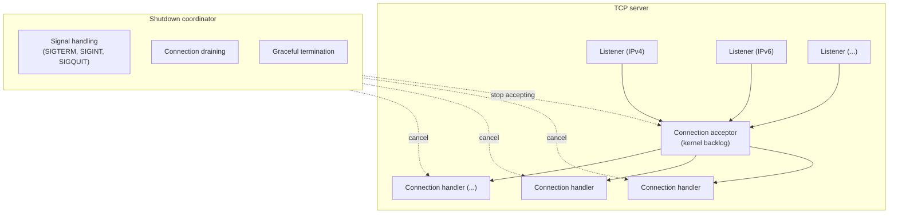
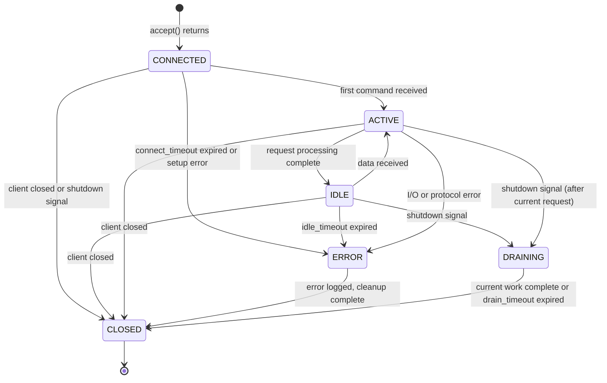

# TCP server specification

## Table of contents

- [Overview](#overview)
- [Requirements summary](#requirements-summary)
- [Architecture](#architecture)
  - [Component overview](#component-overview)
  - [Async runtime](#async-runtime)
- [Configuration](#configuration)
  - [Server configuration](#server-configuration)
  - [Timeout configuration](#timeout-configuration)
  - [Socket options](#socket-options)
  - [Keepalive configuration](#keepalive-configuration)
  - [Shutdown configuration](#shutdown-configuration)
  - [Resource limits configuration](#resource-limits-configuration)
  - [Default values](#default-values)
- [Socket address types](#socket-address-types)
  - [IPv4 sockets](#ipv4-sockets)
  - [IPv6 sockets](#ipv6-sockets)
  - [Address parsing errors](#address-parsing-errors)
- [Connection lifecycle](#connection-lifecycle)
  - [State machine](#state-machine)
  - [State transition rules](#state-transition-rules)
  - [Connection states](#connection-states)
- [Graceful shutdown](#graceful-shutdown)
  - [Signal handling requirements](#signal-handling-requirements)
  - [Shutdown sequence](#shutdown-sequence)
  - [Shutdown exit codes](#shutdown-exit-codes)
  - [Shutdown coordination](#shutdown-coordination)
  - [Shutdown timeline](#shutdown-timeline)
- [Connection handling](#connection-handling)
  - [Connection handler](#connection-handler)
  - [Connection properties](#connection-properties)
  - [Connection operations](#connection-operations)
  - [Connection identifier](#connection-identifier)
- [Concurrency model](#concurrency-model)
  - [10K connections support](#10k-connections-support)
  - [Resource limits](#resource-limits)
  - [Backpressure](#backpressure)
- [Error handling](#error-handling)
  - [Server errors](#server-errors)
  - [Connection errors](#connection-errors)
  - [Error recovery](#error-recovery)
  - [Partial bind failure](#partial-bind-failure)
- [Logging specification](#logging-specification)
  - [Log levels](#log-levels)
  - [Connection lifecycle logs](#connection-lifecycle-logs)
  - [Server lifecycle logs](#server-lifecycle-logs)
  - [Error logs](#error-logs)
  - [Log fields](#log-fields)
- [Monitoring and observability](#monitoring-and-observability)
  - [Metrics](#metrics)
  - [Health check](#health-check)
- [API design](#api-design)
  - [Server builder](#server-builder)
  - [Server handle](#server-handle)
- [Testing requirements](#testing-requirements)
  - [Test coverage](#test-coverage)
  - [Unit tests](#unit-tests)
  - [Integration tests](#integration-tests)
  - [Load tests](#load-tests)
  - [Chaos tests](#chaos-tests)
- [Security considerations](#security-considerations)
- [Implementation notes](#implementation-notes)
- [Dependencies](#dependencies)
- [Future considerations](#future-considerations)
- [References](#references)

## Overview

Design and requirements for the async TCP server in rust-milter. The server speaks the milter protocol over TCP/IP (IPv4 and IPv6), handles many concurrent connections, and shuts down gracefully.

rust-milter does not support Unix domain sockets. An MTA that talks to rust-milter must use an `inet:` or `inet6:` milter address.

## Requirements summary

| Requirement | Target |
|-------------|--------|
| Concurrent connections | 10,000+ (C10K) |
| Socket types | IPv4, IPv6 |
| Graceful shutdown | SIGTERM and SIGINT signals |
| Configurable backlog | Yes |
| Configurable timeouts | Connect/Read/Write/Idle |
| Async runtime | Tokio |

## Architecture

### Component overview

Each listener accepts TCP connections from its own address. The server spawns one connection handler task per accepted connection. The shutdown coordinator stops the listeners and cancels the handlers through a shared `CancellationToken`.

### Async runtime

The server MUST use Tokio as its async runtime, configured as follows:

| Setting | Description | Default |
|---------|-------------|---------|
| Runtime type | Multi-threaded runtime for production use | multi_thread |
| Worker threads | Number of worker threads | Number of CPU cores |
| I/O driver | Platform-specific async I/O | epoll (Linux), kqueue (macOS/BSD) |
| Thread stack size | Stack size per worker thread | 2 MiB |

## Configuration

### Server configuration

| Field | Type | Description |
|-------|------|-------------|
| `bind_addresses` | Vec\<SocketAddr\> | Socket addresses to bind (supports multiple listeners) |
| `backlog` | u32 | Listen backlog size |
| `max_connections` | usize | Maximum concurrent connections (0 = unlimited) |
| `worker_threads` | Option\<usize\> | Number of worker threads (None = CPU cores) |
| `timeouts` | TimeoutConfig | Connection timeout settings |
| `socket_options` | SocketOptions | Socket options |
| `shutdown` | ShutdownConfig | Shutdown settings |
| `resource_limits` | ResourceLimitsConfig | Resource limit settings |

### Timeout configuration

| Field | Type | Description |
|-------|------|-------------|
| `connect_timeout` | Duration | Time allowed from `accept()` until the MTA's first command (`SMFIC_OPTNEG`) arrives |
| `read_timeout` | Duration | Read timeout for socket operations |
| `write_timeout` | Duration | Write timeout for socket operations |
| `idle_timeout` | Duration | Connection idle timeout (no data exchanged) |

The server cannot observe the TCP handshake: the kernel completes it before `accept()` returns. `connect_timeout` therefore covers the time between accepting the socket and receiving the first command.

### Socket options

| Field | Type | Description |
|-------|------|-------------|
| `tcp_nodelay` | bool | Enable TCP_NODELAY (disable Nagle's algorithm) |
| `reuse_addr` | bool | Enable SO_REUSEADDR |
| `reuse_port` | bool | Enable SO_REUSEPORT (Linux 3.9+, BSD) |
| `keepalive` | Option\<KeepaliveConfig\> | TCP keepalive settings |
| `recv_buffer_size` | Option\<usize\> | Receive buffer size (SO_RCVBUF), None = OS default |
| `send_buffer_size` | Option\<usize\> | Send buffer size (SO_SNDBUF), None = OS default |
| `ipv6_only` | bool | Enable IPV6_V6ONLY (disable dual-stack) |

### Keepalive configuration

| Field | Type | Description |
|-------|------|-------------|
| `time` | Duration | Time before first keepalive probe |
| `interval` | Duration | Interval between keepalive probes |
| `retries` | u32 | Number of failed probes before connection is dropped |

### Shutdown configuration

| Field | Type | Description |
|-------|------|-------------|
| `grace_period` | Duration | Time to wait before starting drain (allows in-flight requests to arrive) |
| `drain_timeout` | Duration | Maximum time to wait for existing connections to complete after grace period |

### Resource limits configuration

| Field | Type | Description |
|-------|------|-------------|
| `max_fds` | Option\<usize\> | Maximum file descriptors (None = system limit) |
| `max_memory` | Option\<usize\> | Memory limit for buffers in bytes (None = unlimited) |
| `per_connection_buffer` | usize | Per-connection buffer limit in bytes; must hold one complete milter packet |

### Default values

| Parameter | Default value | Range |
|-----------|---------------|-------|
| `backlog` | 1024 | 1 - 65535 |
| `max_connections` | 10000 | 0 (unlimited) - 1000000 |
| `worker_threads` | CPU cores | 1 - 1024 |
| `connect_timeout` | 10 seconds | 1ms - 5 minutes |
| `read_timeout` | 30 seconds | 1ms - 1 hour |
| `write_timeout` | 30 seconds | 1ms - 1 hour |
| `idle_timeout` | 300 seconds | 1s - 24 hours |
| `tcp_nodelay` | true | - |
| `reuse_addr` | true | - |
| `reuse_port` | false | - |
| `ipv6_only` | false | - |
| `keepalive.time` | 60 seconds | 1s - 24 hours |
| `keepalive.interval` | 10 seconds | 1s - 1 hour |
| `keepalive.retries` | 6 | 1 - 30 |
| `recv_buffer_size` | OS default | 1KB - 64MB |
| `send_buffer_size` | OS default | 1KB - 64MB |
| `grace_period` | 5 seconds | 0s - 1 minute |
| `drain_timeout` | 30 seconds | 1s - 5 minutes |
| `max_fds` | System limit | - |
| `max_memory` | Unlimited | - |
| `per_connection_buffer` | 128 KB | 65,540 bytes - 16MB |

The lower bound of `per_connection_buffer` is one full default-size milter packet: 4 length bytes, 1 command byte, and 65,535 data bytes. A body chunk from either MTA can reach that size, so a smaller buffer would reject valid traffic.

## Socket address types

The server MUST support these TCP address types, in the libmilter (`smfi_setconn`) style and in plain socket address style.

### IPv4 sockets

| Format | Example |
|--------|---------|
| `inet:port@host` | `inet:8891@localhost` |
| `host:port` | `127.0.0.1:8891` |

### IPv6 sockets

| Format | Example |
|--------|---------|
| `inet6:port@host` | `inet6:8891@::1` |
| `[host]:port` | `[::1]:8891` |

| Setting | Default | Description |
|---------|---------|-------------|
| `ipv6_only` | false | When false, accept IPv4 connections on IPv6 socket (dual-stack) |

IPv6 handling:
- When `ipv6_only` is false, support dual-stack sockets (IPv4-mapped IPv6 addresses).
- When `ipv6_only` is true, accept IPv6 connections only.

### Address parsing errors

| Error | Description |
|-------|-------------|
| `InvalidFormat` | Address format not recognized, including `unix:` and `local:` addresses |
| `InvalidHost` | Host name or IP address invalid |
| `InvalidPort` | Port number out of range (1-65535) |

## Connection lifecycle

### State machine

A connection waiting in the kernel's accept queue is not visible to the server. The state machine starts when `accept()` returns.

### State transition rules

| From | To | Trigger |
|------|----|---------|
| CONNECTED | ACTIVE | First command received |
| CONNECTED | ERROR | `connect_timeout` expired, or socket setup failed |
| CONNECTED | CLOSED | Client closed the connection, or a shutdown signal arrived before any command |
| IDLE | ACTIVE | Data received |
| IDLE | ERROR | Idle timeout exceeded |
| IDLE | DRAINING | Shutdown signal received |
| IDLE | CLOSED | Client closes connection |
| ACTIVE | IDLE | Request processing complete |
| ACTIVE | ERROR | I/O error or protocol error |
| ACTIVE | DRAINING | Shutdown signal received (after current request) |
| ACTIVE | CLOSED | Client closes connection |
| ERROR | CLOSED | Error logged, cleanup complete |
| DRAINING | CLOSED | Current work complete or drain timeout |

### Connection states

| State | Description |
|-------|-------------|
| `CONNECTED` | Accepted, waiting for the MTA's first command |
| `IDLE` | Waiting for data, subject to idle timeout |
| `ACTIVE` | Currently processing a request |
| `DRAINING` | Shutdown initiated, completing current work |
| `ERROR` | Error occurred, connection will be closed |
| `CLOSED` | Connection terminated |

## Graceful shutdown

### Signal handling requirements

The TCP server MUST handle these signals for graceful shutdown:

| Signal | Required | Behavior |
|--------|----------|----------|
| `SIGTERM` | REQUIRED | Initiate graceful shutdown |
| `SIGINT` | REQUIRED | Initiate graceful shutdown (Ctrl+C) |
| `SIGQUIT` | Optional | Initiate graceful shutdown. Handling the signal replaces its default action, a core dump |
| `SIGHUP` | Optional | Reload the configuration through the registered loader (designed in [hot-reload.md](hot-reload.md)) |

Signal handling rules:

1. Signal handlers MUST be registered before the server starts accepting connections.
2. Signal handlers MUST be async-safe (use `tokio::signal`).
3. Repeated signals of the same type MUST be deduplicated, so only the first one triggers shutdown.
4. A second SIGTERM or SIGINT during shutdown SHOULD force immediate termination.
5. Signal handlers MUST NOT block the async runtime.

A second signal during shutdown:

| First signal | Second signal | Behavior |
|--------------|---------------|----------|
| SIGTERM | SIGTERM | Force immediate shutdown (skip drain) |
| SIGINT | SIGINT | Force immediate shutdown (skip drain) |
| SIGTERM | SIGINT | Force immediate shutdown (skip drain) |
| SIGINT | SIGTERM | Force immediate shutdown (skip drain) |

### Shutdown sequence

1. The server receives a shutdown signal (SIGTERM or SIGINT).
2. It logs the signal at INFO level.
3. It stops accepting new connections on every listener at once.
4. It waits `grace_period` so in-flight requests can arrive.
5. It notifies every active connection through the cancellation token.
6. It lets existing connections finish within `drain_timeout`.
7. When the drain timeout expires, it force-closes the remaining connections.
8. It releases resources.
9. It logs shutdown completion at INFO level.
10. The process exits with code 0.

### Shutdown exit codes

| Condition | Exit code |
|-----------|-----------|
| Normal shutdown (SIGTERM/SIGINT) | 0 |
| Forced shutdown (double signal) | 0 |
| Shutdown due to fatal error | 1 |
| Configuration error | 2 |

### Shutdown coordination

The shutdown coordinator manages these parts:

| Component | Description |
|-----------|-------------|
| Cancellation token | Coordinated shutdown signal propagation |
| Broadcast channel | Shutdown notifications with reason |
| Active connection counter | Track connections for drain completion |
| Completion notifier | Signal when all connections are closed |

Shutdown reasons:
- signal, with the signal number
- manual, from a programmatic shutdown
- error, with the error description

### Shutdown timeline

With the default `grace_period` (5 seconds) and `drain_timeout` (30 seconds):

```mermaid
gantt
    title Shutdown timeline with default settings
    dateFormat X
    axisFormat %S s
    section Server
    Signal received, stop accepting new connections :milestone, stop, 0, 0
    Grace period (grace_period)                     :grace, 0, 5
    Drain existing connections (drain_timeout)      :drain, 5, 35
    Force-close remaining connections, exit         :milestone, close, 35, 35
```

## Connection handling

### Connection handler

The connection handler trait defines these methods:

| Method | Parameters | Return | Required | Description |
|--------|------------|--------|----------|-------------|
| `handle` | Connection | Result\<(), ConnectionError\> | Yes | Handle a new connection |
| `on_connect` | &Connection | Result\<(), ConnectionError\> | No | Called when connection is established |
| `on_disconnect` | &Connection, DisconnectReason | () | No | Called when connection is closing |

### Connection properties

| Property | Type | Description |
|----------|------|-------------|
| `id` | ConnectionId | Unique connection identifier (see below) |
| `remote_addr` | SocketAddr | Remote address of the MTA |
| `local_addr` | SocketAddr | Local address |
| `connected_at` | Instant | Time `accept()` returned |
| `state` | ConnectionState | Current connection state |
| `bytes_read` | u64 | Total bytes read on this connection |
| `bytes_written` | u64 | Total bytes written on this connection |

### Connection operations

| Operation | Parameters | Return | Description |
|-----------|------------|--------|-------------|
| `read_with_timeout` | &mut [u8], Duration | Result\<usize, ConnectionError\> | Read data with timeout |
| `write_with_timeout` | &[u8], Duration | Result\<(), ConnectionError\> | Write data with timeout |
| `is_shutdown_requested` | - | bool | Check if shutdown was requested |
| `read_or_shutdown` | &mut [u8] | Result\<ReadResult, ConnectionError\> | Wait for data or shutdown |
| `shutdown_write` | - | Result\<(), ConnectionError\> | Half-close the write side |

Read results:

| Variant | Description |
|---------|-------------|
| `Data(usize)` | Data received with byte count |
| `Shutdown` | Shutdown signal received |
| `Timeout` | Read timeout occurred |

Disconnect reasons:

| Reason | Description |
|--------|-------------|
| `ClientClosed` | Client initiated close |
| `ServerShutdown` | Server shutdown in progress |
| `Timeout` | Connect, idle, or read/write timeout |
| `Error` | Error occurred |
| `Reset` | Connection reset by peer |
| `LimitReached` | Closed at once because `max_connections` was reached |

### Connection identifier

| Property | Description |
|----------|-------------|
| Type | 64-bit unsigned integer (u64) |
| Generation | Monotonically increasing, wraps at u64::MAX |
| Uniqueness | Unique within server lifetime (until wrap) |
| Format | Opaque, no guaranteed structure |

The server generates the connection ID atomically when it accepts a connection, and uses it for logging and tracking.

## Concurrency model

### 10K connections support

To support 10,000 or more concurrent connections:

1. All socket operations MUST be non-blocking.
2. Polling uses epoll or kqueue through Tokio.
3. Each connection runs in its own Tokio task.
4. Connection limits prevent resource exhaustion.

### Resource limits

| Limit | Description |
|-------|-------------|
| `max_fds` | Maximum file descriptors (connections + internal) |
| `max_memory` | Memory limit for buffers (approximate) |
| `per_connection_buffer` | Per-connection buffer limit |

### Backpressure

As the server approaches its resource limits:

1. When `max_connections` is reached, the server accepts each new connection and closes it at once. The MTA sees the connection close during option negotiation and applies its own failure policy (Sendmail `F=` flags, Postfix `milter_default_action`). A TCP server cannot answer an incoming connection with `ECONNREFUSED`; only a port with no listener does that.
2. Under memory pressure, it applies backpressure to slow clients.
3. When the CPU is saturated, it limits concurrent request processing.

## Error handling

### Server errors

| Error | Description |
|-------|-------------|
| `Bind` | Failed to bind to address |
| `Accept` | Failed to accept connection |
| `Config` | Configuration error |
| `Shutdown` | Shutdown error |
| `ResourceLimit` | Resource limit exceeded |
| `PartialBind` | Some addresses failed to bind (see below) |

### Connection errors

| Error | Description |
|-------|-------------|
| `Io` | I/O error |
| `ConnectTimeout` | No first command within `connect_timeout` |
| `ReadTimeout` | Read timeout exceeded |
| `WriteTimeout` | Write timeout exceeded |
| `IdleTimeout` | Idle timeout exceeded |
| `Reset` | Connection reset by peer (ECONNRESET) |
| `Closed` | Connection closed (EOF) |
| `BrokenPipe` | Broken pipe (EPIPE) |
| `NotConnected` | Socket not connected (ENOTCONN) |
| `Protocol` | Protocol error |
| `Shutdown` | Shutdown requested |

### Error recovery

| Error | Where | Recovery action |
|-------|-------|-----------------|
| `EMFILE` (too many open files) | `accept()` | Log, stop accepting for a short back-off, then retry |
| `ENFILE` (system file table full) | `accept()` | Log, stop accepting for a short back-off, then retry |
| `ECONNABORTED` | `accept()` | The client gave up before `accept()` returned. Log at debug level and keep accepting |
| `ECONNRESET` | connection | Log at debug level, close connection |
| `ETIMEDOUT` | connection | Close connection, log |
| `EPIPE` | connection | Close connection, log at debug level |
| `ENOTCONN` | connection | Close connection, log at debug level |
| `EWOULDBLOCK` / `EAGAIN` | any | Retry (handled by Tokio) |
| `EINTR` | any | Retry operation (handled by Tokio) |
| Temporary errors | any | Retry with exponential backoff (max 5 retries) |

### Partial bind failure

When the server binds to several addresses, the failure behavior is configurable:

| Mode | Behavior |
|------|----------|
| `FailFast` (default) | Fail if any address fails to bind |
| `BestEffort` | Continue with successfully bound addresses, fail only if all fail |

In `BestEffort` mode the server:
- logs a WARNING with error details for each failed bind
- logs INFO for each successful bind
- returns a `PartialBind` error listing the failed addresses, which the caller can ignore
- serves on the addresses that bound successfully

## Logging specification

### Log levels

| Level | Usage |
|-------|-------|
| ERROR | Fatal errors, server cannot continue |
| WARN | Recoverable errors, degraded operation |
| INFO | Significant events (start, stop, config) |
| DEBUG | Connection events, detailed flow |
| TRACE | Packet-level details, verbose debugging |

### Connection lifecycle logs

| Event | Level | Required fields |
|-------|-------|-----------------|
| Connection accepted | DEBUG | `conn_id`, `remote_addr`, `local_addr` |
| First command received | DEBUG | `conn_id`, `remote_addr`, `local_addr`, `duration_ms` (time since accept) |
| Connection active | TRACE | `conn_id`, `state` |
| Connection idle | TRACE | `conn_id`, `idle_since` |
| Connection draining | DEBUG | `conn_id`, `reason` |
| Connection closed (normal) | DEBUG | `conn_id`, `remote_addr`, `duration_ms`, `bytes_read`, `bytes_written`, `reason` |
| Connection closed (error) | WARN | `conn_id`, `remote_addr`, `duration_ms`, `bytes_read`, `bytes_written`, `error`, `reason` |
| Connection timeout | DEBUG | `conn_id`, `timeout_type`, `timeout_value` |
| Connection rejected (limit) | WARN | `conn_id`, `remote_addr`, `max_connections` |

Fields of the "connection accepted" log:

| Field | Type | Description |
|-------|------|-------------|
| `conn_id` | u64 | Unique connection identifier |
| `remote_addr` | String | Remote address (IP:port) |
| `local_addr` | String | Local address |
| `listener` | String | Listener address that accepted |

Fields of the "connection closed" log:

| Field | Type | Description |
|-------|------|-------------|
| `conn_id` | u64 | Unique connection identifier |
| `remote_addr` | String | Remote address |
| `duration_ms` | u64 | Connection duration in milliseconds |
| `bytes_read` | u64 | Total bytes read |
| `bytes_written` | u64 | Total bytes written |
| `reason` | String | Close reason (see DisconnectReason) |
| `error` | String | Error message (if applicable) |
| `requests` | u64 | Number of requests processed (if applicable) |

### Server lifecycle logs

| Event | Level | Required fields |
|-------|-------|-----------------|
| Server starting | INFO | `version`, `bind_addresses` |
| Server started | INFO | `bind_addresses`, `pid` |
| Listener bound | INFO | `address`, `backlog` |
| Listener bind failed | ERROR | `address`, `error` |
| Shutdown signal received | INFO | `signal`, `signal_name`, `reason` |
| Second shutdown signal received | WARN | `signal`, `signal_name`, `action` (force shutdown) |
| Shutdown grace period started | INFO | `grace_period_ms` |
| Shutdown draining started | INFO | `active_connections`, `drain_timeout_ms` |
| Shutdown complete | INFO | `uptime_s`, `total_connections`, `total_bytes_read`, `total_bytes_written`, `exit_code` |
| Configuration loaded | INFO | `config_summary` |
| Configuration error | ERROR | `error`, `field` |

### Error logs

| Event | Level | Required fields |
|-------|-------|-----------------|
| Accept error | WARN | `listener`, `error`, `consecutive_errors` |
| Accept error (fatal) | ERROR | `listener`, `error` |
| Resource limit reached | WARN | `limit_type`, `current`, `max` |
| I/O error | DEBUG | `conn_id`, `operation`, `error` |
| Protocol error | WARN | `conn_id`, `error`, `details` |

### Log fields

Every log entry SHOULD include:

| Field | Type | Description |
|-------|------|-------------|
| `timestamp` | RFC3339 | Event timestamp with microseconds |
| `level` | String | Log level |
| `target` | String | Module path |
| `message` | String | Human-readable message |

## Monitoring and observability

### Metrics

The server SHOULD expose these metrics:

| Metric | Type | Description |
|--------|------|-------------|
| `connections_accepted_total` | Counter | Total connections accepted |
| `connections_active` | Gauge | Current active connections |
| `connections_closed_total` | Counter | Total connections closed |
| `connections_rejected_total` | Counter | Connections closed at once because `max_connections` was reached |
| `connection_errors_total` | Counter (labeled) | Connection errors by type |
| `connection_duration_seconds` | Histogram | Connection duration distribution |
| `bytes_received_total` | Counter | Total bytes received |
| `bytes_sent_total` | Counter | Total bytes sent |

The length of the kernel's accept queue is not available through Tokio or the standard socket API, so the server does not report it.

### Health check

The health status contains:

| Field | Type | Description |
|-------|------|-------------|
| `accepting` | bool | Server is accepting connections |
| `connections` | usize | Current connection count |
| `uptime` | Duration | Server uptime |
| `last_error` | Option\<String\> | Last error (if any) |
| `shutting_down` | bool | Shutdown in progress |
| `listeners` | Vec\<ListenerStatus\> | Status of each listener |

Listener status:

| Field | Type | Description |
|-------|------|-------------|
| `address` | String | Listener address |
| `bound` | bool | Successfully bound |
| `accepting` | bool | Currently accepting connections |

## API design

### Server builder

The server uses the builder pattern with these methods:

| Method | Description |
|--------|-------------|
| `bind(addr)` | Add a bind address (can be called multiple times) |
| `backlog(size)` | Set listen backlog |
| `max_connections(count)` | Set maximum concurrent connections |
| `worker_threads(count)` | Set number of worker threads |
| `connect_timeout(duration)` | Set the time allowed until the first command |
| `read_timeout(duration)` | Set read timeout |
| `write_timeout(duration)` | Set write timeout |
| `idle_timeout(duration)` | Set idle timeout |
| `tcp_nodelay(enabled)` | Enable/disable TCP_NODELAY |
| `keepalive(config)` | Set keepalive configuration |
| `grace_period(duration)` | Set shutdown grace period |
| `drain_timeout(duration)` | Set shutdown drain timeout |
| `bind_mode(mode)` | Set bind failure mode (FailFast/BestEffort) |
| `handler(handler)` | Set connection handler |
| `build()` | Build the server |

### Server handle

The server handle provides:

| Method | Description |
|--------|-------------|
| `shutdown()` | Trigger graceful shutdown |
| `force_shutdown()` | Force immediate shutdown |
| `wait()` | Wait for server to stop |
| `status()` | Get current server status |
| `metrics()` | Get server metrics |
| `is_running()` | Check if server is running |

## Testing requirements

### Test coverage

| Category | Minimum coverage |
|----------|------------------|
| Unit tests | 80% line coverage |
| Integration tests | All public APIs |
| Error paths | All error variants |
| Edge cases | Timeouts, limits, shutdown |

### Unit tests

- configuration validation
- socket address parsing, including rejection of `unix:` and `local:` addresses
- error handling
- timeout behavior
- state machine transitions
- connection ID generation

### Integration tests

- accepting connections on IPv4, IPv6, and dual-stack sockets
- handling 100 or more concurrent connections
- graceful shutdown with active connections
- timeout enforcement (connect, read, write, idle)
- reconnection after a server restart
- partial bind failure
- resource limit enforcement, including the close-at-once behavior at `max_connections`

### Load tests

- hold 10,000 concurrent connections for 1 hour
- handle connection churn of 1000 connects and disconnects per second
- stable memory under load, with no leaks
- latency percentiles (p50, p95, p99) under different loads

### Chaos tests

- random connection drops
- network partitions
- resource exhaustion (FDs, memory)
- signals during high load
- slow clients (slowloris style)

## Security considerations

1. Validate every configuration parameter.
2. Enforce resource limits to prevent denial of service.
3. The milter protocol has no authentication or encryption. Bind to a loopback address unless the MTA runs on another host, and restrict access with firewall rules when it does.
4. The server should not require root privileges. Use a port above 1023.
5. Enforce timeouts to stop slowloris-style attacks.
6. Optionally rate-limit connections per source.

## Implementation notes

### Tokio practices

1. Use `tokio::select!` for cancellation-safe operations.
2. Use `BufReader` and `BufWriter` for buffered I/O.
3. Avoid blocking operations in async code.
4. Use `tokio::task::spawn_blocking` for CPU-intensive work.

### Memory

1. Reuse buffers where possible.
2. Limit per-connection buffer sizes.
3. Use `bytes::Bytes` for zero-copy operations.
4. Consider memory pools for frequent allocations.

### File descriptors

1. Set `ulimit` for production to at least 10000 plus headroom.
2. Monitor FD usage.
3. Release FDs when a connection closes.
4. When FDs run out, back off and keep running.

## Dependencies

| Crate | Purpose |
|-------|---------|
| `tokio` | Async runtime |
| `tokio-util` | Utilities (CancellationToken, etc.) |
| `socket2` | Advanced socket options |
| `tracing` | Structured logging |
| `thiserror` | Error types |
| `bytes` | Efficient byte handling |

## Future considerations

- TLS support: optional TLS termination
- connection pooling for milter client connections: designed in [milter-client.md](milter-client.md)
- hot reload of the configuration on SIGHUP: designed in [hot-reload.md](hot-reload.md)
- clustering: coordination between several server instances
- metrics export: Prometheus or OpenTelemetry integration

## References

- [Tokio tutorial](https://tokio.rs/tokio/tutorial)
- [The C10K problem](http://www.kegel.com/c10k.html)
- [Linux socket programming](https://man7.org/linux/man-pages/man7/socket.7.html)
- [Graceful shutdown patterns](https://tokio.rs/tokio/topics/shutdown)
