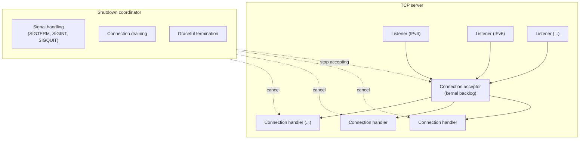
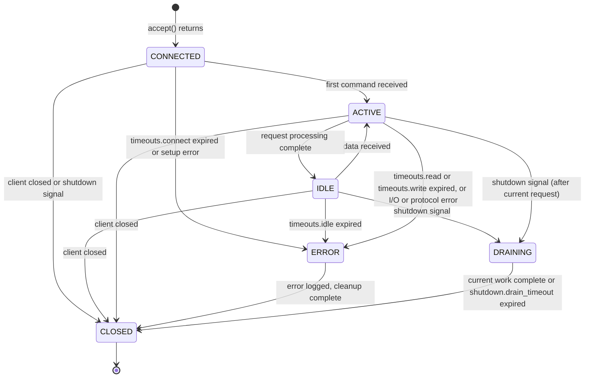

# TCP server specification

## Table of contents

- [Overview](#overview)
- [Requirements summary](#requirements-summary)
- [Architecture](#architecture)
  - [Component overview](#component-overview)
  - [Async runtime](#async-runtime)
- [Configuration](#configuration)
- [Socket address types](#socket-address-types)
  - [IPv4 sockets](#ipv4-sockets)
  - [IPv6 sockets](#ipv6-sockets)
  - [Address parsing errors](#address-parsing-errors)
- [Connection lifecycle](#connection-lifecycle)
  - [State machine](#state-machine)
  - [State transition rules](#state-transition-rules)
  - [Connection states](#connection-states)
- [Graceful shutdown](#graceful-shutdown)
  - [Signal handling requirements](#signal-handling-requirements)
  - [Shutdown sequence](#shutdown-sequence)
  - [Shutdown exit codes](#shutdown-exit-codes)
  - [Shutdown coordination](#shutdown-coordination)
  - [Shutdown timeline](#shutdown-timeline)
- [Connection handling](#connection-handling)
  - [Connection identifier](#connection-identifier)
- [Concurrency model](#concurrency-model)
  - [10K connections support](#10k-connections-support)
  - [Resource limits](#resource-limits)
  - [Backpressure](#backpressure)
- [Error handling](#error-handling)
  - [Error recovery](#error-recovery)
  - [Partial bind failure](#partial-bind-failure)
- [Logging specification](#logging-specification)
  - [Log levels](#log-levels)
  - [Connection lifecycle logs](#connection-lifecycle-logs)
  - [Server lifecycle logs](#server-lifecycle-logs)
  - [Error logs](#error-logs)
  - [Log fields](#log-fields)
- [Monitoring and observability](#monitoring-and-observability)
  - [Metrics](#metrics)
  - [Health check](#health-check)
- [API design](#api-design)
- [Testing requirements](#testing-requirements)
  - [Test coverage](#test-coverage)
  - [Unit tests](#unit-tests)
  - [Integration tests](#integration-tests)
  - [Load tests](#load-tests)
  - [Chaos tests](#chaos-tests)
- [Security considerations](#security-considerations)
- [Dependencies](#dependencies)
- [Future considerations](#future-considerations)
- [References](#references)

## Overview

Design and requirements for the async TCP server in rust-milter. The server speaks the milter protocol over TCP/IP (IPv4 and IPv6), handles many concurrent connections, and shuts down gracefully.

rust-milter does not support Unix domain sockets. An MTA that talks to rust-milter must use an `inet:` or `inet6:` milter address.

## Requirements summary

| Requirement | Target |
|-------------|--------|
| Concurrent connections | 10,000+ (C10K) |
| Socket types | IPv4, IPv6 |
| Graceful shutdown | SIGTERM and SIGINT signals |
| Configurable backlog | Yes |
| Configurable timeouts | Connect/Read/Write/Idle |
| Async runtime | Tokio |

## Architecture

### Component overview

Each listener accepts TCP connections from its own address. The server spawns one connection handler task per accepted connection. The shutdown coordinator stops the listeners and cancels the handlers through a shared `CancellationToken`.

### Async runtime

The server runs on a Tokio multi-threaded runtime. The application creates the runtime, for example with `#[tokio::main]`, and chooses its settings; rust-milter does not build one.

| Setting | Tokio default | Set by |
|---------|---------------|--------|
| Runtime type | multi-threaded with `#[tokio::main]` | the application; rust-milter requires the multi-threaded runtime |
| Worker threads | number of CPU cores | the application |
| I/O driver | epoll (Linux), kqueue (macOS, BSD) | Tokio |
| Thread stack size | 2 MiB | the application |

## Configuration

Every server setting, with its type, default, valid range, and reload behavior, is specified in [configuration.md](configuration.md). This document refers to settings by their names there, such as `timeouts.connect` or `resource_limits.per_connection_buffer`.

## Socket address types

The server MUST support these TCP address types, in the libmilter (`smfi_setconn`) style and in plain socket address style.

### IPv4 sockets

| Format | Example |
|--------|---------|
| `inet:port@host` | `inet:8891@127.0.0.1` |
| `inet:port` | `inet:8891`, every IPv4 address (`0.0.0.0`) |
| `host:port` | `127.0.0.1:8891` |

### IPv6 sockets

| Format | Example |
|--------|---------|
| `inet6:port@host` | `inet6:8891@::1`, or `inet6:8891@fe80::1%2` with a scope ID |
| `inet6:port` | `inet6:8891`, every IPv6 address (`::`) |
| `[host]:port` | `[::1]:8891`, or `[fe80::1%2]:8891` with a scope ID |

The host is always an IP address; no name is looked up. A scope ID is numeric.

| Setting | Default | Description |
|---------|---------|-------------|
| `ipv6_only` | false | When false, accept IPv4 connections on IPv6 socket (dual-stack) |

IPv6 handling:
- When `ipv6_only` is false, support dual-stack sockets (IPv4-mapped IPv6 addresses).
- When `ipv6_only` is true, accept IPv6 connections only.

### Address parsing errors

| Error | Description |
|-------|-------------|
| `InvalidFormat` | Address format not recognized, including `unix:` and `local:` addresses and Postfix's `inet:host:port` |
| `InvalidHost` | Not an IP address of the form's family, or a scope ID that is not a number |
| `InvalidPort` | Port number out of range (1-65535) |

## Connection lifecycle

### State machine

A connection waiting in the kernel's accept queue is not visible to the server. The state machine starts when `accept()` returns.

### State transition rules

| From | To | Trigger |
|------|----|---------|
| CONNECTED | ACTIVE | First command received |
| CONNECTED | ERROR | `timeouts.connect` expired, or socket setup failed |
| CONNECTED | CLOSED | Client closed the connection, or a shutdown signal arrived before any command |
| IDLE | ACTIVE | Data received |
| IDLE | ERROR | `timeouts.idle` expired |
| IDLE | DRAINING | Shutdown signal received |
| IDLE | CLOSED | Client closes connection |
| ACTIVE | IDLE | Request processing complete |
| ACTIVE | ERROR | `timeouts.read` or `timeouts.write` expired, or an I/O or protocol error |
| ACTIVE | DRAINING | Shutdown signal received (after current request) |
| ACTIVE | CLOSED | Client closes connection |
| ERROR | CLOSED | Error logged, cleanup complete |
| DRAINING | CLOSED | Current work complete, or `shutdown.drain_timeout` expired |

### Connection states

| State | Description |
|-------|-------------|
| `CONNECTED` | Accepted, waiting for the MTA's first command |
| `IDLE` | Waiting for the first byte of the next command, subject to `timeouts.idle` |
| `ACTIVE` | Receiving a frame (subject to `timeouts.read`), running the handler (no timeout), or writing the reply (subject to `timeouts.write`) |
| `DRAINING` | Shutdown initiated, completing current work |
| `ERROR` | Error occurred, connection will be closed |
| `CLOSED` | Connection terminated |

## Graceful shutdown

### Signal handling requirements

The TCP server MUST handle these signals for graceful shutdown:

| Signal | Required | Behavior |
|--------|----------|----------|
| `SIGTERM` | REQUIRED | Initiate graceful shutdown |
| `SIGINT` | REQUIRED | Initiate graceful shutdown (Ctrl+C) |
| `SIGQUIT` | Optional | Initiate graceful shutdown. Handling the signal replaces its default action, a core dump |
| `SIGHUP` | Optional | Reload the configuration through the registered loader, as [hot-reload.md](hot-reload.md) specifies. Without a loader, or during shutdown, the server logs `SIGHUP ignored` at WARN and changes nothing |

Signal handling rules:

1. Signal handlers MUST be registered before the server starts accepting connections.
2. Signal handlers MUST be async-safe (use `tokio::signal`).
3. The first SIGTERM, SIGINT, or SIGQUIT starts the graceful shutdown.
4. A second SIGTERM, SIGINT, or SIGQUIT during shutdown, of any of the three kinds, SHOULD force an immediate shutdown that skips the drain.
5. Signal handlers MUST NOT block the async runtime.

Tokio keeps a signal's handler for the life of the process once it is registered, so after `run()` returns, these signals no longer end the process.

### Shutdown sequence

1. The server receives a shutdown signal (SIGTERM, SIGINT, or SIGQUIT) or a `ServerHandle::shutdown()` call.
2. It logs the signal or call at INFO level.
3. It closes every listener at once, so new connections are refused.
4. It waits `shutdown.grace_period` so commands already on their way can arrive. Connections are served as usual meanwhile. The grace period ends early when no connection is open.
5. It notifies every active connection through the cancellation token, which handlers see as `shutdown()` in their context.
6. It lets existing connections finish within `shutdown.drain_timeout`. A connection waiting for the MTA's next command closes at once. One that is receiving a frame, running a callback, or writing a reply finishes that command first, then closes.
7. When the drain timeout expires, it force-closes the remaining connections. A forced close drops the callback in progress and calls no more callbacks, neither `abort` nor `session_end`; the session and message values are dropped.
8. It releases resources.
9. It logs shutdown completion at INFO level.
10. `Server::run()` returns `Ok(())`.

`ServerHandle::force_shutdown()`, and a second shutdown signal, skip steps 4 and 6: every connection is force-closed at once. During a graceful shutdown they end the grace period or the drain.

### Shutdown exit codes

rust-milter is a library and never exits the process itself. These are the exit codes an application should use for each result:

| Result | Recommended exit code |
|--------|-----------------------|
| `Server::run()` returns `Ok(())` after a normal or forced shutdown | 0 |
| `Server::run()` returns an error, such as a bind failure in `FailFast` mode | 1 |
| `ServerBuilder::build()` returns a configuration error | 2 |

### Shutdown coordination

The shutdown coordinator manages these parts:

| Component | Description |
|-----------|-------------|
| Cancellation token | Coordinated shutdown signal propagation |
| Broadcast channel | Shutdown notifications with reason |
| Active connection counter | Track connections for drain completion |
| Completion notifier | Signal when all connections are closed |

Shutdown reasons:
- signal, with the signal number
- manual, from a programmatic shutdown
- error, with the error description

### Shutdown timeline

With the default `shutdown.grace_period` (5 seconds) and `shutdown.drain_timeout` (30 seconds):

```mermaid
gantt
    title Shutdown timeline with default settings
    dateFormat X
    axisFormat %S s
    section Server
    Signal received, stop accepting new connections :milestone, stop, 0, 0
    Grace period (grace_period)                     :grace, 0, 5
    Drain existing connections (drain_timeout)      :drain, 5, 35
    Force-close remaining connections, exit         :milestone, close, 35, 35
```

## Connection handling

The handler API (the `Handler` callbacks and `ConnectionInfo`) is specified in [api-specification.md](api-specification.md). Handlers never touch the connection: the byte-level reads and writes, buffers, and transport states in this document are internal, and the protocol engine sits between the connection and the handler.

### Connection identifier

| Property | Description |
|----------|-------------|
| Type | 64-bit unsigned integer (u64) |
| Generation | Monotonically increasing, wraps at u64::MAX |
| Uniqueness | Unique within server lifetime (until wrap) |
| Format | Opaque, no guaranteed structure |

The server generates the connection ID atomically when it accepts a connection, and uses it for logging and tracking.

## Concurrency model

### 10K connections support

To support 10,000 or more concurrent connections:

1. All socket operations MUST be non-blocking.
2. Polling uses epoll or kqueue through Tokio.
3. Each connection runs in its own Tokio task.
4. Connection limits prevent resource exhaustion.

### Resource limits

| Limit | Description |
|-------|-------------|
| `max_fds` | Maximum file descriptors (connections + internal) |
| `max_memory` | Memory limit for buffers (approximate) |
| `per_connection_buffer` | Per-connection buffer limit |

### Backpressure

As the server approaches its resource limits:

1. When `max_connections` is reached, the server accepts each new connection and closes it at once. The MTA sees the connection close during option negotiation and applies its own failure policy (Sendmail `F=` flags, Postfix `milter_default_action`). A TCP server cannot answer an incoming connection with `ECONNREFUSED`; only a port with no listener does that.
2. When `max_memory` is set and the connection buffers would exceed it, the server closes new connections at once, as at `max_connections`, and closes a connection whose buffer would have to grow past the limit (`Error::ResourceLimit`).

`max_memory` counts the read buffers of the open connections. Each connection reserves 4 KB when it is accepted, and grows its reservation to the length of a frame as soon as the frame's length field arrives, before the data. The reservation falls back to 4 KB once the frame is complete. Replies and the values a handler keeps are not counted.

## Error handling

The error types and their variants are specified in [api-specification.md](api-specification.md#errors). This section covers how the server reacts to operating system errors.

### Error recovery

| Error | Where | Recovery action |
|-------|-------|-----------------|
| `EMFILE` (too many open files) | `accept()` | Log, then back off: stop accepting on that listener for 100 ms, doubling after each consecutive error up to 1 s. A successful accept resets the back-off |
| `ENFILE` (system file table full) | `accept()` | Same back-off as `EMFILE` |
| any other `accept()` error | `accept()` | Same back-off as `EMFILE`, so a failing listener never spins |
| `ECONNABORTED` | `accept()` | The client gave up before `accept()` returned. Log at debug level and keep accepting |
| `ECONNRESET` | connection | Log at debug level, close connection |
| `ETIMEDOUT` | connection | Close connection, log |
| `EPIPE` | connection | Close connection, log at debug level |
| `ENOTCONN` | connection | Close connection, log at debug level |
| `EWOULDBLOCK` / `EAGAIN` | any | Retry (handled by Tokio) |
| `EINTR` | any | Retry operation (handled by Tokio) |

Tokio retries `EINTR`, `EWOULDBLOCK`, and `EAGAIN` itself. rust-milter retries no other error on a connection, because a retried read or write could leave the milter stream out of step: any other error closes the connection.

### Partial bind failure

When the server binds to several addresses, the failure behavior is configurable:

| Mode | Behavior |
|------|----------|
| `FailFast` (default) | Fail if any address fails to bind |
| `BestEffort` | Continue with successfully bound addresses, fail only if all fail |

In `BestEffort` mode the server:
- logs a WARNING with error details for each failed bind
- logs INFO for each successful bind
- marks each failed listener with `bound = false` in `ServerHandle::status()`
- serves on the addresses that bound successfully

## Logging specification

### Log levels

| Level | Usage |
|-------|-------|
| ERROR | Fatal errors, server cannot continue |
| WARN | Recoverable errors, degraded operation |
| INFO | Significant events (start, stop, config) |
| DEBUG | Connection events, detailed flow |
| TRACE | Packet-level details, verbose debugging |

### Connection lifecycle logs

| Event | Level | Required fields |
|-------|-------|-----------------|
| Connection accepted | DEBUG | `conn_id`, `remote_addr`, `local_addr` |
| First command received | DEBUG | `conn_id`, `remote_addr`, `local_addr`, `duration_ms` (time since accept) |
| Connection active | TRACE | `conn_id`, `state` |
| Connection idle | TRACE | `conn_id`, `idle_since` |
| Connection draining | DEBUG | `conn_id`, `reason` |
| Connection closed (normal) | DEBUG | `conn_id`, `remote_addr`, `duration_ms`, `bytes_read`, `bytes_written`, `reason` |
| Connection closed (error) | WARN | `conn_id`, `remote_addr`, `duration_ms`, `bytes_read`, `bytes_written`, `error`, `reason` |
| Connection timeout | DEBUG | `conn_id`, `timeout_type`, `timeout_value` |
| Connection rejected (limit) | WARN | `conn_id`, `remote_addr`, `max_connections` |

The close log is the error form, at WARN, only for the reason `error`: a protocol error, a failed callback, an end of file in the middle of a frame, a frame longer than `per_connection_buffer`, or a socket error other than a reset. A close for the reasons `client_closed`, `server_shutdown`, `timeout`, `reset`, and `limit_reached` (a buffer that would pass `max_memory`) is the normal form at DEBUG, with `error` added for a timeout, a reset, and a limit. MTAs close idle milter connections and reset connections in normal operation, so neither is a warning.

Fields of the "connection accepted" log:

| Field | Type | Description |
|-------|------|-------------|
| `conn_id` | u64 | Unique connection identifier |
| `remote_addr` | String | Remote address (IP:port) |
| `local_addr` | String | Local address |
| `listener` | String | Listener address that accepted |

Fields of the "connection closed" log:

| Field | Type | Description |
|-------|------|-------------|
| `conn_id` | u64 | Unique connection identifier |
| `remote_addr` | String | Remote address |
| `duration_ms` | u64 | Connection duration in milliseconds |
| `bytes_read` | u64 | Total bytes read |
| `bytes_written` | u64 | Total bytes written |
| `reason` | String | Close reason: one of the `milter.close_reason` values in [telemetry.md](telemetry.md#attribute-values) |
| `error` | String | Error message (if applicable) |
| `commands` | u64 | Number of commands received |

### Server lifecycle logs

| Event | Level | Required fields |
|-------|-------|-----------------|
| Server starting | INFO | `version`, `bind_addresses` |
| Server started | INFO | `bind_addresses`, `pid` |
| Listener bound | INFO | `address`, `backlog` |
| Listener bind failed | ERROR in `FailFast` mode, WARN in `BestEffort` mode | `address`, `error` |
| Shutdown requested | INFO | `reason` (`manual`), `force` |
| Shutdown signal received | INFO | `signal`, `signal_name`, `reason` (`signal`) |
| Second shutdown signal received | WARN | `signal`, `signal_name`, `action` (force shutdown) |
| Shutdown grace period started | INFO | `grace_period_ms` |
| Shutdown draining started | INFO | `active_connections`, `drain_timeout_ms` |
| Shutdown complete | INFO | `uptime_s`, `total_connections`, `total_bytes_read`, `total_bytes_written` |
| Configuration loaded | INFO | `generation` |
| Configuration error | ERROR | `error`, `field` |

### Error logs

| Event | Level | Required fields |
|-------|-------|-----------------|
| Accept error | WARN | `listener`, `error`, `consecutive_errors` |
| Accept error (fatal) | ERROR | `listener`, `error` |
| Resource limit reached | WARN | `limit_type`, `current`, `max` |
| I/O error | DEBUG | `conn_id`, `operation`, `error` |
| Protocol error | WARN | `conn_id`, `error`, `details` |

### Log fields

rust-milter supplies the fields in the tables above. The application's `tracing` subscriber adds the timestamp, level, target, and message, and chooses the output format.

No log field contains SMTP data: the rules in [telemetry.md](telemetry.md#data-that-must-never-be-recorded) apply to logs as well. `remote_addr` is the MTA's address, not the SMTP client's.

## Monitoring and observability

### Metrics

The server reports the metrics defined under "Server metrics" in [telemetry.md](telemetry.md), through OpenTelemetry. The same counts are available in-process from `ServerHandle::status()`.

The length of the kernel's accept queue is not available through Tokio or the standard socket API, so the server does not report it.

### Health check

The health status contains:

| Field | Type | Description |
|-------|------|-------------|
| `accepting` | bool | Server is accepting connections |
| `connections` | usize | Current connection count |
| `uptime` | Duration | Server uptime |
| `last_error` | Option\<String\> | Last error (if any) |
| `shutting_down` | bool | Shutdown in progress |
| `listeners` | Vec\<ListenerStatus\> | Status of each listener |

Listener status:

| Field | Type | Description |
|-------|------|-------------|
| `address` | SocketAddr | Listener address |
| `bound` | bool | Successfully bound |
| `accepting` | bool | Currently accepting connections |

## API design

The server builder, the server handle, and the rest of the public API are specified in [api-specification.md](api-specification.md#server-builder-and-handle).

## Testing requirements

The test scenarios are listed in [docs/testing/](../testing/).

### Test coverage

| Category | Minimum coverage |
|----------|------------------|
| Unit tests | 80% line coverage |
| Integration tests | All public APIs |
| Error paths | All error variants |
| Edge cases | Timeouts, limits, shutdown |

### Unit tests

- configuration validation
- socket address parsing, including rejection of `unix:` and `local:` addresses
- the `IPV6_V6ONLY` option on each IPv6 listener matches `ipv6_only`
- error handling
- timeout behavior
- state machine transitions
- connection ID generation

### Integration tests

- accepting connections on the IPv4 and IPv6 loopback addresses
- handling 100 or more concurrent connections
- graceful shutdown with active connections
- timeout enforcement (connect, read, write, idle)
- reconnection after a server restart
- partial bind failure
- resource limit enforcement, including the close-at-once behavior at `max_connections`

### Load tests

- hold 10,000 concurrent connections for 1 hour
- handle connection churn of 1000 connects and disconnects per second
- stable memory under load, with no leaks
- latency percentiles (p50, p95, p99) under different loads

### Chaos tests

- random connection drops
- network partitions
- resource exhaustion (FDs, memory)
- signals during high load
- slow clients (slowloris style)

## Security considerations

1. Validate every configuration parameter.
2. Enforce resource limits to prevent denial of service.
3. The server listens only on the addresses in `bind_addresses`; it never binds a wildcard address on its own.
4. The server does not require root privileges.
5. Enforce timeouts to stop slowloris-style attacks.
6. The server does not rate-limit connections per source. Limit sources with a firewall.

How to deploy the server safely (unprivileged user, loopback binding, firewall rules) is described in [Deploy a milter in production](../how-to/deploy-a-milter-in-production.md).

## Dependencies

| Crate | Purpose |
|-------|---------|
| `tokio` | Async runtime |
| `tokio-util` | Utilities (CancellationToken, etc.) |
| `socket2` | Advanced socket options |
| `tracing` | Structured logging |
| `thiserror` | Error types |
| `bytes` | Efficient byte handling |
| `opentelemetry` | Metrics instruments; API crate only, behind the optional `otel` feature |
| `serde` | Configuration file support, behind the optional `serde` feature |

## Future considerations

- TLS support: optional TLS termination
- clustering: coordination between several server instances

Configuration reload, OpenTelemetry metrics, and the milter client sample are designed in their own documents: [hot-reload.md](hot-reload.md), [telemetry.md](telemetry.md), and [milter-client.md](milter-client.md).

## References

- [Tokio tutorial](https://tokio.rs/tokio/tutorial)
- [The C10K problem](http://www.kegel.com/c10k.html)
- [Linux socket programming](https://man7.org/linux/man-pages/man7/socket.7.html)
- [Graceful shutdown patterns](https://tokio.rs/tokio/topics/shutdown)
