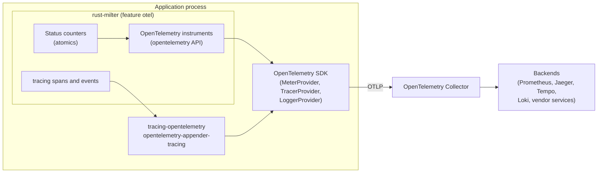
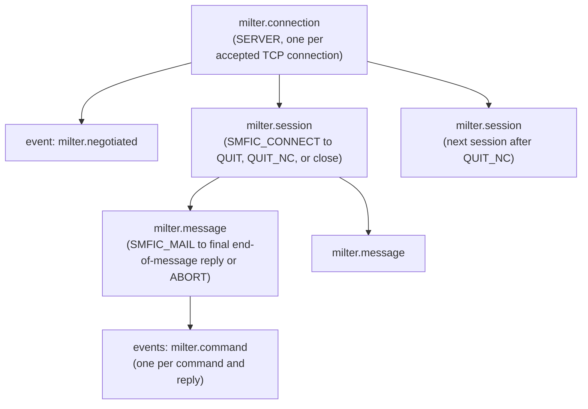

# Telemetry specification (OpenTelemetry)

Status: implemented.

How rust-milter reports metrics, traces, and logs through OpenTelemetry. This document is the single definition of every metric name in rust-milter; the other specifications link here.

## Contents

- [Scope](#scope)
- [Requirements](#requirements)
- [Architecture](#architecture)
- [Data that must never be recorded](#data-that-must-never-be-recorded)
- [Metrics](#metrics)
- [Traces](#traces)
- [Logs](#logs)
- [Configuration and API](#configuration-and-api)
- [Exporting to Prometheus](#exporting-to-prometheus)
- [Performance](#performance)
- [Testing requirements](#testing-requirements)

## Scope

In scope:
- metrics for the server ([tcp-server.md](tcp-server.md)) and configuration reload ([hot-reload.md](hot-reload.md))
- traces of connections, SMTP sessions, and messages
- the bridge from rust-milter's `tracing` logs to OpenTelemetry logs

Out of scope:
- choosing or configuring an exporter, a backend, or sampling. These belong to the application.
- a Prometheus client inside the library (see [Exporting to Prometheus](#exporting-to-prometheus))
- a metrics collector trait or another metrics facade. Metrics come from the OpenTelemetry instruments and `ServerHandle::status()` ([ADR 0004](../adr/0004-metrics-come-from-opentelemetry-and-status.md)).

## Requirements

The reasons behind these requirements are explained in [Telemetry principles](../explanation/telemetry-principles.md).

1. API only. rust-milter depends on the `opentelemetry` API crate and never on the SDK or an exporter. The application installs the SDK. Without an installed SDK, every instrument is a no-op.
2. Optional. The dependency sits behind the Cargo feature `otel`. Without it, rust-milter has no OpenTelemetry dependency and records nothing beyond its own status counters.
3. Traces through `tracing`. rust-milter already emits `tracing` spans and events. The application turns them into OpenTelemetry spans with `tracing-opentelemetry`. The library needs no OpenTelemetry trace API.
4. Semantic conventions first. Where OpenTelemetry defines an attribute, rust-milter uses it: `server.address`, `server.port`, `network.peer.address`, `network.peer.port`, `network.transport`, `network.type`, `network.io.direction`, `error.type`. Names specific to the milter protocol use the `milter.` prefix.
5. Bounded cardinality. Every metric attribute takes values from a small fixed set, defined in this document. No metric attribute holds an address, an ID, or free text.
6. No SMTP data. See the next section.

## Architecture

The library owns the instruments and the spans. The application owns everything to the right of the API: the SDK, the exporters, sampling, resource attributes such as `service.name`, and where the data goes. The OpenTelemetry Collector is the recommended path to any backend, Prometheus included.

The status counters are plain atomics that rust-milter keeps with or without the `otel` feature. They back `ServerHandle::status()` and the health check, and the counter and gauge instruments read them.

## Data that must never be recorded

No metric attribute, span attribute, span event, or log field produced by rust-milter may contain:
- envelope addresses or ESMTP arguments (`MAIL FROM`, `RCPT TO`)
- header names or values
- body content
- macro values, except the queue ID (`{i}`) on spans (see [Span attributes](#span-attributes))
- the SMTP client's hostname, address, or HELO name, which arrive in `SMFIC_CONNECT` and `SMFIC_HELO`
- reply text sent with `SMFIR_REPLYCODE`, and quarantine reasons

`network.peer.address` on a server span is the MTA's address, the peer of the milter connection, not the SMTP client's.

Telemetry follows the session isolation rule (see [Connection reuse and session isolation](../explanation/connection-reuse.md)): a session span ends when its SMTP session ends, and nothing from it is attached to a later session on the same connection.

No setting makes rust-milter record any of this data ([ADR 0003](../adr/0003-never-record-the-smtp-client-address.md)).

A handler can add its own attributes to the current span. The rules above cover only what rust-milter records; what a handler records is the application's responsibility. [Record the SMTP client's address](../how-to/record-the-smtp-client-address.md) shows how a handler records the client's address.

## Metrics

All instruments come from one meter with the instrumentation scope name `rust-milter` and the crate version as the scope version.

Durations use the unit `s`. Every histogram sets these advisory bucket boundaries, in seconds, because the SDK's defaults suit milliseconds: `0.001, 0.005, 0.01, 0.025, 0.05, 0.1, 0.25, 0.5, 1, 2.5, 5, 10, 30, 60, 300`.

### Server metrics

| Name | Instrument | Unit | Attributes | Description |
|------|------------|------|------------|-------------|
| `milter.server.connection.accepted` | Counter (observable) | `{connection}` | `server.address`, `server.port` | Connections accepted, per listener |
| `milter.server.connection.active` | UpDownCounter (observable) | `{connection}` | `server.address`, `server.port` | Open connections, per listener |
| `milter.server.connection.rejected` | Counter (observable) | `{connection}` | `server.address`, `server.port` | Connections closed at once because `max_connections` or `max_memory` was reached |
| `milter.server.connection.closed` | Counter (observable) | `{connection}` | `milter.close_reason`, `error.type` | Connections closed, by reason; `error.type` only when the reason is `error` |
| `milter.server.connection.duration` | Histogram | `s` | `milter.close_reason` | Time from `accept()` to close |
| `milter.server.io` | Counter (observable) | `By` | `network.io.direction` | Bytes received (`receive`) and sent (`transmit`) |
| `milter.server.negotiation` | Counter (observable) | `{negotiation}` | `milter.protocol.version` | Completed option negotiations, by negotiated version |
| `milter.server.command` | Counter (observable) | `{command}` | `milter.command` | Commands received from the MTA |
| `milter.server.reply` | Counter (observable) | `{reply}` | `milter.command`, `milter.reply` | Replies sent, by the command they answer |
| `milter.server.message.duration` | Histogram | `s` | `milter.reply` | Time from `SMFIC_MAIL` to the final reply at end of message |
| `milter.server.eom.duration` | Histogram | `s` | `milter.reply` | Time from `SMFIC_BODYEOB` to the final reply, the stage the MTA's end-of-message timeout guards |

`server.address` and `server.port` name the listener, which comes from the configuration. Their values are bounded by the number of listeners.

### Configuration reload metrics

| Name | Instrument | Unit | Attributes | Description |
|------|------------|------|------------|-------------|
| `milter.config.generation` | Gauge (observable) | `{generation}` | | Current configuration generation |
| `milter.config.reload` | Counter (observable) | `{reload}` | `milter.reload_result`, `milter.reload_source` | Reload attempts |
| `milter.config.last_reload.time` | Gauge (observable) | `s` | | Unix time of the last applied reload; not reported before the first |

### Status counters

Every counter and gauge reads the same value that `ServerHandle::status()` reports ([api-specification.md](api-specification.md#serverhandle)). Histograms have no `status()` field.

| Metric | `status()` field |
|--------|------------------|
| `milter.server.connection.accepted` | `listeners[].connections_accepted` |
| `milter.server.connection.active` | `listeners[].connections_active` |
| `milter.server.connection.rejected` | `listeners[].connections_rejected` |
| `milter.server.connection.closed` | `connections_closed` |
| `milter.server.io` | `bytes_received` (`receive`) and `bytes_sent` (`transmit`) |
| `milter.server.negotiation` | `negotiations` |
| `milter.server.command` | `commands` |
| `milter.server.reply` | `replies` |
| `milter.config.generation` | `config_generation` |
| `milter.config.reload` | `reloads` |
| `milter.config.last_reload.time` | `last_reload` |

What each one counts:
- Bytes are counted as they are read and written, so an open connection adds to `milter.server.io` before it closes.
- A connection closed at once at `max_connections` or `max_memory` counts as rejected, and as closed with the reason `limit_reached`. Its `milter.server.connection.duration` is recorded too.
- A command is counted once it is read in full and its command code is known. `macro`, `abort`, `quit`, and `quit_nc` get no reply, so they appear in `milter.server.command` only.
- `milter.server.message.duration` and `milter.server.eom.duration` record the messages that reach their final reply at end of message.
- Each reload request counts once, when it returns its result: a call to `reload()` or `reload_with_config()` with the source `api`, a `SIGHUP` that reaches the reload coordinator with the source `sighup`. Requests folded into one reload each count, with the shared result. A `SIGHUP` that is ignored counts as nothing.

### Attribute values

| Attribute | Values |
|-----------|--------|
| `milter.close_reason` | `client_closed`, `server_shutdown`, `timeout`, `error`, `reset`, `limit_reached` |
| `error.type` | the variant name of `Error`, such as `Protocol`, `Handler`, or `ConnectionClosed` |
| `network.io.direction` | `receive`, `transmit` |
| `milter.protocol.version` | the negotiated version, `2` to `6` |
| `milter.command` | `optneg`, `macro`, `connect`, `helo`, `mail`, `rcpt`, `data`, `header`, `eoh`, `body`, `eom`, `abort`, `unknown`, `quit`, `quit_nc` |
| `milter.reply` | `optneg` for the answer to option negotiation, `continue`, `accept`, `reject`, `tempfail`, `discard`, `replycode`, `skip`, `progress`, `noreply`, plus `modification` for any `SMFIR_*` modification action |
| `milter.reload_result` | `applied`, `failed` |
| `milter.reload_source` | `sighup`, `api` |

Every attribute is an enum in the code, so a new value needs a code change and an update to this table.

## Traces

### Span structure

| Span | Kind | Starts | Ends |
|------|------|--------|------|
| `milter.connection` | SERVER | `accept()` returns | the socket closes |
| `milter.session` | INTERNAL | the session starts: `SMFIC_CONNECT`, or the first command of a session the MTA starts without it | `SMFIC_QUIT`, `SMFIC_QUIT_NC`, or connection close |
| `milter.message` | INTERNAL | the handler's `Message` value is created: `SMFIC_MAIL`, or the first command of a message without it | the `Message` value is dropped: after the final reply at end of message, after a decision that ends the message earlier, on `SMFIC_ABORT`, or at session end |

When a session or message starts and ends follows the protocol engine rules in [api-specification.md](api-specification.md#protocol-engine-behavior). A session span's parent is the connection span, and a message span's parent is its session span, so a second session after `SMFIC_QUIT_NC` is never a child of the first.

Span names are fixed strings. Nothing variable goes into a name.

The spans are `tracing` spans at INFO level, and `otel.kind` gives their kind to `tracing-opentelemetry`. A subscriber that filters out INFO for the target `rust_milter` records none of them. Every handler callback runs inside the innermost open span, so an attribute a handler adds to the current span lands on the session or message span.

### Span attributes

| Attribute | On spans | Value |
|-----------|----------|-------|
| `network.transport` | connection | `tcp` |
| `network.type` | connection | `ipv4` or `ipv6` |
| `network.peer.address`, `network.peer.port` | connection | the MTA's address |
| `server.address`, `server.port` | connection | the listener that accepted the connection |
| `milter.connection.id` | connection | connection ID |
| `milter.protocol.version` | connection | negotiated version |
| `milter.session.id` | session | a number unique within the server's lifetime, counting from 1 |
| `milter.queue_id` | message | the value of the `{i}` macro, when the MTA sent it before the message ended |
| `milter.reply` | session | the decision of `connect` or `helo` that ended the session early: `accept`, `reject`, `tempfail`, or `replycode`. Not set when the session ended another way |
| `milter.reply` | message | the final reply at end of message, or the decision that ended the message earlier. Not set when the message was aborted |
| `error.type` | connection | set when the connection closes with the close reason `error`; the value is the variant name of `Error`, such as `Protocol`, `Handler`, or `ConnectionClosed`, and the span status is then `Error` |

The queue ID is the one macro value recorded.

A timeout or a reset closes a connection in normal operation, with its own close reason, so it sets no `error.type` and no `Error` status (see the close reasons in [tcp-server.md](tcp-server.md#connection-lifecycle-logs)).

### Command events

Each command and its reply become one span event named `milter.command`. It is a `tracing` event at DEBUG level, with these attributes:

| Attribute | Value |
|-----------|-------|
| `milter.command` | the command, from [Attribute values](#attribute-values) |
| `milter.reply` | the last reply sent for the command, or `noreply` for a command that gets none, such as `macro`, `abort`, and `quit` |
| `milter.command.duration` | seconds, as a floating-point number, from the moment the whole command was read until its last reply was written |

The event goes to the innermost span open while the command ran: a `mail` event to the message it starts, an `eom` or `abort` event to the message it ends, `connect`, `helo`, `unknown`, and `quit` to the session, and `optneg` and the macros before a session to the connection.

After option negotiation, the connection span also gets one DEBUG event named `milter.negotiated`, with `milter.protocol.version`, whatever `trace_commands` says.

The `trace_commands` setting limits the volume of `milter.command` events:

| Value | Events recorded |
|-------|-----------------|
| `none` | no command events |
| `envelope` (default) | `connect`, `helo`, `mail`, `rcpt`, `data`, `eoh`, `eom`, `abort`, `unknown` |
| `all` | every command, including each `header`, `body`, and `macro` |

### Trace context

The Milter protocol carries no trace context, and Sendmail and Postfix cannot send one, so each server-side `milter.connection` span starts a new trace. Operators match a trace with the MTA's records through `milter.queue_id`.

## Logs

rust-milter logs through `tracing`, with the fields listed in [tcp-server.md](tcp-server.md#logging-specification), and its log fields follow [Data that must never be recorded](#data-that-must-never-be-recorded). To send those logs over OpenTelemetry, the application adds the `opentelemetry-appender-tracing` layer. With `tracing-opentelemetry` installed as well, every log record carries the trace and span IDs of the span it was emitted in, which links logs to traces without extra work in the library.

## Configuration and API

| Item | Description |
|------|-------------|
| Cargo feature `otel` | Enables the OpenTelemetry instruments. Off by default |
| `ServerBuilder::meter_provider(provider)` | Use this `MeterProvider`. Without it, rust-milter uses `opentelemetry::global::meter_provider()` |
| `telemetry.trace_commands` in `ServerConfig` | `None`, `Envelope` (default), or `All`; reloadable (see [configuration.md](configuration.md)) |
| `ServerHandle::status()` | In-process snapshot of the status counters, available without the `otel` feature |

The application installs the SDK: it builds a `MeterProvider` with an exporter, such as OTLP, and passes it to `ServerBuilder::meter_provider`. The how-to guide [Export metrics with OpenTelemetry](../how-to/export-metrics-with-opentelemetry.md) shows the steps. For traces, it installs a `TracerProvider` and the `tracing-opentelemetry` layer, as [Export traces with OpenTelemetry](../how-to/export-traces-with-opentelemetry.md) shows.

Standard `OTEL_*` environment variables, such as `OTEL_EXPORTER_OTLP_ENDPOINT`, are read by the SDK in the application, not by rust-milter.

## Exporting to Prometheus

rust-milter does not depend on a Prometheus client. To scrape it with Prometheus, export OTLP to the OpenTelemetry Collector and use its Prometheus exporter, or install an OpenTelemetry Prometheus exporter in the application.

When OpenTelemetry metrics are converted to Prometheus, dots become underscores, counters gain a `_total` suffix, and units such as `s` and `By` become `_seconds` and `_bytes`. For example, `milter.server.connection.duration` becomes `milter_server_connection_duration_seconds`.

## Performance

- Counters and gauges are observable instruments that read the status atomics at collection time. Recording a connection or a command costs one atomic increment, with or without the `otel` feature.
- Each counter attribute has a fixed set of values, so the status counters are fixed arrays of atomics indexed by the attribute enums. No map or lock sits on the hot path.
- Histograms are synchronous and record once per connection, message, or end of message, never per header or body chunk.
- Span creation follows the application's sampler. With `trace_commands` set to `all`, a message with many headers produces many events; keep it for debugging.

## Testing requirements

The test scenarios are in [docs/testing/telemetry.md](../testing/telemetry.md), with the prefix `TEL`.

- With the `otel` feature off, the crate builds and links no OpenTelemetry crate.
- With an in-memory exporter from the SDK's test utilities: every metric in this document is reported with its name, unit, and attribute set, and the values match `status()`.
- A forbidden-data test runs a session with known envelope, header, body, and macro values, and searches every exported metric, span, event, and log record for them. None may appear, apart from the queue ID on the message span.
- Span structure: one `milter.connection`, one `milter.session` per SMTP session, and one `milter.message` per message, including after `SMFIC_QUIT_NC`, where no span from the first session is the parent of the second.
- Cardinality: after 10,000 connections from different peers, every metric has the same number of time series as after one.
