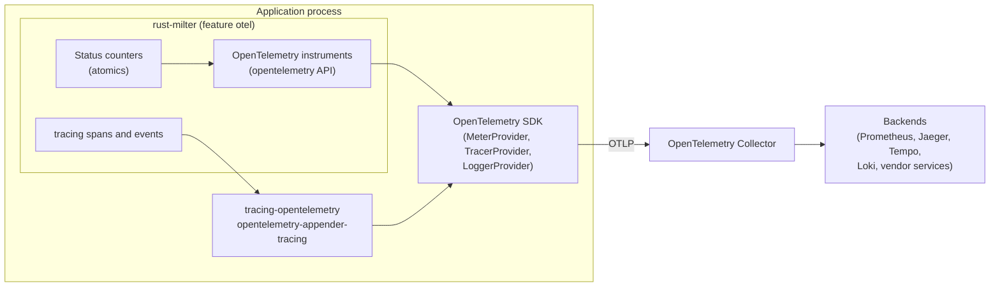
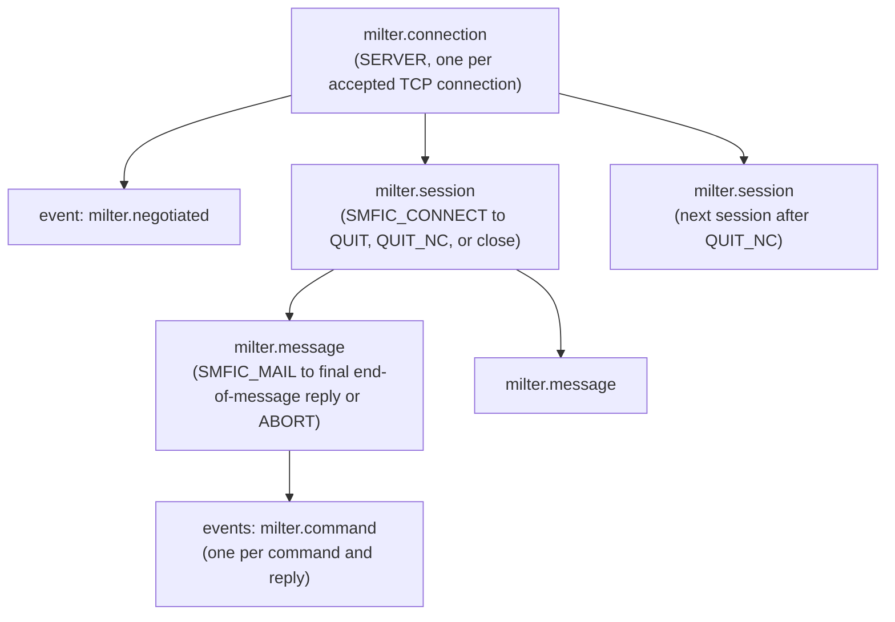

# Telemetry specification (OpenTelemetry)

Status: design, not implemented.

How rust-milter reports metrics, traces, and logs through OpenTelemetry. This document is the single definition of every metric name in rust-milter; the other specifications link here.

## Contents

- [Purpose and scope](#purpose-and-scope)
- [Principles](#principles)
- [Architecture](#architecture)
- [Data that must never be recorded](#data-that-must-never-be-recorded)
- [Metrics](#metrics)
- [Traces](#traces)
- [Logs](#logs)
- [Configuration and API](#configuration-and-api)
- [Exporting to Prometheus](#exporting-to-prometheus)
- [Performance](#performance)
- [Testing requirements](#testing-requirements)
- [Open questions](#open-questions)

## Purpose and scope

Operators need to see connection counts, latency at end of message, error rates, and how a single message moved through the milter. OpenTelemetry gives one vendor-neutral way to export all three signals (metrics, traces, logs) to any backend.

In scope:
- metrics for the server (`docs/reference/tcp-server.md`), the milter client and pool (`docs/reference/milter-client.md`), and configuration reload (`docs/reference/hot-reload.md`)
- traces of connections, SMTP sessions, and messages
- the bridge from rust-milter's `tracing` logs to OpenTelemetry logs

Out of scope:
- choosing or configuring an exporter, a backend, or sampling. These belong to the application.
- a Prometheus client inside the library (see [Exporting to Prometheus](#exporting-to-prometheus))

## Principles

1. API only. rust-milter depends on the `opentelemetry` API crate and never on the SDK or an exporter. The application installs the SDK. Without an installed SDK, every instrument is a no-op. This follows OpenTelemetry's guidance for libraries.
2. Optional. The dependency sits behind the Cargo feature `otel`. Without it, rust-milter has no OpenTelemetry dependency and records nothing beyond its own status counters.
3. Traces through `tracing`. rust-milter already emits `tracing` spans and events. The application turns them into OpenTelemetry spans with `tracing-opentelemetry`. The library needs no OpenTelemetry trace API.
4. Semantic conventions first. Where OpenTelemetry defines an attribute, rust-milter uses it: `server.address`, `server.port`, `network.peer.address`, `network.peer.port`, `network.transport`, `network.type`, `network.io.direction`, `error.type`. Names specific to the milter protocol use the `milter.` prefix.
5. Bounded cardinality. Every metric attribute takes values from a small fixed set, defined in this document. No metric attribute holds an address, an ID, or free text.
6. No SMTP data. See the next section.

## Architecture

The library owns the instruments and the spans. The application owns everything to the right of the API: the SDK, the exporters, sampling, resource attributes such as `service.name`, and where the data goes. The OpenTelemetry Collector is the recommended path to any backend, Prometheus included.

The status counters are plain atomics that rust-milter keeps with or without the `otel` feature. They back `ServerHandle::status()` and the health check, and the counter and gauge instruments read them.

## Data that must never be recorded

No metric attribute, span attribute, span event, or log field produced by rust-milter may contain:
- envelope addresses or ESMTP arguments (`MAIL FROM`, `RCPT TO`)
- header names or values
- body content
- macro values, except the queue ID (`{i}`) on spans (see [Span attributes](#span-attributes))
- the SMTP client's hostname, address, or HELO name, which arrive in `SMFIC_CONNECT` and `SMFIC_HELO`
- reply text sent with `SMFIR_REPLYCODE`, and quarantine reasons

`network.peer.address` on a server span is the MTA's address, the peer of the milter connection, not the SMTP client's.

Telemetry follows the session isolation rule from `docs/reference/milter-client.md`: a session span ends when its SMTP session ends, and nothing from it is attached to a later session on the same connection.

A handler can add its own attributes to the current span. What it records is the application's responsibility; `logging-principles` gives the masking rules.

## Metrics

All instruments come from one meter with the instrumentation scope name `rust-milter` and the crate version as the scope version.

Durations use the unit `s`. Every histogram sets these advisory bucket boundaries, in seconds, because the SDK's defaults suit milliseconds: `0.001, 0.005, 0.01, 0.025, 0.05, 0.1, 0.25, 0.5, 1, 2.5, 5, 10, 30, 60, 300`.

### Server metrics

| Name | Instrument | Unit | Attributes | Description |
|------|------------|------|------------|-------------|
| `milter.server.connection.accepted` | Counter (observable) | `{connection}` | `server.address`, `server.port` | Connections accepted, per listener |
| `milter.server.connection.active` | UpDownCounter (observable) | `{connection}` | `server.address`, `server.port` | Open connections, per listener |
| `milter.server.connection.rejected` | Counter (observable) | `{connection}` | `server.address`, `server.port` | Connections closed at once because `max_connections` was reached |
| `milter.server.connection.closed` | Counter (observable) | `{connection}` | `milter.close_reason`, `error.type` | Connections closed, by reason; `error.type` only when the reason is `error` |
| `milter.server.connection.duration` | Histogram | `s` | `milter.close_reason` | Time from `accept()` to close |
| `milter.server.io` | Counter (observable) | `By` | `network.io.direction` | Bytes received (`receive`) and sent (`transmit`) |
| `milter.server.negotiation` | Counter (observable) | `{negotiation}` | `milter.protocol.version` | Completed option negotiations, by negotiated version |
| `milter.server.command` | Counter (observable) | `{command}` | `milter.command` | Commands received from the MTA |
| `milter.server.reply` | Counter (observable) | `{reply}` | `milter.command`, `milter.reply` | Replies sent, by the command they answer |
| `milter.server.message.duration` | Histogram | `s` | `milter.reply` | Time from `SMFIC_MAIL` to the final reply at end of message |
| `milter.server.eom.duration` | Histogram | `s` | `milter.reply` | Time from `SMFIC_BODYEOB` to the final reply, the stage the MTA's end-of-message timeout guards |

`server.address` and `server.port` name the listener, which comes from the configuration. Their values are bounded by the number of listeners.

### Milter client metrics

| Name | Instrument | Unit | Attributes | Description |
|------|------------|------|------------|-------------|
| `milter.client.connection.open` | UpDownCounter (observable) | `{connection}` | `server.address`, `server.port`, `milter.connection.state` | Open pooled connections, `idle` or `in_use` |
| `milter.client.connection.created` | Counter (observable) | `{connection}` | `server.address`, `server.port` | New TCP connections to the milter |
| `milter.client.session` | Counter (observable) | `{session}` | `server.address`, `server.port`, `milter.connection.reused` | Sessions, on a reused or a new connection |
| `milter.client.connection.not_reusable` | Counter (observable) | `{session}` | `server.address`, `server.port`, `milter.not_reusable_reason` | Sessions whose connection could not be reused |
| `milter.client.checkout.duration` | Histogram | `s` | `server.address`, `server.port` | Time waiting for a pooled connection |
| `milter.client.failure` | Counter (observable) | `{failure}` | `server.address`, `server.port`, `error.type`, `milter.failure_action` | Sessions ended because the milter was unavailable |

For the client, `server.address` and `server.port` name the milter endpoint from the configuration.

### Configuration reload metrics

| Name | Instrument | Unit | Attributes | Description |
|------|------------|------|------------|-------------|
| `milter.config.generation` | Gauge (observable) | `{generation}` | | Current configuration generation |
| `milter.config.reload` | Counter (observable) | `{reload}` | `milter.reload_result`, `milter.reload_source` | Reload attempts |
| `milter.config.last_reload.time` | Gauge (observable) | `s` | | Unix time of the last applied reload |
| `milter.config.pending_restart` | Gauge (observable) | `1` | | 1 while a changed setting waits for a restart, else 0 |

### Attribute values

| Attribute | Values |
|-----------|--------|
| `milter.close_reason` | `client_closed`, `server_shutdown`, `timeout`, `error`, `reset`, `limit_reached` |
| `error.type` | the variant name of the error enum, such as `ReadTimeout`, `Protocol`, `Reset` |
| `network.io.direction` | `receive`, `transmit` |
| `milter.protocol.version` | `2`, `3`, `4`, `6` |
| `milter.command` | `optneg`, `macro`, `connect`, `helo`, `mail`, `rcpt`, `data`, `header`, `eoh`, `body`, `eom`, `abort`, `unknown`, `quit`, `quit_nc` |
| `milter.reply` | `continue`, `accept`, `reject`, `tempfail`, `discard`, `replycode`, `skip`, `progress`, `noreply`, plus `modification` for any `SMFIR_*` modification action |
| `milter.connection.state` | `idle`, `in_use` |
| `milter.connection.reused` | `true`, `false` |
| `milter.not_reusable_reason` | `mirror_state`, `version`, `error`, `cancelled`, `buffer`, `max_lifetime`, `max_sessions`, `shutdown`, `policy_never` |
| `milter.failure_action` | `accept`, `reject`, `tempfail`, `error` |
| `milter.reload_result` | `applied`, `failed` |
| `milter.reload_source` | `sighup`, `api` |

Every attribute is an enum in the code, so a new value needs a code change and an update to this table.

## Traces

### Span structure

| Span | Kind | Starts | Ends |
|------|------|--------|------|
| `milter.connection` | SERVER | `accept()` returns | the socket closes |
| `milter.session` | INTERNAL | `SMFIC_CONNECT` | `SMFIC_QUIT`, `SMFIC_QUIT_NC`, or connection close |
| `milter.message` | INTERNAL | `SMFIC_MAIL` | the final reply at end of message, `SMFIC_ABORT`, or session end |

The milter client creates the same three spans with kind CLIENT for `milter.connection`, as children of whatever span is current in the application. A pooled connection's span covers only its creation and negotiation; each `milter.session` span is a child of the application's span for that SMTP session, with a span link to the connection span. A reused connection therefore never makes one SMTP session the parent of another.

Span names are fixed strings. Nothing variable goes into a name.

### Span attributes

| Attribute | On spans | Value |
|-----------|----------|-------|
| `network.transport` | connection | `tcp` |
| `network.type` | connection | `ipv4` or `ipv6` |
| `network.peer.address`, `network.peer.port` | connection | the MTA's address (server) or the milter's address (client) |
| `server.address`, `server.port` | connection | the listener (server) or the milter endpoint (client) |
| `milter.connection.id` | connection | connection ID |
| `milter.protocol.version` | connection | negotiated version |
| `milter.session.id` | session | session ID, new for every session |
| `milter.queue_id` | message | value of the `{i}` macro, when the MTA sends it |
| `milter.reply` | session, message | the final decision |
| `error.type` | any | set when the span ends with an error; the span status is then `Error` |

The queue ID is the one macro value recorded. It identifies the message in the MTA's own logs and contains no personal data, and it is the main key for matching a trace with an MTA log line.

### Command events

Each command and its reply become one span event named `milter.command`, with the attributes `milter.command`, `milter.reply`, and the command's duration. The `trace_commands` setting limits the volume:

| Value | Events recorded |
|-------|-----------------|
| `none` | no command events |
| `envelope` (default) | `connect`, `helo`, `mail`, `rcpt`, `data`, `eoh`, `eom`, `abort`, `unknown` |
| `all` | every command, including each `header`, `body`, and `macro` |

### Trace context

The Milter protocol carries no trace context, and Sendmail and Postfix cannot send one, so each server-side `milter.connection` span starts a new trace. Operators match a trace with the MTA's records through `milter.queue_id`.

Between a rust-milter client and a rust-milter server, the client can pass W3C trace context in a macro named `{traceparent}`, sent only when the server's symbol list asks for it. The server then continues the client's trace. This is off by default on both sides; see [Open questions](#open-questions).

## Logs

rust-milter logs through `tracing`, with the fields from `docs/reference/tcp-server.md` and the masking rules from `logging-principles`. To send those logs over OpenTelemetry, the application adds the `opentelemetry-appender-tracing` layer. With `tracing-opentelemetry` installed as well, every log record carries the trace and span IDs of the span it was emitted in, which links logs to traces without extra work in the library.

## Configuration and API

| Item | Description |
|------|-------------|
| Cargo feature `otel` | Enables the OpenTelemetry instruments. Off by default |
| `ServerBuilder::meter_provider(provider)` | Use this `MeterProvider`. Without it, rust-milter uses `opentelemetry::global::meter_provider()` |
| `telemetry.trace_commands` in `ServerConfig` | `None`, `Envelope` (default), or `All`; reloadable (see [configuration.md](configuration.md)) |
| `MilterClientBuilder::meter_provider(provider)` | The same, for the client |
| `ServerHandle::status()` | In-process snapshot of the status counters, available without the `otel` feature |

The application installs the SDK: it builds a `MeterProvider` with an exporter, such as OTLP, and passes it to `ServerBuilder::meter_provider`. The [telemetry tutorial](../tutorials/exporting-telemetry.md) walks through it.

Standard `OTEL_*` environment variables, such as `OTEL_EXPORTER_OTLP_ENDPOINT`, are read by the SDK in the application, not by rust-milter.

The `ServerHandle::metrics()` method listed in `docs/reference/tcp-server.md` is replaced by `status()` plus the instruments above.

## Exporting to Prometheus

rust-milter does not depend on a Prometheus client. To scrape it with Prometheus, export OTLP to the OpenTelemetry Collector and use its Prometheus exporter, or install an OpenTelemetry Prometheus exporter in the application.

When OpenTelemetry metrics are converted to Prometheus, dots become underscores, counters gain a `_total` suffix, and units such as `s` and `By` become `_seconds` and `_bytes`. For example, `milter.server.connection.duration` becomes `milter_server_connection_duration_seconds`.

## Performance

- Counters and gauges are observable instruments that read the status atomics at collection time. Recording a connection or a command costs one atomic increment, with or without the `otel` feature.
- Each counter attribute has a fixed set of values, so the status counters are fixed arrays of atomics indexed by the attribute enums. No map or lock sits on the hot path.
- Histograms are synchronous and record once per connection, message, or end of message, never per header or body chunk.
- Span creation follows the application's sampler. With `trace_commands = all`, a message with many headers produces many events; keep it for debugging.

## Testing requirements

- With the `otel` feature off, the crate builds and links no OpenTelemetry crate.
- With an in-memory exporter from the SDK's test utilities: every metric in this document is reported with its name, unit, and attribute set, and the values match `status()`.
- A forbidden-data test runs a session with known envelope, header, body, and macro values, and searches every exported metric, span, event, and log record for them. None may appear, apart from the queue ID on the message span.
- Span structure: one `milter.connection`, one `milter.session` per SMTP session, and one `milter.message` per message, including after `SMFIC_QUIT_NC`, where no span from the first session is the parent of the second.
- Cardinality: after 10,000 connections from different peers, every metric has the same number of time series as after one.

## Open questions

1. Should the `{traceparent}` macro between a rust-milter client and server be part of the first version?
2. Should the SMTP client's address be available as an opt-in span attribute? It is useful for abuse investigations, but it is personal data under many privacy laws and is excluded by default.
3. `docs/reference/architecture.md` and `docs/reference/api-specification.md` list a future "metrics collector trait". Should it be dropped in favor of this design?
