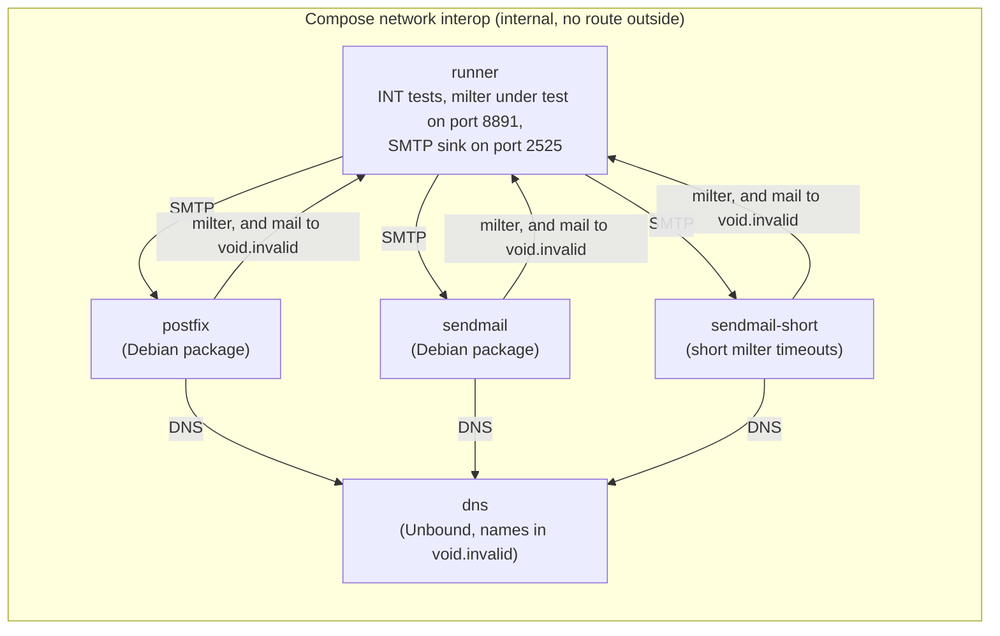

# Test environment specification

Status: implemented.

The fixed TCP ports that rust-milter's tests listen on, how tests share them, and the other rules a test environment must meet. Why the tests use these ports and leases is explained in [Test ports](../explanation/test-ports.md). How to run the tests is in [Run the tests](../how-to/run-the-tests.md); how to write a test that listens on a port is in [Write a network test](../how-to/write-a-network-test.md).

## Contents

- [Test ports](#test-ports)
- [Port leases](#port-leases)
- [Environment variables](#environment-variables)
- [Rules for tests](#rules-for-tests)
- [Socket option readback](#socket-option-readback)
- [Documentation check](#documentation-check)
- [Style check](#style-check)
- [Interoperability environment](#interoperability-environment)
- [CI](#ci)
- [Toolchain](#toolchain)

## Test ports

| Item | Value |
|------|-------|
| Port range | 61000 to 61009 (10 ports) |
| Addresses | `127.0.0.1` and `::1` |
| Protocol | TCP |

Tests listen only on loopback addresses and only on these ports. No test binds port 0, and no test uses a port outside the range.

A test that listens on IPv4 and IPv6 at the same time uses the same port number on both loopback addresses. One lease covers both.

## Port leases

A test that needs a port takes a lease on it, and holds the lease until the test ends. Leases make 10 ports enough for a test suite that runs many tests in parallel.

| Property | Behavior |
|----------|----------|
| Lock | An exclusive file lock on `<temp dir>/rust-milter-test-ports/<port>.lock`, where `<temp dir>` is the system temporary directory |
| Scope | Every test process on the machine, including other checkouts of the repository and `cargo-nextest`, which runs each test in its own process |
| Order | The lease tries the ports from the lowest up and takes the first one whose lock is free |
| Free check | After locking, the lease binds the port on `127.0.0.1` once and closes it at once. If the bind fails, another program uses the port; the lease releases the lock and tries the next port |
| Waiting | If all 10 ports are leased, the lease waits and retries every 100 ms, for up to 60 seconds. It then fails the test with a message that names the busy ports |
| Release | Dropping the lease releases the lock. If the test process crashes, the operating system releases the lock when the process exits, so no stale lock remains |
| Several ports | A test can take up to 3 leases at once, for example to test a partial bind failure |

A lease does not keep the port bound. The server under test binds it after the test has taken the lease.

## Environment variables

| Variable | Default | Effect |
|----------|---------|--------|
| `RUST_MILTER_TEST_PORT_BASE` | 61000 | First port of the range |
| `RUST_MILTER_TEST_PORT_COUNT` | 10 | Number of ports in the range; between 3 and 100 |
| `RUST_MILTER_TEST_IPV6` | `auto` | `auto` runs IPv6 tests if `::1` can be bound and skips them otherwise; `on` fails them if it cannot; `off` skips them |

## Rules for tests

1. Take a lease before binding a port, and keep it until the server under test has stopped.
2. Bind only the leased port, and only on `127.0.0.1` or `::1`.
3. Use the server's default `reuse_addr = true`. A test that stops a server and starts another on the same port in quick succession would otherwise fail on connections left in `TIME_WAIT`.
4. Stop servers through `ServerHandle::shutdown()` and wait for them before the lease is dropped. Only process-level signal tests send real signals.
5. A timeout test finishes in under 10 seconds. It sets the timeout under test to a short value, such as 100 ms (`timeouts.idle` has a minimum of 1 s), or runs on Tokio's paused clock (`tokio::time::pause`) wherever it does not need real network delays.
6. Tests that need IPv6 follow `RUST_MILTER_TEST_IPV6`. When IPv6 is unavailable and not required, they print a skip notice and return. The Rust test harness has no skipped result, so such a test counts as passed; the notice tells the reader it did not run.

## Socket option readback

The Cargo feature `test-support` is for rust-milter's own tests and is not part of the stable API. With it, `ConnectionInfo::read_socket_options()` reads the options of the accepted socket the connection runs on: `TCP_NODELAY`, keepalive with its time, interval, and retries, and the receive and send buffer sizes. A test handler calls it from `ctx.connection()` in any callback. It reads through a duplicate of the socket handle and needs no `unsafe` code.

CI runs the tests with `--all-features`, so the tests that need the feature run there. `cargo test` without the feature skips them.

## Documentation check

`cargo test` compiles the Rust code blocks in the tutorials and how-to guides, and CI runs it on every push and pull request.

| Item | Behavior |
|------|----------|
| Documents checked | Every Markdown file in `docs/tutorials/` and `docs/how-to/`, found automatically; a new file needs no registration |
| Code blocks checked | Blocks marked as Rust; shell, TOML, YAML, and other blocks are not compiled |
| Mechanism | The unpublished workspace crate `tests/docs` includes the documents as doctests, so they remain the only copy of the examples. Its build script finds the documents and prepares a copy of each for rustdoc |
| Compiled, not run | Every Rust block is compiled and none is run, because the examples start servers and wait for signals |
| Fragments | A fragment that cannot compile alone gets setup lines in an HTML comment right before it, which GitHub does not render. The comment starts with the line `<!-- doctest-setup` and ends with the line `-->`. The lines above a `---` line go before the block's code, and the lines below it go after |
| Misplaced setup | A setup comment that is not followed by a Rust block, with only blank lines between, fails the check |
| Blocks without a language | A code block without a language fails the check, because rustdoc would compile it as Rust. A block that is not code, such as log output, is marked `text` |
| Exceptions | A block that cannot compile at all, even with setup lines, is marked `rust,ignore`, with the reason in an HTML comment right before it |
| Features | The check compiles against rust-milter with the `otel` and `serde` features. With `--no-default-features`, the `tests/docs` crate skips the check, so that rust-milter is built without its features |
| Failure | A block that does not compile fails the test run, and with it the CI build |

## Style check

`cargo test` checks that the Rust code keeps the procedural style of [ADR 0008](../adr/0008-rust-code-is-written-in-a-procedural-style.md), [ADR 0009](../adr/0009-no-stored-closures-or-function-pointers.md), and [ADR 0010](../adr/0010-builder-factory-type-parameter-and-loader-trait.md). A separate Clippy run in CI checks the methods ([ADR 0011](../adr/0011-the-disallowed-methods-run-stays-for-derive-code.md)). How to write code that passes is in [Write Rust in the procedural style](../how-to/write-procedural-rust.md).

| Item | Behavior |
|------|----------|
| Files checked | Every `.rs` file under `src/`, `tests/`, and `examples/`, except in `target` directories |
| Closures | A closure fails the check, unless it is an argument of a method call named `handler`, `call_once`, or `with_callback`, or of a call to `thread::spawn` or `std::thread::spawn`. A closure inside an allowed closure fails. An `async` block passes; an `async` closure fails |
| Macros | The check reads the arguments of a macro when they parse as expressions separated by commas, as in `assert!`, `vec!`, and `format!`. It skips other macros, such as `tokio::select!` and `macro_rules!` |
| `Fn` bounds | A bound on `Fn`, `FnMut`, `FnOnce`, `AsyncFn`, `AsyncFnMut`, or `AsyncFnOnce` fails, in an `impl` type, a `dyn` type, a generic parameter, or a `where` clause. Only the builder methods `handler` and `build` in `src/server/mod.rs` may have them |
| Function pointers | A function pointer type, such as `fn(u8) -> bool`, fails wherever it appears: a parameter, a field, a return type, a type alias, or an element type |
| Methods | `clippy.toml` lists the methods that take a function under `disallowed-methods`. Methods that take no function, such as `unwrap_or`, `ok`, `enumerate`, and `collect`, are allowed. The workspace allows the lint, so a plain `cargo clippy` stays quiet. The style check's Clippy run turns it on with `-W clippy::disallowed_methods` and `--message-format=short`, and the `disallowed-methods` binary of `tests/style` reads the output, ignoring terminal colors. Every call fails the run except one that Clippy reports on the lines of a `derive` attribute, alone or inside `cfg_attr`: such a call comes from the derive macro, such as serde's code for a `#[serde(with = ...)]` field, and is not counted |
| Lints that suggest closures | The workspace allows `manual_filter`, `manual_filter_map`, `manual_find`, `manual_find_map`, `manual_map`, `manual_retain`, and `map_entry` |
| Lint attributes | An attribute that allows or expects `clippy::disallowed_methods` fails the check in any file |
| Mechanism | The unpublished workspace crate `tests/style` parses each file with `syn`. It is a default member of the workspace, so `cargo test` runs it. CI runs the Clippy part in the Clippy job |
| Failure | Each finding prints as `path:line:column` with its reason and fails the test run or the Clippy job, and with it the CI build |

## Interoperability environment

The interoperability scenarios (`INT`) run in a Docker Compose stack defined in `tests/interop/compose.yaml`, on every pull request ([testing ADR 0001](../testing/adr/0001-interop-tests-run-on-distro-mtas-in-compose-on-every-pr.md)).

| Service | Image | Role |
|---------|-------|------|
| `runner` | The official `rust` image, at the tag in `tests/interop/runner/Dockerfile`, with the repository copied in when the image is built | Builds the `INT` tests with the toolchain from `rust-toolchain.toml` when the image is built, while the build can still reach the network, then runs them offline, one at a time. Each test starts its own milter on port 8891 with the scenario's handler, sends mail through an MTA, and stops the milter. The runner also holds an SMTP sink on port 2525 that keeps every delivered message for the test to inspect |
| `postfix` | The pinned Debian release with the `postfix` package | MTA under test |
| `sendmail` | The same Debian release with the `sendmail` package | MTA under test |
| `sendmail-short` | The `sendmail` image with the filter timeouts `T=E:3s;R:2s` | MTA for the Sendmail timeout scenario |
| `dns` | The same Debian release with the `unbound` package | The MTAs' only DNS resolver. It answers for the names in `void.invalid` and their addresses, and answers NXDOMAIN at once for every other name, without sending a query anywhere ([testing ADR 0003](../testing/adr/0003-interop-stack-resolves-names-with-a-local-unbound.md)) |

The network has the fixed subnet `10.231.0.0/24`, and each service has a fixed address, so that `dns` can answer for each name:

| Name | Address | Records in `dns` |
|------|---------|------------------|
| `runner.void.invalid` | 10.231.0.10 | A, PTR. `void.invalid` has the MX record `10 runner.void.invalid` |
| `postfix.void.invalid` | 10.231.0.25 | A, PTR |
| `sendmail.void.invalid` | 10.231.0.26 | A, PTR |
| `sendmail-short.void.invalid` | 10.231.0.27 | A, PTR |
| `dns.void.invalid` | 10.231.0.53 | A, PTR |

Each container's host name is its name in the table. The MTAs start once `dns` passes its healthcheck. Each MTA writes `dns` as the only `nameserver` in its `/etc/resolv.conf` when it starts, and its configuration names the runner as `runner.void.invalid`, which resolves before the runner exists. The runner keeps Docker's resolver, and reaches the MTAs by their service names.

The MTA and DNS images use one Debian release, pinned by tag. Each MTA container prints its version when it starts, and CI keeps the Compose logs, so a failure can be traced to a package upgrade.

Postfix listens on several ports. Each port is an `smtpd` service in `master.cf` that overrides the settings in the table:

| Port | Overrides | Used by |
|------|-----------|---------|
| 25 | none | most scenarios |
| 2602, 2603, 2604 | `milter_protocol` = 2, 3, 4 | INT-002 |
| 2625 | `milter_content_timeout = 2s` | INT-040 |
| 2626 | `smtpd_peername_lookup = no`, so the client's hostname arrives as `[<address>]` | INT-031 |

Settings common to both MTAs:

| Setting | Value |
|---------|-------|
| Milter | `inet:8891@runner.void.invalid` for Sendmail; `inet:runner.void.invalid:8891` in Postfix's `smtpd_milters` |
| Milter protocol | 6, except on the Postfix ports above |
| Failure policy | tempfail: Postfix `milter_default_action = tempfail`, Sendmail filter flag `F=T` |
| Test addresses | Only the domain `void.invalid`. Both MTAs route it to the sink on `runner.void.invalid` port 2525: Postfix through `transport_maps`, Sendmail through its mailertable, because an MX record cannot name a port |
| Relaying | Both MTAs accept mail for `void.invalid` from the Compose network only |
| Client limits | Sendmail's access database sets `ClientRate`, `ClientConn`, and `GreetPause` to 0 for `10.231.0`, as Debian does for localhost. Debian's defaults for other clients, 10 connections per 10 minutes, would refuse the tests' sessions |
| Queues | Postfix's `/var/spool/postfix` and Sendmail's `/var/spool/mqueue` are Compose volumes. The runner mounts them read-only at `/mta/postfix` and `/mta/sendmail`, so a test can find a message that an MTA held or quarantined instead of delivering |

Rules:
1. The Compose network is internal. No container in it can reach the internet or the host's network, so test mail cannot leave even if an MTA routes it wrongly.
2. Every email address in a test uses the domain `void.invalid`. Only the stack's `dns` service resolves it; no DNS outside the stack ever can.
3. The `INT` tests run one at a time (`--test-threads=1`), because every MTA points at the one milter address `runner.void.invalid:8891`.
4. Inside the stack the milter listens on the runner's network address, not on loopback. The loopback rule in [Rules for tests](#rules-for-tests) applies to `cargo test` only.
5. The `INT` tests live in their own crate, `tests/interop`, and are `#[ignore]`d so that `cargo test` outside the stack skips them.
6. A timeout scenario finishes in under 10 seconds, as in `cargo test`.

How to run the stack is in [Run the tests](../how-to/run-the-tests.md#run-the-interoperability-tests).

## CI

GitHub Actions runs these jobs on every push to `main` and on every pull request. The tools are chosen in [testing ADR 0002](../testing/adr/0002-ci-scans-with-cargo-deny-clippy-and-codeql.md).

| Job | Workflow | Checks |
|-----|----------|--------|
| Format | `ci.yml` | `cargo fmt --check` |
| Clippy | `ci.yml` | Clippy with warnings as errors, with all features and with none, then the disallowed methods of the [style check](#style-check) with all features |
| Test | `ci.yml` | `cargo test` on Rocky Linux 9, Debian 13, and macOS, with all features and with none, and `RUST_MILTER_TEST_IPV6=on`. Rocky Linux and Debian run in containers on an Ubuntu runner |
| MSRV | `ci.yml` | The library builds with Rust 1.85, with all features and with none |
| Rustdoc | `ci.yml` | The API documentation builds without warnings |
| Dependencies | `ci.yml` | cargo-deny: known vulnerabilities, yanked crates, licenses, and sources, as set in `deny.toml` |
| Interoperability | `ci.yml` | The `INT` tests in the [interoperability environment](#interoperability-environment) |
| CodeQL | `codeql.yml` | CodeQL's Rust analysis; also runs weekly |

Every action is pinned to a full commit SHA. Dependabot proposes updates to Cargo dependencies, the pinned actions, and the interop base images every week (`.github/dependabot.yml`).

## Toolchain

The library's minimum supported Rust version stays 1.85. The test support code locks files with `std::fs::File::try_lock`, stable since Rust 1.89, so running the tests needs Rust 1.89 or later. `rust-toolchain.toml` is the only file that sets the toolchain version. It applies to work in the repository, to every CI job except MSRV, and to the interop runner, whatever the tag of the runner's image. The MSRV check in CI builds the library without its tests.
